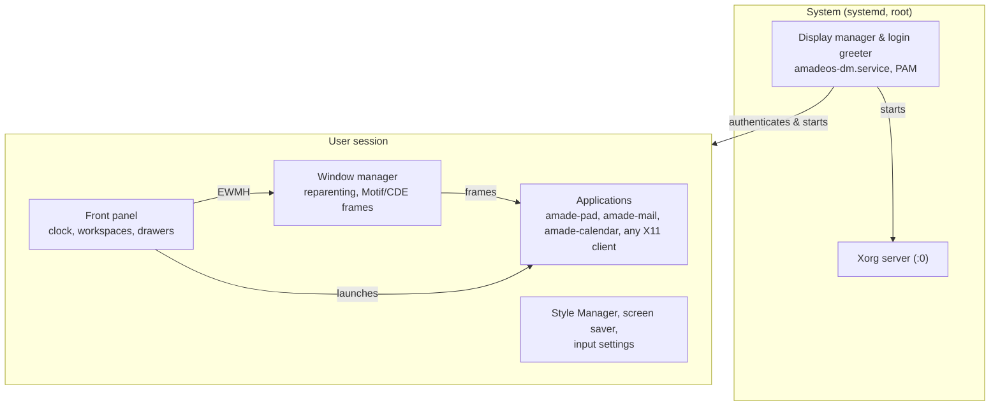

# amadeOS

**Digital Sovereignty starts on your desktop.**

amadeOS is an open source Linux distribution with a timeless, classic desktop. Its source code is
freely available under the European Union Public Licence, so anyone can inspect, change and share it.

[](https://github.com/datazuul/amadeos/actions/workflows/build.yml)
[](LICENSE)
[](https://openjdk.org/projects/jdk/25/)
[](https://www.debian.org/releases/trixie/)
[](https://www.x.org/)
[](#getting-started)
[](ROADMAP.md)
[](https://github.com/datazuul/amadeos/commits/main)

---

amadeOS is a free, Java-powered European desktop operating system: a bootable x86-64 live image
based on Debian, with a desktop written in Java. Display manager, window manager, front panel and
settings tools are Swing applications on Xorg, styled after the Common Desktop Environment (CDE).

## Why amadeOS

- **Open source, all the way up.** Everything from the login screen to the text editor is free
  software under the [EUPL-1.2](LICENSE), a licence published by the European Commission and legally
  valid in all official EU languages.
- **Built on proven foundations.** Debian Stable as the base, Linux as the kernel, Xorg/X11 as the
  display stack. amadeOS adds a desktop, not a new platform you have to trust.
- **Understandable.** The desktop is plain Java and Swing. One codebase, one language, readable by
  anyone who wants to know what their system does.
- **Open standards instead of lock-in.** Applications are ordinary Debian packages with Freedesktop
  `.desktop` entries; the window manager speaks ICCCM and EWMH, so non-Java X11 programs work too.
- **A desktop that stays.** The classic CDE look and workflow: a front panel, workspaces and
  Motif-style windows, without fashion-driven redesigns.

## Status

amadeOS is in active development and has not had a release yet. Milestones M0 to M11 are complete
(bootable image, Java window manager, desktop shell, display manager, application discovery,
virtual workspaces); M12, release hardening, is in progress. Progress is tracked in
[`ROADMAP.md`](ROADMAP.md), the design decisions and rejected alternatives in
[`CONCEPT.md`](CONCEPT.md).

## Architecture



The desktop is five Debian packages from the
[amade-system](https://github.com/datazuul/amade-system) repository: `amade-dm` (display manager and
login greeter), `amade-session` (the session script `amadeos-session`, screen lock and screen saver),
`amade-wm` (window manager), `amade-panel-cde` (the Front Panel; it provides `amade-panel`, the panel
the session starts, so another panel can take its place) and `amade-style` (Style Manager and input
settings). This repository holds the live image: its package list and configuration.

## What is in the image

| Component | Description |
|---|---|
| **Base** | Debian *trixie* (minimal), Linux, Xorg/X11, OpenJDK 25, BIOS and UEFI boot. |
| **Display manager** | `amadeos-dm.service` (enabled by the `amade-dm` package) starts Xorg on VT 7 and shows the Java login greeter, which authenticates through PAM (`/etc/pam.d/amadeos-dm`) and starts the session in the language chosen there. |
| **Time zone** | Chosen in the login greeter (*Time Zone*, the zones of `zone1970.tab`, preselected with the system's current zone). The display manager runs as root and, once the password is accepted, points `/etc/localtime` at the zone and writes `/etc/timezone` before the session starts. The live image boots with `Europe/Berlin` (`timezone=` on the kernel command line) and `systemd-timesyncd` sets the clock from the network. |
| **Window manager** | A floating, reparenting X11 window manager in Java (Xlib via JNA) with Motif/CDE-style frames, interactive move and resize, minimize to desktop icons, four virtual workspaces, a desktop root menu and the EWMH/ICCCM hints that panels and toolkits rely on (`_NET_CLIENT_LIST`, `_NET_ACTIVE_WINDOW`, `_NET_CURRENT_DESKTOP`, `_NET_WM_STRUT_PARTIAL`, `WM_DELETE_WINDOW`, ...). |
| **Front panel** | A CDE-style dock with clock, calendar, workspace switcher and drawers that list installed applications from their `.desktop` files. |
| **Logs** | One log per application in `~/.cache/amadeos/logs` (`firefox-esr.log`, `amade-files.log`, ...), written by the panel when it starts a program, next to `session.log` and `wm.log` from `amadeos-session`. *Session Diagnostics & Logs* in the Tools drawer (the program `amade-logviewer`) shows one of them at a time, chosen from a list, with the display manager's logs from `/var/log` and the system journal of this boot (the live user is in `systemd-journal`); *Follow* reloads every two seconds. |
| **Language** | English, Deutsch, Français, Español, Italiano. Chosen in the login greeter (*Language*, preselected with the user's last choice) for the whole session, or with the language button under the lock in the front panel. Both write `~/.config/amadeos/locale.conf`; applications built on amade-commons start in that language, the panel and terminals follow at the next login (`LANG`). An application's own *Settings* can override it. |
| **Style Manager** (`style`) | The controls of CDE's dtstyle. Color (palette and icon theme), Backdrop, Keyboard, Mouse, Beep and Screen work; Font, Window and Startup are shown but not yet available. |
| **Icons** | The NsCDE icon theme is the default (package `nscde-icon-theme`, built by `scripts/package-nscde-icons.sh`, included in the image automatically). Any other installed Freedesktop icon theme can be chosen in the Style Manager. |
| **Backdrops** | The original CDE pattern backdrops (Pebbles, Concave, BrickWall, Toronto, ...) come as the separate package `amadeos-backdrops-cde` (built by `scripts/package-cde-backdrops.sh`, installed to `/usr/share/amadeos/backdrops/cde`) and take their shades from the chosen backdrop color like in dtstyle. Own `.pm`/`.bm` files (XPM/XBM) are found in `~/.dt/backdrops` and `~/.config/amadeos/backdrops`, pictures (PNG/JPEG) as well. |
| **Input settings** (`input`) | Keyboard repeat and click, mouse handedness, double-click time and acceleration, and the bell; stored in `~/.config/amadeos/input.conf` and applied with `xset`, `xmodmap` and `xrdb` at login (`/etc/amadeos/autostart.d/10-amadeos-input`) and on Apply. |
| **Screen saver** (`screen`) | CDE's dtscreen: started through `/etc/amadeos/autostart.d/50-amadeos-screen`, uses the X server's idle counter (MIT-SCREEN-SAVER, `libxss1`), shows a saver module (Qix, Swarm, Starfield, Floating Logo, Blank) and locks the screen after the configured time. Settings in `~/.config/amadeos/screen.conf`. |
| **Web browser** | Firefox ESR from Debian (Gecko, MPL-2.0, security updates through `debian-security`) in the five desktop languages. `/usr/share/firefox-esr/distribution/policies.json` turns off telemetry, studies, Pocket and sponsored content, makes Ecosia the default search engine and installs uBlock Origin; `/etc/xdg/mimeapps.list` makes Firefox the default for web links and HTML files. |
| **Applications** | Separate Debian packages, like the desktop itself (`amade-dm`, `amade-session`, `amade-wm`, `amade-panel-cde`, `amade-style`); `.deb` files placed in `config/packages.chroot/` are installed into the image. |

## The amadeOS family

| Repository | Purpose |
|---|---|
| [amadeos](https://github.com/datazuul/amadeos) | This repository: the live image (live-build configuration, boot loaders, the scripts of the session) |
| [amade-system](https://github.com/datazuul/amade-system) | System components, one package per module: `amade-dm` (display manager), `amade-session` (session, lock, screen saver), `amade-wm` (window manager), `amade-panel-cde` (front panel), `amade-style` (Style Manager), `amade-logviewer` (Session Diagnostics & Logs), `amade-print`, `amade-sysinfo` |
| [amade-commons](https://github.com/datazuul/amade-commons) | Shared library: desktop themes, colors and Motif styling, application scaffold |
| [amade-pad](https://github.com/datazuul/amade-pad) | Text editor |
| [amade-mail](https://github.com/datazuul/amade-mail) | Mail client (IMAP/SMTP) in the style of CDE's dtmail |
| [amade-calendar](https://github.com/datazuul/amade-calendar) | Calendar with appointments, reminders and To Do items in the style of CDE's dtcm, stored as iCalendar |

The Style Manager writes the chosen theme to `~/.config/amadeos/theme.conf`; applications follow
that file and switch together with window frames and front panel. Gradle takes amade-commons from
JitPack, or builds a checkout in `../amade-commons` instead.

## Getting started

Requirements for the image: `live-build`, `sudo` and optionally QEMU. Java 25 is needed only to
build the packages that go into it (amade-system and the applications).
[`CONTRIBUTING.md`](CONTRIBUTING.md) lists the packages per distribution.

```bash
git clone https://github.com/datazuul/amadeos.git
git clone https://github.com/datazuul/amade-system.git
git clone https://github.com/datazuul/amade-commons.git
cd amade-system && ./gradlew :desktop:installToAmadeOs && cd ../amadeos   # the desktop package

scripts/check-config.sh   # the checks CI runs on the configuration
./build.sh                # build artifacts/amadeos-amd64.iso (uses sudo for live-build)
./run-qemu.sh             # boot the ISO in QEMU
```

`build.sh` needs the five desktop packages (`amade-dm`, `amade-session`, `amade-wm`, `amade-panel-cde`,
`amade-style`) in `config/packages.chroot/`; `(cd ../amade-system && ./gradlew installToAmadeOs)` puts
them there. The desktop itself is developed in amade-system, where `wm/run-xephyr.sh` and
`dm/run-greeter.sh` start the window manager with the panel, or the login greeter, in a nested X server
without an ISO.

The live user is `amadeos` with the password `amadeos`.

The image is described in `config/`: the packages in `config/package-lists/amadeos.list.chroot`
(the only list of them), the live-config settings of the live user, keyboard, time zone and host name
in `config/includes.chroot/etc/live/config.conf`, the files of the live image under
`config/includes.chroot/` (the live user's password and a unit drop-in for it, the keyboard and locale
defaults, Firefox policies, wallpapers), and two hooks in `config/hooks/normal/` (permissions and the X
server wrapper; security updates and locales). The desktop's own scripts (`amadeos-dm`,
`amadeos-session`, `amadeos-lock`), its systemd unit, PAM services, polkit rule and autostart scripts are
part of the desktop packages. `scripts/build-image.sh` only adds the kernel command line, the UEFI boot
loader and, for live-build 3.0, links to the hooks in `config/hooks/`.

### Building the complete distribution

`build.sh` puts into the image whatever application packages are already in
`config/packages.chroot/`. To build everything from the current `main` branches instead, clone
amade-commons and the applications next to this repository (`../amade-commons`, `../amade-pad`,
`../amade-mail`, ...) and run:

```bash
./buildDistribution.sh
```

It pulls `main` of amadeos, amade-commons and every `../amade-*` repository that has an
`installToAmadeOs` Gradle task (amade-system with the desktop among them), builds amade-commons and
the packages against that checkout
(with tests), copies their `.deb` packages into `config/packages.chroot/` and builds
`artifacts/amadeos-amd64.iso`. It stops before pulling if a repository has uncommitted changes.
Options: `--no-pull` (build the checkouts as they are), `--skip-tests`, `--quick` (repack the
previous image, see `AMADEOS_QUICK`) and `--apps "amade-pad amade-mail"` (only these
applications).

### Writing the image to a USB stick

The ISO is a hybrid image for BIOS and UEFI: it is written to the stick as it is, byte for byte,
without copying it onto a file system on the stick. **This erases everything on the stick.**

On Linux:

```bash
sha256sum -c artifacts/amadeos-amd64.iso.sha256   # check the image
lsblk -d -o NAME,SIZE,MODEL,TRAN                   # find the stick (TRAN usb), e.g. sdb
sudo umount /dev/sdX?*                             # unmount its partitions if auto-mounted
sudo dd if=artifacts/amadeos-amd64.iso of=/dev/sdX bs=4M status=progress conv=fsync oflag=direct
```

Replace `sdX` with the stick's whole device (`/dev/sdb`, not the partition `/dev/sdb1`), and
check the name twice: `dd` overwrites the device it is given without asking. When `dd` has
returned, the stick can be removed. GNOME Disks (*Restore Disk Image*) does the same with a
graphical interface. On Windows, use [Rufus](https://rufus.ie/) in *DD image* mode, on macOS
`sudo dd if=amadeos-amd64.iso of=/dev/rdiskN bs=4m` after `diskutil unmountDisk /dev/diskN`.

To boot from the stick, choose it in the computer's boot menu (often F12, F11, F9 or Esc right
after switching on). With Secure Boot enabled, UEFI firmware refuses the unsigned boot loader;
switch Secure Boot off or use legacy BIOS boot.

## Contributing

Contributions are welcome: small, testable changes to the desktop (in
[amade-system](https://github.com/datazuul/amade-system)) or the image, compatibility tests on real
hardware, new applications as Debian packages, documentation. [`CONTRIBUTING.md`](CONTRIBUTING.md)
describes the development setup, how to package applications for amadeOS and the Git workflow.
Bugs and ideas go to the [issue tracker](https://github.com/datazuul/amadeos/issues).

## License

amadeOS is free software, licensed under the
[European Union Public Licence v. 1.2](LICENSE) (EUPL-1.2, SPDX identifier `EUPL-1.2`). The EUPL is
published by the European Commission and is legally valid in all official languages of the EU;
translations are available at
[interoperable-europe.ec.europa.eu](https://interoperable-europe.ec.europa.eu/collection/eupl/eupl-text-eupl-12).

Copyright © 2026 datazuul.com and contributors.

The live image is an aggregation of Debian packages and separately packaged applications; each of
them keeps its own licence (see `/usr/share/doc/<package>/copyright` on the running system). In
particular, the NsCDE icon theme built by `scripts/package-nscde-icons.sh` stays under the GPL-3.0
as a separate package, and the CDE backdrops packaged by `scripts/package-cde-backdrops.sh`
(`amadeos-backdrops-cde`, fetched from the CDE sources at build time) stay under the LGPL-2+. The
screenshots in `docs/` show third-party software and are not covered by this repository's licence.
