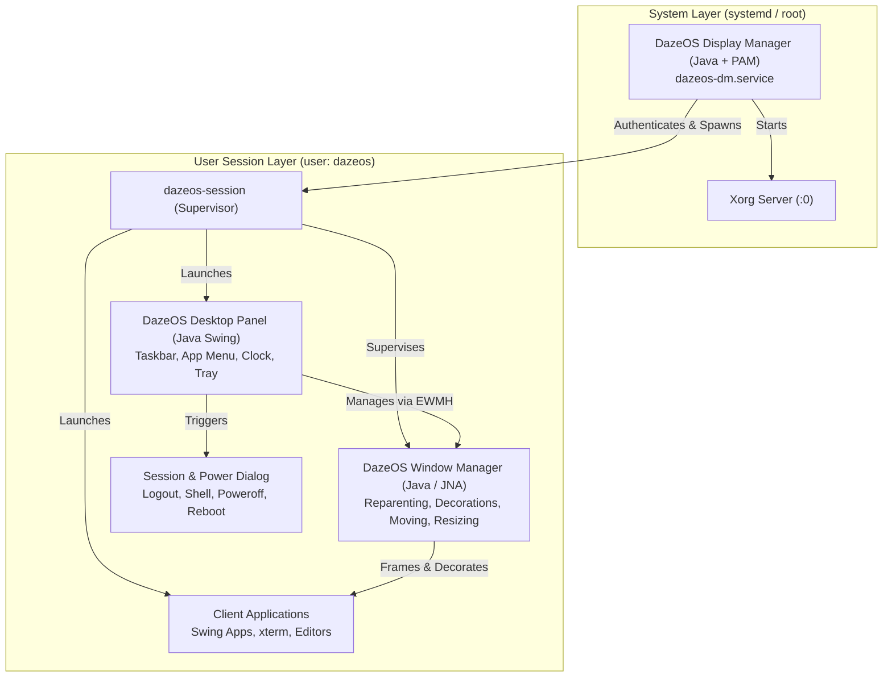

# DazeOS roadmap

This roadmap records the verified project status and the next implementation steps. It deliberately separates completed work, work in progress, and work that still requires evidence. No milestone is considered complete merely because the corresponding files or scripts exist.

Status date: 2026-10-10

## Project direction

DazeOS is a free, European, Java-centred desktop system based on a minimal Debian x86-64 live image. The system architecture progresses toward a complete Java Desktop Environment:




The architectural decisions and rejected alternatives are documented in [`CONCEPT.md`](CONCEPT.md).

## Current status

### Verified and available

- The repository contains the Java window-manager core, native X11 adapter, and Swing desktop suite.
- Clean Debian 13 (Trixie) live ISO generation verified with SHA-256 integrity (`artifacts/dazeos-amd64.iso`).
- Dual-firmware boot (UEFI via OVMF and legacy BIOS via Isolinux) empirically verified in QEMU.
- Native X11 integration via JNA (`LibX11`, `NativeX11Adapter`, `X11WindowManagerService`) claiming root window with `SubstructureRedirectMask`.
- Click-to-focus and click-to-raise with dynamic button grab/ungrab on active windows (zero click latency or grab interference).
- ICCCM `WM_TAKE_FOCUS` protocol support eliminating Java AWT/Swing focus delays; graceful close via `WM_DELETE_WINDOW`.
- EWMH compliance: `_NET_SUPPORTING_WM_CHECK`, `_NET_WM_NAME`, `_NET_SUPPORTED`, `_NET_CLIENT_LIST`, `_NET_ACTIVE_WINDOW`.
- Transient modal dialog detection (`XGetTransientForHint`) and automatic parent-relative centering.
- Multi-window Swing application with document frames, transient dialogs, external non-Java client launcher (`xterm`), and in-app diagnostics log viewer.
- Session configuration manifest (`/etc/dazeos/session.conf` and `~/.config/dazeos/session.conf`), drop-in autostart (`/etc/dazeos/autostart.d/`), and background WM watchdog supervision with automatic restart recovery.
- Incremental packaging mode `DAZEOS_QUICK=1` updating chroot and squashfs in under 30 seconds.

### In progress or incomplete

- Session lifecycle & power management (M6): unified dialog offering Logout, Drop to Shell, Shutdown, and Reboot.

### Not yet verified

- Real hardware, graphics acceleration, firmware, WLAN, audio, suspend/resume, multiple displays, and USB boot have not been tested.
- Security updates, image signing, rollback, persistence, installation, and release procedures are not defined.

## Milestones

### M0 — Restore a reproducible build (Completed)

**Goal:** Produce the first inspectable ISO from a clean checkout. (Achieved 2026-10-09)

1. Inspect the generated live-build configuration immediately after the archive/chroot archive stages:
   - `chroot/etc/apt/sources.list*`
   - `chroot/var/lib/apt/lists/`
   - live-build configuration files and logs
2. From the generated chroot, check APT visibility with `apt-cache policy` for representative packages such as `xserver-xorg`, `openjdk-21-jre`, and `live-boot`.
3. Verify that the configured Debian mirror, distribution (`trixie`), archive areas, DNS, and proxy handling are available inside the chroot.
4. Make the smallest configuration fix required. Prefer explicit mirror and archive configuration over undocumented host-specific behavior.
5. Run `./build.sh` and retain the relevant log output.
6. Verify the resulting artifact:

   ```bash
   file artifacts/dazeos-amd64.iso
   sha256sum -c artifacts/dazeos-amd64.iso.sha256
   ```

**Exit criteria:** A clean build creates a non-empty ISO and its checksum verifies. The build result and any required environment assumptions are documented.

### M1 — Boot and inspect the live image (Completed)

**Goal:** Demonstrate that the image boots through both firmware paths and contains the intended runtime.

1. **BIOS boot in QEMU (Verified):**
   ```bash
   qemu-system-x86_64 -enable-kvm -m 2048 -usb -device usb-tablet -cdrom artifacts/dazeos-amd64.iso
   ```
   - Boots via Isolinux menu to live Linux 6.12 kernel.
   - Automatically logs in as `dazeos` on tty1.
   - Automatically starts Xorg and launches `dazeos-session`.
   - Displays `SwingDemoApplication` with fully functional mouse pointer tracking and interactive button clicks.
2. **UEFI boot in QEMU (Verified):**
   ```bash
   qemu-system-x86_64 -enable-kvm -m 2048 -bios /usr/share/ovmf/OVMF.fd -usb -device usb-tablet -cdrom artifacts/dazeos-amd64.iso
   ```
   - Generated standalone 64-bit EFI bootloader (`BOOTX64.EFI`) using `grub-mkstandalone` with embedded memdisk and search/linux modules.
   - Embedded FAT16 EFI boot image (`/boot/grub/efi.img`) and configured El Torito EFI boot catalog with `xorriso -isohybrid-gpt-basdat`.
   - OVMF loads GRUB 2 EFI directly, boots Linux 6.12 kernel, logs in as `dazeos`, and renders desktop session.
3. Live root filesystem usable, Java runtime and Xorg package set confirmed functional under both BIOS and UEFI.

**Exit criteria:** Dual-firmware (BIOS + UEFI/OVMF) boot evidenced, live root filesystem usable, Java runtime and Xorg package set confirmed functional. (Achieved 2026-10-10)

### M2 — Make the session launcher reliable (Completed)

**Goal:** Provide a predictable Xorg session entrypoint before native WM integration.

1. Validated the relationship between `live-config`, `agetty` autologin on tty1, `/etc/skel/.xinitrc`, `dazeos-session`, and `startx`.
2. `dazeos-session` validates Java runtime and application JAR availability, writes structured diagnostics to `~/.dazeos-session.log`, and launches a fallback `xterm` with diagnostic output if components are missing.
3. Included `xterm` in image package lists as a debugging and client test terminal.

**Exit criteria:** The documented session launcher starts the desktop cleanly and reports actionable diagnostics on failure. (Achieved 2026-10-10)

### M3 — Implement the native X11 boundary (Completed)

**Goal:** Connect the Java WM prototype to a real X11 server without mixing native concerns into the pure model.

1. Pinned JNA with `net.java.dev.jna:jna:5.14.0` as the native X11 binding layer and configured fat JAR packaging.
2. Implemented `LibX11` JNA interface, `NativeX11Adapter`, and `X11WindowManagerService` handling `SubstructureRedirectMask`, `MapRequest`, `ConfigureRequest`, `UnmapNotify`, and `DestroyNotify`.
3. Separated the WM daemon process (`dazeos-session` launches `DazeWindowManagerMain` as a background daemon) from Swing applications (`SwingDemoApplication`).
4. Automated integration testing against `Xvfb` verified that `X11WindowManagerService` claims the root window and manages real client windows (`xmessage`).

**Exit criteria:** The Java process can claim the root-window WM role, observe client lifecycle events, and manage a controlled test client without crashing. (Achieved 2026-10-10)

### M4 — Implement the minimum usable floating WM (Completed)

**Goal:** Manage ordinary Swing windows predictably.

1. Applied deterministic floating cascade layout to native X11 client windows.
2. Implemented click-to-focus and click-to-raise via `XGrabButton` (Button 1, sync mode) and `XAllowEvents(ReplayPointer)`.
3. Implemented graceful window closing via ICCCM `WM_DELETE_WINDOW` client messages (`XSendEvent` with `WM_PROTOCOLS`), falling back to `XKillClient`.
4. Handled transient dialog windows (`XGetTransientForHint`) with automatic parent-relative centering.
5. Added EWMH compliance: supporting check window with `_NET_SUPPORTING_WM_CHECK`, `_NET_WM_NAME`, `_NET_SUPPORTED`, `_NET_CLIENT_LIST`, and `_NET_ACTIVE_WINDOW` properties (essential for Swing/AWT non-reparenting WM support).
6. Expanded `SwingDemoApplication` with multi-window document creation (`JFrame`), transient dialogs (`JDialog`/`JOptionPane`), and external X11 client launching (`xterm`).
7. Verified full suite with unit tests and headless X11 integration tests (`Xvfb`).

**Exit criteria:** Representative Swing applications can open, move, resize, focus, show dialogs, and close under the Java WM in a controlled Xorg/Xvfb environment. (Achieved 2026-10-10)

### M5 — Integrate the WM and applications into the image (Completed)

**Goal:** Turn the prototype into the first end-to-end DazeOS desktop session.

1. Separated WM daemon and application processes with independent logging (`~/.dazeos-wm.log` and `~/.dazeos-session.log`).
2. Implemented background WM daemon watchdog/supervision in `dazeos-session` with automatic restart recovery and clean signal-trapped session teardown.
3. Created configurable session manifest (`/etc/dazeos/session.conf` and `~/.config/dazeos/session.conf`) and drop-in autostart directories (`/etc/dazeos/autostart.d/`).
4. Added GUI diagnostics: `SwingDemoApplication` features an interactive "View Session Logs" dialog with live reload and structured session exit/logout confirmation.
5. Added `DAZEOS_QUICK=1` incremental live-build support to rebuild squashfs in under 30 seconds.

**Exit criteria:** A booted image starts a usable Java-based session without manual process orchestration. (Achieved 2026-10-10)

### M6 — Session lifecycle & power management

**Goal:** Provide controlled session exit, preventing unconditional kiosk restart loops and offering clean power options.

1. **Session & Power Dialog:**
   - Interactive Swing dialog triggered from session controls:
     - **Log Out:** Exits X session and cleanly breaks out of the `startx` restart loop.
     - **Exit to Shell:** Drops cleanly to the `dazeos@dazeos:~$` interactive bash prompt on `tty1`.
     - **Power Off:** Invokes `systemctl poweroff` (or `loginctl poweroff`) via systemd/polkit.
     - **Reboot:** Invokes `systemctl reboot` (or `loginctl reboot`) via systemd/polkit.
     - **Cancel:** Dismisses the dialog without terminating the session.
2. **Break Out of Debian Live Kiosk Loop:**
   - Update `/etc/profile.d/zz-live-config_xinit.sh` (or replace with controlled launcher) so user-initiated logout or shell exit terminates cleanly without unconditionally respawning `startx`.
3. **Graceful Multi-App Teardown:**
   - On session exit, send `WM_DELETE_WINDOW` to all open client windows, allowing applications to exit cleanly before X server teardown.

**Exit criteria:** User can cleanly log out to a working `tty1` console or trigger shutdown/reboot directly from the Java desktop.

### M7 — Reparenting window manager & server-side decorations

**Goal:** Transform the Java Window Manager into a reparenting WM with native titlebars, minimize/maximize/close buttons, and interactive drag-to-move and border-resize capabilities.

1. **Reparenting Architecture (`XReparentWindow`):**
   - Intercept `MapRequest`: create an outer frame window `F` for each top-level client window `C`.
   - Reparent client: `XReparentWindow(display, C, F, border_width, title_height)`.
   - Frame window `F` hosts server-side titlebar and 8 border resize zones ($N, S, E, W, NW, NE, SW, SE$).
2. **Server-Side Titlebar & Window Controls:**
   - Render window title dynamically from `_NET_WM_NAME` or `WM_NAME`.
   - **Close Button (`[X]`):** sends `WM_DELETE_WINDOW` client message under `WM_PROTOCOLS`.
   - **Maximize / Restore Button (`[□]`):** toggles full screen geometry (excluding dock struts) and sets EWMH `_NET_WM_STATE_MAXIMIZED_HORZ`/`VERT`.
   - **Minimize Button (`[-]`):** unmaps frame window and transitions `WM_STATE` to `IconicState`.
3. **Interactive Mouse Dragging & Resizing:**
   - **Titlebar Dragging:** left-click drag grabs pointer with `XGrabPointer` (`move_cursor`), calculates $(x+dx, y+dy)$ on `MotionNotify`, and moves frame via `XMoveWindow`.
   - **Border Resizing:** cursor dynamically changes to direction cursors over frame borders; drag adjusts $(w+dw, h+dh)$ according to `WM_NORMAL_HINTS` and resizes frame and client via `XResizeWindow`.

**Exit criteria:** Windows have visible server-side titlebars with minimize/maximize/close buttons and can be smoothly moved and resized by dragging with the mouse.

### M8 — DazeOS desktop shell & panel

**Goal:** Create a persistent desktop dock with an application launcher, taskbar window list, and status tray.

1. **EWMH Dock Integration:**
   - Standalone Swing process `dazeos-panel` setting `_NET_WM_WINDOW_TYPE = _NET_WM_WINDOW_TYPE_DOCK`.
   - Sets `_NET_WM_STRUT` / `_NET_WM_STRUT_PARTIAL` reserving $36\text{px}$ dock height at the screen edge.
   - Java WM automatically respects dock struts during window cascade, floating placement, and maximization.
2. **Application Launcher (Start Menu):**
   - Quick-access menu categorized into *Applications* (Terminal, Text Editor, File Browser), *System Tools* (Diagnostics Log Viewer, Settings), and *Session Controls* (Logout, Power Off, Reboot).
   - Configurable via `/etc/dazeos/applications.conf` or standard `.desktop` entries.
3. **Taskbar Window List:**
   - Listens for root window EWMH properties (`_NET_CLIENT_LIST`, `_NET_ACTIVE_WINDOW`).
   - Displays clickable task items for all open windows:
     - Clicking inactive window focuses and raises it.
     - Clicking active window minimizes it.
     - Clicking minimized window restores and focuses it.
4. **Status Tray & Clock:**
   - Real-time digital clock and calendar widget.
   - JVM and system RAM utilization gauge.
   - Quick notification / status indicators.

**Exit criteria:** A permanent panel rests docked at the screen edge, offering a functional application launcher and interactive taskbar managing running and minimized windows.

### M9 — Java display manager & login greeter

**Goal:** Replace console autologin with a dedicated graphical Display Manager implemented in Java with PAM authentication.

1. **System Service (`dazeos-dm.service`):**
   - Systemd service running as `root` targeting `graphical.target`.
   - Launches dedicated Xorg display server instance (`Xorg :0 vt7 -novtswitch -nolisten tcp`).
2. **Greeter GUI (Java Swing):**
   - Renders a full-screen greeter interface before any user session exists.
   - Features DazeOS branding, username and password input fields, session selector, and shutdown/reboot controls.
3. **PAM Authentication via JNA:**
   - JNA binding to Linux PAM (`libpam.so`):
     - `pam_start`, `pam_authenticate`, `pam_acct_mgmt`, `pam_setcred`, `pam_open_session`.
4. **Session Spawning & Reset:**
   - Resolves user UID, GID, and `$HOME` (`getpwnam`).
   - Drops root privileges: `initgroups`, `setgid`, `setuid`.
   - Initializes session environment (`XDG_SESSION_TYPE=x11`, `DBUS_SESSION_BUS_ADDRESS`, etc.) and executes `/usr/local/bin/dazeos-session`.
   - On user logout, Display Manager catches session exit and cleanly resets to the login greeter.

**Exit criteria:** Machine boots to a graphical Java login greeter, authenticates system users via PAM, and hands off execution to the user desktop session.

### M10 — Compatibility, security, and release hardening

**Goal:** Establish whether the complete desktop environment can be maintained and tested as a reproducible distribution.

- Pin and document the supported Java baseline and correct documentation inconsistencies.
- Test fonts, HiDPI scaling, keyboard layouts, focus/modality, clipboard behavior, and representative Swing/AWT applications.
- Evaluate multi-monitor behavior, graphics drivers, WLAN firmware, audio, suspend/resume, and USB boot on representative hardware.
- Define Debian security-update handling, dependency update policy, image signing, artifact provenance, and rollback/recovery.
- Add reproducible-build checks and a release manifest containing image version, package inputs, checksum, and test results.
- Decide whether JNA/libX11 remains appropriate or whether FFM or JNI/XCB is justified.
- Reassess Wayland only after the X11 desktop model and compatibility requirements are understood.

**Exit criteria:** A documented release process exists, supported hardware and software boundaries are explicit, and the image can be rebuilt and evaluated by another contributor.

## Deferred by design

The following are intentionally outside the scope of current milestones:

- replacing the Linux kernel or Debian low-level userland
- a Wayland compositor (reassessed post-M10)
- compositing effects and 3D visual effects (drop shadows, blur, transparency)
- persistence and installation to disk
- Secure Boot signing
- broad hardware certification
- automatic runtime package updates

*(Note: Server-side window decorations, reparenting WM, desktop panel/taskbar, and display manager were originally deferred, but are now scheduled in active milestones M6 through M9).*

## Working agreement for status updates

- A source file or build script is not evidence that its runtime behavior works.
- A successful ISO build is not evidence of BIOS, UEFI, hardware, or Swing compatibility.
- Every completed milestone should record the command, environment, artifact, and observed result.
- When a test is blocked, record the exact error and the next diagnostic action instead of marking the milestone complete.

## Related documentation

- [`README.md`](README.md) — concise project overview and current limitations
- [`CONCEPT.md`](CONCEPT.md) — architecture, decisions, alternatives, and risks
- [`CONTRIBUTING.md`](CONTRIBUTING.md) — development environment, build commands, and validation procedure
- [`java-wm/README.md`](java-wm/README.md) — Java window-manager prototype scope and limitations

