# amadeOS roadmap

This roadmap records the verified project status and the next implementation steps. It deliberately separates completed work, work in progress, and work that still requires evidence. No milestone is considered complete merely because the corresponding files or scripts exist.

Status date: 2026-10-11

## Project direction

amadeOS is a free, European, Java-centred desktop system based on a minimal Debian x86-64 live image. The system architecture progresses toward a complete Java Desktop Environment:

```mermaid
flowchart LR
    M1["M1: Boot & UEFI (Done)"] --> M2["M2: Session (Done)"]
    M2 --> M3["M3: Native X11 (Done)"]
    M3 --> M4["M4: Floating WM (Done)"]
    M4 --> M5["M5: Integrated Session (Done)"]
    M5 --> M6["M6: Power & Lifecycle (Done)"]
    M6 --> M7["M7: Reparenting & Decorations (Done)"]
    M7 --> M8["M8: Desktop Shell & Themes (Done)"]
    M8 --> M9["M9: Java Display Manager (Done)"]
    M9 --> M10["M10: XDG App Discovery & .deb Apps (Done)"]
    M10 --> M11["M11: Virtual Workspaces & Root Menu (Done)"]
    M11 --> M12["M12: Release Hardening (In Progress)"]
```




The architectural decisions and rejected alternatives are documented in [`CONCEPT.md`](CONCEPT.md).

## Current status

### Verified and available

- The repository contains the Java window-manager core, native X11 adapter, and Swing desktop suite.
- Clean Debian 13 (Trixie) live ISO generation verified with SHA-256 integrity (`artifacts/amadeos-amd64.iso`).
- Dual-firmware boot (UEFI via OVMF and legacy BIOS via Isolinux) empirically verified in QEMU.
- Native X11 integration via JNA (`LibX11`, `NativeX11Adapter`, `X11WindowManagerService`) claiming root window with `SubstructureRedirectMask`.
- Click-to-focus and click-to-raise with dynamic button grab/ungrab on active windows (zero click latency or grab interference).
- ICCCM `WM_TAKE_FOCUS` protocol support eliminating Java AWT/Swing focus delays; graceful close via `WM_DELETE_WINDOW`.
- EWMH compliance: `_NET_SUPPORTING_WM_CHECK`, `_NET_WM_NAME`, `_NET_SUPPORTED`, `_NET_CLIENT_LIST`, `_NET_ACTIVE_WINDOW`, `_NET_WM_WINDOW_TYPE_DOCK`, and `_NET_WM_STRUT`.
- Reparenting Window Manager (M7) with authentic Motif 3D beveled borders, titlebars, maximize/restore/minimize buttons, corner grab handles, and 8-directional border resizing.
- Desktop Icon Tiles (M8): Minimized windows park neatly in top-left corner stacked vertically with zero spacing, featuring dynamic reflow and double-click restore.
- **Authentic CDE Front Panel (M8):** Centered 85px dock (`AmadeDesktopPanel`) with pixel-exact 10-slot layout measured from authentic UNIX workstation CDE specification:
  - Left slots: Slot 1 Clock (analog dial with tick marks & hands), Slot 2 Calendar (tear-off paper sheet showing current month & day), Slot 3 File Manager (drawer with `▲`), Slot 4 Text Editor (drawer with `▲`), Slot 5 Mail / Mailer (in-tray drawer with `▲`).
  - Center: Iconic 4-way Workspace Switcher pad ("One", "Two", "Three", "Four"), lock button, activity LED bar, and EXIT button.
  - Right slots: Slot 6 Printer Manager (drawer with `▲`), Slot 7 Style Manager (flat notch tab opening the `StyleManager`), Slot 8 Application Manager (flat notch tab with categorized app catalog), Slot 9 Help Viewer (books drawer with `▲`), Slot 10 Trash Can (wastebasket pedal bin).
  - Selective `hasDrawer` architecture rendering 3D carved triangle arrows (`▲`/`▼`) on drawer slots while flat notch tabs remain un-arrowed and non-popup.
  - Memory gauge cleanly removed from panel to preserve original CDE layout.
- Central Desktop Theme Engine (M8): `DesktopTheme` and `ThemeManager` with unified warm Motif `#CEC2BB` palette, 5 built-in themes, dynamic icon theme switching, and real-time cross-process synchronization via the X11 root window property `_AMADEOS_THEME`.
- **Decoupled NsCDE Icon Packaging & Freedesktop Compliance (M8):**
  - Standalone packaging script `scripts/package-nscde-icons.sh` downloading and packaging NsCDE icon themes as Debian `.deb`, tarball, or local user icon directory, decoupling GPL-3.0 icons from core codebase.
  - Candidate-first icon resolution hierarchy in `IconManager` prioritizing `apps` over generic actions at authentic 42px scale, with case-insensitive fallback and vector/pixel fallbacks for all 10 slots.
- **Motif Look-and-Feel & Scrollbar Hardening (`AmadeUI`):**
  - Rectangular 3D beveled `BasicScrollBarUI` matching authentic Motif desktop styling.
  - Solid theme-colored flat gradients eliminating Ocean blue tint while preventing Metal gradient `IndexOutOfBoundsException: Index: 0` crashes on scrollable components.
- Style Manager & Wallpaper Management (M8, restructured after M11): `style.StyleManager` (formerly `AmadeSettingsApplication`) and `WallpaperManager` supporting scaling modes (Fill, Fit, Stretch, Tile, Center), solid color matte, and direct X11 root window pixmap rendering.
- Java Display Manager & PAM Greeter (M9): `AmadeDisplayManager`, `AmadeLoginGreeter`, and `PamAuthenticator` providing full Linux PAM authentication (`libpam.so.0`), root privilege dropping via `runuser`/POSIX, systemd unit `amadeos-dm.service`, and default live credentials (`amadeos` / `amadeos`).
- Session configuration manifest (`/etc/amadeos/session.conf`), drop-in autostart (`/etc/amadeos/autostart.d/`), and background WM watchdog supervision.
- Incremental packaging mode `AMADEOS_QUICK=1` updating chroot and squashfs in under 30 seconds.
- Session lifecycle & power management (M6): Session & Power Dialog offering Log Out, Exit to Shell (breaking out of the `startx` loop), Shut Down, and Reboot.
- XDG Application Discovery & Debian App Ecosystem (M10): Freedesktop `.desktop` parser (`XdgDesktopEntryParser`), category mapping (`XdgCategory`), and app indexer (`XdgApplicationManager`). CDE Front Panel drawers dynamically populated by category with primary launcher actions. Drop-in `.deb` package support in `config/packages.chroot/`. First independent app [`amade-pad`](https://github.com/datazuul/amade-pad) built and packaged as Debian `.deb`.
- **EWMH Virtual Workspaces & 4-Way Multi-Desktop Support (M11):**
  - Full EWMH desktop property support (`_NET_NUMBER_OF_DESKTOPS = 4`, `_NET_CURRENT_DESKTOP`, `_NET_DESKTOP_NAMES = "One\0Two\0Three\0Four\0"`, `_NET_WM_DESKTOP`).
  - Bidirectional synchronization between Front Panel switcher pad ("One", "Two", "Three", "Four"), root window properties, and Window Manager.
  - Window isolation and selective mapping/unmapping of client frames and minimized icon tiles per workspace with sticky window support (`0xFFFFFFFF`).
- **Motif 3D Desktop Root Window Menu (`DesktopRootMenu`, M11):**
  - Interception of Button 3 (right-click) and Button 1 (dismiss) on the X11 root window background.
  - Authentic Motif 3D popup menu featuring Programs (categorized XDG application submenus), New Window launchers, Workspaces switcher, Window Management (Shuffle Up, Shuffle Down, Minimize All, Restore All), Desktop Settings, Refresh Desktop, Screen Lock, and Session Exit dialog (`SessionDialogHelper`).
- **Root Cursor & Window Stacking Order (M11):**
  - Native X11 `XC_left_ptr` arrow cursor defined on the root window at startup.
  - Window stacking ordering (`bringToFront`, `sendToBack`, `raise`, `lower`) in `WindowRegistry` and `WindowManagerCore` powering "Shuffle Up" and "Shuffle Down".

### In progress or next

- **Style Manager and screen saver (branch `feat/style-manager-screen`, needs verification on a live image):**
  - `AmadeSettingsApplication` renamed and restructured as `style.StyleManager` with dtstyle's control row (Color, Font, Backdrop, Keyboard, Mouse, Beep, Screen, Window, Startup); Color, Backdrop and Screen implemented, the others disabled until they work. The former Window Manager tab offered check boxes without effect and is gone.
  - Screen saver daemon `amadeos.jar screen` (dtscreen): idle time from MIT-SCREEN-SAVER via JNA (`libxss1`), saver modules Qix, Swarm, Starfield, Floating Logo and Blank, screen lock after the configured idle time through the existing `amadeos-lock`; started by `/etc/amadeos/autostart.d/50-amadeos-screen`.
  - Open: DPMS (monitor power saving), Font, Keyboard, Mouse, Beep, Window and Startup controls.
- **Compatibility, security, and release hardening (M12):** NsCDE icon debian package build (`scripts/package-nscde-icons.sh --deb`), drop-in live package verification, ISO rebuild via `./build.sh`, and end-to-end QEMU live boot testing.

### Not yet verified

- Real hardware, graphics acceleration, firmware, WLAN, audio, suspend/resume, multiple displays, and USB boot have not been tested.
- Security updates, image signing, rollback, persistence, installation, and release procedures are not defined.

## Milestones

### M0 — Restore a reproducible build (Completed)

**Goal:** Produce the first inspectable ISO from a clean checkout. (Achieved 2026-10-09)

1. Inspect the generated live-build configuration immediately after the archive/chroot archive stages:
   - `chroot/etc/apt/sources.list*`
   - `chroot/var/lib/apt/lists/`
   - live-build configuration files and logs
2. From the generated chroot, check APT visibility with `apt-cache policy` for representative packages such as `xserver-xorg`, `openjdk-21-jre`, and `live-boot`.
3. Verify that the configured Debian mirror, distribution (`trixie`), archive areas, DNS, and proxy handling are available inside the chroot.
4. Make the smallest configuration fix required. Prefer explicit mirror and archive configuration over undocumented host-specific behavior.
5. Run `./build.sh` and retain the relevant log output.
6. Verify the resulting artifact:

   ```bash
   file artifacts/amadeos-amd64.iso
   sha256sum -c artifacts/amadeos-amd64.iso.sha256
   ```

**Exit criteria:** A clean build creates a non-empty ISO and its checksum verifies. The build result and any required environment assumptions are documented.

### M1 — Boot and inspect the live image (Completed)

**Goal:** Demonstrate that the image boots through both firmware paths and contains the intended runtime.

1. **BIOS boot in QEMU (Verified):**
   ```bash
   qemu-system-x86_64 -enable-kvm -m 2048 -usb -device usb-tablet -cdrom artifacts/amadeos-amd64.iso
   ```
   - Boots via Isolinux menu to live Linux 6.12 kernel.
   - Automatically logs in as `amadeos` on tty1.
   - Automatically starts Xorg and launches `amadeos-session`.
   - Displays `SwingDemoApplication` with fully functional mouse pointer tracking and interactive button clicks.
2. **UEFI boot in QEMU (Verified):**
   ```bash
   qemu-system-x86_64 -enable-kvm -m 2048 -bios /usr/share/ovmf/OVMF.fd -usb -device usb-tablet -cdrom artifacts/amadeos-amd64.iso
   ```
   - Generated standalone 64-bit EFI bootloader (`BOOTX64.EFI`) using `grub-mkstandalone` with embedded memdisk and search/linux modules.
   - Embedded FAT16 EFI boot image (`/boot/grub/efi.img`) and configured El Torito EFI boot catalog with `xorriso -isohybrid-gpt-basdat`.
   - OVMF loads GRUB 2 EFI directly, boots Linux 6.12 kernel, logs in as `amadeos`, and renders desktop session.
3. Live root filesystem usable, Java runtime and Xorg package set confirmed functional under both BIOS and UEFI.

**Exit criteria:** Dual-firmware (BIOS + UEFI/OVMF) boot evidenced, live root filesystem usable, Java runtime and Xorg package set confirmed functional. (Achieved 2026-10-10)

### M2 — Make the session launcher reliable (Completed)

**Goal:** Provide a predictable Xorg session entrypoint before native WM integration.

1. Validated the relationship between `live-config`, `agetty` autologin on tty1, `/etc/skel/.xinitrc`, `amadeos-session`, and `startx`.
2. `amadeos-session` validates Java runtime and application JAR availability, writes structured diagnostics to `~/.amadeos-session.log`, and launches a fallback `xterm` with diagnostic output if components are missing.
3. Included `xterm` in image package lists as a debugging and client test terminal.

**Exit criteria:** The documented session launcher starts the desktop cleanly and reports actionable diagnostics on failure. (Achieved 2026-10-10)

### M3 — Implement the native X11 boundary (Completed)

**Goal:** Connect the Java WM prototype to a real X11 server without mixing native concerns into the pure model.

1. Pinned JNA with `net.java.dev.jna:jna:5.14.0` as the native X11 binding layer and configured fat JAR packaging.
2. Implemented `LibX11` JNA interface, `NativeX11Adapter`, and `X11WindowManagerService` handling `SubstructureRedirectMask`, `MapRequest`, `ConfigureRequest`, `UnmapNotify`, and `DestroyNotify`.
3. Separated the WM daemon process (`amadeos-session` launches `AmadeWindowManagerMain` as a background daemon) from Swing applications (`SwingDemoApplication`).
4. Automated integration testing against `Xvfb` verified that `X11WindowManagerService` claims the root window and manages real client windows (`xmessage`).

**Exit criteria:** The Java process can claim the root-window WM role, observe client lifecycle events, and manage a controlled test client without crashing. (Achieved 2026-10-10)

### M4 — Implement the minimum usable floating WM (Completed)

**Goal:** Manage ordinary Swing windows predictably.

1. Applied deterministic floating cascade layout to native X11 client windows.
2. Implemented click-to-focus and click-to-raise via `XGrabButton` (Button 1, sync mode) and `XAllowEvents(ReplayPointer)`.
3. Implemented graceful window closing via ICCCM `WM_DELETE_WINDOW` client messages (`XSendEvent` with `WM_PROTOCOLS`), falling back to `XKillClient`.
4. Handled transient dialog windows (`XGetTransientForHint`) with automatic parent-relative centering.
5. Added EWMH compliance: supporting check window with `_NET_SUPPORTING_WM_CHECK`, `_NET_WM_NAME`, `_NET_SUPPORTED`, `_NET_CLIENT_LIST`, and `_NET_ACTIVE_WINDOW` properties (essential for Swing/AWT non-reparenting WM support).
6. Expanded `SwingDemoApplication` with multi-window document creation (`JFrame`), transient dialogs (`JDialog`/`JOptionPane`), and external X11 client launching (`xterm`).
7. Verified full suite with unit tests and headless X11 integration tests (`Xvfb`).

**Exit criteria:** Representative Swing applications can open, move, resize, focus, show dialogs, and close under the Java WM in a controlled Xorg/Xvfb environment. (Achieved 2026-10-10)

### M5 — Integrate the WM and applications into the image (Completed)

**Goal:** Turn the prototype into the first end-to-end amadeOS desktop session.

1. Separated WM daemon and application processes with independent logging (`~/.amadeos-wm.log` and `~/.amadeos-session.log`).
2. Implemented background WM daemon watchdog/supervision in `amadeos-session` with automatic restart recovery and clean signal-trapped session teardown.
3. Created configurable session manifest (`/etc/amadeos/session.conf` and `~/.config/amadeos/session.conf`) and drop-in autostart directories (`/etc/amadeos/autostart.d/`).
4. Added GUI diagnostics: `SwingDemoApplication` features an interactive "View Session Logs" dialog with live reload and structured session exit/logout confirmation.
5. Added `AMADEOS_QUICK=1` incremental live-build support to rebuild squashfs in under 30 seconds.

**Exit criteria:** A booted image starts a usable Java-based session without manual process orchestration. (Achieved 2026-10-10)

### M6 — Session lifecycle & power management (Completed)

**Goal:** Provide controlled session exit, preventing unconditional kiosk restart loops and offering clean power options.

1. **Session & Power Dialog:**
   - Interactive Swing dialog triggered from session controls:
     - **Log Out:** Exits X session and cleanly breaks out of the `startx` restart loop.
     - **Exit to Shell:** Drops cleanly to the `amadeos@amadeos:~$` interactive bash prompt on `tty1`.
     - **Power Off:** Invokes `systemctl poweroff` (or `loginctl poweroff`) via systemd/polkit.
     - **Reboot:** Invokes `systemctl reboot` (or `loginctl reboot`) via systemd/polkit.
     - **Cancel:** Dismisses the dialog without terminating the session.
2. **Break Out of Debian Live Kiosk Loop:**
   - Pre-seeded `/etc/profile.d/zz-live-config_xinit.sh` with lifecycle action processing (`.amadeos-session-action`), allowing clean exit to interactive console without kiosk respawn loops.
3. **Graceful Multi-App Teardown:**
   - On session exit, cleans up WM daemon PID file, terminates supervisor, and shuts down X server cleanly.

**Exit criteria:** User can cleanly log out to a working `tty1` console or trigger shutdown/reboot directly from the Java desktop. (Achieved 2026-10-10)

### M7 — Reparenting window manager & server-side decorations (Completed)

**Goal:** Transform the Java Window Manager into a reparenting WM with native titlebars, minimize/maximize/close buttons, and interactive drag-to-move and border-resize capabilities.

1. **Modernized Motif 3D Beveled Theme (Java2D Renderer):**
   - High-performance `Graphics2D` rendering into off-screen `BufferedImage` blitted via `XPutImage`.
   - Distinctive workstation gray `#C0C0C0` palette with 3D chiseled beveled borders and corner grab brackets.
   - Active slate blue (`#4A6B82`) and inactive muted gray titlebar highlighting with crisp text rendering.
   - Modernized window buttons: `[=]` menu, `[-]` minimize, `[□]` maximize/restore, and `[✕]` close with subtle red hover feedback.
2. **Reparenting Architecture (`XReparentWindow`):**
   - Intercepts `MapRequest`: creates outer frame window `F` sized $(W_{client} + 2\cdot bw, H_{client} + tbh + bw)$ wrapping client window `C`.
   - Registers client with `XAddToSaveSet` to guarantee preservation upon WM restart/exit.
   - Reparents client window into frame at $(bw, tbh)$.
   - Manages StructureNotify, Exposure, PointerMotion, and Button events.
3. **Interactive Mouse Dragging & Resizing:**
   - **Titlebar Dragging:** left-click drag on titlebar grabs pointer with `XGrabPointer` (`XC_fleur`), computes $(\Delta x, \Delta y)$ from `MotionNotify`, and moves frame via `XMoveWindow`.
   - **8-Directional Border Resizing:** mouse hovering over $6\text{px}$ borders and corners dynamically switches pointer cursor (`XC_top_side`, `XC_left_side`, `XC_top_left_corner`, etc.); dragging resizes frame and reparented client via `XMoveResizeWindow`.
   - **Window Controls:**
     - `[✕]` Close: sends `WM_DELETE_WINDOW` client message with fallback to `XKillClient`.
     - `[□]` Maximize / Restore: toggles full screen geometry $(0, 0, screenWidth, screenHeight)$ and restores previous unmaximized bounds.
     - `[-]` Minimize: cleanly unmaps frame window while preserving client state.
     - `[=]` Menu: triggers window actions.

**Exit criteria:** Windows have visible server-side titlebars with minimize/maximize/close buttons and can be smoothly moved and resized by dragging with the mouse. (Achieved 2026-10-10)

### M8 — amadeOS desktop shell, panel & themes (Completed)

**Goal:** Create a persistent desktop dock, minimized window desktop icon tiles, central theme engine, Freedesktop icon support, desktop settings app, and native X11 wallpaper management. (Achieved 2026-10-10)

1. **Centered CDE Front Panel Dock (`AmadeDesktopPanel`):**
   - Standalone Swing process `AmadeDesktopPanel` with pixel-exact 85px CDE geometry (`CdePanelChrome`) measured from original UNIX workstation specifications.
   - Sets `_NET_WM_WINDOW_TYPE = _NET_WM_WINDOW_TYPE_DOCK` and reserves bottom dock height via `_NET_WM_STRUT` / `_NET_WM_STRUT_PARTIAL`.
   - Pre-map dock property registration and single-instance lock file (`~/.amadeos-panel.lock`) to eliminate reparenting race conditions.
2. **Authentic 10-Slot Modular `DockWidget` Architecture:**
   - Full 10-slot CDE specification (5 left + Switcher pad + 5 right):
     - **Slot 1 (Clock):** `ClockDockWidget` with authentic round/octagonal dial bezel, minute ticks, live hour/minute hands, and digital time display fallback.
     - **Slot 2 (Calendar):** `CalendarDockWidget` rendering authentic tear-off paper calendar sheet with month abbreviation and day number (`Oct 11`).
     - **Slot 3 (File Manager):** Filing drawer with slide-up `▲` tab and home/root directory drawer tools.
     - **Slot 4 (Text Editor):** Paper & pencil launcher with slide-up `▲` tab and scratchpad/document tools.
     - **Slot 5 (Mail):** In-tray mailer with slide-up `▲` tab, mail client launchers, and terminal/root console tools.
     - **Center Switcher Pad:** `WorkspaceSwitcherDockWidget` featuring 4 workspace buttons ("One", "Two", "Three", "Four"), lock button, activity LED bar, and EXIT session button.
     - **Slot 6 (Printer Manager):** Desktop printer module with slide-up `▲` tab, print queue inspector, CUPS web admin, and printer settings (replaces legacy memory gauge).
     - **Slot 7 (Style Manager):** Flat notch tab (no arrow) launching `AmadeSettingsApplication` (Themes, Icons, Wallpaper, WM).
     - **Slot 8 (Application Manager):** Flat notch tab (no arrow) opening categorized desktop applications browser dialog.
     - **Slot 9 (Help Viewer):** Books with `?` icon, slide-up `▲` tab, help guide, diagnostics, and system info.
     - **Slot 10 (Trash Can):** Silver pedal bin with flat notch tab (no arrow) for wastebasket and temporary storage inspection.
   - `DrawerDockWidget` supports `hasDrawer` parameter: slots with subpanel drawers render the 3D carved triangle arrow (`▲`/`▼`) and open popups; flat notch slots render a clean bevel tab with click popups disabled.
3. **Minimized Window Desktop Icon Tiles (`DesktopIconTile`):**
   - Minimized windows unmap frame and spawn authentic Motif 3D beveled icon boxes (64x64) parked neatly in the top-left corner stacked vertically with zero spacing.
   - Recessed sunken title plate, 32px theme pixmap, dynamic reflow on restore/minimize, and single/double-click restore.
4. **Central Desktop Theme Engine (`DesktopTheme`, `ThemeManager`):**
   - Unified Warm Motif `#CEC2BB` color palette across window frames, dock, icon tiles, and control panel.
   - 5 built-in themes: *Warm Motif*, *CDE Brocade* (Teal), *CDE Desert* (Sand), *Classic Gray*, *Dark Slate*.
   - Dynamic icon theme switching persisted in `~/.config/amadeos/icon_theme.conf` and real-time cross-process synchronization via the X11 root window property `_AMADEOS_THEME`.
5. **Decoupled NsCDE Icon Theme Integration & Freedesktop Compliance (`IconManager`):**
   - Automated packaging script `scripts/package-nscde-icons.sh` downloading and packaging NsCDE icon themes as Debian `.deb`, tarball, or local user icon directory, decoupling GPL-3.0 icons from core codebase.
   - Candidate-first icon resolution hierarchy in `IconManager` prioritizing `apps` over generic actions at authentic 42px scale, with case-insensitive fallback and vector/pixel fallbacks for all 10 slots.
6. **Motif Look-and-Feel & Scrollbar Hardening (`AmadeUI`):**
   - Rectangular 3D beveled `BasicScrollBarUI` matching authentic Motif desktop styling.
   - Solid theme-colored flat gradients eliminating Ocean blue tint while preventing Metal gradient `IndexOutOfBoundsException: Index: 0` crashes on scrollable components.
7. **Dedicated Desktop Settings Application (`AmadeSettingsApplication`):**
   - 4-tab control center: Color Themes (with hex swatch preview), Freedesktop Icon Themes, Wallpaper & Backdrop, and Window Manager behavior.
8. **Desktop Wallpaper Management (`WallpaperManager`):**
   - Scaling modes: *Fill Screen (Crop)*, *Fit to Screen (Letterbox)*, *Stretch to Screen*, *Tile Pattern*, *Center*, plus solid color matte.
   - Persistence in `~/.config/amadeos/wallpaper.conf`.
9. **Architectural Decision: Native X11 Root Window Background vs. Fullscreen Swing Window:**
   - **Decision:** Retain native X11 root window background rendering via `XSetWindowBackgroundPixmap` and EWMH root pixmap export (`_XROOTPMAP_ID`, `ESETROOT_PMAP_ID`), rather than mapping a fullscreen Swing desktop window.
   - **Rationale:**
     - *Zero Idle Overhead:* The X server retains the background pixmap in video/server memory without background Java paint loops or JVM heap memory consumption.
     - *Impenetrable Z-Order Stacking:* The physical root window can never accidentally cover client windows, steal focus, or cause z-order flicker.
     - *Native Root Menus:* Clicks on empty desktop space deliver native `ButtonPress` events to the Window Manager daemon for the classic Motif desktop root menu.
     - *Compatibility:* Native X11 applications with pseudo-transparency (`xterm -tr`, `urxvt`, `conky`) work out of the box.
     - *Future Expansion:* An interactive Swing desktop surface window (`_NET_WM_WINDOW_TYPE_DESKTOP`) is deferred until freeform drag-and-drop desktop icons or desklets/widgets are required.

**Exit criteria:** A permanent CDE front panel rests docked at the screen bottom, minimized windows park as Motif tiles in the top-left corner, global themes synchronize in real time, and wallpapers render directly to the X11 root window. (Achieved 2026-10-10)

### M9 — Java display manager & login greeter (Completed)

**Goal:** Replace console autologin with a dedicated graphical Display Manager implemented in Java with PAM authentication. (Achieved 2026-10-10)

1. **System Service (`amadeos-dm.service`):**
   - Systemd service running as `root` targeting `graphical.target`.
   - Dedicated display manager launcher supporting automatic Xorg server startup on `:0 vt7` (`Xorg :0 vt7 -novtswitch -nolisten tcp`).
2. **Greeter GUI (`AmadeLoginGreeter`):**
   - Authentic full-screen Motif workstation greeter interface (`#CEC2BB` with 3D chiseled card).
   - Features workstation title, hostname banner, real-time clock, pre-filled username `amadeos`, masked password entry, session selector, and power buttons (Shut Down, Reboot).
3. **PAM Authentication via JNA (`PamAuthenticator`, `LibPam`):**
   - JNA binding to Linux PAM (`libpam.so.0`):
     - `pam_start`, `pam_authenticate`, `pam_acct_mgmt`, `pam_setcred`, `pam_open_session`, `pam_close_session`, `pam_end`.
     - Secure C-allocated conversation reply buffers (`LibC.calloc`, `LibC.strdup`) eliminating memory corruption.
     - Dual mode: real PAM in live OS + developer fallback (`AMADEOS_MOCK_PAM=1`) for local Xephyr testing.
4. **Session Spawning & Privilege Dropping (`SessionLauncher`):**
   - Resolves user UID, GID, home directory, and default shell via POSIX `getpwnam`.
   - Drops root privileges via `runuser -u <user>` or POSIX user switching.
   - Initializes complete session environment (`USER`, `HOME`, `SHELL`, `DISPLAY`, `XDG_SESSION_TYPE=x11`, `XDG_CURRENT_DESKTOP=amadeOS`) and spawns `/usr/local/bin/amadeos-session`.
   - On user logout or session termination, Display Manager catches exit, cleans up PAM credentials, handles action requests (`poweroff`/`reboot`), and cleanly re-arms the login greeter.
5. **System Configuration:**
   - Dedicated PAM service manifest `/etc/pam.d/amadeos-dm`.
   - Live boot credentials configured in `scripts/build-image.sh` and `/etc/live/config.conf` (`username=amadeos user-password=amadeos`).
   - Console autologin on tty1 gracefully yields to `amadeos-dm.service`.

**Exit criteria:** Machine boots to a graphical Java login greeter, authenticates system users via PAM, and hands off execution to the user desktop session. (Achieved 2026-10-10)

### M10 — XDG application discovery & Debian app ecosystem (Completed)

**Goal:** Decouple user-space applications from the core desktop shell. User applications (e.g. file manager, text editor, terminal, calculators) are developed in independent repositories, packaged as standard Debian `.deb` packages, and installed via Debian package management (`dpkg`, `apt`, or `config/packages.chroot/`). amadeOS provides dynamic XDG discovery and execution. (Achieved 2026-10-10)

1. **Freedesktop.org `.desktop` Parser & Indexer:**
   - Implement an XDG Desktop Entry Specification parser reading `/usr/share/applications/`, `/usr/local/share/applications/`, and `~/.local/share/applications/`.
   - Parse `Name`, `Exec`, `Icon`, `Categories`, `Terminal`, `Keywords`, `NoDisplay`, and `MimeType`.
   - Resolve icon assets via standard XDG icon lookup paths (`/usr/share/pixmaps/`, icon themes) or Motif vector fallbacks.
2. **Dynamic CDE Front Panel Drawer Population:**
   - Map Front Panel drawers to standard XDG categories:
     - 📁 **File Management:** `Categories=FileManager;System;`
     - 📝 **Text Editors:** `Categories=TextEditor;Utility;`
     - 📟 **Terminal Consoles:** `Categories=TerminalEmulator;System;`
     - 📋 **Diagnostics & Monitoring:** `Categories=Monitor;System;`
     - ⚙️ **Settings & Tools:** `Categories=Settings;DesktopSettings;`
   - Populated drawers display primary launcher actions plus subpanels listing all installed matching Debian applications.
   - Clean command execution supporting `Terminal=true` wrapping and environment preservation.
3. **Debian Package Integration:**
   - Enable drop-in `.deb` package support via `config/packages.chroot/` so custom user apps are installed automatically into the live ISO during `./build.sh`.
   - Establish standard Debian packaging guidelines for independent amadeOS apps (JReleaser, Gradle `ospackage`, or Debian `dpkg-deb`).
4. **First Independent Application (`amade-pad`):**
   - Bootstrapped independent repository [`datazuul/amade-pad`](https://github.com/datazuul/amade-pad) with Java 21, Swing Motif look-and-feel, tabbed documents, line numbers, and find/replace.
   - Created `./gradlew deb` and `./gradlew installToAmadeOs` tasks building `amade-pad_0.1.0_all.deb` via `dpkg-deb` and dropping it into `amadeos/config/packages.chroot/`.

**Exit criteria:** Installing any Debian `.deb` application containing a valid `.desktop` file automatically populates the corresponding CDE Front Panel drawer and launches cleanly. (Achieved 2026-10-10)

### M11 — Virtual workspaces & desktop root window menu (Completed)

**Goal:** Provide authentic CDE 4-way virtual workspace management and the classic Motif 3D desktop root window menu. (Achieved 2026-10-11)

1. **EWMH Multi-Desktop / Virtual Workspaces:**
   - Implement EWMH root window desktop properties:
     - `_NET_NUMBER_OF_DESKTOPS` (fixed at 4: `One`, `Two`, `Three`, `Four`)
     - `_NET_CURRENT_DESKTOP` (0..3)
     - `_NET_DESKTOP_NAMES` (`One\0Two\0Three\0Four\0`)
     - `_NET_WM_DESKTOP` assigned to each managed client window (or `0xFFFFFFFF` for sticky windows)
   - Synchronize CDE Front Panel 4-way switcher buttons ("One", "Two", "Three", "Four") and amber/green status indicators with active desktop state.
   - Window Manager selectively unmaps/maps or hides/shows frame windows and minimized desktop icon tiles based on their associated workspace.
   - Window focus and stacking order automatically follow the active desktop when switching workspaces.
2. **Motif 3D Desktop Root Window Menu (`DesktopRootMenu`):**
   - Intercept root window clicks (Button 3 right-click / Button 1 left-click) via X11 pointer grabs in `X11WindowManagerService`.
   - Render authentic Motif 3D beveled root popup menu:
     - **Workspace Menu Banner:** Motif styled header plate.
     - **Programs:** Submenus generated dynamically from XDG categories (`Accessories`, `System`, `Development`, `Graphics`, `Internet`, etc.) and launchable directly.
     - **New Window:** Terminal (`xterm`), Text Editor, File Manager.
     - **Workspaces:** Active indicator (`✔`) and one-click workspace switching.
     - **Window Management:** Shuffle Up (cycle bottom window to top), Shuffle Down (cycle top window to bottom), Minimize All Windows, Restore All Windows.
     - **Desktop Settings...:** Launches `AmadeSettingsApplication`.
     - **Refresh Desktop:** Redraws background wallpaper, clears canvas, and refreshes frames.
     - **Lock Screen / Log Out...:** Integrated with `SessionDialogHelper`.
3. **Root Window Visual Polish & Cursor Polish:**
   - Initialize standard arrow pointer (`XC_left_ptr`) on the root canvas via `XDefineCursor` at startup.
   - Window stacking order tracked via `bringToFront` and `sendToBack` in `WindowRegistry` and `WindowManagerCore`.

**Exit criteria:** Windows are isolated across 4 workspaces toggled via the Front Panel, and right-clicking empty desktop space brings up the Motif root menu. (Achieved 2026-10-11)

### M12 — Compatibility, security, and release hardening (In Progress)

**Goal:** Establish whether the complete desktop environment can be maintained and tested as a reproducible distribution.

- Pin and document the supported Java baseline and correct documentation inconsistencies.
- Test fonts, HiDPI scaling, keyboard layouts, focus/modality, clipboard behavior, and representative Swing/AWT applications.
- Evaluate multi-monitor behavior, graphics drivers, WLAN firmware, audio, suspend/resume, and USB boot on representative hardware.
- Define Debian security-update handling, dependency update policy, image signing, artifact provenance, and rollback/recovery.
- Add reproducible-build checks and a release manifest containing image version, package inputs, checksum, and test results.
- Decide whether JNA/libX11 remains appropriate or whether FFM or JNI/XCB is justified.
- Reassess Wayland only after the X11 desktop model and compatibility requirements are understood.

**Exit criteria:** A documented release process exists, supported hardware and software boundaries are explicit, and the image can be rebuilt and evaluated by another contributor.

## Deferred by design

The following are intentionally outside the scope of current milestones:

- replacing the Linux kernel or Debian low-level userland
- a Wayland compositor (reassessed post-M12)
- compositing effects and 3D visual effects (drop shadows, blur, transparency)
- persistence and installation to disk
- Secure Boot signing
- broad hardware certification
- automatic runtime package updates

*(Note: Server-side window decorations, reparenting WM, desktop panel/taskbar, display manager, XDG discovery, and virtual workspaces were originally deferred, but are now scheduled in active milestones M6 through M11).*

## Working agreement for status updates

- A source file or build script is not evidence that its runtime behavior works.
- A successful ISO build is not evidence of BIOS, UEFI, hardware, or Swing compatibility.
- Every completed milestone should record the command, environment, artifact, and observed result.
- When a test is blocked, record the exact error and the next diagnostic action instead of marking the milestone complete.

## Related documentation

- [`README.md`](README.md) — project overview, components and how to build and run them
- [`CONCEPT.md`](CONCEPT.md) — architecture, decisions, alternatives, and risks
- [`CONTRIBUTING.md`](CONTRIBUTING.md) — development environment, build commands, and validation procedure

