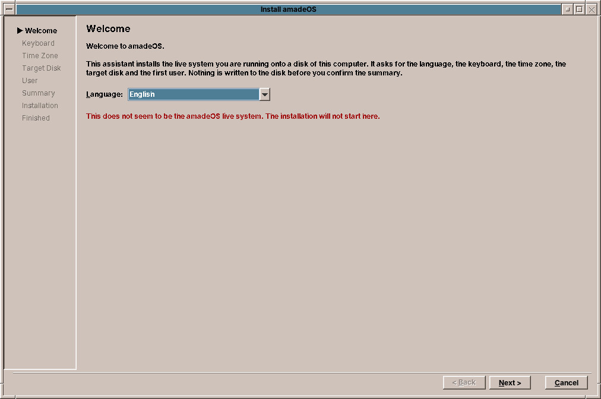
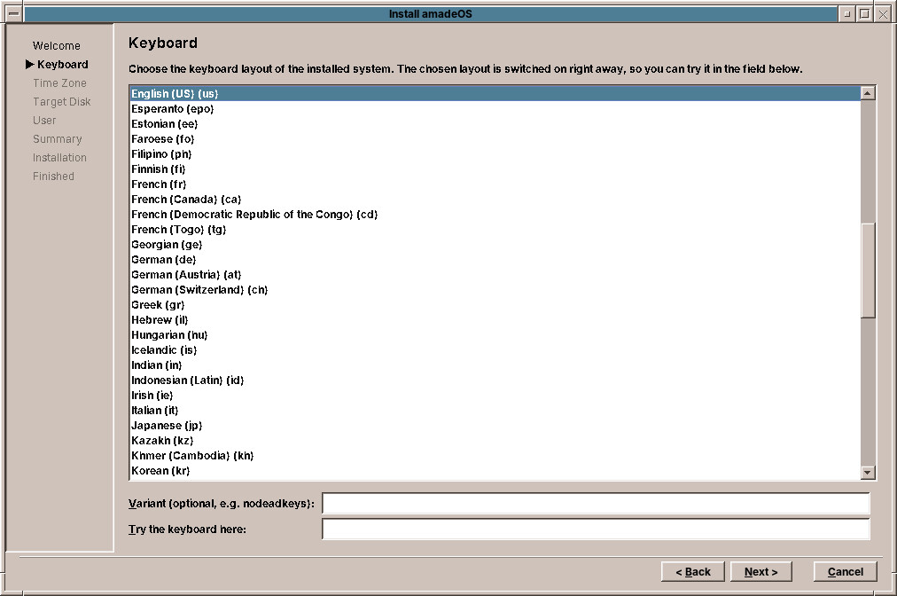
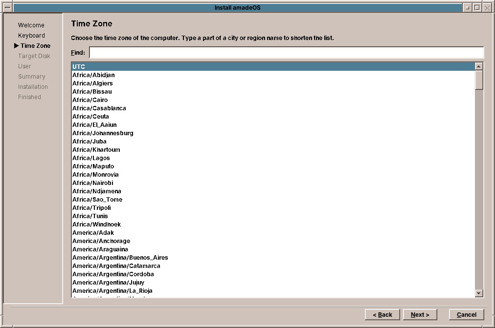
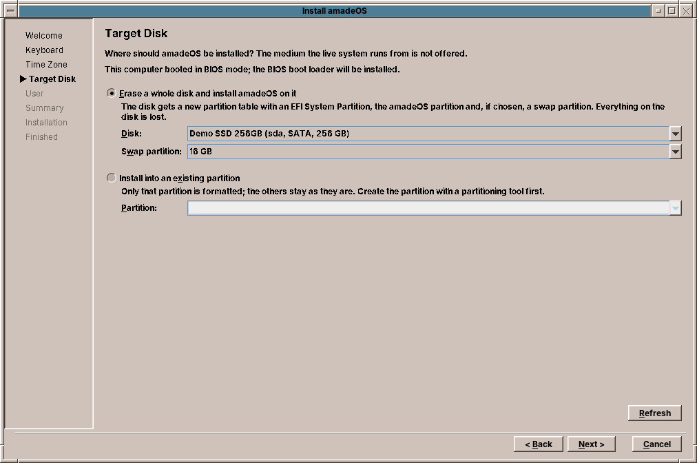
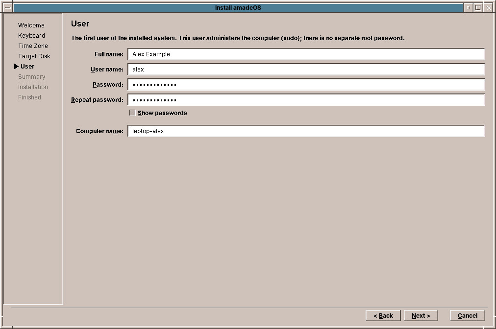
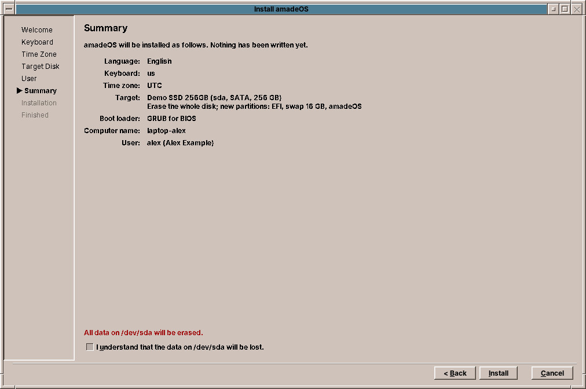

# 14. Installing amadeOS

The assistant *Install amadeOS* copies the live system onto a disk of the computer. It asks a few questions, shows a summary, and writes nothing before you have confirmed that summary.

!!! warning "Before you start"
    Copy your important files to another disk. If you want to keep Windows on the computer, read chapter 15 first: it uses the same assistant with a different choice on the *Target Disk* page.

Start the live system (chapter 13), open the **Tools** drawer of the Front Panel (the arrow above the toolbox) and choose **Install amadeOS**. The assistant lists its steps on the left; *Next >* and *< Back* move between them, *Cancel* ends it without changes.

## Welcome



Choose the **language** of the installed system: English, Deutsch, Français, Español or Italiano. The assistant switches to it at once.

## Keyboard



Choose the **keyboard layout** of the installed system. The layout is switched on at once, so you can try it in the field *Try the keyboard here*: type the letters that differ between layouts, such as ++y++, ++z++, ++q++ and the umlauts. The optional **variant** changes details; `nodeadkeys`, for example, makes the accent keys type their accent at once instead of waiting for a letter.

## Time Zone



Choose the **time zone**, the one chosen at the login screen is preselected. Type part of a city name into *Find* to shorten the list: `Vienna`, `Lisbon`, `Helsinki`.

## Target Disk



Choose **where** amadeOS goes. There are two ways:

**Erase a whole disk and install amadeOS on it.** The disk gets a new partition table with everything amadeOS needs. Everything that was on the disk is lost. *Swap partition* is space on the disk that Linux uses when the memory is full and for hibernation; the assistant proposes a size from the memory of the computer, and *None* leaves it out.

**Install into an existing partition.** Only the chosen partition is formatted; the others stay as they are. This is the way to keep Windows or another system; chapter 15 describes it.

The page also says whether the computer started in UEFI or BIOS mode, and which boot loader it will therefore install. The assistant does not offer the USB stick the live system runs from, disks that are mounted, optical drives and disks under 8 GB. *Refresh* reads the disks again, for example after you plugged one in.

## User



The **first user** of the installed system. This user is the administrator of the computer: there is no separate root password, and administrative tasks ask for this user's password (chapter 50).

| Field | What to enter |
|---|---|
| Full name | Your name, as other people should see it. |
| User name | The short name you log in with, in small letters. It is proposed from the full name. |
| Password, Repeat password | At least 8 characters. *Show passwords* shows what you typed. |
| Computer name | The name of the computer in the network, for example `laptop-alex`. |

## Summary



Everything you chose, and in red which device will be erased. Check it, tick **I understand that the data on … will be lost**, and click **Install**. Until this moment nothing has been written.

## Installation

The assistant now runs the installation in ten steps, with a progress bar and a log of what it does:

1. Partitioning the disk (or preparing the chosen partition).
2. Formatting.
3. Mounting the target.
4. Copying the system.
5. Removing the parts of the live system, the installer itself among them.
6. Writing the system settings: language, keyboard, time zone, computer name, and the network connections of the live session, WLAN passwords included.
7. Creating the user, with a locked root account.
8. Building the initial RAM disk, the small start-up system Linux loads first.
9. Installing the boot loader GRUB.
10. Finishing.

Do not switch the computer off while it runs. Nothing is downloaded: everything comes from the stick. How long it takes depends mostly on the speed of the USB stick and the disk.

## Finished

Remove the stick and choose **Restart Now**, or choose *Close* the assistant and keep using the live system. After the restart the computer starts amadeOS from its disk; chapter 16 continues there.

??? hood "Under the hood"
    The assistant runs as the live user and starts the script `/usr/sbin/amadeos-install` as root through `pkexec`. The script does the work and can also be used on its own, for example for an installation without questions:

    ```bash
    sudo amadeos-install --disk /dev/sda --swap 4G --hostname pc --user alex --fullname "Alex Example" \
        --password-hash "$(mkpasswd -m yescrypt)" --locale en_GB.UTF-8 --keyboard gb --timezone Europe/London
    ```

    Without `--yes` it only checks and prints its plan. On a whole disk it creates a GPT partition table with a 1 MB BIOS boot partition, a 512 MB EFI System Partition, the optional swap partition and the amadeOS partition (ext4). The log is `/var/log/amadeos-install.log`, and it is copied into the installed system.

!!! planned "Planned"
    The installer does not yet encrypt the disk, create a separate partition for the home folders or shrink an existing partition to make room. These are open items of milestone M14.
