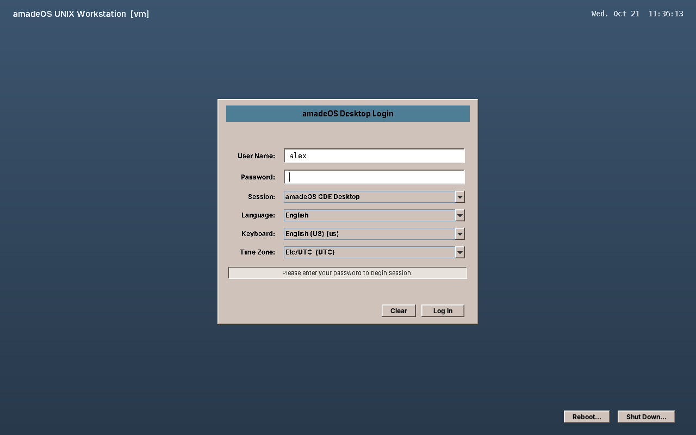

# 20. Logging In

When amadeOS starts, it shows the login screen. Here you say who you are, and you choose the language, keyboard and time zone for the session.

At the top left the screen names the computer (*amadeOS UNIX Workstation* and the computer name in brackets), at the top right the date and time. The login box is in the middle, the power buttons at the bottom right.

## The fields

| Field | What it does |
|---|---|
| **User Name** | Proposed with the user who logged in last. Type another name to log in as someone else. |
| **Password** | Your password. The cursor waits here, so you can type at once. |
| **Session** | *amadeOS CDE Desktop*, the normal desktop, or *Failsafe Terminal*, a single terminal window for repairs when the desktop does not start (chapter 57). |
| **Language** | The language of the desktop and the applications: English, Deutsch, Français, Español or Italiano. Your last choice is preselected. |
| **Keyboard** | The keyboard layout, preselected with the one of the computer (chosen in the installer; German on the live system). Another layout switches at once, before you type the password. |
| **Time Zone** | The time zone of the computer's clock. The current one is preselected; a change holds for the whole computer, not only for you. |

Press ++enter++ or click **Log In**. **Clear** empties the fields. If the password is wrong, the box says so under the fields, and you can try again.

!!! tip "The password is not accepted?"
    Check the keyboard first. On a German keyboard ++y++ and ++z++ are swapped, and some symbols are elsewhere. Typing the password into the user name field shows what the keyboard really types; delete it again afterwards.

## Switching off without logging in

**Reboot…** restarts the computer, **Shut Down…** switches it off. Both ask once more before they act.

!!! cde "CDE heritage"
    The login screen follows CDE's `dtlogin`: a framed login box in the middle of the screen, the workstation name above it and the options for language and session. CDE hid language and session in an *Options* menu; amadeOS shows them as fields, because most people never found that menu.

??? hood "Under the hood"
    The login screen is the *greeter* of the display manager `amadeos-dm`. The systemd unit `amadeos-dm.service` starts the X server on virtual terminal 7 and the greeter on it. The password is checked through PAM (`/etc/pam.d/amadeos-dm`) by a separate process running as root; after a successful login it opens a session for the user with systemd-logind and starts `amadeos-session` as that user. The last user name is kept in `/var/lib/amadeos-dm/last-user`, the chosen language in `~/.config/amadeos/locale.conf`.

    To see the greeter without logging out, `java -jar /opt/amadeos-dm/amadeos-dm.jar greeter` shows it in a window; it logs nobody in.
