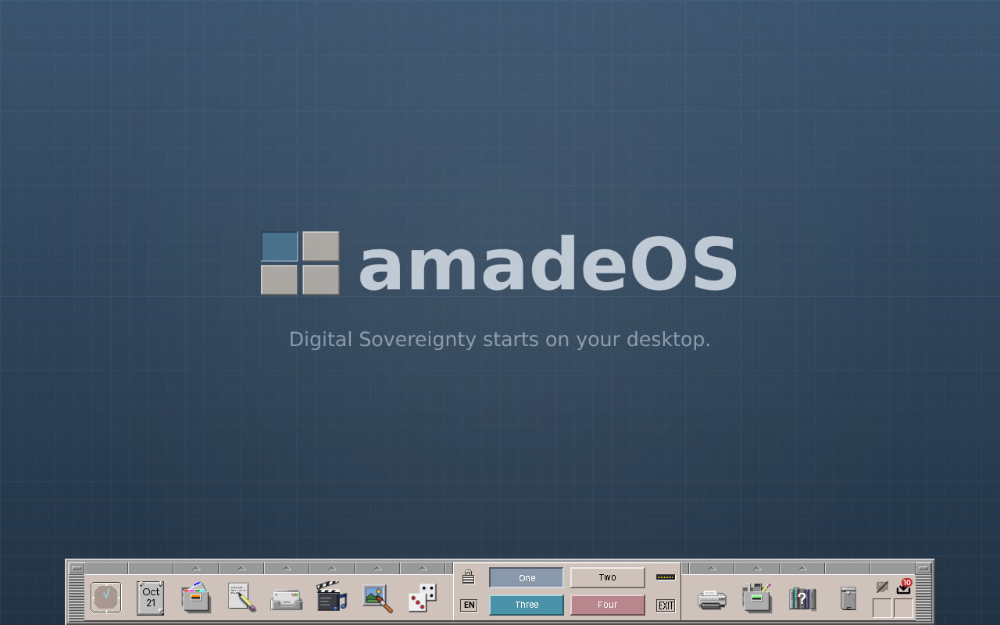
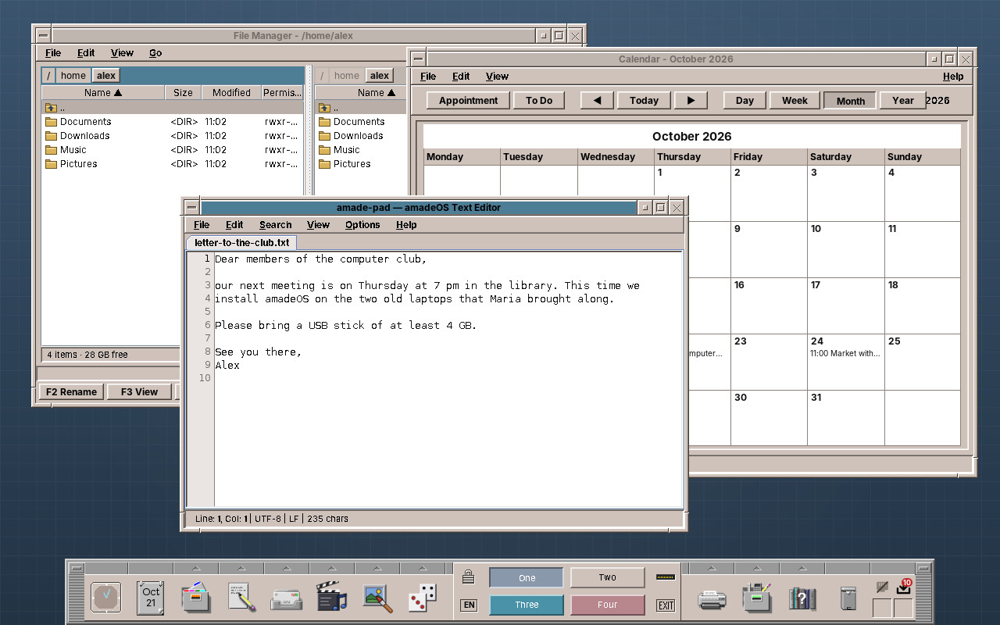
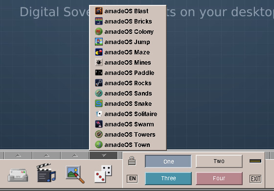

# 21. A Tour of the Desktop

After logging in, you see the amadeOS desktop: a calm backdrop and, at the bottom, the Front Panel.

## The parts of the desktop

**The backdrop** fills the screen behind the windows. Settings changes it (chapter 32): the original CDE patterns, a plain colour or a picture of your own.

**The Front Panel** at the bottom is the centre of the desktop. From left to right it holds the clock, the calendar, the drawers with the programs, the workspace switch in the middle, then the Print Manager, the tools, the help, the trash can and the status cell. Chapter 22 describes every part of it.

**Windows** open above the backdrop, each with a frame in the Motif style: a title bar, buttons to minimise and maximise, and edges to resize it (chapter 23).

**Workspaces** are four desktops, *One* to *Four*, each with its own windows. The four buttons in the middle of the Front Panel switch between them (chapter 24).

## Starting a program

Most programs are started from the Front Panel:

- **Click the icon** of a slot to start its main program: the File Manager, the Text Editor, the Mailer.
- **Click the small arrow** above a slot to open its **drawer**, the list of all programs of that kind, and click one of them. The drawers fill themselves with the programs installed on the computer.

While a program starts, the mouse pointer shows that the desktop is busy.

## The three mouse buttons

amadeOS uses all three buttons of the mouse, as CDE did. On a laptop touchpad, the right button is a click at the bottom right or a click with two fingers; the middle button is often a click with three fingers, or both buttons at once.

| Button | On a window | On the backdrop |
|---|---|---|
| Left | Select, click, drag; on the title bar: move the window | Closes an open menu |
| Middle | Pastes the text selected last, in most programs | — |
| Right | The program's context menu, if it has one | The **Workspace Menu** (chapter 24) |

!!! switching "Coming from Windows or macOS"
    The Front Panel combines the taskbar and the Start menu of Windows, or the Dock of macOS: the drawers are the Start menu, sorted by kind. There is no list of open windows; minimised windows appear as small icons at the top left of the desktop instead (chapter 23), and the workspaces keep many windows apart. Copy and paste with ++ctrl+c++ and ++ctrl+v++ work as you know them in the amadeOS programs.

## The keys to know

| Keys | What they do |
|---|---|
| ++super+l++ | Locks the screen (chapter 26). ++super++ is the key with the Windows logo. |
| ++ctrl+q++ | Quits the program (*File → Exit*), in most amadeOS programs. |

Appendix A lists all keys and mouse actions.

!!! planned "Planned"
    More keyboard shortcuts for the windows, such as switching between them with ++alt+tab++, are not there yet.
