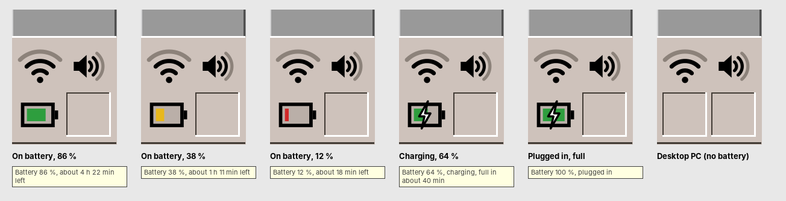
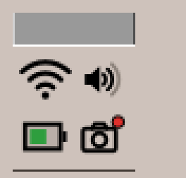
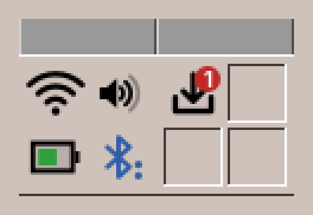

# 22. The Front Panel

The Front Panel is the long bar at the bottom of the screen. It stays above all windows and is the same on all four workspaces.

Every slot does two things: **clicking its icon** starts its main program, and **clicking the small arrow** above it opens its **drawer**, a list of more programs. A second click on the arrow, or a click elsewhere, closes the drawer again. The drawers fill themselves from the programs installed on the computer: install a new graphics program, and it appears in the Graphics drawer. Programs that fit no drawer, such as programming tools, are in the **Application Manager** (Tools slot), which lists every installed program.

## The left side

| Slot | Click on the icon | The drawer |
|---|---|---|
| **Clock** | — (a right click chooses *Analog Clock* or *Digital Clock*, as does *Settings → Front Panel*, chapter 37) | — |
| **Calendar** | Opens the Calendar, today's date on the icon | — |
| **File Manager** | Opens your home folder | The file managers, *Home Directory (~)* and *Root Filesystem (/)* |
| **Text & Office** | Starts the Text Editor | The text editors and WritePad, then the other office programs: the PDF Viewer, the Calculator, the Calendar, Contacts and LibreOffice (Writer, Calc, Impress, Draw, Math) |
| **Mail & Internet** | Starts the Mailer | The mail programs and Contacts, News, then the web browser and other internet programs |
| **Sound & Video** | Starts the first program of the drawer | Audio Station, Video Player, TV and other media programs |
| **Graphics** | Starts the first program of the drawer | Image Viewer, Image Scan, Fractals, LibreOffice Draw and other graphics programs |
| **Games** | Starts the first game of the drawer | All installed games, from Blast to Town (chapter 49) |

## The workspace switch in the middle

The middle of the panel holds the controls of the session:

- **The padlock** at the top left locks the screen (chapter 26).
- **The language button** under it, with the code of the current language such as *EN*, switches the language (chapter 25).
- **The four buttons One to Four** switch between the workspaces. Each has its workspace's colour; the current one is pressed in. A second click on the current one renames its workspace (chapter 24).
- **The busy light**, the slit at the top right, and under it **EXIT**, which logs out, restarts or shuts down (chapter 26).

## The right side

| Slot | Click on the icon | The drawer |
|---|---|---|
| **Print Manager** | Opens the Print Manager with the printers and their jobs | Other printing programs and *Add or Configure Printers* (chapter 27) |
| **Tools** | Opens the Application Manager, the list of all programs | See below |
| **Help** | Opens this handbook in the web browser | The handbooks on the computer |
| **Trash Can** | Opens the trash in the File Manager | — |
| **Status** | Small cells: the network, the sound, the battery on a laptop, the notification bell with the number of new notifications (chapter 28), and the software updates when updates are waiting; a camera light while a camera is on | — |

### The Tools drawer

| Entry | What it is |
|---|---|
| Settings | Colours, text size, backdrop, keyboard, mouse, beep, screen saver, windows and clipboard (Part IV). |
| Application Manager | All installed programs, sorted by kind. |
| Terminal | A terminal window for commands (chapter 42); also ++ctrl+alt+t++. |
| Root Console (sudo) | A terminal with administrator rights; asks for your password (chapter 50). |
| Clipboard History | Your last copies, to paste them again (chapter 36). |
| Backup & Sync | Backups of your home folder to an external disk, and folder syncs (chapter 41). |
| Session Diagnostics & Logs | The logs of the desktop and the programs (chapter 57). |
| Hardware & System Info | Processor, memory, disks, graphics, network and battery on one page (chapter 57). |
| Task Manager | Running programs and processes, how busy the computer is, ending a program that hangs (chapter 59). |

Below them come the other installed settings and system programs: *amadeOS Print Manager*, *amadeOS Software* for updates (chapters 51 and 52), *Install amadeOS* in the live system (chapter 14), the File Manager and the terminals.

### The Help drawer

The first entry, **amadeOS User's Handbook**, opens this book in the web browser. It is installed on the computer (package `amadeos-handbook`), so it opens without a network; if the package is missing, the browser opens the copy on the web. The other entries are the handbooks installed as programs of the kind *Documentation*: the **Application Developer's Handbook** for writing amadeOS applications, the **Game Developer's Handbook** for writing games with the amade game engine, and the *Documentation Viewer* for the documentation of the installed packages.

### The busy light

The slit above **EXIT** shows what the computer is busy with. It is dark when nothing happens.

| The light | What it means |
|---|---|
| All dashes **blink yellow** | A program is starting. The light goes out when its window appears. |
| An **amber** run of dashes moves from left to right | Software is being installed or removed, by Software, the updates cell or a terminal (chapter 52). |
| A **violet** run of dashes moves from right to left | A backup runs: Backup & Sync is saving, thinning out, checking or restoring a backup (chapter 41). |
| The left half lights **green** | The disks are reading or writing. The more dashes, the more data. |
| The right half lights **cyan** | Data goes through the network. |

Point at the light to see the rates, for example *Disk 12 MB/s · Network 340 KB/s*. A click opens **Hardware & System Info** (chapter 57). If you prefer the plain busy light of CDE, switch off the green and cyan halves in Settings > Front Panel (chapter 37).

### The status cell

The **network cell** shows the connection: a cable for a wired network, bars for the WLAN signal, a cross when there is none. Clicking it opens the list of WLAN networks (chapter 27).

The **sound cell** beside it shows a loudspeaker with one to three waves for the volume, and an X when muted. Clicking it opens a volume slider and the choice of the output and the microphone; the mouse wheel over it makes it louder or softer, the middle button mutes (chapter 27).

The **battery cell** below them appears only on a computer with a battery, such as a laptop. The battery is filled to its charge: **green** above 50 %, **yellow** from 50 % down to 21 % and **red** at 20 % and below, time to plug in the charger. A lightning bolt shows that the computer is plugged in. Point at the cell to see the percentage and, while the battery charges or runs the computer, about how long until it is full or empty, for example *Battery 38 %, about 1 h 11 min left*. Settings > Front Panel can hide it (chapter 37).

The **Bluetooth cell** appears only on a computer with Bluetooth. Its rune is **blue** while Bluetooth is on, with a dot for each connected device, and **grey** and crossed out while it is off. Point at it to see what is connected, for example *Bluetooth: WH-1000XM4 connected*. Click it for its menu:

| In the Bluetooth menu | What it does |
|---|---|
| **Bluetooth** | Switches Bluetooth on and off. |
| A paired device | Ticked while it is connected; a click connects or disconnects it, with its battery in brackets if it tells it, such as *MX Master 3 (55 %)*. |
| **Bluetooth settings…** | Opens the Bluetooth page of Settings, for pairing new devices (chapter 38). |

The **updates cell** appears only while software updates wait: an arrow into a tray with their number, on red when security updates are among them. Its menu offers *Install all updates*, *Install security updates only* and *Check now* (chapter 52).

The **camera light** appears only while a program uses a camera: a camera with a red dot. Point at it to see which programs, for example *Camera in use by amade-webcam, firefox*. It goes away within two seconds after the last program lets the camera go. Unlike the other cells it cannot be hidden, because it is there so that you always see when a camera is on.

The status slot holds four cells. When more of them have something to show, a laptop with Bluetooth while updates wait for example, a second slot opens beside the first and closes again when it is no longer needed.

!!! cde "CDE heritage"
    The Front Panel follows CDE's: the clock and calendar on the left, the workspace switch with lock and EXIT in the middle, the Print Manager, Tools, Help and Trash Can on the right, and drawers ("subpanels" in CDE) above the slots. CDE's drawers were configured by hand; those of amadeOS fill themselves. The Games drawer and the status slot are new, and so is the language button, in the corner CDE left empty. CDE's busy light only blinked while an action started; the disk, network and install signals are new.

??? hood "Under the hood"
    The Front Panel is the program `amadeos-panel-cde`, started by the session as `/usr/bin/amadeos-panel`. The drawers list the `.desktop` files in `/usr/share/applications` and `~/.local/share/applications` by their *Categories*: `FileManager`, `TextEditor` and `Office`, `Email` and `Network`, `AudioVideo`, `Graphics`, `Game`, `Printing`, `Settings` and `System`, `Documentation`. A program started from the panel writes its messages to `~/.cache/amadeos/logs/<program>.log`. The busy light reads `/proc/diskstats` (whole disks only) and `/proc/net/dev` (all interfaces but `lo`) four times a second, and looks for a running `dpkg` every two seconds. The battery cell reads `/sys/class/power_supply` every 20 seconds; the batteries of a wireless mouse or keyboard do not count, and two batteries in one laptop show as one. The camera light looks every two seconds which processes have a `/dev/video*` device open (in `/proc/<pid>/fd`); a camera that a program opens through `ffmpeg` is shown under the program's name. The Bluetooth cell follows the signals of the Bluetooth service `bluetoothd` (BlueZ) on the system bus, and asks it again every 30 seconds, so an adapter plugged in later appears too.
