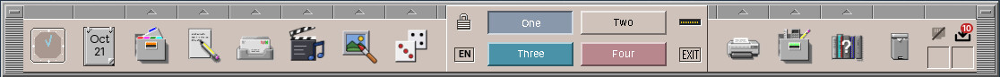
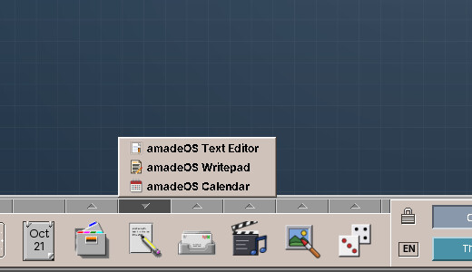
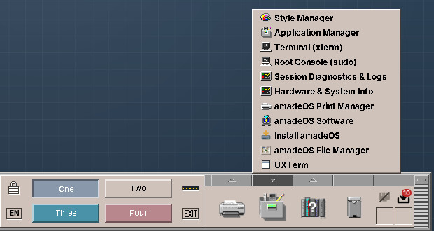
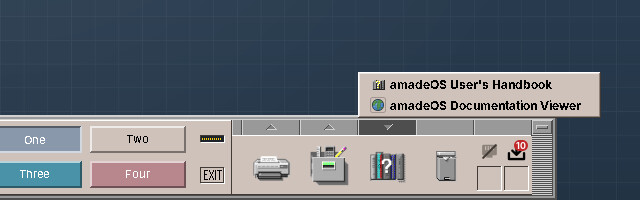

# 22. The Front Panel

The Front Panel is the long bar at the bottom of the screen. It stays above all windows and is the same on all four workspaces.

Every slot does two things: **clicking its icon** starts its main program, and **clicking the small arrow** above it opens its **drawer**, a list of more programs. A second click on the arrow, or a click elsewhere, closes the drawer again. The drawers fill themselves from the programs installed on the computer: install a new graphics program, and it appears in the Graphics drawer. Programs that fit no drawer, such as programming tools, are in the **Application Manager** (Tools slot), which lists every installed program.

## The left side

| Slot | Click on the icon | The drawer |
|---|---|---|
| **Clock** | — (a right click chooses *Analog Clock* or *Digital Clock*, as does *Settings → Front Panel*, chapter 37) | — |
| **Calendar** | Opens the Calendar, today's date on the icon | — |
| **File Manager** | Opens your home folder | The file managers, *Home Directory (~)* and *Root Filesystem (/)* |
| **Text & Office** | Starts the Text Editor | The text editors and WritePad, then the other office programs: the PDF Viewer, the Calculator, the Calendar, Contacts, spreadsheets, presentations |
| **Mail & Internet** | Starts the Mailer | The mail programs and Contacts, then the web browser and other internet programs |
| **Sound & Video** | Starts the first program of the drawer | Audio Station, Video Player and other media programs |
| **Graphics** | Starts the first program of the drawer | Image Viewer, Image Scan, Fractals and other graphics programs |
| **Games** | Starts the first game of the drawer | All installed games, from Blast to Town (chapter 49) |

## The workspace switch in the middle

The middle of the panel holds the controls of the session:

- **The padlock** at the top left locks the screen (chapter 26).
- **The language button** under it, with the code of the current language such as *EN*, switches the language (chapter 25).
- **The four buttons One to Four** switch between the workspaces. Each has its workspace's colour; the current one is pressed in. A second click on the current one renames its workspace (chapter 24).
- **The busy light**, the slit at the top right, and under it **EXIT**, which logs out, restarts or shuts down (chapter 26).

## The right side

| Slot | Click on the icon | The drawer |
|---|---|---|
| **Print Manager** | Opens the Print Manager with the printers and their jobs | Other printing programs and *Add or Configure Printers* (chapter 27) |
| **Tools** | Opens the Application Manager, the list of all programs | See below |
| **Help** | Opens this handbook in the web browser | The handbooks on the computer |
| **Trash Can** | Opens the trash in the File Manager | — |
| **Status** | Up to four small cells: the network, and the software updates when updates are waiting | — |

### The Tools drawer

| Entry | What it is |
|---|---|
| Settings | Colours, text size, backdrop, keyboard, mouse, beep, screen saver, windows and clipboard (Part IV). |
| Application Manager | All installed programs, sorted by kind. |
| Terminal (xterm) | A terminal window for commands. |
| Root Console (sudo) | A terminal with administrator rights; asks for your password (chapter 50). |
| Clipboard History | Your last copies, to paste them again (chapter 36). |
| Session Diagnostics & Logs | The logs of the desktop and the programs (chapter 57). |
| Hardware & System Info | Processor, memory, disks, graphics, network and battery on one page (chapter 57). |

Below them come the other installed settings and system programs: *amadeOS Print Manager*, *amadeOS Software* for updates (chapters 51 and 52), *Install amadeOS* in the live system (chapter 14), the File Manager and the terminals.

### The Help drawer

The first entry, **amadeOS User's Handbook**, opens this book in the web browser. It is installed on the computer (package `amadeos-handbook`), so it opens without a network; if the package is missing, the browser opens the copy on the web. The other entries are the handbooks installed as programs of the kind *Documentation*: the **Application Developer's Handbook** for writing amadeOS applications, the **Game Developer's Handbook** for writing games with the amade game engine, and the *Documentation Viewer* for the documentation of the installed packages.

### The status cell

The **network cell** shows the connection: a cable for a wired network, bars for the WLAN signal, a cross when there is none. Clicking it opens the list of WLAN networks (chapter 27).

The **updates cell** appears only while software updates wait: an arrow into a tray with their number, on red when security updates are among them. Its menu offers *Install all updates*, *Install security updates only* and *Check now* (chapter 52).

!!! planned "Planned"
    Cells for the sound volume, the battery and Bluetooth will join the status slot.

!!! cde "CDE heritage"
    The Front Panel follows CDE's: the clock and calendar on the left, the workspace switch with lock and EXIT in the middle, the Print Manager, Tools, Help and Trash Can on the right, and drawers ("subpanels" in CDE) above the slots. CDE's drawers were configured by hand; those of amadeOS fill themselves. The Games drawer and the status slot are new, and so is the language button, in the corner CDE left empty.

??? hood "Under the hood"
    The Front Panel is the program `amadeos-panel-cde`, started by the session as `/usr/bin/amadeos-panel`. The drawers list the `.desktop` files in `/usr/share/applications` and `~/.local/share/applications` by their *Categories*: `FileManager`, `TextEditor` and `Office`, `Email` and `Network`, `AudioVideo`, `Graphics`, `Game`, `Printing`, `Settings` and `System`, `Documentation`. A program started from the panel writes its messages to `~/.cache/amadeos/logs/<program>.log`.
