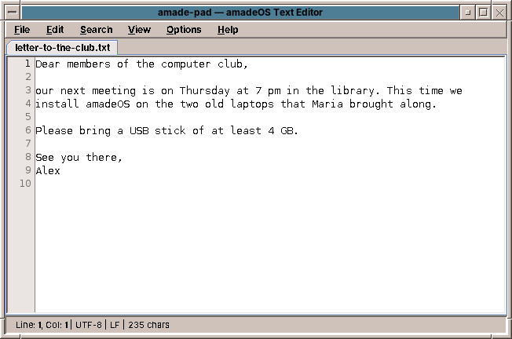
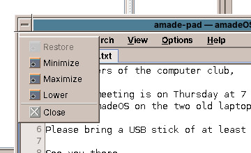

# 23. Working with Windows

Every program opens in a window, and every window gets the same frame from amadeOS, whatever program it belongs to.

## The frame

| Part | Where | What it does |
|---|---|---|
| **Window menu button** | Left end of the title bar, a small bar | Opens the window menu (below). A double click closes the window. |
| **Title bar** | Top | Shows the window's name. Drag it to move the window. The active window's title bar has the active colour of the palette. |
| **Minimise button** | Right, the small square | Hides the window and puts an icon for it on the desktop. |
| **Maximise button** | Right, the large square | Makes the window as large as the screen above the Front Panel; a second click gives it back its size. |
| **Close button** | Right end, the cross | Closes the window. |
| **Edges and corners** | All around | Drag them to resize the window; the mouse pointer changes to show the direction. |

!!! cde "CDE heritage"
    The frame is the Motif frame of CDE's window manager `dtwm`, with its raised edges and corner pieces, and the window menu on the left button. CDE's menu also had *Move* and *Size* for the keyboard; amadeOS leaves them out, since the frame is moved and resized with the mouse. The cross on the right, which CDE did not have, is there for everyone used to closing a window at the top right.

## The window menu

Click the button at the left end of the title bar to open the **window menu** of that window:

| Entry | What it does |
|---|---|
| **Restore** | Gives a maximised window its earlier size back. |
| **Minimize** | Like the minimise button. |
| **Maximize** | Like the maximise button. |
| **Lower** | Puts the window behind all the others. |
| **Close** | Closes the window. |

A **double click** on the button closes the window at once.

## The active window

You work in one window at a time, the **active** window: it receives what you type, and its title bar shows the active colour. Click into a window, or on its title bar, to make it active; it also comes to the front.

## Switching windows with Alt+Tab

Hold down ++alt++ and press ++tab++: a window with small pictures of the open windows comes up in the middle of the screen. The window you worked in before is already selected. Press ++tab++ again, still holding ++alt++, to move on; when you let go of ++alt++, the selected window comes to the front.

| Keys (with ++alt++ held) | What they do |
|---|---|
| ++tab++ | The next window |
| ++shift+tab++ | The previous window |
| ++right++ / ++left++ | The next / previous window |
| Letting go of ++alt++, or ++enter++ | Brings the selected window to the front |
| ++esc++ | Closes the switcher; nothing changes |

You can also point at a picture to select it and click it to switch. The windows are in the order you last used them, so a quick ++alt+tab++, pressed and let go at once, simply takes you back to the window before, and a second one brings you back again.

The switcher shows the windows of the current workspace, minimised ones too; they are marked *(minimized)* and come back when you choose them. Dialogs are not listed on their own: they come to the front with their window.

!!! tip "Why a picture may be old"
    amadeOS takes the picture of a window while the window is fully in view, for example just before you switch to another one. The switcher therefore shows each window as it looked when you last saw it whole. A window that was never fully in view shows the icon of its program instead.

## Minimising and restoring

A minimised window disappears from the screen and leaves a small icon with its name at the top left of the desktop. Click the icon to bring the window back. Several minimised windows line up below each other.

The Workspace Menu (chapter 24) has *Minimize All Windows* and *Restore All Windows* under *Window Management*.

## Full screen

Programs can ask for the whole screen, for example the games with ++f11++. The frame and the Front Panel then disappear until the program leaves full screen again, with the same key.

## Closing a program

Closing the last window of a program usually ends the program. A program with unsaved work asks first, as the Text Editor does with a changed document. The close buttons ask the program to close its window; a program that does not understand that request is ended at once. A program that hangs may not answer at all; chapter 57 shows how to end it.

??? hood "Under the hood"
    The frames come from the window manager `amadeos-wm`, a Java program that talks to the X server through the X11 library. It *reparents* each window into a frame window of its own and follows the conventions ICCCM and EWMH, so programs that are not written in Java, Firefox for example, get the same frame. The ++alt+tab++ switcher is part of it too; without a compositor the X server keeps no picture of covered windows, which is why the window manager reads each window from the screen while it is in full view. It is started by the session and restarted at once should it ever end. Its log is `~/.cache/amadeos/logs/wm.log`.
