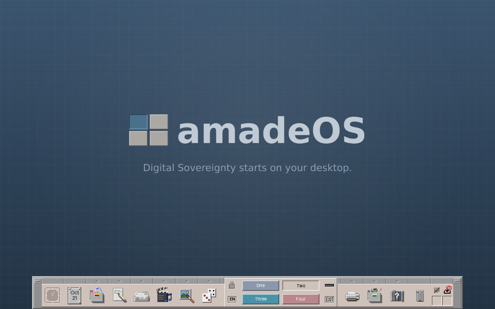
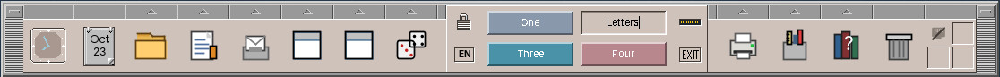
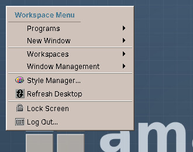

# 24. Workspaces and the Workspace Menu

## Four workspaces

amadeOS has four **workspaces**, four desktops side by side, called *One*, *Two*, *Three* and *Four* until you give them names of your own. Each holds its own windows and can have its own backdrop. You might keep your mail and calendar in *One*, a letter you are writing in *Two* and a game in *Four*, and switch between them without moving a single window.

The four buttons in the middle of the Front Panel switch between the workspaces. Each has its own colour from the palette, and the button of the current workspace is pressed in. A new window opens in the workspace you are in.

The Front Panel is the same on all workspaces. The backdrop is too, until you give a workspace one of its own in Settings (chapter 32): then switching to that workspace changes the backdrop with the windows.

## Naming a workspace

A name such as *Mail* or *Letters* tells you better than *Two* what a workspace is for. To rename one:

1. Click its button, so that it is the current workspace.
2. Click the button again. It turns into a text field with the old name selected.
3. Type the new name and press ++enter++.

A double click on any workspace button does both clicks at once. You can also click the **right mouse button** on a workspace button and choose **Rename**.

++escape++ keeps the old name. An empty name gives the workspace back its own name, *One* to *Four* in the language of the desktop. A name can be up to 24 characters long; when it is wider than the button, the button shows its beginning with "…", and the tooltip shows it in full. The Workspace Menu (below) and the Backdrop page of Settings use the new names too.

!!! cde "CDE heritage"
    CDE gave every workspace its own colour from the palette, so you always see where you are; amadeOS keeps that. Renaming works as in CDE: click the current workspace's button, type, press Return. Each workspace can also have its own backdrop, as in CDE. CDE could also change the number of workspaces; amadeOS has four for now.

??? hood "Under the hood"
    The names are kept in `~/.config/amadeos/workspaces.conf` (`workspace.2.name=Letters`); only workspaces you renamed are listed there. The Front Panel publishes all four names in the root window's `_NET_DESKTOP_NAMES` property, the standard place where the window manager and other programs look for them.

!!! planned "Planned"
    There is no menu entry or key yet to move a window to another workspace or to show it on all of them. A window stays in the workspace where it was opened, unless the program itself asks for another one.

## The Workspace Menu

Click the **right mouse button on the backdrop** to open the Workspace Menu.

| Entry | What it does |
|---|---|
| **Programs** | All installed programs, sorted by kind, the same ones as in the drawers. |
| **New Window** | A *Terminal Emulator*, the *Text Editor* or a *File Manager* window with your home folder. |
| **Workspaces** | Switches to *Workspace 1: One* to *Workspace 4: Four*, under the names you gave them; the current one has a tick. |
| **Window Management** | *Shuffle Up* and *Shuffle Down* bring the bottom window to the front or send the front window to the back, one at a time; *Minimize All Windows* clears the workspace, *Restore All Windows* brings them back. |
| **Settings…** | Opens Settings (Part IV). |
| **Refresh Desktop** | Draws the desktop and all frames anew, if something on the screen looks wrong. |
| **Lock Screen** | Locks the screen (chapter 26). |
| **Log Out…** | Ends the session (chapter 26). |

Click an entry, or click elsewhere to close the menu without choosing.

!!! cde "CDE heritage"
    CDE called it the *Workspace Menu* too and opened it the same way. Its entries could be edited in a file (`dtwmrc`); amadeOS builds its menu from the installed programs.
