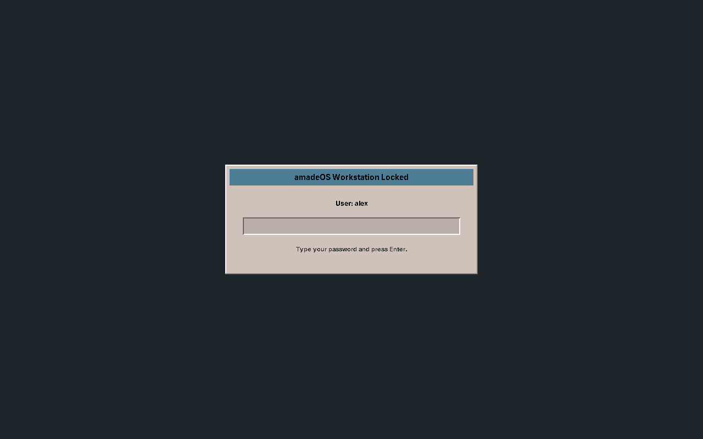

# 26. Locking, Logging Out, Shutting Down

## Locking the screen

When you leave the computer for a moment, **lock** it. Your windows stay open behind a closed screen, and only your password opens it again.

- Click the **padlock** in the middle of the Front Panel,
- or press ++super+l++ (the key with the Windows logo and ++l++),
- or choose **Lock Screen** in the Workspace Menu (right mouse button on the backdrop).

To unlock, type your password and press ++enter++.

After a time without keyboard or mouse, the **screen saver** starts, and a little later the screen locks by itself. How long that takes, and which picture the screen saver shows, is set on the *Screen* page of Settings (chapter 34).

!!! sovereignty "Your data"
    The lock grabs the keyboard and mouse for itself, so no program behind it can read what you type. If the lock program should ever crash, it starts again at once and the screen stays locked.

## The EXIT button

**EXIT**, at the right of the workspace switch, opens the window *amadeOS Session & Power Control*:

| Button | What it does |
|---|---|
| **Suspend** | Puts the computer to sleep. Your programs stay open; a key, the mouse, the power button or opening the lid wakes it up, and the screen is locked. |
| **Hibernate** | Writes everything that is open to the disk and switches the computer off; at the next start you are back where you were (after the password). Greyed out where it is not set up (see below). |
| **Log Out** | Ends your session and returns to the login screen. |
| **Reboot** | Ends the session and restarts the computer; asks once more. |
| **Shut Down** | Ends the session and switches the computer off; asks once more. |
| **Exit to Shell** | Logs out and switches the screen to the text console, for repairs with commands. The login screen is still there: ++ctrl+alt+f7++ brings it back. |
| **Cancel** | Closes the window. |

*Log Out…* in the Workspace Menu does the same.

!!! warning "Save first"
    Logging out ends all your programs. Save your work before; amadeOS does not yet ask the programs to save.

## Sleeping, the lid and the power button

While you are logged in, **closing the lid** of a laptop suspends it, and **pressing the power button** opens the EXIT window. Both can be changed on the *Power* page of Settings (chapter 34), and so can when the screen goes dark and when the computer goes to sleep by itself.

Suspend keeps the session in the memory and needs a little battery while it sleeps. Hibernate needs no power at all, but it needs a **swap space** on the disk at least as large as the memory: the installer proposes one of that size (chapter 14). Without it, or with Secure Boot's lockdown, Hibernate is greyed out.

## Without logging in

At the login screen, **Reboot…** and **Shut Down…** at the bottom right restart or switch off the computer (chapter 20). There the power button of the computer shuts amadeOS down properly, and closing the lid suspends it.

!!! cde "CDE heritage"
    CDE had the same padlock and EXIT button at the same places. amadeOS adds the keyboard shortcut ++super+l++, suspending and hibernating, and the choice of rebooting or shutting down directly from EXIT.
