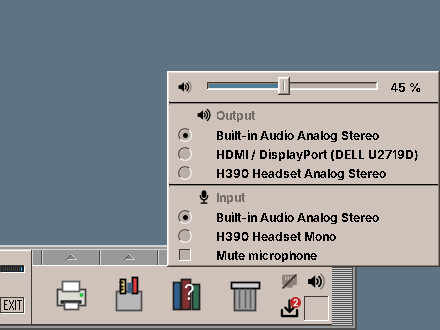

# 27. Network, Sound and Printing

## The network

A **wired network** works by itself: plug in the cable, and amadeOS connects. The network cell at the right end of the Front Panel shows a cable then; its tooltip names the connection.

For a **WLAN**, click the network cell. A menu lists the networks in reach with their signal strength. Click one; for a protected network amadeOS asks for its password once and remembers it. *Show password* shows what you typed.

| In the network menu | What it does |
|---|---|
| A network | Joins it. |
| The current network | A submenu with **Disconnect** and **Forget network** (forget the password). |
| **Search again** | Looks for networks anew. |
| **Network settings…** | Opens the Network page of Settings, with the wired network, hidden networks and the details of a connection (chapter 38). |

If the cell shows a cross, there is no connection; *Not connected* in its tooltip, or *Network service is not running* if the network service itself has stopped (chapter 57).

!!! switching "Coming from Windows or macOS"
    The network cell is the network icon of the Windows taskbar or the macOS menu bar. Mobile hotspots of phones appear in the list like any other WLAN.

!!! sovereignty "Your data"
    WLAN passwords are kept on your computer only, readable by the system and its administrators. The desktop sends nothing to a server when it connects; the system only sets its clock from a public time server.

## Sound

Sound works without setting anything up: amadeOS uses PipeWire, the sound system of current Linux distributions, for speakers, headphones and USB sound cards. Programs that play sound, the Audio Station, the Video Player, the games and Firefox, use the device that is active.

The **sound cell** next to the network cell sets the volume for the whole computer. Its loudspeaker shows one to three waves for how loud it is, and an X when the sound is muted.

Click the cell for its menu:

| In the sound menu | What it does |
|---|---|
| The **slider** | Sets the volume from 0 to 100 %. Moving it also ends muting. |
| The **loudspeaker** left of the slider | Mutes the sound, and a second click turns it on again. |
| **Output** | The speakers, headphones, HDMI screens and USB headsets. Click one to play through it; what is playing moves over at once. |
| **Input** | The microphones. Click one to record from it, for example for a video call. |
| **Mute microphone** | Keeps the microphone in use silent. |

Two shortcuts work without opening the menu: turn the **mouse wheel** over the cell to make it louder or softer in steps of 5 %, and click it with the **middle button** to mute. The tooltip names the volume and the output, for example *Volume 45 % · Built-in Audio Analog Stereo*. When the loudspeaker is grey and crossed out, the sound system is not running (chapter 57).

A headset plugged in appears in the menu at once, and so do Bluetooth headphones once they are paired (chapter 38). Most programs also have a volume control of their own; it sets their share of the volume of the cell. The *Sound* page of Settings (chapter 33) has the same choices and more: a test tone for the left and right speaker, a level meter for the microphone and the profiles of the sound cards, for example for sound over HDMI.

!!! switching "Coming from Windows or macOS"
    The sound cell is the speaker icon of the Windows taskbar or the sound control of the macOS menu bar, with the choice of the output and the input in one menu.

The **beep**, the short sound the desktop makes for a mistake, is set on the *Beep* page of Settings (chapter 33).

## Printing

Most printers sold in the last ten years print without a driver (IPP Everywhere, AirPrint). Connect them by USB, or to the same network, and amadeOS finds them by itself.

Click the **Print Manager** in the Front Panel to see them. It lists the printers with their state, and for each printer its jobs:

- **Cancel**, **hold** or **release** a print job,
- **pause** and **resume** a printer,
- choose the **default printer**, the one programs offer first,
- print a **test page**.

If a printer does not appear by itself, add it in Settings: **Printers** (chapter 38). **Add…** finds the printers in the network and on USB that print without a driver, or takes the address of one. The same page chooses the default printer, the paper size and two-sided printing. An older printer that needs a driver is added in the administration pages of the print system, CUPS (chapter 54).

!!! cde "CDE heritage"
    The Print Manager follows CDE's `dtprintinfo`, which had its slot at the same place on the right of the Front Panel.

??? hood "Under the hood"
    The sound cell talks to PipeWire through `pactl` (package `pulseaudio-utils`) and follows `pactl subscribe`, so a change made by another program shows at once. Volume and mute act on the default output, `@DEFAULT_SINK@`; choosing a device sets the default and moves the running streams with `pactl move-sink-input`.

    The network cell asks NetworkManager through `nmcli`; members of the group `netdev` may change connections without a password (polkit rule `/usr/share/polkit-1/rules.d/50-amadeos-network.rules`). *Network settings…* runs `amadeos-settings network`. The Print Manager `amadeos-print` speaks the printing protocol IPP to CUPS directly, over its socket `/run/cups/cups.sock`; members of the group `lpadmin` may pause printers and choose the default without a password. The first user of an installed system and the live user are in both groups.
