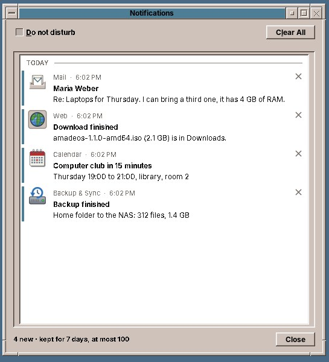
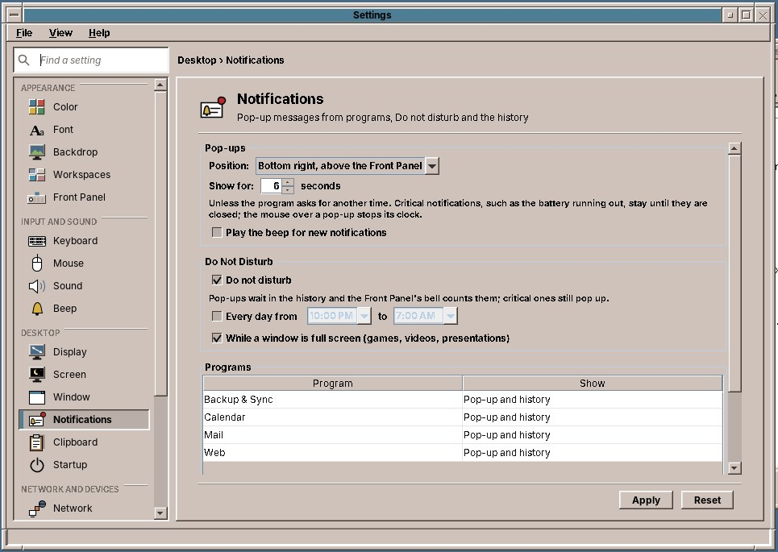

# 28. Notifications

When a program has news for you while you work in another window, a **notification** comes up in a corner of the screen: a reminder from the Calendar, new mail, a finished download in Firefox, new software updates. It goes away by itself after a few seconds and waits in the **notification history** until you have seen it. The **bell** in the Front Panel counts the ones you have not seen yet.


## A notification

Each notification shows the program's icon and name, how long ago it came, a line in bold and some text under it. Some have buttons, such as *Snooze 5 min* on a reminder or *Mark as read* on new mail.

| You do | What happens |
|---|---|
| Wait | It goes away after six seconds (or the time the program asked for) and stays in the history. |
| Point at it with the mouse | Its clock stops while the pointer is on it, so you can read it to the end. |
| Click a button | The program does what the button says, and the notification closes. |
| Click the text | Usually brings the program's window to the front. |
| Click **×** | Closes it; it stays in the history as seen. |

Up to four notifications are on the screen at once, the newest nearest the corner; more wait their turn. Notifications never take the keyboard from you: while you type a letter, your keystrokes stay in the letter.

**Critical** notifications, such as a battery that is almost empty, have a red bar at the left and stay until you close them.

## The bell in the Front Panel

The bell sits in the status slot at the right end of the Front Panel (chapter 22). A red number on it counts the notifications you have not seen yet; its tooltip says the same in words.

- **Click the bell** to open the history.
- **Right-click the bell** for its menu: *Notification history…*, *Do not disturb for 1 hour*, *Do not disturb until tomorrow morning*, *Do not disturb until I turn it off* (or *Turn off Do not disturb*), *Clear all* and *Settings…*.

While Do not disturb is on, the bell is crossed out.

## The notification history



The history lists the notifications of the last seven days, at most 100, the newest first and grouped by *Today*, *Yesterday* and the days before. New ones have a coloured bar at the left. When you open the history, they count as seen and the bell's number goes away.

- **Click an entry**, or choose it and press ++enter++, to do what a click on the notification would have done: open the reminder, the mail, the download. If the program has been closed in the meantime, it is started.
- **×** next to an entry, or ++delete++, removes it.
- **Clear All** empties the history.
- **Do not disturb** at the top turns it on and off.

The history survives logging out: it is kept in your home folder (see below).

## Do not disturb

While **Do not disturb** is on, notifications come up silently: they go straight into the history, and the bell counts them. Critical ones still come up, because they need you now.

There are four ways to turn it on:

- from the bell's menu, for one hour, until tomorrow morning (7:00, or the end of your daily time below) or until you turn it off;
- with the checkbox at the top of the history;
- every day at fixed times, such as 22:00 to 7:00 (Settings, below);
- automatically while a window fills the whole screen: a game, a film, a presentation.

## Settings → Notifications

Open Settings and click **Notifications** in the *Desktop* group (chapter 30).



| Setting | What it does |
|---|---|
| **Position** | The corner where notifications come up: bottom right or bottom left above the Front Panel, top right or top left. |
| **Show for … seconds** | How long a notification stays, unless the program asks for another time; 6 at first. |
| **Play the beep for new notifications** | Beeps for each new notification (the beep of *Settings → Beep*). |
| **Do not disturb** | Turns it on until you turn it off. |
| **Every day from … to …** | Do not disturb at these times each day; it may run over midnight. |
| **While a window is full screen** | Do not disturb while a game, a film or a presentation fills the screen. On at first. |
| **Programs** | Each program that has sent a notification, with what to do with its notifications: **Pop-up and history**, **History only** (no pop-up, but the bell counts it) or **Off** (dropped). |

*Apply* and *Reset* work as on every page. The bell itself can be hidden on the **Front Panel** page (chapter 37).

## Which programs send notifications

- **Firefox**: finished downloads, and websites you allowed to send notifications.
- **The Front Panel**: new software updates, with a *Show* button that opens Software (chapter 52).
- **The amade programs** that support it, and any program that uses the desktop notification standard of Linux, as GNOME and KDE programs do.
- **Your own scripts**, with the command `notify-send`:

```sh
notify-send "Backup finished" "312 files copied to the NAS"
notify-send -u critical "Disk almost full" "Only 2 GB left on /home"
```

!!! info "Under the hood"
    The notifications are shown by `amadeos-session notifications`, started at login by `/etc/amadeos/autostart.d/45-amadeos-notifications`; it owns the D-Bus name `org.freedesktop.Notifications` on the session bus, so every program that follows the freedesktop.org notification specification reaches it. Its log is `~/.cache/amadeos/logs/notifications.log`. The settings are in `~/.config/amadeos/notifications.conf`, the history in `~/.cache/amadeos/notifications.json`. `amadeos-notifications` opens the history from a terminal.
