# 29. The Horizon Look

amadeOS has two looks for the whole desktop. **Classic** is the CDE desktop this handbook mostly shows: the Front Panel at the bottom, Motif window frames and the palettes of chapter 31. **Horizon** is a second, modern look: a slim bar along the top of the screen, a dock at the bottom, flat window frames with rounded corners, and dark or light colours with an accent colour of your choice.

Both looks run the same programs, the same window manager and the same settings. You can switch back and forth at any time; nothing is lost.

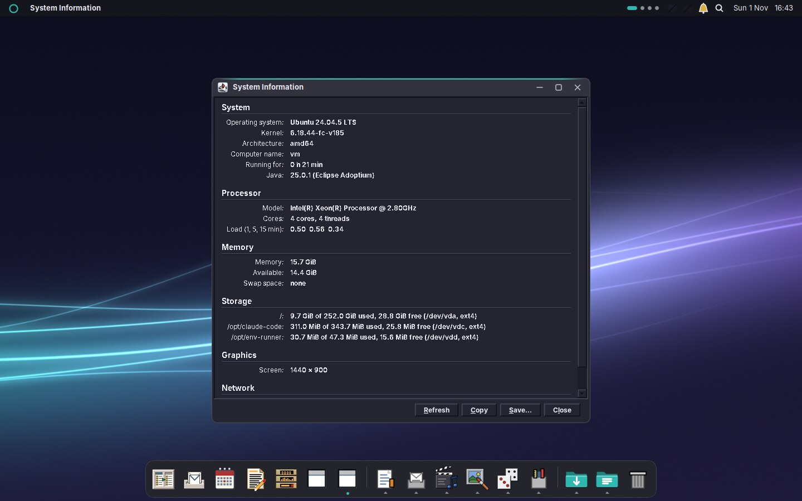

## Switching the look

Open **Settings → Desktop look** (the first page of the *Appearance* group).

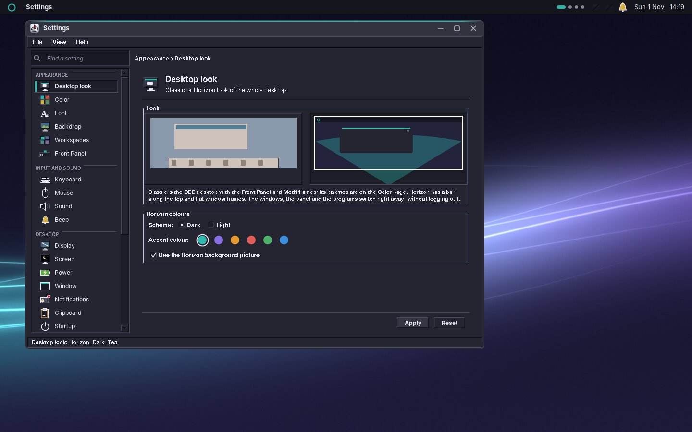

1. Click the picture **Classic** or **Horizon**.
2. For Horizon, choose the **Scheme**, *Dark* or *Light*, and an **Accent colour**: teal, violet, amber, red, green or blue. The picture shows how it will look.
3. Leave **Use the Horizon background picture** ticked to get the matching background (*horizon-dark.png* or *horizon-light.png*); clear it to keep your own backdrop.
4. Under **Dock**, choose the **Icon size** (*Small*, *Medium* or *Large*) and whether the dock shows the program drawers and the Downloads and Documents folders.
5. Click **Apply**.

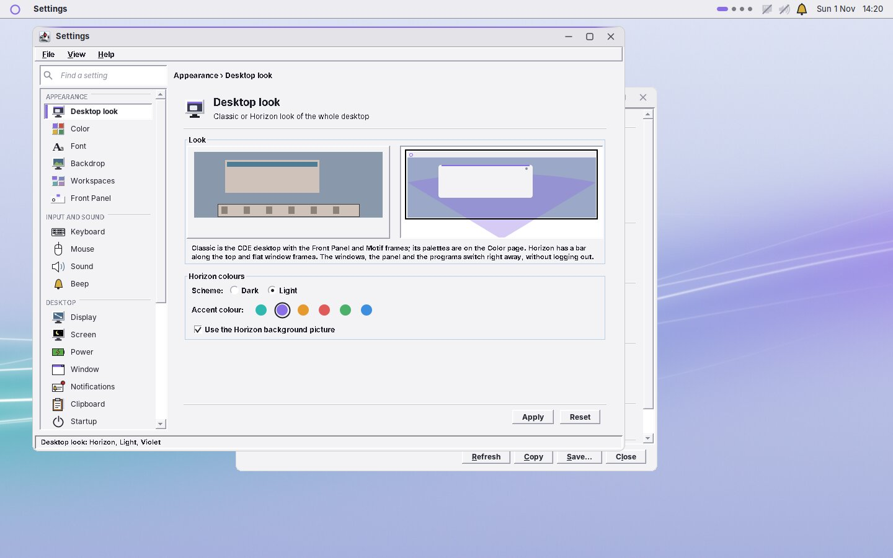

The window frames change at once, the Front Panel gives way to the top bar and the dock (or the other way round), and the open amadeOS applications take the new colours. You do not need to log out. Your choices are kept: switch back to Classic and you get your last palette again; switch to Horizon and you get your last scheme and accent colour.

## The top bar

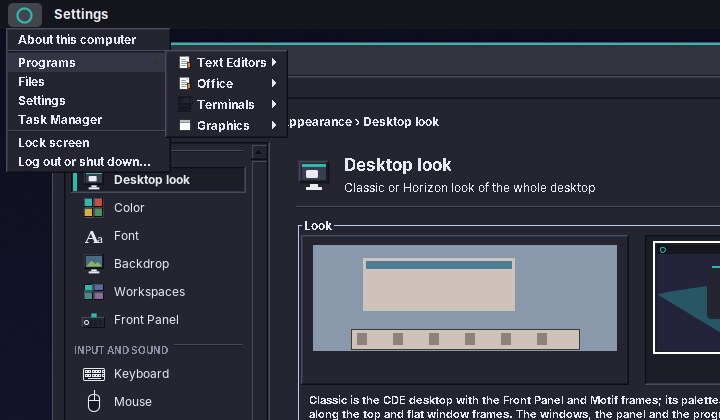

From left to right the top bar holds:

| Part | What it does |
|---|---|
| **The ring** | Opens the system menu: *About this computer*, **Programs** (every installed program, sorted like the drawers of the Front Panel), *Files*, *Settings*, *Software*, *Task Manager*, *Widgets…*, *Lock screen* and *Log out or shut down…* (the Exit dialog of chapter 26). |
| **The program name** | The name of the program you are working in, in bold, or *Desktop*. A click opens a small menu to minimise or close its window. |
| **The screen button** | Shows the desktop: all windows of the workspace step aside, as with ++super+d++ (see below). It is filled with the accent colour while the desktop is shown; a second click brings the windows back. |
| **The four dots** | The workspaces; the current one is the wider dot in the accent colour. Click a dot to switch, hold the mouse over it to see the workspace's name. |
| **The status cells** | Network, sound, battery, Bluetooth, notifications, waiting updates and the camera light: the same cells as in the Front Panel (chapter 27), chosen under *Settings → Front Panel* (chapter 37). |
| **The magnifier** | Opens the search (see below), as ++super+space++ does. |
| **The clock** | Weekday, date and time. A click opens the Calendar. |

Windows stay below the top bar: a maximised window fills the screen under it, and a window cannot be dragged under it.

## The dock

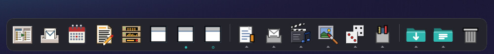

The dock floats at the bottom of the screen. Thin lines divide it into three parts:

| Part | What it holds |
|---|---|
| **Programs** | Your favourite programs, then the programs that are running without being favourites. A dot under an icon means the program is running; a ring means all its windows are minimised. |
| **Drawers** | The groups of the Front Panel's drawers: Text & Office, Mail & Internet, Sound & Video, Graphics, Games and Tools. A small triangle marks a drawer. |
| **Folders and Trash** | Downloads and Documents, then the Trash. |

**Programs.** A click on a program that is not running starts it. A click on a running program brings its window to the front; a click on the program you are working in minimises its window, or, with several windows, goes on to the next one. A click with the middle mouse button opens a new window. The right mouse button opens a menu with the program's windows, *New window*, *Keep in dock* or *Remove from dock*, and *Close* (or *Close all windows*).

To add a program to the dock, start it, then choose *Keep in dock* from its menu; it stays after you close it. *Remove from dock* takes it out again. The first favourites are Files, Firefox, Mail, Calendar, WritePad, Audio Station, Terminal and Software, those of them that are installed.

**Minimised windows** go into their program's icon in the dock, not onto the desktop: click the icon, or choose the window from its menu, to bring it back. In the Classic look they become desktop icons again.

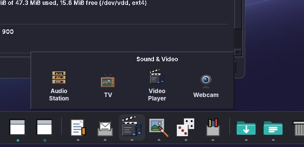

**Drawers.** A click on a drawer opens the installed programs of its group above the dock; a click on a program starts it. Programs you install appear in their drawer right away.

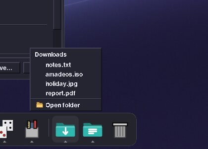

**Folders.** A click on Downloads or Documents shows the ten newest files of the folder; a click on a file opens it in its program, *Open folder* opens the folder in Files. A click on the **Trash** opens it in Files.

Windows stay above the dock, as they stay below the top bar: a maximised window fills the space between the two.

**The dock's own menu.** The right mouse button on the dock, between the icons, opens a menu with *Show desktop*, *Widgets…* and *Dock settings…* (the Desktop look page of Settings).

## The search

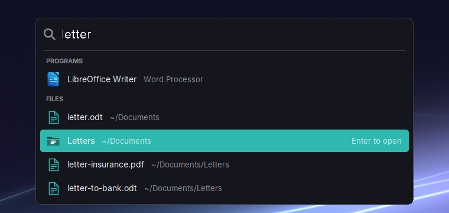

Press ++super+space++ (++super++ is the key with the Windows logo), or click the **magnifier** in the top bar, and a search field opens in the upper middle of the screen. Start typing; the results appear as you type, grouped by kind:

| Kind | What it finds |
|---|---|
| **Calculation** | A sum such as `12*7+3`, `(1250+380)*1,19`, `2^10`, `80*15%` (fifteen percent of 80) or `sqrt(2)`. A comma counts as a decimal point. |
| **Programs** | The installed programs, by their name (*WritePad*), by what they are (*word processor*, *web browser*) and by a word of their description. |
| **Settings** | The pages of Settings, by their name and by the words the search of Settings knows: *wallpaper* finds *Backdrop*, *volume* finds *Sound*. |
| **Files** | Files and folders in your home folder, by their name, with the folder they are in. Hidden files and folders are left out. |

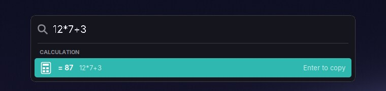

The first result is chosen; ++down++ and ++up++ (or ++tab++) choose another, and the mouse does too. ++enter++ or a click opens it: a program starts, a page of Settings opens, a file opens in its program and a folder in Files. The result of a sum goes onto the clipboard, ready to paste. ++esc++, ++super+space++ again or a click on another window close the search, and the window you were working in gets the keyboard back.

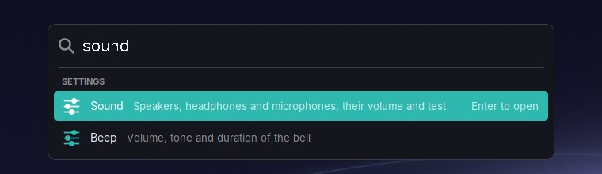

The search reads your home folder each time it opens, up to six folders deep, so a file you saved a moment ago is found. It does not look inside files.

## Showing the desktop

Press ++super+d++, click the screen button in the top bar or choose *Show desktop* from the dock's menu: all windows of the workspace step aside and you see the desktop with its widgets. The windows are not minimised; they wait, and nothing changes in the dock.

The windows come back when you press ++super+d++ again, click the screen button again, click a program in the dock, switch with ++alt+tab++, open a new window or switch to another workspace. The window you were working in gets the keyboard again.

In the Classic look ++super+d++ works the same way; the Workspace Menu (chapter 24) has it as *Show Desktop* under *Window Management*.

## Widgets

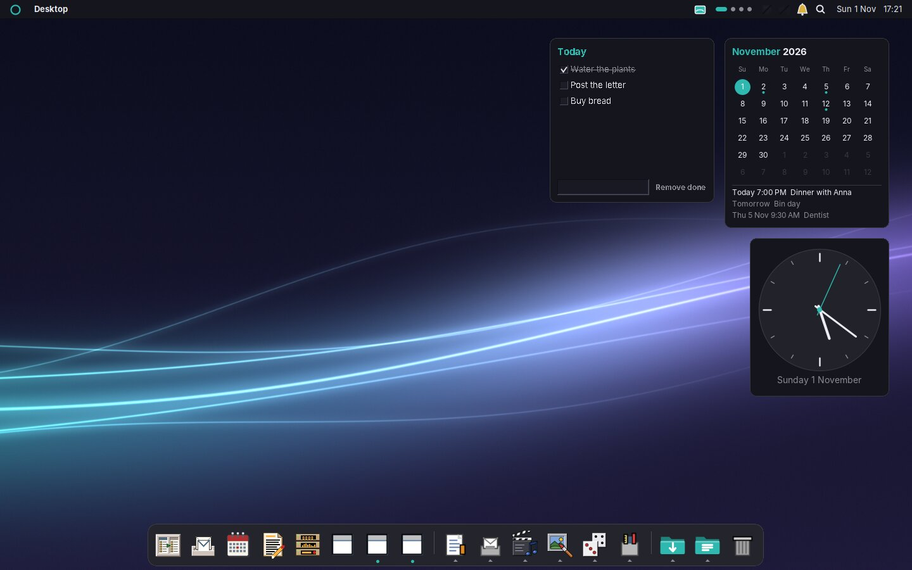

Widgets are small cards on the desktop that show something at a glance. They always stay below the windows; ++super+d++ shows them when windows cover them.

To add one, choose **Widgets…** from the system menu (the ring) or from the dock's menu. The gallery lists every widget there is; click **Add** next to one. A new widget goes into the first free place along the right edge of the screen.

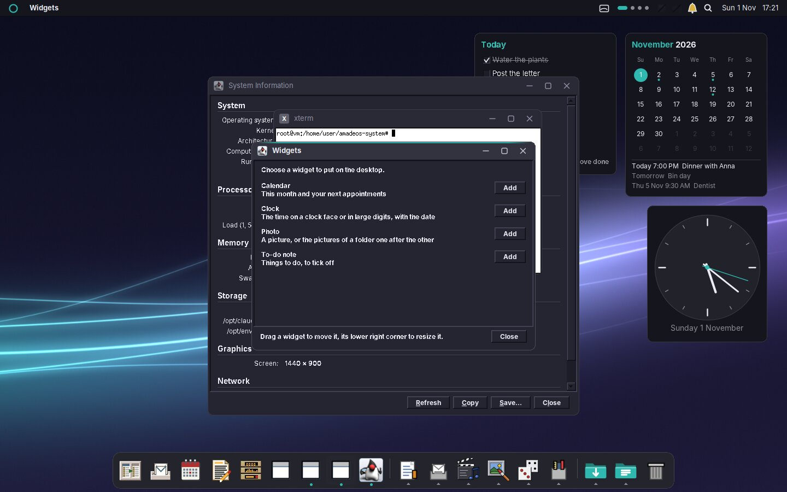

| Widget | What it shows | Its settings |
|---|---|---|
| **Calendar** | This month with today in the accent colour, a dot under every day with an appointment, and your next appointments. A click opens the Calendar (chapter 45). It comes with the Calendar. | How many of the next appointments it lists (0 to 8) |
| **Clock** | The time on a clock face with a second hand, or in large digits, and the date. | Clock face or digits |
| **Photo** | One picture, or the pictures of a folder one after the other. | The picture or folder, and every how many minutes the picture changes |
| **To-do note** | A short list: type a line and press ++enter++, tick off what is done, *Remove done* clears the ticked lines. | The title of the note |

You can add a widget more than once, for example two notes or a photo of each of two folders.

- **Move** a widget by dragging it.
- **Resize** it by dragging its lower right corner.
- The **right mouse button** on a widget opens a menu with *Settings…*, *Add widgets…* and *Remove from desktop*.

The widgets and their places are kept: they are back after the next login. Widgets are a part of Horizon; in the Classic look the desktop shows the minimised windows instead (chapter 23).

## Programs and icons

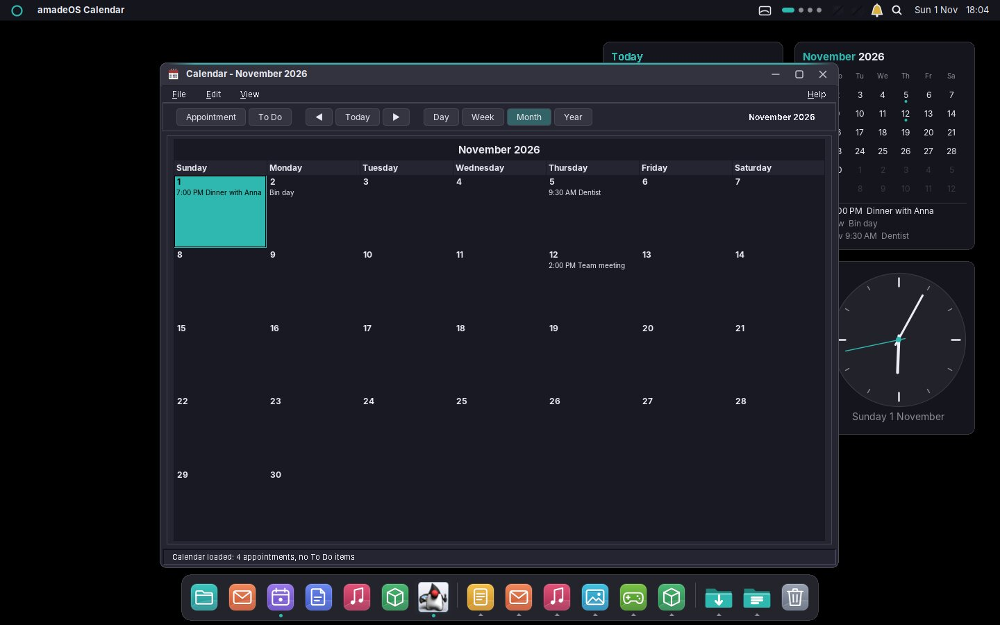

In Horizon the amadeOS programs are flat too. Buttons are rounded and have no bevel; the button that Enter presses is filled with the accent colour. Text fields have a thin frame that turns into a ring in the accent colour while you type in them. Scroll bars are slim and have no arrows, tabs are underlined in the accent colour, and ticked check boxes and radio buttons are filled with it. The text is plain instead of bold. Toolbar buttons show only their icon until the mouse is over them. The programs switch between the flat look and the Motif look together with the desktop, while they run.

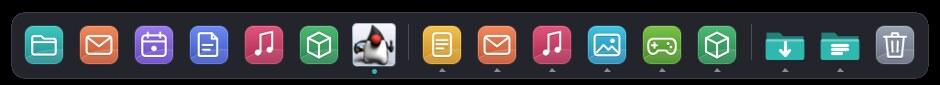

Horizon has its own icons, **amadeOS Horizon**: rounded tiles with a soft horizon for the programs and games, blue folders for the places, and pages with a coloured band for the file types. The dock, the system menu, the search and the File Manager use them. Programs that the set has no icon for keep their NsCDE or their own icon.

Each look keeps its own icon theme. In Horizon, the *Icon theme* list on the Color page (chapter 31) chooses the icons of Horizon; the Classic look keeps NsCDE, or whatever you chose there.

## The window frames

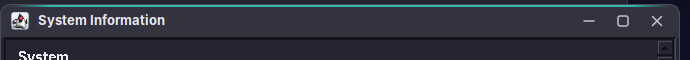

A Horizon frame has a flat title bar in the window's own colour. A thin line in the accent colour runs along the top of the window you are working in; the other windows show their title in grey.

- **The program icon** at the left of the title bar opens the window menu (Restore, Minimise, Maximise, Lower, Close), as the menu button of a classic frame does; a double click on it closes the window.
- **The three symbols at the right** minimise, maximise and close the window. Close turns coral when the mouse is on it.
- **Drag** the title bar to move the window, and drag the thin edge around it to resize it, as in chapter 23.

The corners are rounded with the X Shape extension. Without a compositor the edge is cut pixel by pixel, so the corners look slightly stepped; the soft shadow of other desktops is not there.

!!! planned "Planned: the rest of Horizon"
    Planned next: widgets from more programs (what Audio Station is playing, the newest News); folder icons on the desktop; dragging programs within the dock to reorder them; choosing the look at the login screen. Other programs (Firefox, LibreOffice) keep their own look in Horizon.

!!! info "Under the hood"
    The look is stored in `~/.config/amadeos/look.conf` (`look=horizon`, `scheme=dark`, `accent=teal`); the classic palette stays in `theme.conf`. The top bar, the dock and the search are the package **amadeos-panel-horizon**, one program; the dock's favourites, icon size and parts are in `~/.config/amadeos/dock.conf`. The dock sets `_AMADEOS_DOCK_TAKES_MINIMIZED` on its window, so the window manager gives minimised windows no desktop icon while it runs. The window manager catches ++super+space++ and hands it to the search over a socket in `$XDG_RUNTIME_DIR` (`amadeos-search-_0.socket`); in the Classic look nobody listens there and the key does nothing. The search window carries `_AMADEOS_FRAMELESS`, so the window manager shows it without a frame and gives it the keyboard. `amadeos-session` starts the panel of the look; when the look changes, the running panel ends with exit code 75 and the session starts the other one (chapter 55). Without amadeos-panel-horizon, the Front Panel stays in both looks. ++super+d++ uses the window manager's `_NET_SHOWING_DESKTOP`, the standard way, so other programs can ask for it too. The widgets are one program, **amadeos-widgets**, which the top bar starts; their places are in `~/.config/amadeos/widgets.conf` and the settings of each widget in `~/.config/amadeos/widgets/`. Programs bring their own widgets with a file in `/usr/share/amadeos/widgets/`, as the Calendar does. The Horizon icons are the package **amadeos-icons-horizon** in `/usr/share/icons/amadeos-horizon`, PNG files from 16 to 256 pixels; icons it does not have come from NsCDE and hicolor. Horizon's choice of icon theme is the line `icons=` in `look.conf`; the Classic look's stays in `icon_theme.conf`.
