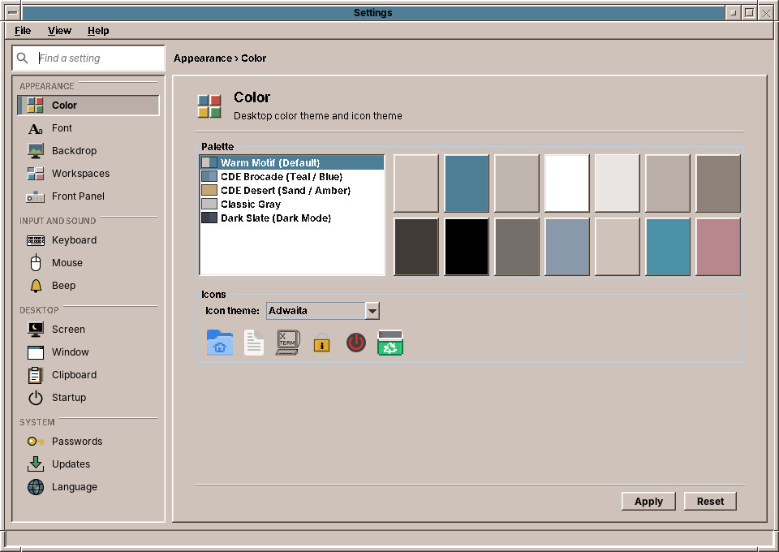
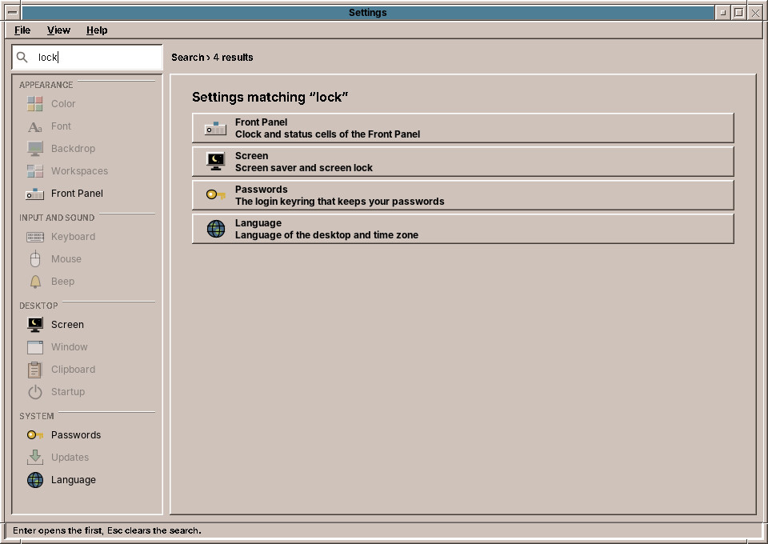
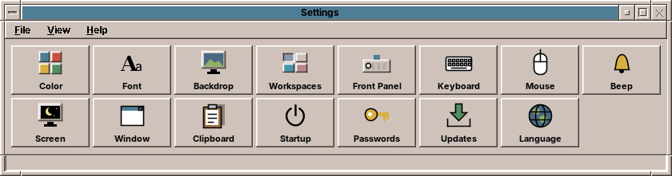
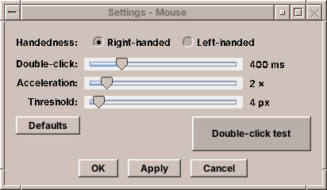

# 30. Settings

**Settings** is where you make the desktop your own: its colours, the size of its text, the picture behind the windows, the names of the workspaces and the Front Panel, how the keyboard, the mouse and the windows behave, the speakers and microphones, the sound of the beep, the resolution of the monitors, the screen saver, sleeping and the battery, the notifications, the clipboard and what starts at login, the network, Bluetooth and the printers, and, for the system, the accounts of the computer, the keyring, the updates, the language and the time zone. It grew out of CDE's Style Manager, and it can still look like it (see *The compact view* below).

## Opening it

- Open the **Tools** drawer of the Front Panel and choose **Settings** (chapter 22),
- or choose **Settings…** in the Workspace Menu (right mouse button on the backdrop, chapter 24),
- or type `amadeos-settings` in a terminal. `amadeos-settings mouse` opens it at the *Mouse* page, and so on for every control; `amadeos-settings proxy` opens the *Proxy* tab of the Network page. The old name `amadeos-style` still works.

## The sidebar

On the left, the controls are grouped by what they set. Click one, or move through them with ++arrow-up++ and ++arrow-down++, and its page appears on the right. The line above the page says where you are, for example *Appearance › Color*.

| Group | Control | What it sets | Chapter |
|---|---|---|---|
| Appearance | **Color** | The colour palette of the desktop and the icon theme | 31 |
| | **Font** | The size of the text | 35 |
| | **Backdrop** | The pattern, picture or colour behind the windows | 32 |
| | **Workspaces** | The names of the four workspaces | 37 |
| | **Front Panel** | The clock and the status cells | 37 |
| Input and Sound | **Keyboard** | Key repeat and key click | 33 |
| | **Mouse** | Left or right hand, double-click speed, acceleration | 33 |
| | **Sound** | Output and input, their volume, a test tone, the profiles of the sound cards | 33 |
| | **Beep** | Volume, tone and length of the beep | 33 |
| Desktop | **Display** | Resolution, refresh rate, rotation and arrangement of the monitors | 39 |
| | **Screen** | Screen saver and screen lock | 34 |
| | **Power** | Screen off, suspend, lid, power button and low battery | 34 |
| | **Window** | How windows get the focus, come to the front and move | 35 |
| | **Notifications** | Where pop-ups appear and for how long, Do not disturb, which programs may show them | 28 |
| | **Clipboard** | The clipboard history, and copies that outlive their program | 36 |
| | **Startup** | Programs and desktop services started at login | 35 |
| Network and Devices | **Network** | Wired network, WLAN and the proxy | 38 |
| | **Bluetooth** | Switching it on, pairing and connecting devices | 38 |
| | **Printers** | Adding printers, the default printer, paper size and two-sided printing | 38 |
| System | **Users and Groups** | The accounts of the computer, administrators, permission groups | 53 |
| | **Passwords** | The login keyring: lock, unlock, change its password | 38 |
| | **Updates** | Automatic security updates, the updates waiting | 38 |
| | **Language** | The language of the desktop and the time zone | 38 |

The pages of the *System* group change things for the whole computer or your keyring; some of them ask for the administrator's password on **Apply**. The pages *Sound*, *Bluetooth*, *Printers* and *Users and Groups* have no *Apply*: what you do there happens at once, as on the network's *Connections* tab.

## Apply and Reset

Each page has two buttons at the bottom:

| Button | What it does |
|---|---|
| **Apply** | Saves and applies the settings of this page. |
| **Reset** | Throws away what you changed on this page since the last *Apply*, and shows the saved settings again. |

You can go to another page before you click *Apply*; your changes wait on their page until you come back. Closing the window forgets the changes that were not applied.

The line at the bottom of the window says what the last *Apply* did, for example *Palette: CDE Desert (Sand / Amber)* or *Mouse applied*.

The settings are yours alone. Another user of the same computer keeps their own colours and backdrop, and your settings come back at every login.

## Finding a setting

Type into the field **Find a setting** at the top left, or press ++ctrl+f++ first. The page shows the controls that match, and the sidebar dims the others. The search knows more than the names: *lock* finds *Screen*, *zoom* finds *Font*, *left-handed* finds *Mouse*, in the language of the desktop.

++enter++ opens the first result, ++esc++ clears the search.

## The compact view

**View → Compact (CDE controls)** turns Settings into the row of buttons of CDE's Style Manager. Each button opens its control in a window of its own:

In that window, **OK** saves, applies and closes; **Apply** saves and applies and leaves the window open; **Cancel** closes it without changing anything. **View → Sidebar** goes back. Settings remembers the view you chose.

**File → Exit** (++ctrl+q++) closes Settings; **Help → About Settings** says what it is for.

!!! cde "CDE heritage"
    CDE's Style Manager, `dtstyle`, was a row of buttons, each opening a small window. That worked for a handful of controls; amadeOS has more to set, so the sidebar groups them and a search finds them. The compact view keeps the CDE row for those who prefer it.

??? hood "Under the hood"
    Settings writes small text files to `~/.config/amadeos/`, one per control: `theme.conf` and `icon_theme.conf` (Color), `font.conf` (Font), `wallpaper.conf` (Backdrop), `input.conf` (Keyboard, Mouse and Beep), `display.conf` (Display), `screen.conf` (Screen), `power.conf` (Power), `window.conf` (Window), `notifications.conf` (Notifications), `clipboard.conf` (Clipboard), `workspaces.conf` (Workspaces), `panel.conf` (Front Panel), `startup.conf` (Startup) and `locale.conf` (Language); the programs started at login are in `~/.config/autostart/`; its own view is kept in `settings.conf`. The desktop and the amadeOS applications watch these files, so a change reaches them at once. Chapter 56 lists all settings files.
