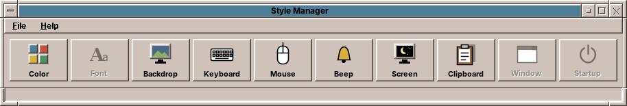

# 30. The Style Manager

The **Style Manager** is where you make the desktop your own: its colours, the picture behind the windows, how the keyboard and mouse react, the sound of the beep and the screen saver. It is the same tool CDE had, with the same row of buttons.

## Opening it

- Open the **Tools** drawer of the Front Panel and choose **Style Manager** (chapter 22),
- or choose **Style Manager…** in the Workspace Menu (right mouse button on the backdrop, chapter 24),
- or type `amadeos-style` in a terminal.

## The buttons

Each button opens one control in a window of its own. Hold the mouse over a button to see what it sets.

| Button | What it sets | Chapter |
|---|---|---|
| **Color** | The colour palette of the desktop and the icon theme | 31 |
| **Font** | Font sizes (planned) | 35 |
| **Backdrop** | The pattern, picture or colour behind the windows | 32 |
| **Keyboard** | Key repeat and key click | 33 |
| **Mouse** | Left or right hand, double-click speed, acceleration | 33 |
| **Beep** | Volume, tone and length of the beep | 33 |
| **Screen** | Screen saver and screen lock | 34 |
| **Window** | Window focus and minimized windows (planned) | 35 |
| **Startup** | What the session restores at login (planned) | 35 |

The grey buttons, *Font*, *Window* and *Startup*, are there because CDE had them; amadeOS does not have them yet.

## OK, Apply and Cancel

Every control has the same three buttons at the bottom:

| Button | What it does |
|---|---|
| **OK** | Saves and applies the settings, and closes the window. |
| **Apply** | Saves and applies the settings; the window stays open, so you can try something else. |
| **Cancel** | Closes the window without changing anything. |

The line at the bottom of the Style Manager says what the last *OK* or *Apply* did, for example *Palette: CDE Desert (Sand / Amber)* or *Mouse applied*.

The settings are yours alone. Another user of the same computer keeps their own colours and backdrop, and your settings come back at every login.

**File → Exit** closes the Style Manager; **Help → About Style Manager** says what it is for.

??? hood "Under the hood"
    The Style Manager writes small text files to `~/.config/amadeos/`, one per control: `theme.conf` and `icon_theme.conf` (Color), `wallpaper.conf` (Backdrop), `input.conf` (Keyboard, Mouse and Beep) and `screen.conf` (Screen). The desktop and the amadeOS applications watch these files, so a change reaches them at once. Chapter 56 lists all settings files.
