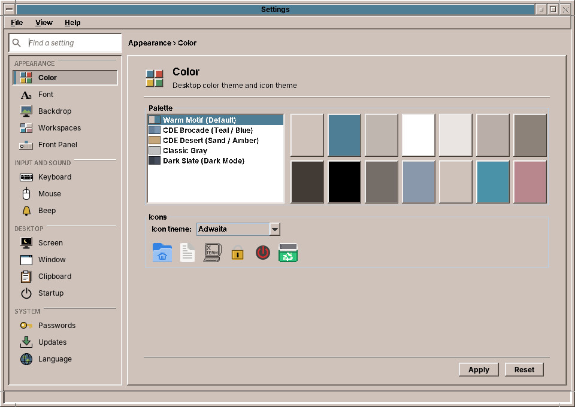
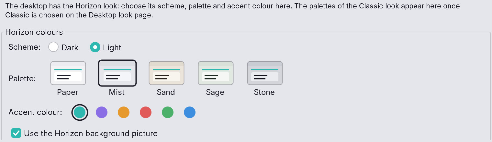
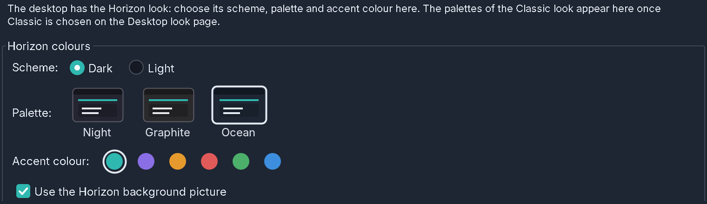

# 31. Color

**Color** chooses the **palette**, the set of colours for the whole desktop: window frames, buttons, menus, the Front Panel, the four workspaces, and every amadeOS application. It also chooses the **icon theme**.

!!! note "Horizon"
    The palettes belong to the Classic look. In the Horizon look (chapter 29) the Color page shows Horizon's colours instead: the **Scheme**, *Dark* or *Light*, the **Palette** of the scheme, the **Accent colour** and **Use the Horizon background picture**, the same controls as on the *Desktop look* page (see *Horizon's palettes* below). Changing them keeps the Horizon look; only the *Desktop look* page switches between Horizon and Classic. The icon theme below is Horizon's (at first amadeOS Horizon), and your palette and your icon theme come back when you switch to Classic again.



## Horizon's palettes

Like the Classic look, Horizon has palettes, a few for each scheme. They change the grey of the windows, the fields and lists, and the top bar and dock; the accent colour stays the one you chose. Each palette is shown as a small window with its name under it; click one, then **Apply**.

| Scheme | Palette | Colours |
|---|---|---|
| Light | *Paper* | The brightest: white fields on a very light grey. Horizon's first light palette and the default. |
| Light | *Mist* | A cool light grey, a step darker than Paper. |
| Light | *Sand* | Warm beige, like recycled paper. |
| Light | *Sage* | A soft grey-green. |
| Light | *Stone* | A medium grey, the darkest of the light palettes, with the strongest contrast. |
| Dark | *Night* | Dark blue-grey. Horizon's first dark palette and the default. |
| Dark | *Graphite* | A neutral dark grey without blue. |
| Dark | *Ocean* | A deep navy blue. |

If the light scheme is too bright for your screen, try *Mist* or *Stone*. Changing the scheme selects that scheme's default palette; your choice comes back when you switch to Classic and to Horizon again.





## The palettes

amadeOS comes with seven palettes:

| Palette | What it looks like |
|---|---|
| **Warm Motif** (the default) | Warm grey with blue-grey title bars, the look of this handbook's pictures. |
| **CDE Brocade** | Teal and blue, close to the default colours of classic CDE. |
| **CDE Desert** | Sand and amber, another of the original CDE palettes. |
| **Classic Gray** | The plain grey of early Motif desktops. |
| **Dark Slate** | A dark palette, for dim rooms and tired eyes. |
| **Halloween** | Dark grey with pumpkin-orange title bars and selections. It goes with the backdrop *halloween.png* (chapter 32). |
| **Christmas** | Pine green with red title bars and selections. It goes with the backdrops *christmas.png* and *christmas-santa.png* (chapter 32). |

Click a palette in the list. The colour chips to the right show its colours; hold the mouse over a chip to see its name and value, such as *Active title #4E7D96*:

- **Base**, the colour of windows and buttons, with **Sunken**, **Shadow** and **Dark shadow** for the 3D edges;
- **Active title** and **Inactive title**, the title bar of the window you work in and of the others;
- **Highlight** and **Soft highlight**, for selected text and list entries;
- **Text** and **Inactive text**;
- **Workspace One** to **Four**, the colours of the workspace buttons in the Front Panel (chapter 24).

Click **Apply**. The window frames, the Front Panel and the open amadeOS applications change at once. Programs that are not part of amadeOS, such as Firefox or LibreOffice, keep their own look.

## The icon theme

Under **Icons**, the *Icon theme* list chooses the icons of the Front Panel, the File Manager and the menus. The row below it shows a few icons of the chosen theme. amadeOS ships the theme **NsCDE**, icons in the style of CDE, and **amadeOS Horizon**, the flat icons of the Horizon look (chapter 29).

## Your own palette

A palette is a small text file. Put it into `~/.config/amadeos/themes/<name>/theme.properties` for yourself, or into `/etc/amadeos/themes/<name>/theme.properties` for all users of the computer, and it appears in the list the next time you open *Color*:

```properties
name=Forest
base=#B8C4A8
activeTitleBg=#4F6B3A
workspace1=#6B8E4E
workspace2=#8E7A4E
workspace3=#4E7A8E
workspace4=#8E4E5C
iconTheme=NsCDE
```

The Halloween palette is such a file too, `/etc/amadeos/themes/halloween/theme.properties`, a good one to copy.

Only `base` is required; amadeOS works out the edges, shadows and other colours from it. Copying the file of a palette that is already there and changing a few values is the easiest way to start.

??? hood "Under the hood"
    The chosen palette is stored in `~/.config/amadeos/theme.conf`, the icon theme in `~/.config/amadeos/icon_theme.conf` (in Horizon: the line `icons=` in `look.conf`). The window manager and the Front Panel also tell each other the palette through a property on the X11 root window, `_AMADEOS_THEME`. Applications built on the amadeOS library *amade-commons* watch `theme.conf` and repaint themselves when it changes.
