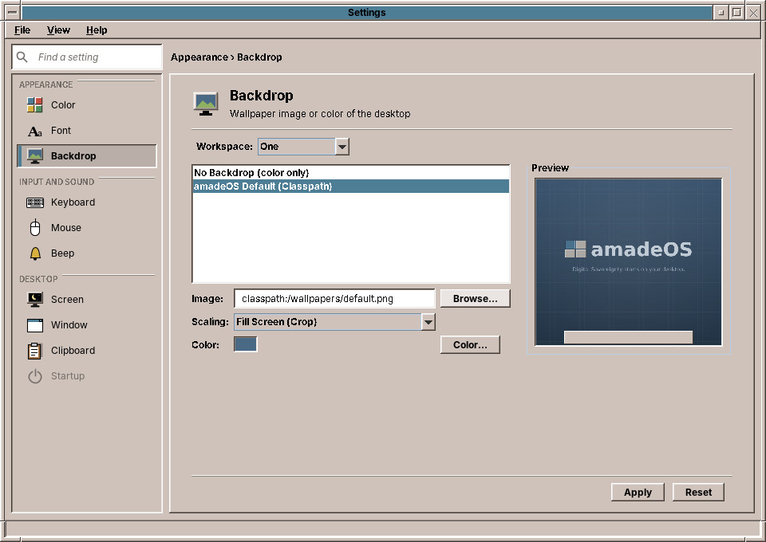

# 32. Backdrop

The **backdrop** is what you see behind the windows. **Backdrop** chooses a CDE pattern, a picture or just a colour, for one workspace or for all four.

## For which workspace

**Workspace** at the top says whose backdrop you are changing. It opens on the workspace you are in, so *Apply* changes the backdrop you see, as in CDE. Choose another workspace to give it a backdrop of its own: the fields below show its backdrop, and *Apply* stores it without changing the screen. You see it the next time you switch to that workspace. The workspaces are listed under the names you gave them (chapter 24).

**All workspaces** gives all four the same backdrop and drops the ones they had of their own.

## Choosing a backdrop

The list on the left offers, from top to bottom:

- **No Backdrop (color only)**: a plain colour, the colour below.
- **amadeOS Default**: the amadeOS picture of a new account.
- **The CDE backdrops**: the 26 patterns of the original CDE, from *Ankh*, *BrickWall* and *Corduroy* to *Pebbles*, *RicePaper*, *SkyDark*, *WaterDrops* and *Wooly*.
- **Your pictures**: the pictures in the folders below.

Click an entry and the **Preview** on the right shows the desktop with it. **Apply** puts it on the screen.

## Your own pictures

**Browse…** next to the *Image* field picks any picture on the computer: PNG and JPEG photos, and the CDE pattern formats `.pm` and `.bm`.

Pictures in these folders appear in the list by themselves:

| Folder | For |
|---|---|
| `~/Pictures/Wallpapers` and `~/Pictures` | Your own pictures |
| `~/.local/share/backgrounds` | Your own pictures |
| `~/.config/amadeos/wallpapers` and `~/.config/amadeos/backdrops` | Your own pictures and patterns |
| `~/.dt/backdrops` | Patterns from an old CDE account |
| `/usr/share/backgrounds` | Pictures for all users of the computer |
| `/usr/share/amadeos/backdrops/cde` | The CDE patterns |

## Scaling

A picture rarely has exactly the size of the screen. **Scaling** decides what happens:

| Scaling | What it does |
|---|---|
| **Fill Screen (Crop)** | Fills the whole screen; the edges of the picture that stick out are cut off. Usually the best for photos. |
| **Fit to Screen (Letterbox)** | Shows the whole picture; bars of the backdrop colour fill the rest. |
| **Stretch to Screen** | Fills the screen exactly, and distorts the picture if its shape is different. |
| **Tile Pattern** | Repeats the picture like tiles. The CDE patterns always tile. |
| **Center (Original Size)** | Puts the picture in the middle at its own size, on the backdrop colour. |

## The colour

**Color…** chooses the backdrop colour: the colour of *No Backdrop*, and of the bars around a picture. The CDE patterns are drawn in shades of this colour, so the same pattern looks quite different in blue, sand or green, just as in CDE.

!!! tip "A backdrop for each workspace"
    Different backdrops make it easy to see at a glance where you are, for example a calm colour for the workspace with your mail and a photo for the one with your games. The workspace buttons in the Front Panel keep their own colours (chapter 31).

??? hood "Under the hood"
    The backdrops are stored in `~/.config/amadeos/wallpaper.conf`: the picture, the scaling and the colour for all workspaces (`wallpaper`, `mode`, `color`), and for each workspace with a backdrop of its own the same three under `workspace.2.` and so on. *Apply* draws the backdrop on the X11 root window, the screen behind all windows, if it belongs to the workspace you are in. The window manager reads the file at every workspace switch, draws each backdrop once and then only swaps them, so switching stays quick.
