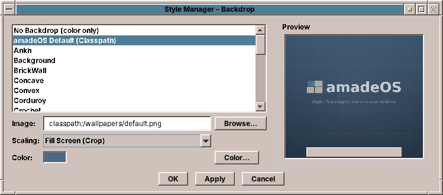

# 32. Backdrop

The **backdrop** is what you see behind the windows. **Backdrop** chooses a CDE pattern, a picture or just a colour.

## Choosing a backdrop

The list on the left offers, from top to bottom:

- **No Backdrop (color only)**: a plain colour, the colour below.
- **amadeOS Default**: the amadeOS picture of a new account.
- **The CDE backdrops**: the 26 patterns of the original CDE, from *Ankh*, *BrickWall* and *Corduroy* to *Pebbles*, *RicePaper*, *SkyDark*, *WaterDrops* and *Wooly*.
- **Your pictures**: the pictures in the folders below.

Click an entry and the **Preview** on the right shows the desktop with it. **Apply** or **OK** puts it on the screen.

## Your own pictures

**Browse…** next to the *Image* field picks any picture on the computer: PNG and JPEG photos, and the CDE pattern formats `.pm` and `.bm`.

Pictures in these folders appear in the list by themselves:

| Folder | For |
|---|---|
| `~/Pictures/Wallpapers` and `~/Pictures` | Your own pictures |
| `~/.local/share/backgrounds` | Your own pictures |
| `~/.config/amadeos/wallpapers` and `~/.config/amadeos/backdrops` | Your own pictures and patterns |
| `~/.dt/backdrops` | Patterns from an old CDE account |
| `/usr/share/backgrounds` | Pictures for all users of the computer |
| `/usr/share/amadeos/backdrops/cde` | The CDE patterns |

## Scaling

A picture rarely has exactly the size of the screen. **Scaling** decides what happens:

| Scaling | What it does |
|---|---|
| **Fill Screen (Crop)** | Fills the whole screen; the edges of the picture that stick out are cut off. Usually the best for photos. |
| **Fit to Screen (Letterbox)** | Shows the whole picture; bars of the backdrop colour fill the rest. |
| **Stretch to Screen** | Fills the screen exactly, and distorts the picture if its shape is different. |
| **Tile Pattern** | Repeats the picture like tiles. The CDE patterns always tile. |
| **Center (Original Size)** | Puts the picture in the middle at its own size, on the backdrop colour. |

## The colour

**Color…** chooses the backdrop colour: the colour of *No Backdrop*, and of the bars around a picture. The CDE patterns are drawn in shades of this colour, so the same pattern looks quite different in blue, sand or green, just as in CDE.

!!! tip "One backdrop for all workspaces"
    The backdrop is the same in all four workspaces. The workspace buttons in the Front Panel keep their own colours (chapter 31).

??? hood "Under the hood"
    The backdrop is stored in `~/.config/amadeos/wallpaper.conf`: the picture, the scaling and the colour. *Apply* draws it on the X11 root window, the screen behind all windows, and the window manager draws it there again at every login.
