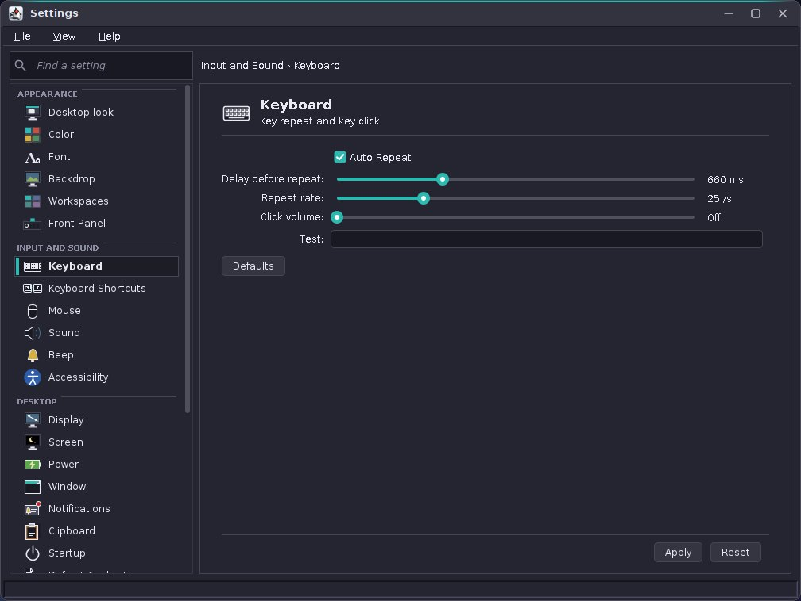
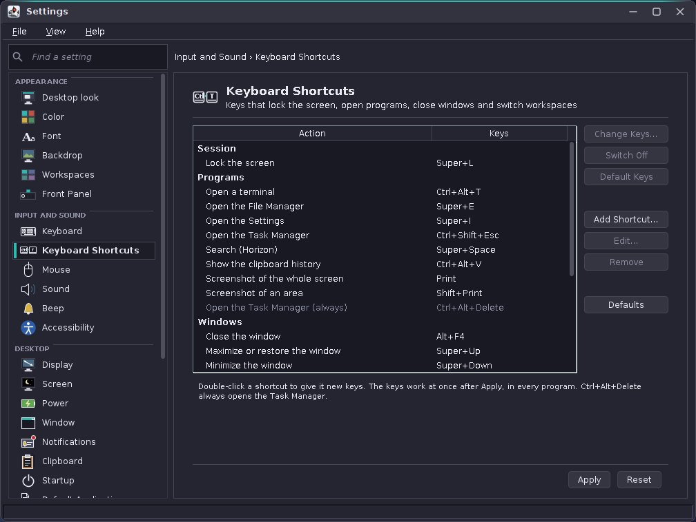
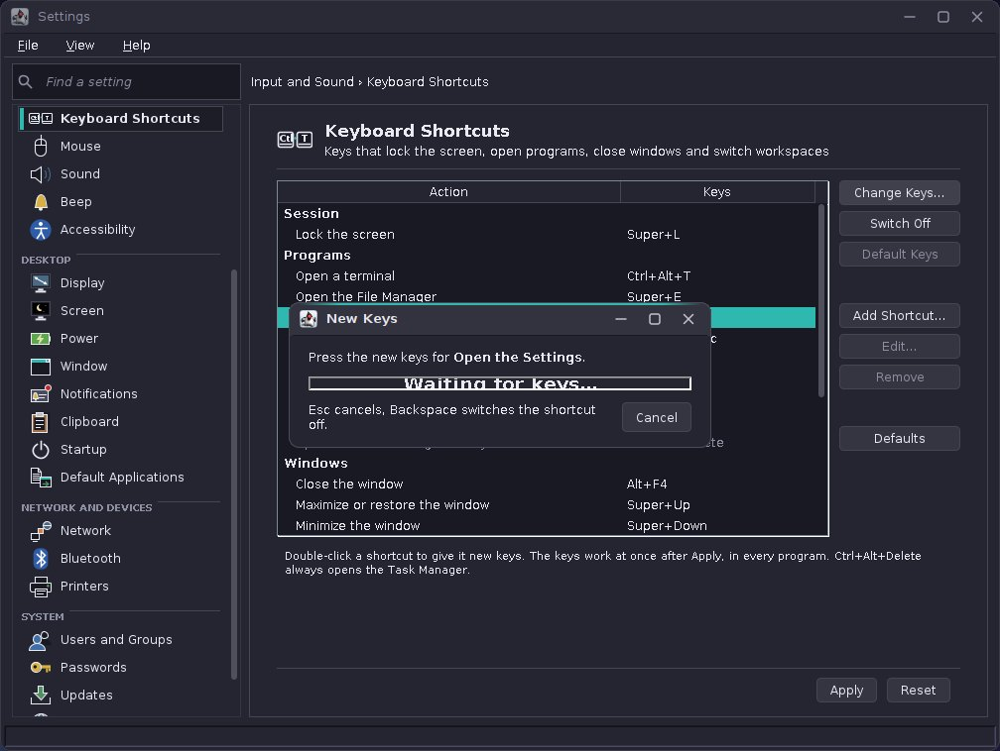
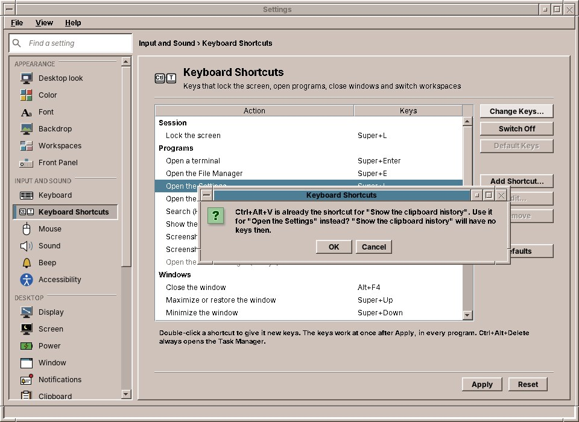
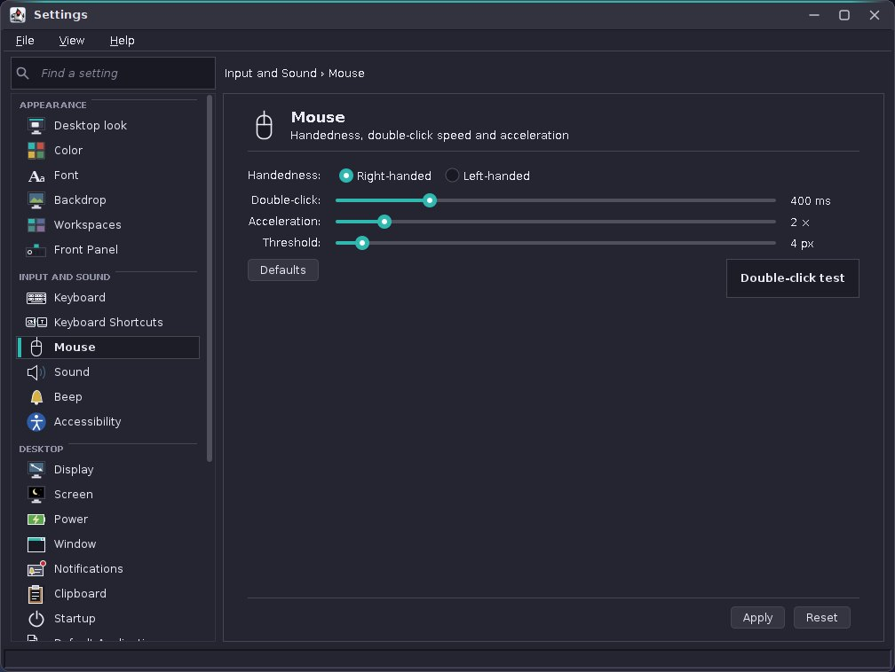
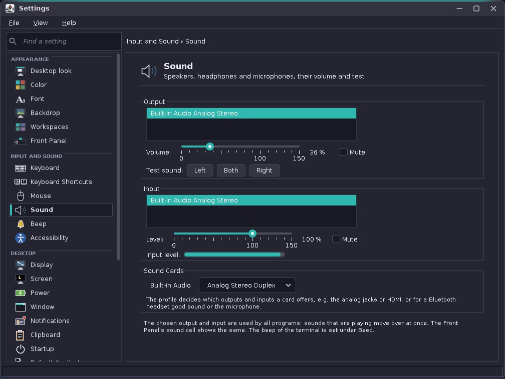
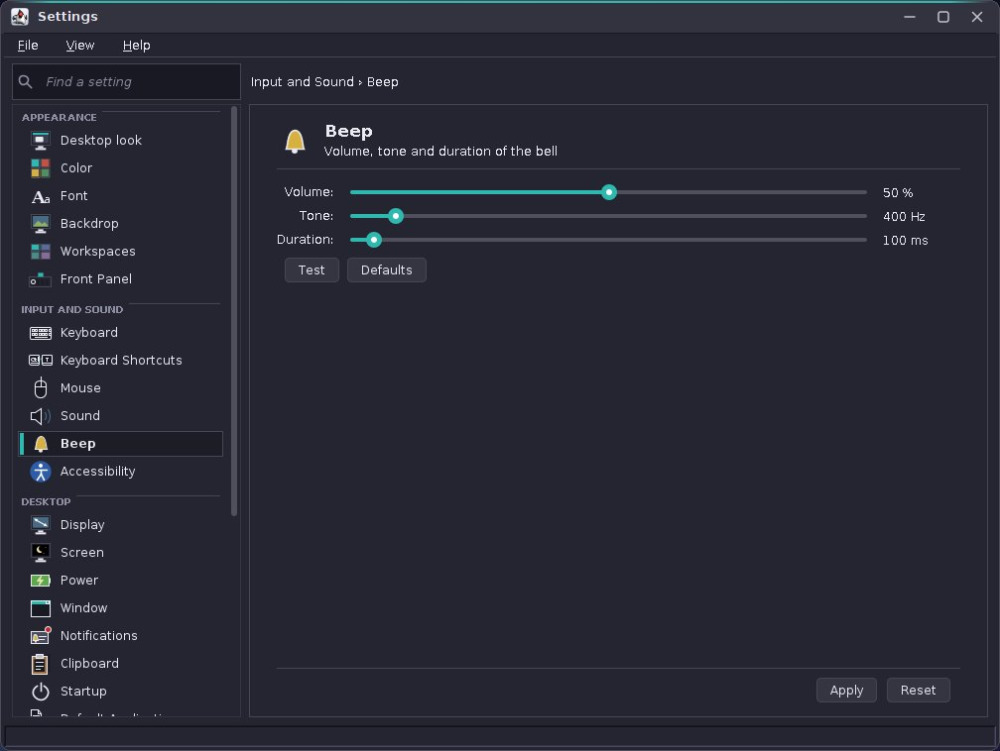
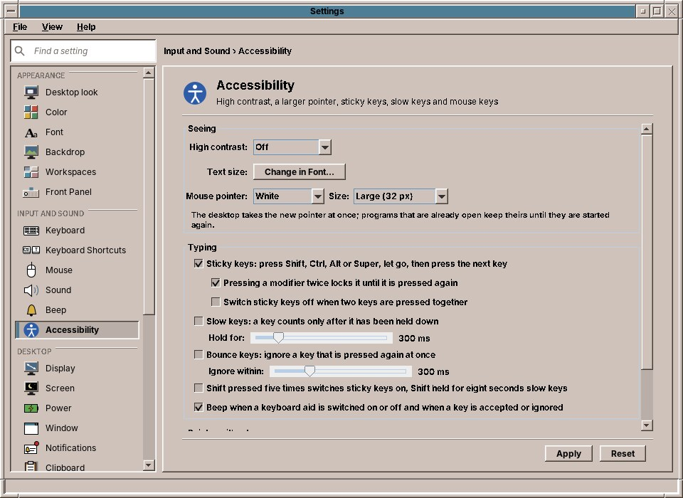
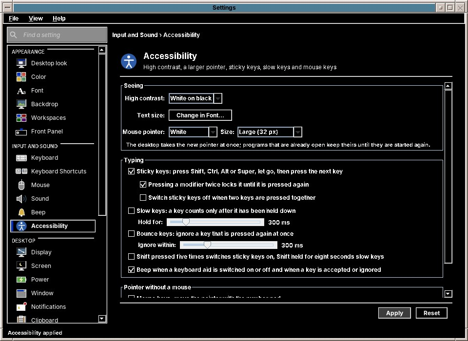

# 33. Keyboard, Mouse, Sound, Beep and Accessibility

The *Input and Sound* group sets how the keyboard and mouse react, which keys do what on the whole desktop, which speakers and microphones the computer uses, how the desktop beeps, and the aids for people who see less well or find typing and the mouse hard. Keyboard, Mouse and Beep each have a **Defaults** button, which puts the values of a new account back on the page; click *Apply* to keep them. The Sound page acts at once.

## Keyboard

| Setting | What it does | Default |
|---|---|---|
| **Auto Repeat** | A key held down types its character again and again. | on |
| **Delay before repeat** | How long you hold a key before it repeats, 100 to 2000 milliseconds. | 660 ms |
| **Repeat rate** | How many characters per second it then types, 1 to 100. | 25 per second |
| **Click volume** | A short click for every key press, 0 % (*Off*) to 100 %. | off |

After *Apply*, try the settings in the **Test** field.

The keyboard **layout**, German, French or another, is not set here: choose it at the login screen (chapter 20) or in the installer (chapter 14).

## Keyboard Shortcuts

**Keyboard Shortcuts** lists the keys of the desktop: keys that work everywhere, whichever program is in front. They are grouped by what they do:

| Group | Shortcut | Keys out of the box |
|---|---|---|
| Session | Lock the screen | ++super+l++ |
| Programs | Open a terminal | ++ctrl+alt+t++ |
| | Open the File Manager | ++super+e++ |
| | Open the Settings | ++super+i++ |
| | Open the Task Manager | ++ctrl+shift+esc++ |
| | Search (Horizon look, chapter 29) | ++super+space++ |
| | Show the clipboard history | ++ctrl+alt+v++ |
| | Screenshot of the whole screen | ++print++ |
| | Screenshot of an area | ++shift+print++ |
| Windows | Close the window | ++alt+f4++ |
| | Maximize or restore the window | ++super+up++ |
| | Minimize the window | ++super+down++ |
| | Show the desktop | ++super+d++ |
| Workspaces | Go to workspace 1 to 4 | ++super+1++ to ++super+4++ |
| | Go to the workspace on the left or right | ++ctrl+alt+left++, ++ctrl+alt+right++ |

++super++ is the key with the Windows logo. The screenshots are saved in your *Pictures* folder; the *Screenshot* program in the Graphics drawer takes them with more choices, such as one window or a delay.

**To give a shortcut other keys**, double-click it, or choose it and click **Change Keys…**. A small window asks for the new keys: press them together, for example ++ctrl+alt+return++. While you hold ++ctrl++ and ++alt++ it shows *Ctrl+Alt+…*, so you can see what it has. ++esc++ on its own cancels, ++backspace++ on its own switches the shortcut off.

If another shortcut has those keys already, Settings asks whether to take them from it; that one is then off. A shortcut needs ++ctrl++, ++alt++ or ++super++, because a plain letter would no longer reach the programs; only the function keys ++f1++ to ++f12++, ++print++ and the special keys of multimedia keyboards (calculator, mail, volume) may be used on their own.

| Button | What it does |
|---|---|
| **Change Keys…** | New keys for the chosen shortcut. |
| **Switch Off** | The shortcut has no keys; the keys go back to the programs. |
| **Default Keys** | The chosen shortcut gets its keys out of the box again. |
| **Add Shortcut…** | A shortcut of your own: a name, a command and then the keys. The command is run like in a terminal, for example `amade-calculator` or `firefox-esr --private-window`. |
| **Edit…** / **Remove** | Changes the name and command of one of your own shortcuts, or removes it. |
| **Defaults** | Every built-in shortcut gets its keys out of the box again; your own shortcuts stay. |

The keys work as soon as you click *Apply*, in every program.

Three keys belong to the desktop and are shown in grey: ++alt+tab++ and ++alt+shift+tab++ switch between the windows (chapter 23), and ++ctrl+alt+del++ always opens the Task Manager (chapter 59), so you can still end a program that hangs when you have changed the other keys.

!!! tip "A shortcut does nothing?"
    Some programs and games take the whole keyboard while they run, for example a game in full screen or a virtual machine; the desktop's keys work again when you leave it. Keys of the programs themselves, such as ++ctrl+c++, are not on this page: a desktop shortcut wins over them, which is why the shortcuts use ++super++ or ++ctrl+alt++.

## Mouse

| Setting | What it does | Default |
|---|---|---|
| **Handedness** | *Left-handed* swaps the left and right mouse buttons. | right-handed |
| **Double-click** | How quickly two clicks must follow each other to count as a double click, 100 to 1500 milliseconds. | 400 ms |
| **Acceleration** | How much faster the pointer moves when you move the mouse quickly, 1× (*None*) to 10×. | 2× |
| **Threshold** | How far, in pixels, the mouse must move at once before the acceleration starts. | 4 px |

The **Double-click test** box opens and closes when you double-click it at the speed set on the slider. If it does not react, move the slider to the right.

!!! tip "Double-click speed"
    Programs read the double-click time when they start. Programs that are already open keep the old one until you start them again.

## Sound

The Sound page has everything of the sound cell (chapter 27) and more room for it. What you choose here takes effect at once, so the page has no *Apply*; the compact view shows only *Close*.

| Part | What it does |
|---|---|
| **Output** | The speakers, headphones, HDMI screens and Bluetooth headphones. Click one to play through it; sounds that are playing move over at once. |
| **Volume** and **Mute** | The volume of the chosen output, up to 150 %. Above 100 % the sound is made louder in software and can distort; use it for quiet laptop speakers. |
| **Test sound** | **Left**, **Both** and **Right** play a short tone on that side, so you can hear whether the speakers are the right way round. |
| **Input** | The microphones, built in, in a webcam or a headset. Click one to record from it. |
| **Level** and **Mute** | How loud the microphone records. |
| **Input level** | A bar that moves while you speak: if it stays still, the microphone hears nothing. |
| **Sound Cards** | The **profile** of each card: which of its outputs and inputs it offers, for example the analog jacks or HDMI. A Bluetooth headset has two: *High Fidelity Playback* for good sound without its microphone, and *Headset* for calls, with the microphone but in telephone quality. |

!!! tip "No sound over HDMI?"
    A screen connected by HDMI plays sound only when the card's profile includes HDMI. Choose a profile with *HDMI* in its name under *Sound Cards*, then the screen under *Output*.

## Beep

The **beep** is the short sound the desktop and the programs make to say no, for example when a key does nothing where you pressed it.

| Setting | What it does | Default |
|---|---|---|
| **Volume** | 0 % (silent) to 100 %. | 50 % |
| **Tone** | From a deep 55 Hz to a high 4000 Hz. | 400 Hz |
| **Duration** | 10 to 2000 milliseconds. | 100 ms |

**Test** plays the beep with the values shown. *Reset* goes back to the saved beep.

## Accessibility

**Accessibility** brings together what helps when the screen is hard to read, or typing and the mouse are hard work.

### Seeing

| Setting | What it does | Default |
|---|---|---|
| **High contrast** | *White on black* or *Black on white*: a colour palette with the strongest contrast, white or black text and a blue or yellow title bar for the active window. *Off* goes back to the palette you had before. | off |
| **Text size** | **Change in Font…** opens the *Font* page (chapter 35), where the text of all programs gets larger. | — |
| **Mouse pointer** | *Classic* is X's black and white arrow. *White* and *Black* are pointers with a clear edge, in three **sizes**: normal (24 pixels), large (32) and very large (48). | Classic |

High contrast is a palette like those on the *Color* page (chapter 31): it stays until you choose another palette there, and the window frames and the Front Panel follow it too.

The desktop shows the new pointer at once. Programs that are already open keep the one they had until you start them again; after logging out and in again everything has the new pointer.

### Typing

These are the keyboard aids of the X server (*AccessX*):

| Setting | What it does | Default |
|---|---|---|
| **Sticky keys** | ++shift++, ++ctrl++, ++alt++ and ++super++ stay pressed until the next key: press ++ctrl++, let go, press ++c++, and that is ++ctrl+c++. Helpful for typing with one hand or with a head pointer. | off |
| … **locks** | Pressed twice, a modifier stays pressed until you press it a third time, for several capitals or shortcuts in a row. | on |
| … **two keys** | Pressing two keys together switches sticky keys off again, for someone else using the computer. | off |
| **Slow keys** | A key counts only after it has been held down for the time set, 50 to 1500 milliseconds. Against keys hit by mistake, for example with a tremor. | off, 300 ms |
| **Bounce keys** | A key pressed again within the time set, 50 to 1000 milliseconds, is ignored. Against doubled letters. | off, 300 ms |
| **Shift gestures** | ++shift++ pressed five times switches sticky keys on, ++shift++ held for eight seconds slow keys, without opening Settings. | off |
| **Beep** | A beep when one of the aids is switched on or off, when a modifier sticks and when slow keys accept or bounce keys ignore a key. | on |

### Pointer without a mouse

**Mouse keys** moves the pointer with the number pad: ++1++ to ++9++ around ++5++ move it in that direction, faster the longer you hold the key; ++5++ clicks; ++slash++, ++asterisk++ and ++minus++ choose the left, middle or right button for the clicks; ++plus++ double-clicks; ++0++ holds the button down for dragging and ++period++ lets it go.

!!! planned "Planned"
    A screen reader and a magnifier. Orca does not read the Java programs of the desktop yet; a magnifier that follows the pointer is a program of its own.

??? hood "Under the hood"
    Keyboard Shortcuts writes `~/.config/amadeos/shortcuts.conf`, only with the keys that differ from the defaults (`terminal=Super+Return`, `search=none` for a shortcut that is off) and your own shortcuts as `custom.1.name`, `custom.1.command` and `custom.1.keys`. The window manager watches the file and grabs the new keys at once (`XGrabKey` on the root window). The window that waits for the new keys takes the whole keyboard for a moment (`XGrabKeyboard`), which is why it can see keys the window manager has grabbed.

    Accessibility writes `~/.config/amadeos/accessibility.conf`. *Apply* and the next login hand the keyboard aids to the X server with `xkbset` (`sticky`, `slowkeys`, `bouncekeys`, `mousekeys`, `accessx`, `feedback`; `xkbset exp` keeps them from switching off after two idle minutes) and the pointer with `xrdb` (`Xcursor.theme`, `Xcursor.size`) and `xsetroot -cursor_name left_ptr`. The white and black pointers are the DMZ cursor themes of the package `dmz-cursor-theme`; the classic pointer is the empty theme `amadeos-classic`, which `amadeos-settings` makes the system's default cursor theme. The high contrast palettes are `/etc/amadeos/themes/high-contrast-dark` and `high-contrast-light`; the palette before is kept in `accessibility.conf`.

??? hood "Under the hood: Keyboard, Mouse, Beep and Sound"
    Keyboard, Mouse and Beep share one file, `~/.config/amadeos/input.conf`. *Apply* hands the settings to the X server with the standard tools `xset` (repeat, click, acceleration, beep), `xmodmap` (handedness) and `xrdb` (double-click time). At login, `/etc/amadeos/autostart.d/10-amadeos-input` runs `amadeos-settings input`, which applies the file again. The Sound page writes no file: it asks PipeWire with `pactl` (`list sinks`, `list sources`, `list cards`) and sets the volume, the default device and the card profile there (`set-sink-volume`, `set-default-sink`, `set-card-profile`), which remembers them for the next login. The test tone is played with `paplay`, the input level is read with `parec`.
