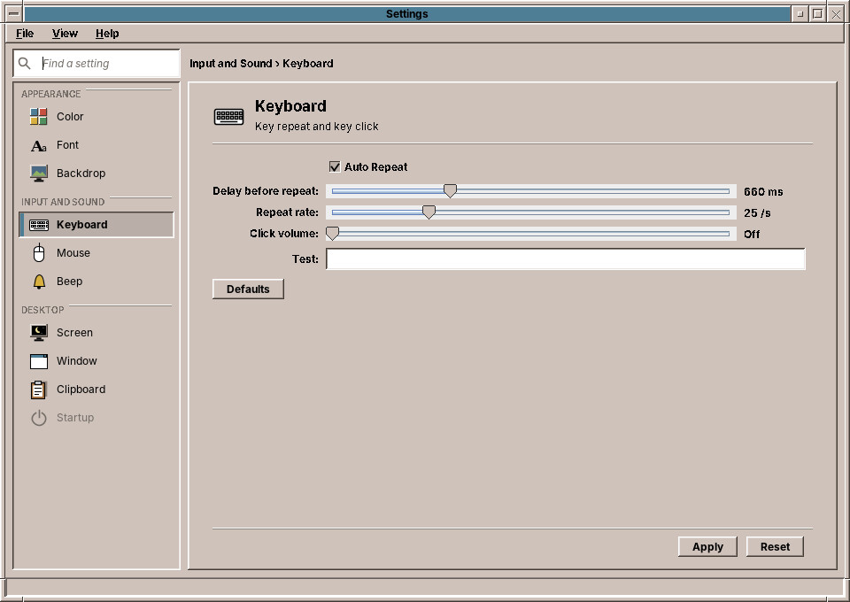
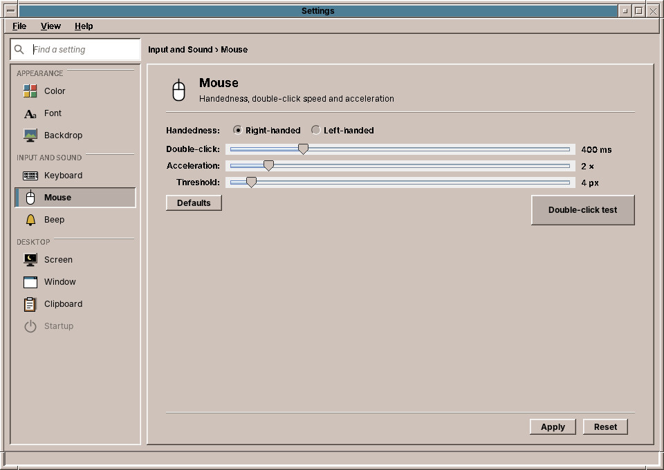
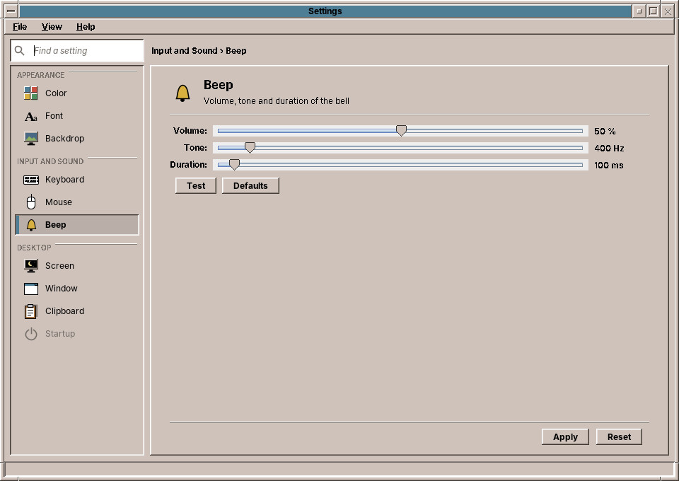

# 33. Keyboard, Mouse, Sound and Beep

The *Input and Sound* group sets how the keyboard and mouse react, which speakers and microphones the computer uses, and how the desktop beeps. Keyboard, Mouse and Beep each have a **Defaults** button, which puts the values of a new account back on the page; click *Apply* to keep them. The Sound page acts at once.

## Keyboard

| Setting | What it does | Default |
|---|---|---|
| **Auto Repeat** | A key held down types its character again and again. | on |
| **Delay before repeat** | How long you hold a key before it repeats, 100 to 2000 milliseconds. | 660 ms |
| **Repeat rate** | How many characters per second it then types, 1 to 100. | 25 per second |
| **Click volume** | A short click for every key press, 0 % (*Off*) to 100 %. | off |

After *Apply*, try the settings in the **Test** field.

The keyboard **layout**, German, French or another, is not set here: choose it at the login screen (chapter 20) or in the installer (chapter 14).

## Mouse

| Setting | What it does | Default |
|---|---|---|
| **Handedness** | *Left-handed* swaps the left and right mouse buttons. | right-handed |
| **Double-click** | How quickly two clicks must follow each other to count as a double click, 100 to 1500 milliseconds. | 400 ms |
| **Acceleration** | How much faster the pointer moves when you move the mouse quickly, 1× (*None*) to 10×. | 2× |
| **Threshold** | How far, in pixels, the mouse must move at once before the acceleration starts. | 4 px |

The **Double-click test** box opens and closes when you double-click it at the speed set on the slider. If it does not react, move the slider to the right.

!!! tip "Double-click speed"
    Programs read the double-click time when they start. Programs that are already open keep the old one until you start them again.

## Sound

The Sound page has everything of the sound cell (chapter 27) and more room for it. What you choose here takes effect at once, so the page has no *Apply*; the compact view shows only *Close*.

| Part | What it does |
|---|---|
| **Output** | The speakers, headphones, HDMI screens and Bluetooth headphones. Click one to play through it; sounds that are playing move over at once. |
| **Volume** and **Mute** | The volume of the chosen output, up to 150 %. Above 100 % the sound is made louder in software and can distort; use it for quiet laptop speakers. |
| **Test sound** | **Left**, **Both** and **Right** play a short tone on that side, so you can hear whether the speakers are the right way round. |
| **Input** | The microphones, built in, in a webcam or a headset. Click one to record from it. |
| **Level** and **Mute** | How loud the microphone records. |
| **Input level** | A bar that moves while you speak: if it stays still, the microphone hears nothing. |
| **Sound Cards** | The **profile** of each card: which of its outputs and inputs it offers, for example the analog jacks or HDMI. A Bluetooth headset has two: *High Fidelity Playback* for good sound without its microphone, and *Headset* for calls, with the microphone but in telephone quality. |

!!! tip "No sound over HDMI?"
    A screen connected by HDMI plays sound only when the card's profile includes HDMI. Choose a profile with *HDMI* in its name under *Sound Cards*, then the screen under *Output*.

## Beep

The **beep** is the short sound the desktop and the programs make to say no, for example when a key does nothing where you pressed it.

| Setting | What it does | Default |
|---|---|---|
| **Volume** | 0 % (silent) to 100 %. | 50 % |
| **Tone** | From a deep 55 Hz to a high 4000 Hz. | 400 Hz |
| **Duration** | 10 to 2000 milliseconds. | 100 ms |

**Test** plays the beep with the values shown. *Reset* goes back to the saved beep.

??? hood "Under the hood"
    Keyboard, Mouse and Beep share one file, `~/.config/amadeos/input.conf`. *Apply* hands the settings to the X server with the standard tools `xset` (repeat, click, acceleration, beep), `xmodmap` (handedness) and `xrdb` (double-click time). At login, `/etc/amadeos/autostart.d/10-amadeos-input` runs `amadeos-settings input`, which applies the file again. The Sound page writes no file: it asks PipeWire with `pactl` (`list sinks`, `list sources`, `list cards`) and sets the volume, the default device and the card profile there (`set-sink-volume`, `set-default-sink`, `set-card-profile`), which remembers them for the next login. The test tone is played with `paplay`, the input level is read with `parec`.
