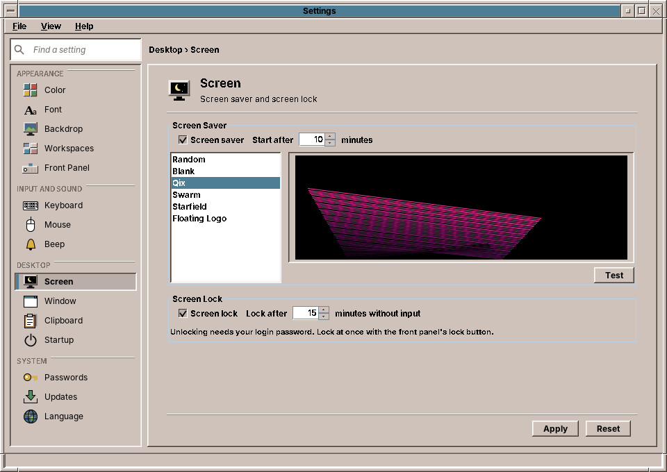

# 34. Screen and Power

**Screen** sets the **screen saver**, the moving picture that appears when you have not used the computer for a while, and the **screen lock**, which closes the screen after a longer time. **Power**, next to it in the sidebar, decides when the screen goes dark and the computer goes to sleep, and what the lid and the power button do. The resolution of the monitors is set in **Display** (chapter 39).

## The screen saver

| Setting | What it does | Default |
|---|---|---|
| **Screen saver** | Switches the screen saver on or off. | on |
| **Start after … minutes** | How long without keyboard or mouse before it starts. | 10 minutes |
| **The list** | Which screen saver it shows. | Qix |

The screen savers:

| Screen saver | What it shows |
|---|---|
| **Random** | A different one of the others each time. |
| **Blank** | A black screen. |
| **Qix** | Coloured lines that bounce across the screen, the classic of the X11 screen savers. |
| **Swarm** | A swarm of bees chasing a wasp, after the old X11 screen saver. |
| **Starfield** | A flight through the stars. |
| **Floating Logo** | The amadeOS logo and the time, drifting slowly across the screen. |

The **preview** to the right of the list runs the chosen screen saver in small. **Test** shows it on the whole screen; any key or mouse click ends it.

The screen saver ends at the next key press or mouse movement and does not ask for a password. That is the lock's job.

## The screen lock

| Setting | What it does | Default |
|---|---|---|
| **Screen lock** | Locks the screen by itself after a time without input. | on |
| **Lock after … minutes without input** | How long before it locks. | 15 minutes |

The lock takes over from a running screen saver. Only your login password opens the screen again (chapter 26). To lock at once, use the padlock in the Front Panel or ++super+l++.

!!! sovereignty "Your data"
    Leave the lock on, especially on a laptop. A screen saver alone only hides the screen; anyone who touches the mouse sees your open windows.

??? hood "Under the hood"
    The settings are stored in `~/.config/amadeos/screen.conf`. The screen saver program of the session, started by `/etc/amadeos/autostart.d/50-amadeos-screen`, asks the X server how long there has been no input, starts the screen saver and the lock at the set times, and reads the file again whenever it changes; there is no need to log in again.

## Power

On a laptop the page has two columns: **On battery** and **Plugged in**. A desktop computer shows only the second one, and only the power button below.

### When the computer is not used

| Setting | What it does | On battery | Plugged in |
|---|---|---|---|
| **Turn the screen off after** | The monitor goes dark; any key or mouse movement turns it on again. | 5 min | 15 min |
| **Suspend after** | The computer goes to sleep (chapter 26). | 15 min | Never |

The time counts from the last key press or mouse movement. A video that is playing keeps the computer awake. If the screen saver is set to start later than the screen goes off, you will not see it.

### Lid and power button

| Setting | Choices | Default |
|---|---|---|
| **When the lid is closed** | Suspend, Hibernate, Lock the screen, Turn the screen off, Do nothing; for each column | Suspend |
| **Do nothing when the lid is closed while an external screen is connected** | Work on the big monitor with the laptop closed | on |
| **When the power button is pressed** | Ask (the EXIT window), Suspend, Hibernate, Shut down, Do nothing | Ask |

While the screen is locked, the power button does nothing; unlock first.

### Low battery

| Setting | What it does | Default |
|---|---|---|
| **Warn at … %** | A notification (chapter 28) asks you to plug the computer in; it stays until you close it, even with Do not disturb on, and a click on it opens this page. | 10 % |
| **At … %** | Then the computer hibernates, suspends, shuts down or does nothing. | 5 %, Hibernate |

Hibernate appears in the lists only where it is set up (chapter 26); otherwise the default is *Shut down*, so that a running-down battery never loses the session halfway.

### Waking up

**Lock the screen when the computer goes to sleep** (on): the computer wakes up behind the screen lock, whatever sent it to sleep: EXIT, the lid, the power button or the idle time. Waking up then needs your login password.

!!! sovereignty "Your data"
    A laptop that is closed and carried away is most at risk. Leave *Lock the screen when the computer goes to sleep* on.

??? hood "Under the hood"
    The settings are stored in `~/.config/amadeos/power.conf`. The same session program that runs the screen saver carries them out: it turns the screen off through the X server's DPMS (`xset`), reads the battery from `/sys/class/power_supply`, and asks systemd-logind to suspend, hibernate or power off. While you are logged in it holds logind's inhibitor locks for the lid (`handle-lid-switch`) and, for a moment before sleeping, for sleep itself, so that the lock is up before the computer sleeps; the window manager takes the power button (`handle-power-key`). `systemd-inhibit --list` shows them. At the login screen logind's own defaults apply.

