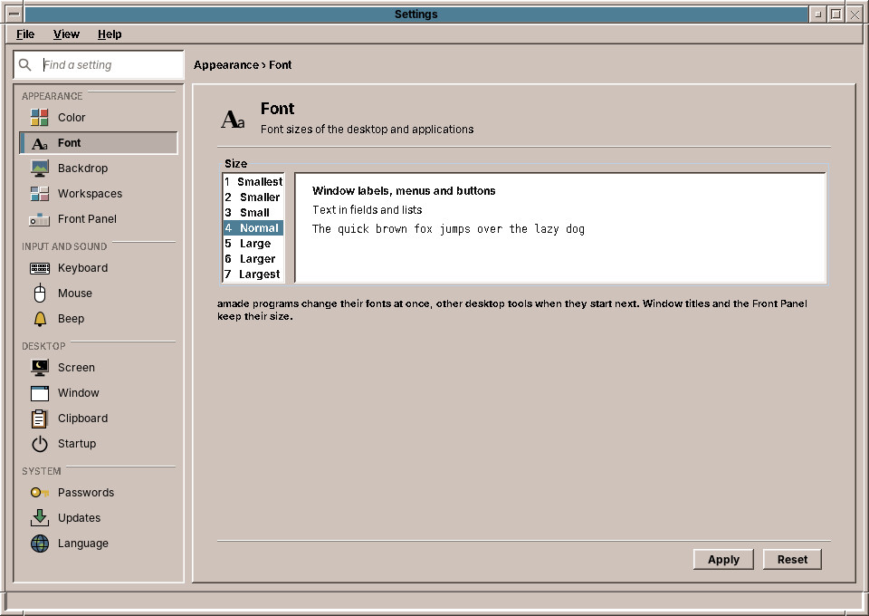
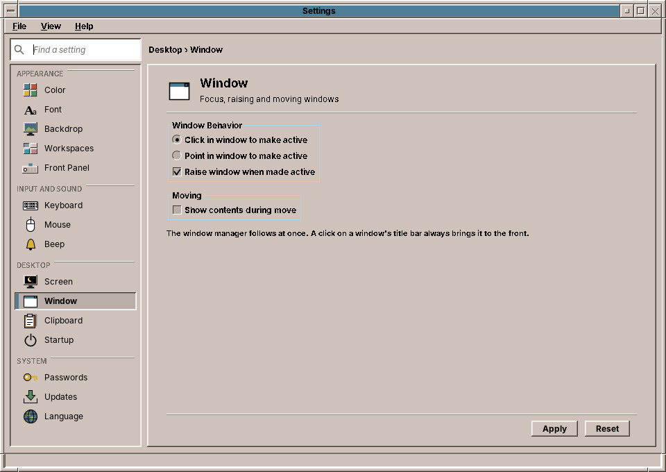
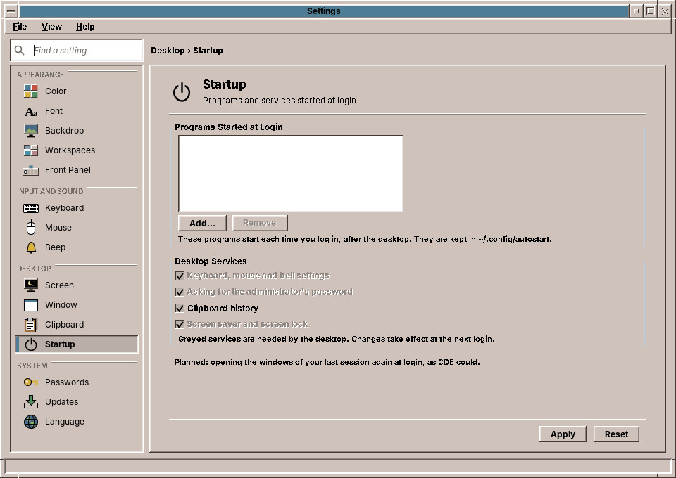

# 35. Font, Window and Startup

**Font** sets the size of the text, **Window** how the windows behave, and **Startup** what starts when you log in: the three controls that CDE's Style Manager had for this.

## Font

The list on the left offers seven sizes, from *1 Smallest* to *7 Largest*; *4 Normal* is the size of a new account. Click a size and the preview on the right shows it at once: the labels, menus and buttons, the text in fields and lists, and a line of fixed-width text as in the Text Editor. Click **Apply** to keep it.

The amadeOS applications change their text at once, even while they are open, and Settings itself does too. Other desktop tools take the new size when they start next. Window titles and the Front Panel keep their size, so the desktop around your work stays the same.

!!! tip "Bigger text in other programs"
    Programs that are not part of amadeOS, such as Firefox or LibreOffice, keep their own text size. Firefox and this handbook zoom with ++ctrl+plus++ and ++ctrl+minus++.

## Window

| Setting | What it does | Default |
|---|---|---|
| **Click in window to make active** | A window gets the keyboard when you click into it. | on |
| **Point in window to make active** | A window gets the keyboard as soon as the mouse pointer moves over it, without a click. Moving the pointer onto the backdrop leaves the last window active. | off |
| **Raise window when made active** | A click into a window also brings it to the front. Without it, a click into a window behind another one gives it the keyboard but leaves it where it is. | on |
| **Show contents during move** | While you drag a window by its title bar, the whole window moves with the mouse. Without it, only an outline moves, and the window follows when you let go, as in CDE. | off |

A click on a window's title bar always brings it to the front, whatever *Raise window* says. The window manager follows a change as soon as you click **Apply**; there is no need to log out.

!!! switching "Coming from Windows or macOS"
    The defaults behave like Windows and macOS: click into a window and it comes to the front with the keyboard. *Point in window to make active* is the classic behaviour of many Unix desktops; try it with *Raise window* switched off, so that a window can be typed into while another one covers part of it.

## Startup

**Programs Started at Login** lists the programs that start each time you log in, after the desktop is ready. **Add…** offers the installed programs; choose one, for example the Mailer, and click **Apply**. **Remove** takes the selected program off the list. A program that has been uninstalled since is skipped at login.

**Desktop Services** are the parts of the desktop that the session starts at login (chapter 55). Clear a check box to leave a service out, for example *Clipboard history* if you do not want one. The grey services are needed by the desktop and always run. Programs can bring their own: Backup & Sync adds *Scheduled backups (Backup & Sync)* (chapter 41). Changes take effect at the next login.

!!! planned "Planned: resuming the last session"
    Opening the windows of your last session again at login, as CDE could. Until then the desktop starts empty, with the programs of the list above.

??? hood "Under the hood"
    The font size is stored as a number from 1 to 7 in `~/.config/amadeos/font.conf`; programs built on *amade-commons* watch the file and scale all the fonts of their Motif look by the same factor, from 75 % to 150 %. The window settings are in `~/.config/amadeos/window.conf` (`focus=click` or `pointer`, `raise.when.active`, `move.contents`), which the window manager watches. Startup keeps a desktop entry (a `.desktop` file) for each program in `~/.config/autostart/`, the folder other desktops use for the same purpose, and the services you switched off in `~/.config/amadeos/startup.conf` (`disabled=40-amadeos-clipboard`).
