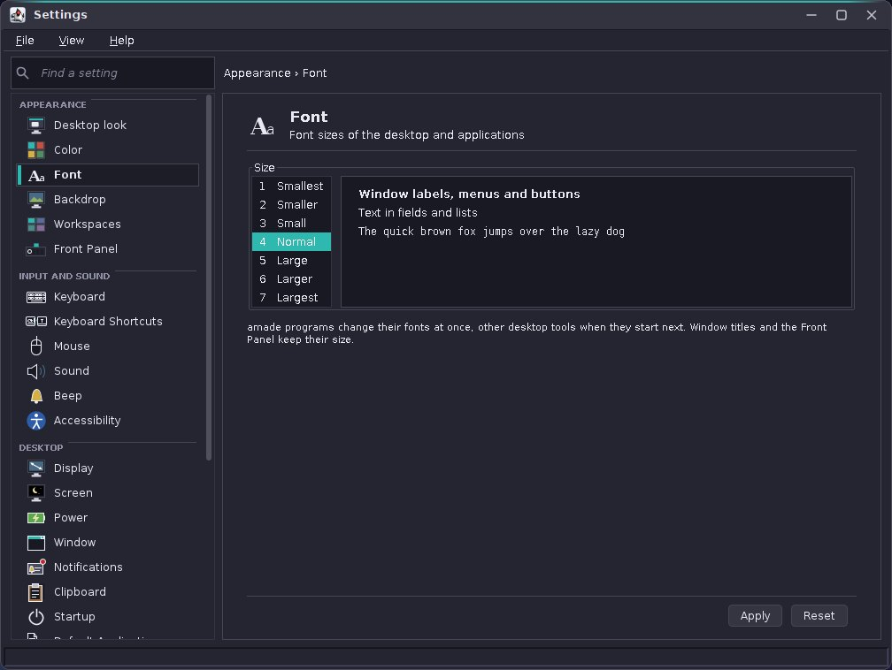
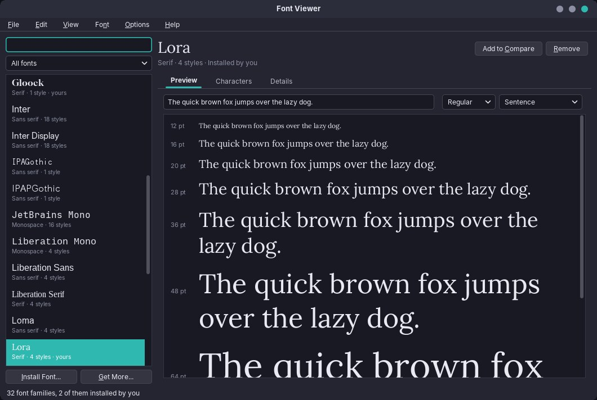
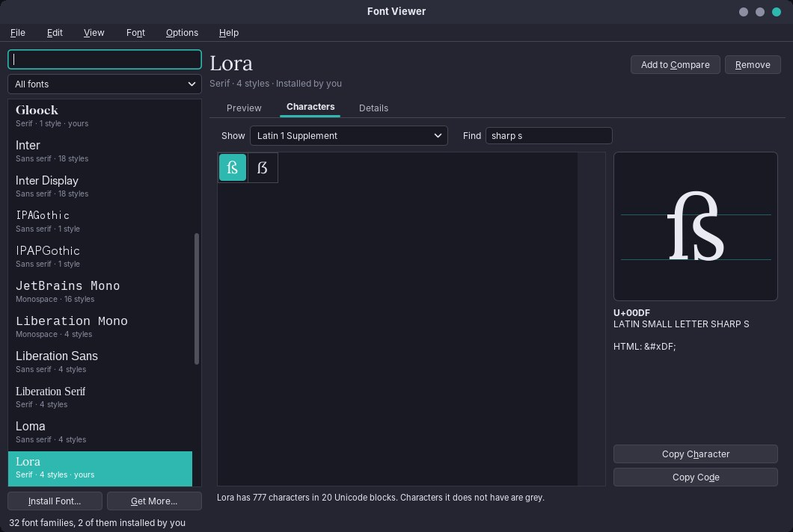
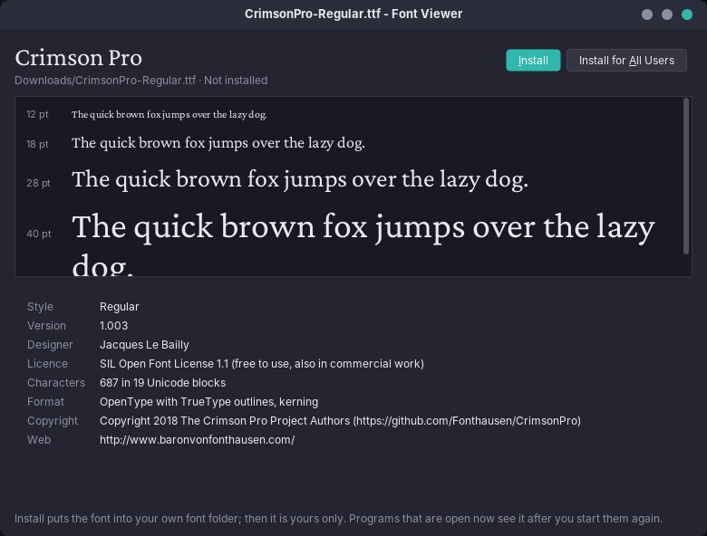
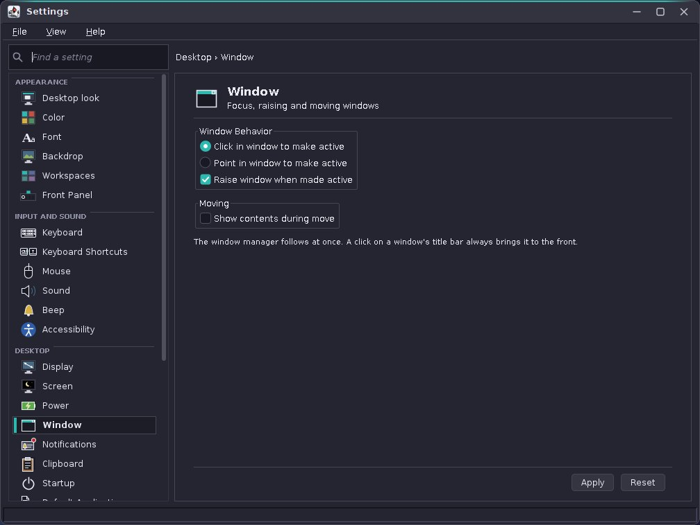
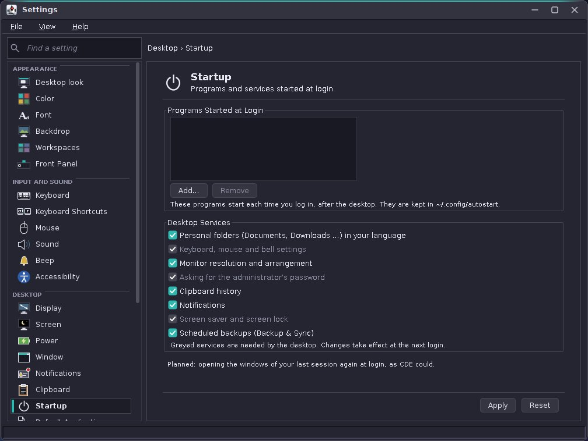

# 35. Font, Font Viewer, Window and Startup

**Font** sets the size of the text, **Window** how the windows behave, and **Startup** what starts when you log in: the three controls that CDE's Style Manager had for this. The **Font Viewer** in the middle of the chapter shows and installs the fonts themselves.

## Font

The list on the left offers seven sizes, from *1 Smallest* to *7 Largest*; *4 Normal* is the size of a new account. Click a size and the preview on the right shows it at once: the labels, menus and buttons, the text in fields and lists, and a line of fixed-width text as in the Text Editor. Click **Apply** to keep it.

The amadeOS applications change their text at once, even while they are open, and Settings itself does too. Other desktop tools take the new size when they start next. Window titles and the Front Panel keep their size, so the desktop around your work stays the same.

!!! tip "Bigger text in other programs"
    Programs that are not part of amadeOS, such as Firefox or LibreOffice, keep their own text size. Firefox and this handbook zoom with ++ctrl+plus++ and ++ctrl+minus++.

**Manage Fonts…** below the sizes opens the Font Viewer, which shows the fonts themselves.

## Font Viewer

The **Font Viewer** shows every font on the computer, lets you try them with your own text, finds a character in them and installs fonts you downloaded. Open it from the **Graphics** drawer, with *Manage Fonts…* on the Font page of Settings, or by double-clicking a font file (`.ttf`, `.otf`, `.ttc`) in the File Manager. In a terminal it is `amade-fontviewer`.

On the left is the list of font families, each name written in its own font. Below the name are its kind (serif, sans serif, monospace, handwriting, display or symbols), the number of styles and *yours* for fonts you installed yourself. Type into the field above the list to find a font by name, and choose *My fonts* or a kind in the box below it. On the right are three pages for the chosen family:

- **Preview** shows a sample text from 12 to 64 points. Type your own text into the field, or choose *Sentence*, *Alphabet*, *Numbers* or *Paragraph*; the style box shows Bold, Italic and the other styles. Your text stays when you click another font, so you can go down the list and compare.
- **Characters** shows all characters of the font by Unicode block; characters the font does not have are grey. Type a name (`sharp s`, `euro`) or a code (`U+00DF`) into *Find*. The chosen character is shown large with its base line, its code and Unicode name; **Copy Character** puts it on the clipboard, **Copy Code** its code.

    

- **Details** lists the styles, the version, the designer, the licence, how many characters and which languages the font covers, its format, where it is installed and, for fonts that came with the system, the program package.

To compare fonts, click **Add to Compare** (++ctrl+d++) for each of them and open *View → Compare Fonts* (++ctrl+k++): up to six fonts one below the other with the same text, each in a style of its own, and one size for all.

### Installing a font

Free fonts come as `.ttf` or `.otf` files, often in a zip file (extract it first, chapter 41). Double-click the font file in the File Manager: a small window shows the font and its details.

- **Install** puts the font into your own font folder (`~/.local/share/fonts`). It is yours only; other users of the computer do not see it.
- **Install for All Users** asks for an administrator's password and puts the font into `/usr/local/share/fonts/amadeos`, for everybody on this computer.

If the font is installed already, the window says so and offers *Show in Font Viewer*. You can also install from the Font Viewer itself with *File → Install Font…* (++ctrl+i++), or by dropping font files on its window.

!!! note "Restart open programs"
    A newly installed font appears at once in the Font Viewer and in programs you start afterwards. Programs that were already open, such as WritePad or LibreOffice, see it after you close and start them again.

**Remove** (or ++delete++) takes one of your own fonts away; it goes to the trash, so you can get it back. Fonts installed for all users are removed the same way, after the administrator's password. Fonts that came with the system belong to a program package and are removed in Software (chapter 51). *File → Get More Fonts…* opens Software with the font packages (their names start with `fonts-`).

!!! tip "Fonts for office documents"
    amadeOS brings free fonts with the same measures as the fonts of Microsoft Office: *Liberation Serif*, *Liberation Sans* and *Liberation Mono* stand in for Times New Roman, Arial and Courier New, *Carlito* for Calibri and *Caladea* for Cambria. A Word or Excel file therefore keeps its line and page breaks in WritePad and LibreOffice. The *Noto* fonts cover the scripts of Europe and most of the world.

!!! switching "Coming from Windows or macOS"
    The Font Viewer is what *Settings → Fonts* is on Windows and *Font Book* on macOS. Fonts in TrueType and OpenType format work the same on all three systems, so a font file you used on Windows installs here as well.

## Window

| Setting | What it does | Default |
|---|---|---|
| **Click in window to make active** | A window gets the keyboard when you click into it. | on |
| **Point in window to make active** | A window gets the keyboard as soon as the mouse pointer moves over it, without a click. Moving the pointer onto the backdrop leaves the last window active. | off |
| **Raise window when made active** | A click into a window also brings it to the front. Without it, a click into a window behind another one gives it the keyboard but leaves it where it is. | on |
| **Show contents during move** | While you drag a window by its title bar, the whole window moves with the mouse. Without it, only an outline moves, and the window follows when you let go, as in CDE. | off |

A click on a window's title bar always brings it to the front, whatever *Raise window* says. The window manager follows a change as soon as you click **Apply**; there is no need to log out.

!!! switching "Coming from Windows or macOS"
    The defaults behave like Windows and macOS: click into a window and it comes to the front with the keyboard. *Point in window to make active* is the classic behaviour of many Unix desktops; try it with *Raise window* switched off, so that a window can be typed into while another one covers part of it.

## Startup

**Programs Started at Login** lists the programs that start each time you log in, after the desktop is ready. **Add…** offers the installed programs; choose one, for example the Mailer, and click **Apply**. **Remove** takes the selected program off the list. A program that has been uninstalled since is skipped at login.

**Desktop Services** are the parts of the desktop that the session starts at login (chapter 55). Clear a check box to leave a service out, for example *Clipboard history* if you do not want one. The grey services are needed by the desktop and always run. Programs can bring their own: Backup & Sync adds *Scheduled backups (Backup & Sync)* (chapter 41). Changes take effect at the next login.

!!! planned "Planned: resuming the last session"
    Opening the windows of your last session again at login, as CDE could. Until then the desktop starts empty, with the programs of the list above.

??? hood "Under the hood"
    The font size is stored as a number from 1 to 7 in `~/.config/amadeos/font.conf`; programs built on *amade-commons* watch the file and scale all the fonts of their Motif look by the same factor, from 75 % to 150 %. The window settings are in `~/.config/amadeos/window.conf` (`focus=click` or `pointer`, `raise.when.active`, `move.contents`), which the window manager watches. Startup keeps a desktop entry (a `.desktop` file) for each program in `~/.config/autostart/`, the folder other desktops use for the same purpose, and the services you switched off in `~/.config/amadeos/startup.conf` (`disabled=40-amadeos-clipboard`).
