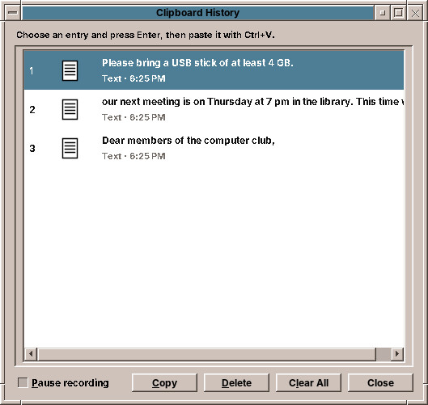
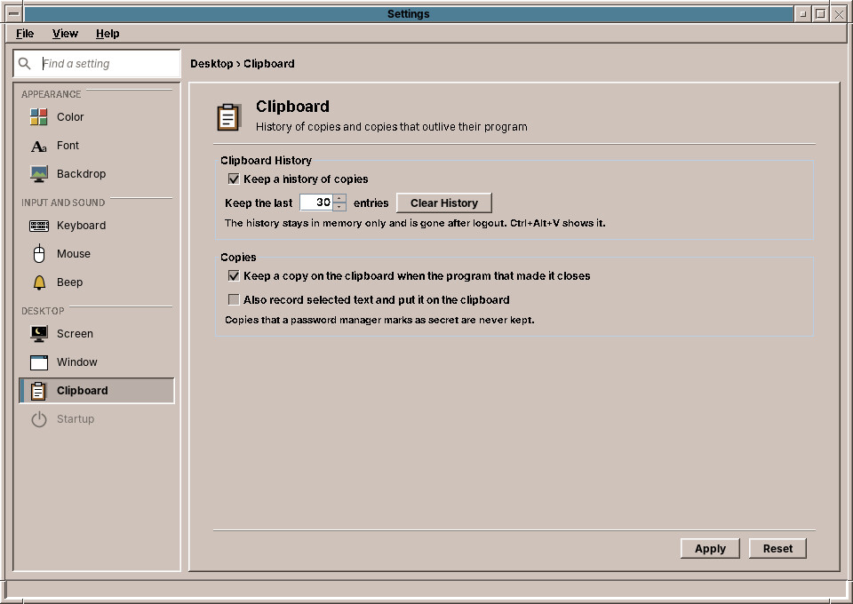

# 36. Clipboard

What you copy with ++ctrl+c++ stays available in amadeOS after you have copied something else, and even after the program you copied from has closed. The **clipboard history** keeps the last copies; the **Clipboard** page of Settings sets how many, and what else the clipboard does.

## The clipboard history

Press ++ctrl+alt+v++, or choose **Clipboard History** in the Tools drawer of the Front Panel. A window lists your last copies, the newest first: texts with their first line, pictures with their size, files with their number, and when you copied them.

To paste an older copy:

1. Choose it with the arrow keys or the mouse, and press ++enter++ (or **Copy**). The digits ++1++ to ++9++ choose the first nine entries directly.
2. The window closes, and the copy is on the clipboard again.
3. Paste it with ++ctrl+v++ where you want it.

| Button | What it does |
|---|---|
| **Copy** | Puts the chosen entry on the clipboard. |
| **Delete** | Removes the chosen entry from the history; the ++delete++ key does the same. |
| **Clear All** | Removes every entry, after a question. |
| **Close** | Closes the window; ++esc++ does the same. |
| **Pause recording** | While ticked, new copies are not kept. Useful before you copy something private. |

## The Clipboard control

Open Settings and click **Clipboard** (chapter 30).

| Setting | What it does |
|---|---|
| **Keep a history of copies** | Turns the history on or off. |
| **Keep the last … entries** | How many copies the history keeps, from 5 to 100; 30 at first. |
| **Clear History** | Forgets everything in the history now. |
| **Keep a copy on the clipboard when the program that made it closes** | Without it, a copy disappears when you close the program you copied from, as on many Linux desktops. With it, the copy stays. |
| **Also record selected text and put it on the clipboard** | Linux has a second clipboard: text you select with the mouse can be pasted with the middle mouse button. With this setting, selected text also goes into the history and onto the normal clipboard. |

*Apply* and *Reset* work as on every page.

!!! switching "Coming from Windows or macOS"
    ++ctrl+alt+v++ is what ++win+v++ is on Windows. macOS has no clipboard history of its own.

!!! sovereignty "Your data"
    The history is kept **in memory only**. It is never written to the disk and is gone when you log out. Copies that a password manager marks as secret are neither recorded nor kept.

??? hood "Under the hood"
    The clipboard manager is part of `amadeos-session` and starts at login (`/etc/amadeos/autostart.d/40-amadeos-clipboard`). It notices every copy through the X extension XFixes and reads it at once. When the program that copied closes, the manager takes the clipboard over, so the copy can still be pasted. The settings are in `~/.config/amadeos/clipboard.conf`; `amadeos-clipboard` opens the history window.
