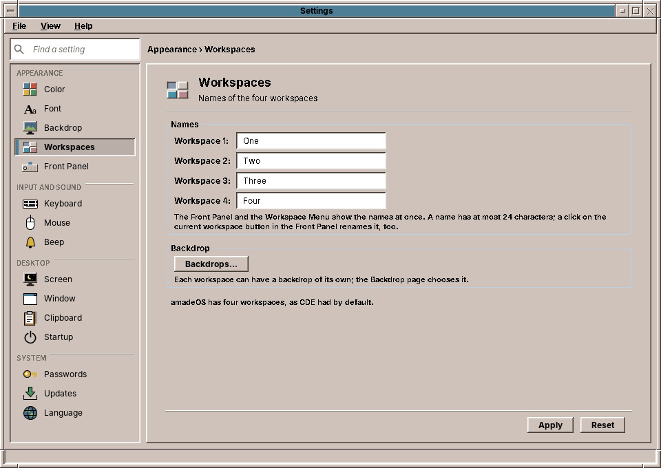
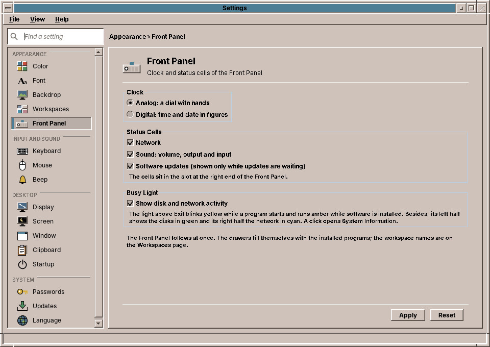

# 37. Workspaces and Front Panel

Two pages of the *Appearance* group set up the parts of the desktop you see all day: **Workspaces** names the four workspaces, **Front Panel** chooses the clock, the status cells and what the busy light shows.

## Workspaces

The four fields hold the names of the workspaces, *One* to *Four* on a new account. Type a name that says what the workspace is for, such as *Mail* or *Letters*, and click **Apply**: the workspace buttons of the Front Panel and the Workspace Menu show the new names at once. A name has at most 24 characters. Empty a field, or type its old default back, and the workspace is called *One*, *Two* and so on again.

This is the same name you get with a click on the current workspace button in the Front Panel (chapter 24); both ways change the same setting.

**Backdrops…** goes to the Backdrop page (chapter 32), where each workspace can get a picture of its own.

!!! planned "Planned: more or fewer workspaces"
    amadeOS has four workspaces, as CDE had by default. Choosing another number is planned.

## Front Panel

| Setting | What it does | Default |
|---|---|---|
| **Analog** | The clock at the left end of the Front Panel is a dial with hands. | on |
| **Digital** | The clock shows the time and the date in figures. | off |
| **Network** | The network cell in the status slot at the right end of the Front Panel (chapter 27). | on |
| **Software updates** | The updates cell, which appears only while updates are waiting (chapter 52). | on |
| **Show disk and network activity** | The busy light above EXIT also shows the disks in green and the network in cyan (chapter 22). When it is off, the light only blinks while a program starts and runs amber while software is installed. | on |

The Front Panel follows a change as soon as you click **Apply**. A right click on the clock still switches between analog and digital, and the page shows that choice the next time you open it.

The drawers of the Front Panel need no setting: they fill themselves with the programs that are installed (chapter 22).

!!! planned "Planned: the Front Panel at another edge"
    The Front Panel sits at the bottom of the screen, as in CDE. Putting it at the top or a side is planned.

??? hood "Under the hood"
    The names are in `~/.config/amadeos/workspaces.conf` (`workspace.2.name=Letters`), the Front Panel settings in `~/.config/amadeos/panel.conf` (`clock=analog` or `digital`, `cell.network`, `cell.updates`, `activity.meter`). The Front Panel watches both files; it publishes the workspace names to the window manager in the root window's `_NET_DESKTOP_NAMES` property.
