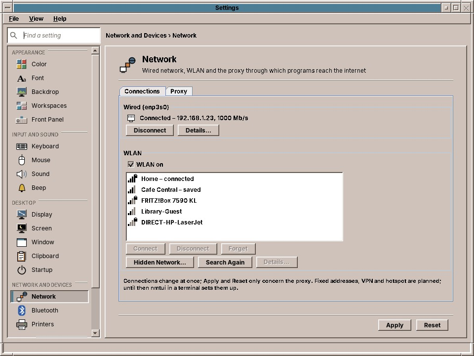
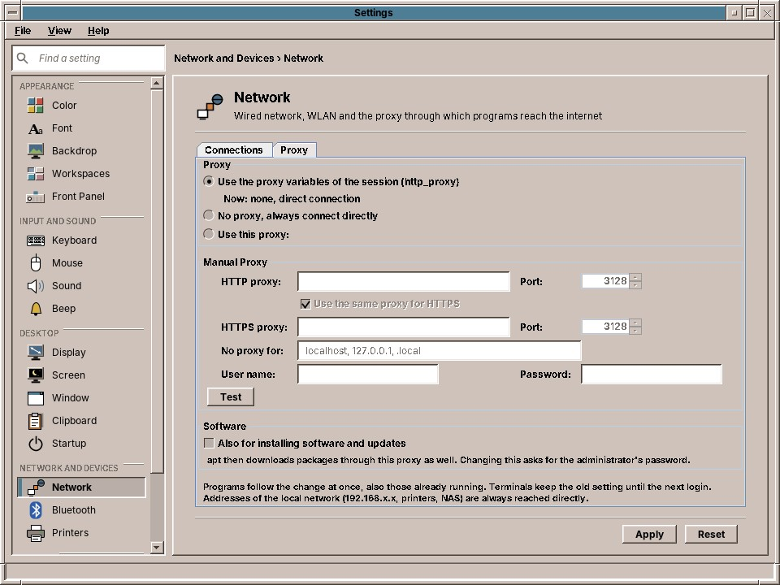

# 38. Network, Devices and System

Two groups of Settings reach below the desktop. *Network and Devices* connects the computer: the wired network and the WLAN with the proxy through which programs reach the internet, the Bluetooth devices and the printers. *System* has the accounts of the computer (chapter 53), the keyring with your passwords, the updates of the system, and the language and time zone.

## Network

The Network page has two tabs: **Connections** for the cable and the WLAN, and **Proxy**.

### Connections

**Wired** shows the network cable: *Connected* with the address and the speed, *No cable plugged in*, or *Not connected*. **Disconnect** and **Connect** switch the wired connection off and on.

**WLAN** lists the networks in reach with their signal strength; a lock means the network has a password. *connected* marks the one in use, *saved* those the computer knows and joins by itself.

| Button | What it does |
|---|---|
| **Connect** | Joins the chosen network. For a protected network you type its password once; amadeOS remembers it. |
| **Disconnect** | Leaves the network. The computer stays off it until you connect again. |
| **Forget** | Deletes the saved password: the computer no longer joins the network by itself. |
| **Hidden Network…** | Joins a network that does not announce its name: type its name (*SSID*) and password. |
| **Search Again** | Looks for networks anew, for example after you switched on a phone's hotspot. |
| **Details…** | The IPv4 and IPv6 addresses, the router (gateway), the name servers (DNS), the hardware address and the speed of the cable or the WLAN. |

**WLAN on** switches the WLAN off, on a plane for example, and on again.

The connections change at once; *Apply* and *Reset* belong to the proxy. Fixed addresses and VPNs are still set up in the terminal program `nmtui` (chapter 54).

### Proxy

In an office, a school or a library the way to the internet often leads through a **proxy**. The Network page sets it once for all of amadeOS: the amade applications (Audio Station, TV, the Mailer, News, the Image Viewer's maps, Software), the programs they start (the video player, `yt-dlp`, the backup), and everything you start from the Front Panel, Firefox and the terminals included.

| Choice | What it means |
|---|---|
| **Use the proxy variables of the session** | The default. Programs use what the variables `http_proxy` and `https_proxy` say, if an administrator set them; the line below shows what they say now. Without them, programs connect directly. |
| **No proxy, always connect directly** | Programs ignore any proxy. |
| **Use this proxy** | The proxy you enter: its name or address and its port, for example `proxy.example.org` and `3128`. Untick **Use the same proxy for HTTPS** if secure connections go through another one. |

**No proxy for** lists the names reached directly, separated by commas: `localhost, .intranet.example.org` reaches every computer whose name ends in `.intranet.example.org` without the proxy. Addresses of your own network, such as a printer at `192.168.1.20`, are always reached directly.

If the proxy asks you to sign in, enter the **user name** and **password**. The password is kept in your login keyring (below), not in a file.

**Test** tries the settings before you apply them: *Works* means the proxy let amadeOS through; otherwise the line says whether the proxy wants a password, refused it, or could not be reached.

**Also for installing software and updates** lets Software and the automatic updates (chapter 52) download through the proxy as well. Clicking **Apply** after changing it, or after changing the proxy while it is ticked, asks for the administrator's password.

Programs follow a change at once, even those already open. Terminals keep the old setting until you log in again.

!!! planned "Planned: automatic configuration"
    Some networks hand out their proxy through an automatic configuration file (PAC or WPAD). amadeOS does not read it yet; enter the proxy by hand.

## Bluetooth

Bluetooth connects headphones, loudspeakers, mice, keyboards, game pads and phones without a cable. Most laptops have Bluetooth; a desktop computer can get it from a small USB stick. Without it, the page says that the computer has no Bluetooth adapter.

**This Computer** switches Bluetooth on and off and names the computer as others see it. Phones that want to find the computer need **Visible to other devices**; it switches itself off after 3 minutes.

**My Devices** are the devices paired with this computer, with their state and, for headphones and mice that tell it, their battery. A paired device connects by itself when you switch it on near the computer. **Connect** and **Disconnect** do it by hand; **Remove** forgets the device, which then has to be paired anew.

To pair a new device:

1. Put the device into pairing mode, usually by holding its Bluetooth or power button until a light blinks. Its manual says how.
2. Click **Search for Devices**. The devices in reach appear under **Other Devices**, by name and an icon for their kind.
3. Choose the device and click **Pair**.
4. Some devices want a confirmation: a phone shows a number, and amadeOS asks *Does Pixel 7 show the number 123456?*. A keyboard asks you to type a number on it and press ++enter++. Older devices want a PIN, often `0000` or `1234`.

Headphones paired and connected appear on the Sound page (chapter 33) and in the sound cell as an output; sound moves to them when you choose them. The **Bluetooth cell** of the Front Panel (chapter 22) shows the connected devices and connects the paired ones with one click.

!!! sovereignty "Your data"
    Visible or not, the computer only pairs with a device you chose on this page. A paired device is trusted: it may connect again by itself, so remove a device you give away.

## Printers

The page lists the printers with their state, model, location and the jobs waiting; the default printer, the one programs offer first, says *(default)*. Most printers need nothing from you: a printer that can print without a driver (IPP Everywhere, AirPrint) appears by itself when it is switched on in your network or connected by USB.

| Button | What it does |
|---|---|
| **Add…** | Searches the network and the USB ports for printers that print without a driver and lists them. Choose one, or type its address under **Or by Address**, such as `192.168.1.40` or `printer.local`; give it a name and a location, and **Add**. |
| **Remove** | Removes the printer. Jobs waiting for it are cancelled. |
| **Make Default** | Makes it the default printer. |
| **Print Test Page** | Prints a page to check the printer. |
| **Print Queue…** | Opens the Print Manager with the jobs (chapter 54). |

Under **Defaults of** the chosen printer, set the **paper size** and **two-sided** printing (*Long edge* for pages to turn like a book, *Short edge* like a calendar) and **Save Defaults**. Programs start with these settings and can change them for one job in their print dialog.

An older printer that needs a driver is added in the administration pages of CUPS (chapter 54).

## Users and Groups

The accounts of everyone who uses the computer, who is an administrator, and the groups that give permissions such as managing printers. The page is described in chapter 53.

## Passwords

Programs such as the Mailer keep their passwords in your **login keyring** (chapter 58). The page shows whether the keyring is **unlocked** or **locked**, and how many passwords and keys it holds.

| Button | What it does |
|---|---|
| **Lock Now** | Locks the keyring. Programs can no longer read their passwords; the next one that needs a password asks you again. |
| **Unlock…** | Asks for the keyring's password and unlocks it. |
| **Change Password…** | Asks for the current password and a new one, twice. |

The login screen unlocks the keyring with your login password, as long as both passwords are the same. When you change your login password on the *Users and Groups* page (chapter 53), the keyring changes with it. If you changed it some other way, change the keyring's to the same one here; otherwise the keyring stays locked after the next login, and you unlock it on this page.

If the page says that no keyring is running, the session was started without GNOME Keyring; programs then ask for their passwords each time.

## Updates

**Install security updates automatically** is the same switch as *Software → Settings…* (chapter 52): turned on, amadeOS installs security updates once a day in the background, and other updates wait for you. Clicking **Apply** after changing it asks for the administrator's password.

Below, the page shows when the package lists were last checked and how many updates are waiting, and how many of them are security updates. **Open Software…** opens Software at its *Updates* tab, where you install them.

## Language

**Language of the desktop** is the language of the menus and windows: English, Deutsch, Français, Español or Italiano. It is the same choice as the language button of the Front Panel and the login screen (chapter 25). Programs started after **Apply** speak the new language; the Front Panel, the window manager and the terminals follow at the next login.

**Time zone** sets the time zone of the computer's clock. The time zone holds for all users of the computer, so **Apply** asks for the administrator's password.

!!! planned "Planned: formats of their own"
    Dates, times and numbers follow the language of the desktop. Choosing their format separately, for example English texts with German dates, is planned.

??? hood "Under the hood"
    The *Connections* tab asks NetworkManager with `nmcli` (`device status`, `device wifi list`, `device show`) and changes connections with `nmcli device connect` and `nmcli device wifi connect`, which members of the group `netdev` may do without a password. The Bluetooth page speaks with the Bluetooth service `bluetoothd` (BlueZ) over the system bus, and answers the pairing questions as its agent; the user needs to be in the group `bluetooth`. The Printers page speaks IPP to CUPS like the Print Manager, finds printers with `lpinfo`, adds them with `lpadmin -m everywhere` (members of the group `lpadmin` may) and saves the defaults with `lpadmin -o`. The Proxy tab writes `~/.config/amadeos/proxy.conf`; the password is in the keyring under `service amadeos account proxy`. The amade applications follow the file at once. At login the session turns it into the variables `http_proxy`, `https_proxy` and `no_proxy` (`/usr/libexec/amadeos-proxy-env`), and programs started from the desktop get them as they are at that moment. For apt, `/usr/libexec/amadeos-packages proxy` writes `/etc/apt/apt.conf.d/80amadeos-proxy`, which only root can read. The Passwords page talks to the keyring over the freedesktop.org Secret Service on the session bus; locking and unlocking use GNOME Keyring's own interface for its master password. The Updates page reads the same state as the updates cell and writes the automatic setting through `/usr/libexec/amadeos-packages` and `pkexec`. The language is written to `~/.config/amadeos/locale.conf`; the time zone is set with `timedatectl set-timezone`, which polkit allows to administrators.
