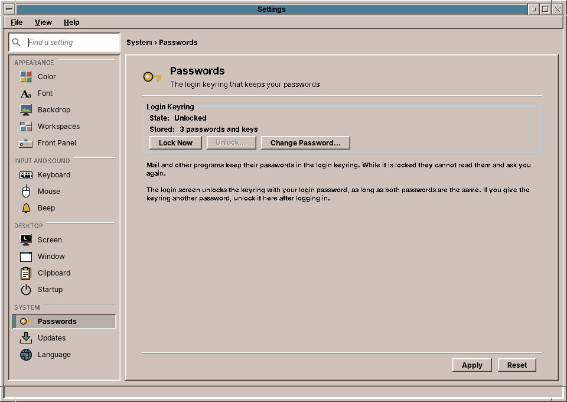
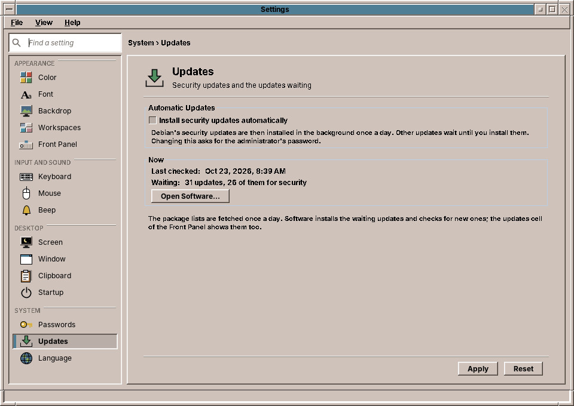
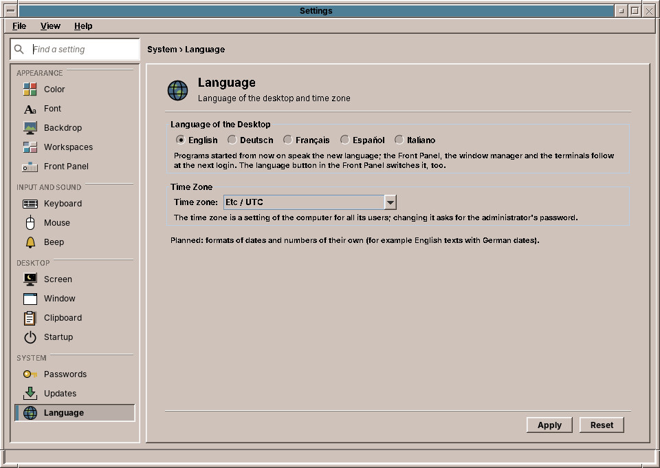

# 38. Passwords, Updates and Language

The *System* group of Settings has the settings that reach below the desktop: the keyring with your passwords, the updates of the system, and the language and time zone.

## Passwords

Programs such as the Mailer keep their passwords in your **login keyring** (chapter 58). The page shows whether the keyring is **unlocked** or **locked**, and how many passwords and keys it holds.

| Button | What it does |
|---|---|
| **Lock Now** | Locks the keyring. Programs can no longer read their passwords; the next one that needs a password asks you again. |
| **Unlock…** | Asks for the keyring's password and unlocks it. |
| **Change Password…** | Asks for the current password and a new one, twice. |

The login screen unlocks the keyring with your login password, as long as both passwords are the same. When you change your login password, change the keyring's to the same one here; otherwise the keyring stays locked after the next login, and you unlock it on this page.

If the page says that no keyring is running, the session was started without GNOME Keyring; programs then ask for their passwords each time.

## Updates

**Install security updates automatically** is the same switch as *Software → Settings…* (chapter 52): turned on, amadeOS installs security updates once a day in the background, and other updates wait for you. Clicking **Apply** after changing it asks for the administrator's password.

Below, the page shows when the package lists were last checked and how many updates are waiting, and how many of them are security updates. **Open Software…** opens Software at its *Updates* tab, where you install them.

## Language

**Language of the desktop** is the language of the menus and windows: English, Deutsch, Français, Español or Italiano. It is the same choice as the language button of the Front Panel and the login screen (chapter 25). Programs started after **Apply** speak the new language; the Front Panel, the window manager and the terminals follow at the next login.

**Time zone** sets the time zone of the computer's clock. The time zone holds for all users of the computer, so **Apply** asks for the administrator's password.

!!! planned "Planned: formats of their own"
    Dates, times and numbers follow the language of the desktop. Choosing their format separately, for example English texts with German dates, is planned.

??? hood "Under the hood"
    The Passwords page talks to the keyring over the freedesktop.org Secret Service on the session bus; locking and unlocking use GNOME Keyring's own interface for its master password. The Updates page reads the same state as the updates cell and writes the automatic setting through `/usr/libexec/amadeos-packages` and `pkexec`. The language is written to `~/.config/amadeos/locale.conf`; the time zone is set with `timedatectl set-timezone`, which polkit allows to administrators.
