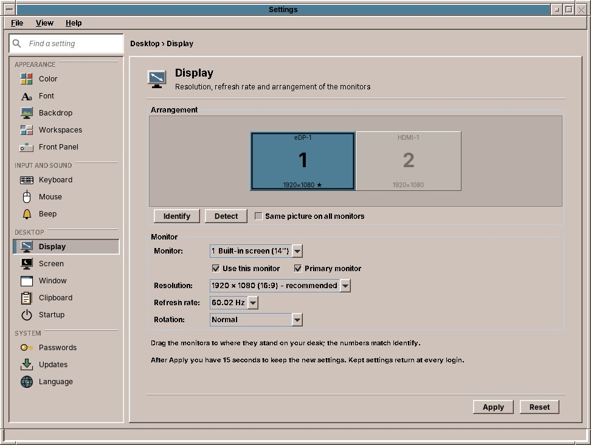
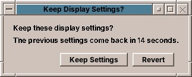

# 39. Display

**Display** sets your monitors: the **resolution** (how many dots the picture has), the **refresh rate**, whether a monitor is **turned** on its side, and, with more than one monitor, which ones are on and **where they stand** next to each other. Don't mix it up with **Screen** (chapter 34), which sets the screen saver and the lock.

## The arrangement

The grey area at the top shows each monitor that is on as a box with its number, its connector (such as *HDMI-1*) and its resolution; a ★ marks the primary monitor. Click a box to choose that monitor for the settings below it.

With two or more monitors, drag a box to where the monitor stands on your desk: to the right of the other, to its left, above or below it. When you let go, the box snaps to the edge of its neighbour, so the mouse moves from one monitor to the other without a gap.

| Button | What it does |
|---|---|
| **Identify** | Shows each monitor's number on the monitor itself for three seconds, so you know which box is which. |
| **Detect** | Looks for monitors again, for example after you have plugged one in. |
| **Same picture on all monitors** | Shows the same desktop on every monitor, at the largest resolution all of them can show. Handy for a projector. |

## One monitor

| Setting | What it does |
|---|---|
| **Monitor** | Which monitor the settings below are for. The built-in screen of a laptop is called *Built-in screen*; its size in inches follows when the monitor reports it. |
| **Use this monitor** | Switches the monitor on or off. The last monitor that is on stays on. |
| **Primary monitor** | The monitor the desktop counts as the main one. |
| **Resolution** | The resolutions the monitor offers, largest first, with the aspect ratio. *recommended* marks the one the monitor asks for; it gives the sharpest picture. |
| **Refresh rate** | How often per second the picture is drawn. Most monitors want 60 Hz; some offer more. |
| **Rotation** | *Normal*, *Turned left* or *Turned right* for a monitor standing upright (portrait), or *Upside down*. |

## Apply, and keep or revert

**Apply** sets the new settings at once. Then this question appears:

Click **Keep Settings** if the picture looks right. If it does not, because the monitor shows nothing or the picture is garbled, simply wait: after 15 seconds the previous settings come back by themselves. **Revert** brings them back at once.

Settings you keep come back at every login. They are kept separately for each set of monitors: a laptop remembers one arrangement for the desk with its external monitor and another for the road, and uses the right one when you log in.

The desktop follows a new resolution at once: the backdrop is drawn anew, the Front Panel moves to the bottom of the new screen, maximized windows fill it, and other windows move back onto it if they would lie outside.

!!! tip "Text too small at a high resolution?"
    A high resolution makes everything smaller. Rather than lowering it, which makes the picture less sharp, make the text bigger with **Font** (chapter 35).

!!! warning "Planned"
    For now all monitors together form one large desktop: a maximized window covers all of them, and the Front Panel sits in the middle of the whole width. Maximizing on one monitor and the Front Panel on the primary monitor come later. The login screen always uses the monitors' own settings.

??? hood "Under the hood"
    The page asks `xrandr --query` for the monitors and sets a new arrangement with one `xrandr` call. Kept settings are stored in `~/.config/amadeos/display.conf`, one line per monitor under the names of the connected monitors, for example `eDP-1+HDMI-1.HDMI-1=1920x1080 60.00 1920 0 normal primary`. At login, `/etc/amadeos/autostart.d/15-amadeos-display` runs `amadeos-settings display-apply`, which sets the arrangement kept for the monitors connected now and does nothing if none was kept. To start from the monitors' own settings again, delete `display.conf` and log in again.
