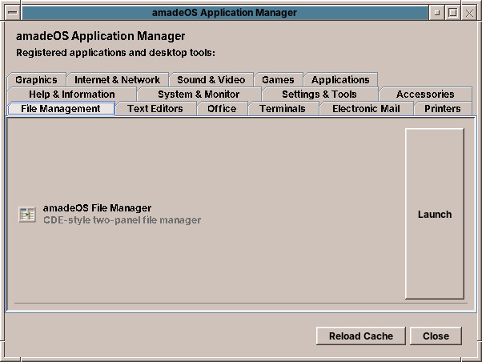

# 40. Applications at a Glance

amadeOS comes with its own set of programs, the **amade applications**, written in Java for this desktop. Next to them are two well-known programs from the wider free software world: **Firefox** for the web and **LibreOffice Writer** for documents that need more than WritePad offers.

| Program | What it is for | Front Panel | Chapter |
|---|---|---|---|
| **File Manager** | Folders and files, in two panels | File Manager | 41 |
| **Text Editor** | Plain text: notes, lists, configuration files | Text & Office | 42 |
| **WritePad** | Letters and documents on real pages, ODT and Word | Text & Office | 43 |
| **LibreOffice Writer** | The full office word processor | Text & Office | 43 |
| **Mailer** | E-mail from one or more accounts | Mail & Internet | 44 |
| **Calendar** | Appointments, reminders and To Do items | Calendar | 45 |
| **Audio Station** | Audio CDs, music files and internet radio | Sound & Video | 46 |
| **Video Player** | Video files, streams and DVDs | Sound & Video | 46 |
| **Image Scan** | Scanning photos and letters | Graphics | 47 |
| **Fractals** | Exploring the Mandelbrot set | Graphics | 47 |
| **Calculator** | Basic, scientific and programmer calculations | Text & Office | 48 |
| **Firefox** | The web | Mail & Internet | 48 |
| **Documentation Viewer** | The documentation installed on the computer | Help | 48 |
| **Games** | Fourteen games, from Mines to Town | Games | 49 |

## Starting a program

- Click the icon or open the drawer of its slot in the **Front Panel** (chapter 22).
- Choose it in the **Application Manager**: click the icon of the **Tools** slot.
- Double-click a file in the **File Manager**: it opens in the program made for it, a `.txt` in the Text Editor, an `.odt` in WritePad, an `.ics` in the Calendar.
- Type its command in a terminal, such as `amade-pad letter.txt`. Each section below names the command.

While a program starts, the pointer shows the busy cursor until its window appears.

## The Application Manager

The Application Manager lists **every installed program** with a desktop entry, sorted by kind in tabs: *Graphics*, *Internet & Network*, *Sound & Video*, *Games*, *Office*, *System & Monitor*, *Settings & Tools*, *Text Editors* and more. Select a program and click **Launch**. Programs that fit no drawer of the Front Panel, such as programming tools, are found here. **Reload Cache** reads the list again after you installed something.

## What all amade applications share

- **The look of the desktop.** They use the palette and the text size chosen in Settings and change with them at once, even while they are open (chapter 31).
- **Five languages.** They follow the desktop language (chapter 25). Each has a language setting of its own as well, which applies to that program alone from its next start.
- **Your settings stay with you.** Each program keeps its settings in a folder of its own under `~/.config/amadeos/`, readable only by you.
- **Safe saving.** A file is written to a temporary file first and put in place when it is complete, so a crash or a full disk never leaves half a document behind.
- **No surprises from files.** Files that could run a program, such as `.sh`, `.jar` or `.desktop` files, are not opened from the File Manager or a mail without asking first.

!!! sovereignty "Your data"
    None of the amade applications sends anything about you anywhere. They connect to the network only for what you asked for: your mail server, the radio station you chose, the title list of a CD you inserted.

??? hood "Under the hood"
    Every amade application is a Debian package (`amade-pad`, `amade-mail`, …) with a jar under `/opt/<package>/`, a start command in `/usr/bin/` and a desktop entry in `/usr/share/applications/`, whose *Categories* decide the Front Panel drawer. They are built on the library *amade-commons*, which provides the Motif look, the theme, the language and the start-up. The source code of each is in its own repository at `github.com/datazuul/<package>`, under the EUPL-1.2.
