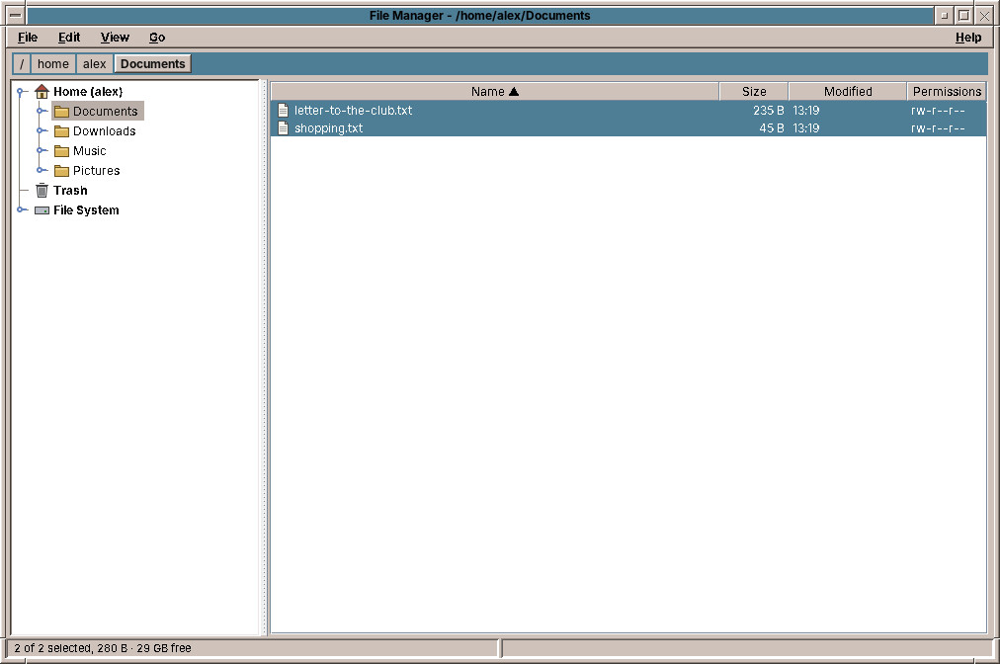
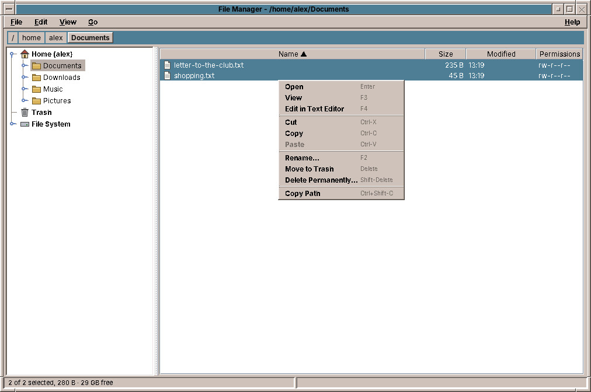
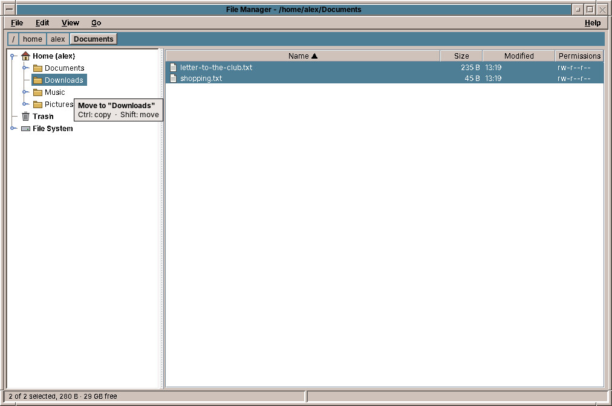
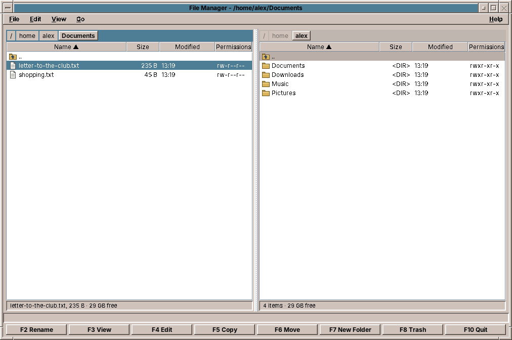
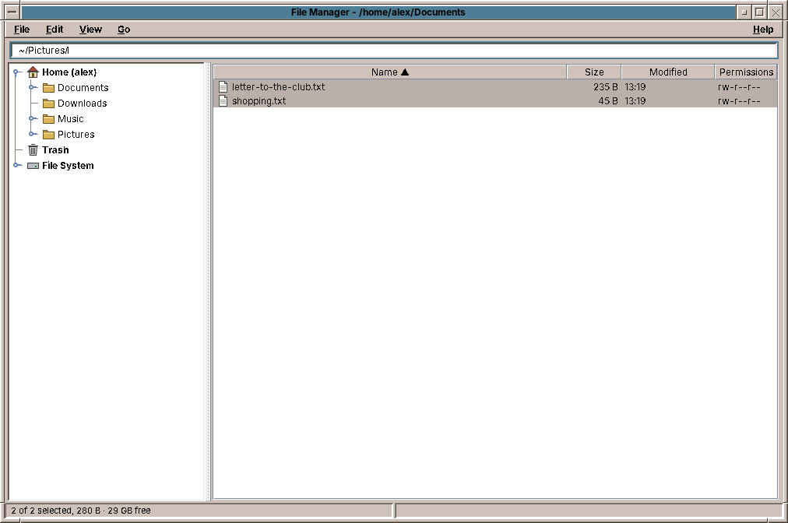

# 41. File Manager

The **File Manager** shows your folders and files in one of two views:

- **The tree view** (the default) is the one you know from Windows Explorer or the Finder: your folders as a tree on the left, the contents of the chosen folder on the right. You work with the mouse: the right mouse button opens a menu, and files are dragged to where they should go.
- **The two-panel view** shows two folders side by side: one where things are, one where they should go. Copying a file is then one key, ++f5++. Anyone who knows Midnight Commander or Total Commander will feel at home, and the function keys are printed at the bottom of the window.

*View → Tree* (++ctrl+1++) and *View → Two Panels* (++ctrl+2++) switch between them. The File Manager remembers your choice.

Start it with the File Manager slot of the Front Panel, which opens your home folder, or with `amade-files`.

## The tree view

- **The folder tree** on the left starts with your **Home** folder, the **Trash**, the **File System** (everything, from `/`) and every USB stick or disc that is plugged in; a stick appears a few seconds after you plug it in. Click the small handle in front of a folder to open it. Click a folder to see what is in it.
- **The list** on the right shows the files of that folder with name, size, date and permissions. Click a column heading to sort by it. Click a file to select it, ++ctrl++-click to add more, ++shift++-click to select a range. Double-click opens a folder or opens a file with its program.
- **The path bar** at the top shows where you are, one button per folder (see *Typing a path* below).
- **The status line** at the bottom shows the selected files with their size and the free space on the disk, and on the right what the File Manager has just done.

### The menu on the right mouse button

Click a file with the right mouse button for what you can do with it: *Open*, *View*, *Edit in Text Editor*, *Cut*, *Copy*, *Paste*, *Rename…*, *Move to Trash*, *Delete Permanently…* and *Copy Path*. If several files are selected, the commands work on all of them.

The right mouse button on a folder in the tree offers *New Folder…*, *Paste into Folder*, *Rename…*, *Move to Trash* and *Open in Two Panels*; on the free space below the files *New Folder…*, *Paste* and *Show Hidden Files*. In the trash the menu offers *Restore* and *Empty Trash…*. Your home folder, the trash, the file system and USB sticks cannot be moved, renamed or deleted.

The keys work as in the menus. While the folder tree has the keyboard focus (click a folder, or ++tab++ to switch between tree and list), ++f2++, ++delete++ and ++ctrl+x++ work on the folder chosen in the tree.

### Cut, copy and paste

++ctrl+x++ (cut) or ++ctrl+c++ (copy) puts the selected files on the clipboard; ++ctrl+v++ in another folder moves or copies them there. Pasting copied files into their own folder makes a copy beside them, called `report (2).odt`. The clipboard also works with other file managers, so you can copy files between amadeOS and, say, Thunar or Nautilus.

### Drag and drop

Drag files with the mouse onto a folder, in the tree or in the list. A note next to the mouse says what will happen when you let go:

- Without a key, files are **moved** within the same disk and **copied** onto another one, such as a USB stick.
- Hold ++ctrl++ to copy, ++shift++ to move. ++escape++ cancels.
- Dropping files on the **Trash** moves them to the trash.
- If you rest the mouse on a closed folder of the tree, it opens, so you can go deeper.

Files can also be dragged between the File Manager and other programs.

!!! switching "Coming from Windows or macOS"
    This is how Windows Explorer behaves: drag within a drive moves, drag to another drive copies. The Finder of macOS does the same. Only the keys differ: on a Mac, ++option++ copies.

## The two-panel view

- **The path bar** above each panel has one button per folder of the path, as in CDE: click one to go to that folder. The active panel has the coloured path bar.
- **The list** shows name, size, date and permissions; the line `..` leads to the folder above.
- **The status line** below each panel shows the selected files with their size, and the free space on the disk.
- **The function-key bar** at the bottom: each button does what its key does.

*View → Show Second Panel* (++ctrl+f1++) switches to one panel and back. The menu on the right mouse button, cut, copy and paste and drag and drop work here as well, also from one panel to the other. *Open in Two Panels* in the menu of a folder in the tree opens that folder here.

## Typing a path

Click the free space of the path bar, or press ++ctrl+l++, and the path becomes text you can type in. Type a folder, such as `~/Pictures` (`~` is your home folder), and press ++enter++; a file's path opens its folder with the file selected. ++tab++ completes the name of a folder, as in a terminal. ++escape++ goes back. The path is selected, so ++ctrl+c++ copies it.

The right mouse button on the path bar offers *Copy Path*, which copies the path of the folder you clicked, and *Edit Path*.

## Moving around

| Key | What it does |
|---|---|
| ++enter++ or double-click | Opens a folder, or opens a file with its program |
| ++backspace++ | Goes to the folder above |
| ++ctrl+1++ / ++ctrl+2++ | Tree view / two-panel view |
| ++tab++ | Switches to the other panel; in the tree view between tree and list |
| ++ctrl+l++ | Type a path in the path bar (`~` for your home folder, ++tab++ completes) |
| ++ctrl+h++ | Shows or hides hidden files |
| ++ctrl+u++ | Swaps the two panels |
| ++ctrl+equal++ | Shows the same folder in the other panel |
| ++ctrl+r++ | Reads the folder again |

## Selecting files in the two-panel view

Selecting, called **marking**, is separate from the cursor bar. ++insert++ or ++space++ marks the file under the cursor and moves down; marked files are bold and red. With the mouse, ++ctrl++-click and ++shift++-click mark. ++ctrl+a++ marks all, ++ctrl+shift+a++ none, ++ctrl+i++ turns the marks around. Without marks, the commands work on the file under the cursor.

## Copying, moving, renaming

| Key | What it does |
|---|---|
| ++f5++ | Copies to the folder of the other panel (the target can be changed; in the tree view it asks) |
| ++f6++ | Moves to the folder of the other panel |
| ++ctrl+x++ / ++ctrl+c++ / ++ctrl+v++ | Cut / copy / paste files |
| ++f2++ | Renames |
| ++f7++ | Makes a new folder |
| ++f3++ / ++f4++ | Opens the file in its program / in the Text Editor |
| ++ctrl+shift+c++ | Copies the paths of the files to the clipboard |

Copying and moving run in the background with a progress window and a *Cancel* button. If a file of the same name is already there, the File Manager shows both and asks: *Overwrite*, *Skip*, *Keep Both* (the copy is called `report (2).odt`), or the same for all files.

A copy is written under a hidden name first and gets its real name only when it is complete. A cancelled copy, a full USB stick or a pulled plug never leave a half file behind that looks like the real one.

## The trash

++f8++ or ++delete++ moves files to the **trash**, and so does dropping them on the Trash in the folder tree. The Trash Can at the right end of the Front Panel, the Trash in the tree, or *Go → Trash*, shows what is in it, with the folder each file came from and when you threw it away.

- *File → Restore from Trash* puts the marked files back where they were.
- *File → Empty Trash…* deletes everything in the trash for good, after asking.
- ++f8++ inside the trash deletes the marked files for good, after asking.

++shift+f8++ or ++shift+delete++ deletes for good straight away, after asking. Files on a USB stick go to a trash on the stick itself, so throwing them away is quick and emptying the trash frees space on the stick.

!!! switching "Coming from Windows or macOS"
    The trash is the Recycle Bin or Bin you know. It follows the freedesktop.org standard, so other Linux programs see the same trash.

!!! planned "Planned"
    Folders that refresh by themselves, quick search by typing, tabs and bookmarks, an icon view, dragging files onto the desktop and the Front Panel, file properties and *Open With…*, archives as folders, and folders on other computers (SFTP).

??? hood "Under the hood"
    The settings, such as the view, hidden files and the folders of both panels when you closed the File Manager, are in `~/.config/amadeos/files/files.conf`. `amade-files /tmp /media` opens the File Manager with these folders in the left and right panel, and `amade-files trash:` opens the trash.
