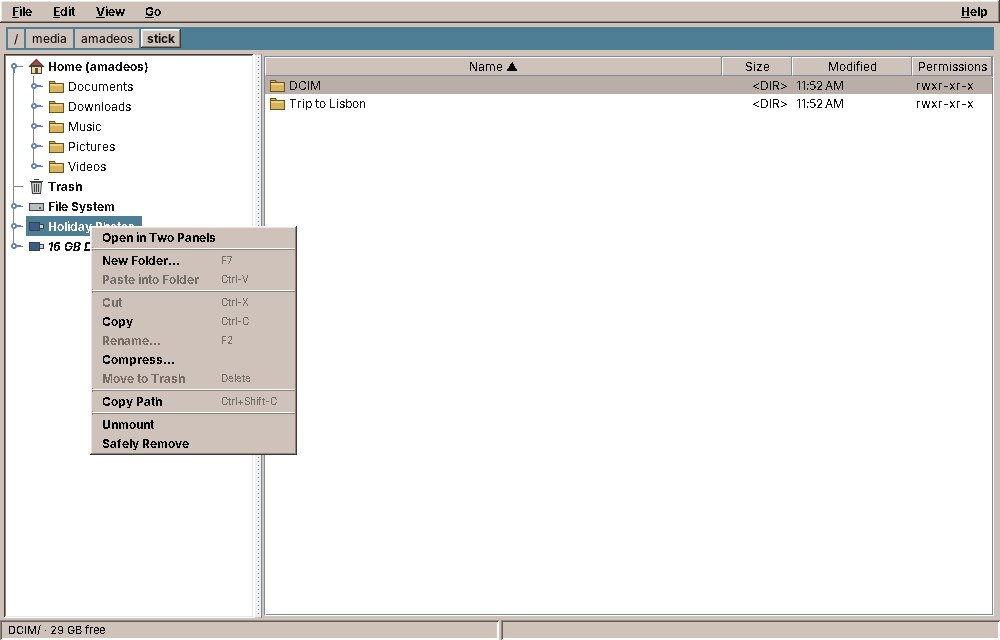
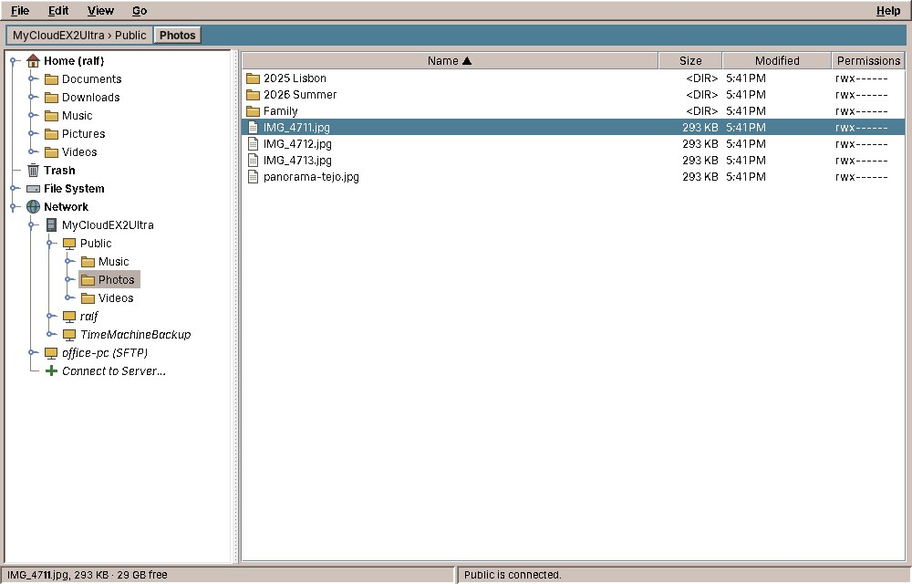
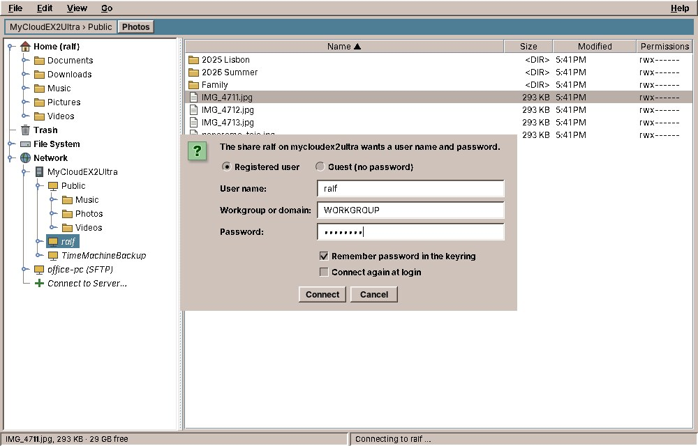
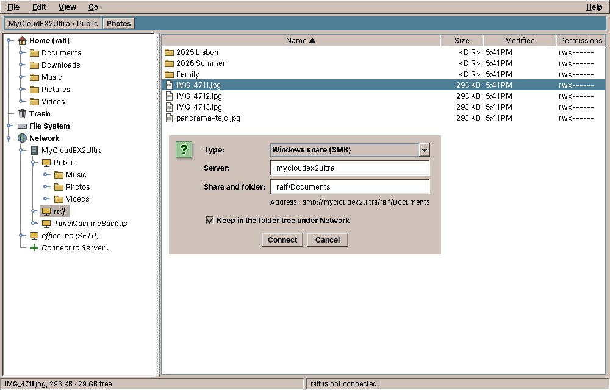
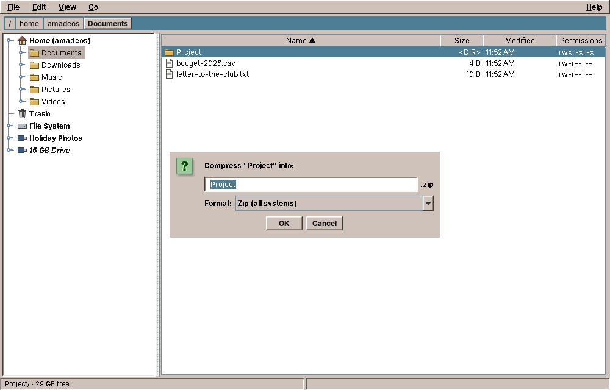
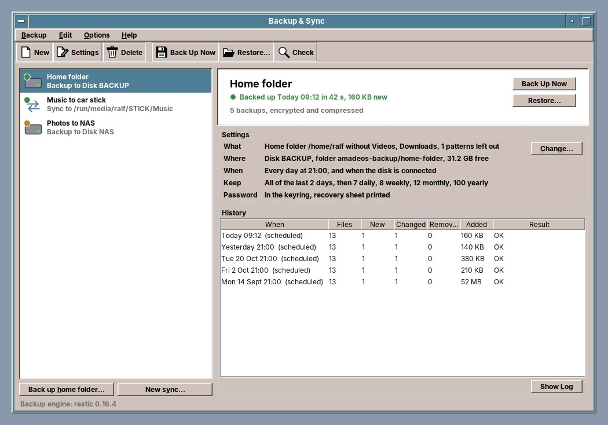
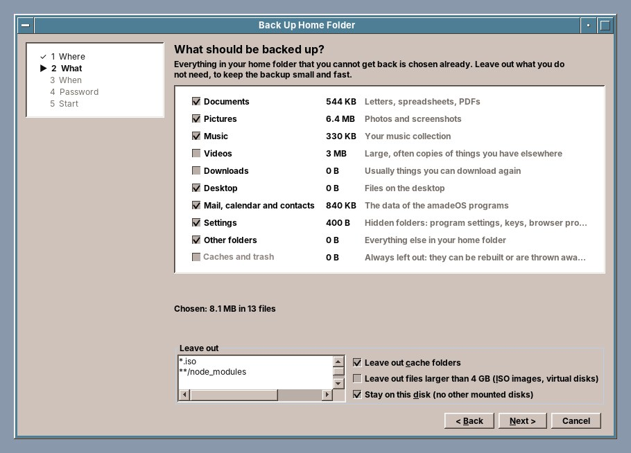
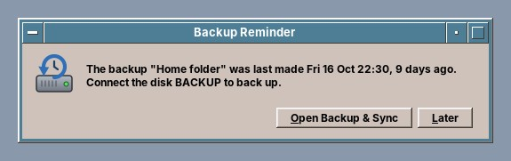
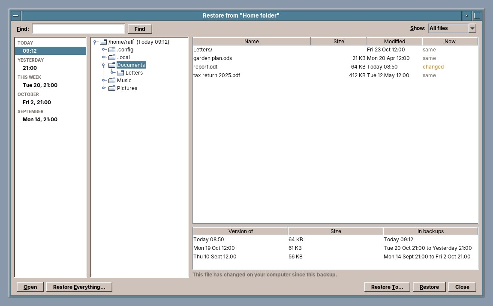
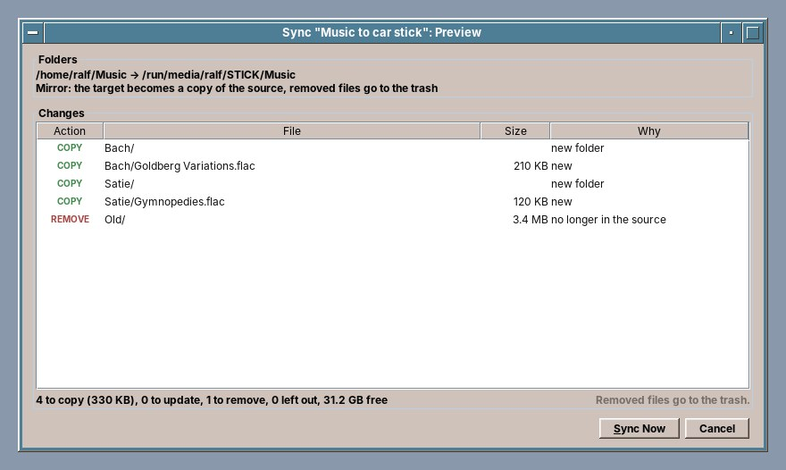

# 41. File Manager and Backup & Sync

## File Manager

The **File Manager** shows your folders and files in one of two views:

- **The tree view** (the default) is the one you know from Windows Explorer or the Finder: your folders as a tree on the left, the contents of the chosen folder on the right. You work with the mouse: the right mouse button opens a menu, and files are dragged to where they should go.
- **The two-panel view** shows two folders side by side: one where things are, one where they should go. Copying a file is then one key, ++f5++. Anyone who knows Midnight Commander or Total Commander will feel at home, and the function keys are printed at the bottom of the window.

*View → Tree* (++ctrl+1++) and *View → Two Panels* (++ctrl+2++) switch between them. The File Manager remembers your choice.

Start it with the File Manager slot of the Front Panel, which opens your home folder, or with `amade-files`.

### The tree view

- **The folder tree** on the left starts with your **Home** folder, the **Trash**, the **File System** (everything, from `/`) every USB stick, memory card or disc that is plugged in, and the **Network** with the servers and network drives of your home or office; a stick appears a few seconds after you plug it in (see *USB sticks and discs* and *Network drives* below). Click the small handle in front of a folder to open it. Click a folder to see what is in it.
- **The list** on the right shows the files of that folder with name, size, date and permissions. Click a column heading to sort by it. Click a file to select it, ++ctrl++-click to add more, ++shift++-click to select a range. Double-click opens a folder or opens a file with its program.
- **The path bar** at the top shows where you are, one button per folder (see *Typing a path* below).
- **The status line** at the bottom shows the selected files with their size and the free space on the disk, and on the right what the File Manager has just done.

#### The menu on the right mouse button

Click a file with the right mouse button for what you can do with it: *Open*, *View*, *Edit in Text Editor*, *Cut*, *Copy*, *Paste*, *Rename…*, *Compress…*, *Move to Trash*, *Delete Permanently…* and *Copy Path*; on an archive also *Extract Here* and *Extract To…*. If several files are selected, the commands work on all of them.

The right mouse button on a folder in the tree offers *New Folder…*, *Paste into Folder*, *Rename…*, *Compress…*, *Move to Trash* and *Open in Two Panels*, on a USB stick also *Unmount* and *Safely Remove*; on the free space below the files *New Folder…*, *Paste* and *Show Hidden Files*. In the trash the menu offers *Restore* and *Empty Trash…*. Your home folder, the trash, the file system and USB sticks cannot be moved, renamed or deleted.

The keys work as in the menus. While the folder tree has the keyboard focus (click a folder, or ++tab++ to switch between tree and list), ++f2++, ++delete++ and ++ctrl+x++ work on the folder chosen in the tree.

#### Cut, copy and paste

++ctrl+x++ (cut) or ++ctrl+c++ (copy) puts the selected files on the clipboard; ++ctrl+v++ in another folder moves or copies them there. Pasting copied files into their own folder makes a copy beside them, called `report (2).odt`. The clipboard also works with other file managers, so you can copy files between amadeOS and, say, Thunar or Nautilus.

#### Drag and drop

Drag files with the mouse onto a folder, in the tree or in the list. A note next to the mouse says what will happen when you let go:

- Without a key, files are **moved** within the same disk and **copied** onto another one, such as a USB stick.
- Hold ++ctrl++ to copy, ++shift++ to move. ++escape++ cancels.
- Dropping files on the **Trash** moves them to the trash.
- If you rest the mouse on a closed folder of the tree, it opens, so you can go deeper.

Files can also be dragged between the File Manager and other programs.

!!! switching "Coming from Windows or macOS"
    This is how Windows Explorer behaves: drag within a drive moves, drag to another drive copies. The Finder of macOS does the same. Only the keys differ: on a Mac, ++option++ copies.

### USB sticks and discs

Plug in a USB stick, a memory card or an external disk while the File Manager is open, and after a few seconds it appears at the bottom of the folder tree under its name, such as *Holiday Photos*, or its size, such as *16 GB Drive*. It is ready to use at once: click it to see the files.

A stick that was already plugged in when the File Manager started is shown in *italics*. Click it, and the File Manager makes it ready (it **mounts** it) and shows its files. The right mouse button on it offers *Mount and Open* and *Mount*.

Before you pull a stick out, click it with the right mouse button and choose **Safely Remove**. The File Manager finishes writing, unmounts the stick and switches it off; the status line says *Holiday Photos can be removed now.* Pulling a stick out without this can lose the files you have just copied onto it. *Unmount* does the same, but leaves the stick plugged in and switched on. For a CD or DVD the command is called **Eject**, and it opens the tray.

If a program still has a file on the stick open, the File Manager tells you: *Holiday Photos is still in use. Close the files and programs that use it, then try again.*

!!! switching "Coming from Windows or macOS"
    *Safely Remove* is Windows' *Eject* in the Explorer or *Safely Remove Hardware* in the taskbar, and the eject arrow next to a stick in the Finder of macOS.

### Network drives

A **network drive** is a folder on another computer or on a network storage box (a NAS, such as a WD My Cloud, a Synology or a Fritz!Box with a USB disk) that you use as if it were on your own disk. The File Manager shows them under **Network** at the bottom of the folder tree.

Click the handle in front of *Network*. After a moment it lists the servers it finds in your network: Windows computers, NAS boxes and other Linux and Mac computers that offer folders. Click the handle of a server, and its **shares** appear, the folders it offers, such as *Public*, *ralf* or *TimeMachineBackup*. A share that is not connected yet is shown in *italics*.

Click a share to **connect** to it. A share that anyone may open, such as *Public*, opens at once. For a private share the File Manager asks who you are:

- *Guest (no password)* for shares open to everyone, or *Registered user* with the **user name** and **password** of an account on that server, not of your amadeOS account.
- **Workgroup or domain** is needed only for Windows shares (SMB). It is *WORKGROUP* on almost every home network, and the File Manager fills that in for you; in a company network ask for the domain's name.
- **Remember password in the keyring** keeps it in your login keyring (see chapter 38), so the next time the share opens without asking. Without it, the File Manager asks again after you log out.
- **Connect again at login** makes the share ready every time you log in, so programs find their files on it without your opening the File Manager first.

If the password was wrong, the window comes back with *The user name or password for ralf on MyCloudEX2Ultra was not accepted. Please try again.* Once connected, the share opens like any folder: you can copy files onto it and off it, open them, drag them between the share and your home folder, and use the two-panel view with a share on one side. The path bar shows *MyCloudEX2Ultra › ralf*, not the long hidden folder where the share really is.

A server the File Manager does not find by itself, such as one in another network, a cloud storage with WebDAV or a computer you reach over SSH, you add with **File → Connect to Server…** (++ctrl+k++), or with *Connect to Server…* at the bottom of *Network*:

Type the address, such as `smb://mycloudex2ultra/ralf`, or choose the kind of server and type its name. The File Manager understands these addresses:

| Address | For |
|---|---|
| `smb://server/share` or `\\server\share` | Windows shares and nearly every NAS |
| `nfs://server/path` | NFS, common between Linux computers and on NAS boxes |
| `davs://server/path` | WebDAV over a secure connection: Nextcloud, ownCloud, many cloud storages |
| `sftp://server/path` | a folder on a computer you can log in to with SSH |
| `ftp://server/path` | old FTP servers |

**Keep in the folder tree under Network** leaves the server there, even when it is switched off; the last eight addresses are offered again under *Recent servers*. You can also type such an address into the path bar (++ctrl+l++) and press ++enter++.

The right mouse button on *Network* offers *Connect to Server…* and *Refresh* (look for servers again); on a server *Log In As…* (another user) and *Copy Network Address*; on a share that is not connected *Connect and Open*, *Connect*, *Log In As…* and *Copy Network Address*; on a connected share also *Disconnect*. What you keep has *Forget Password* (removes it from the keyring) and *Remove from Network…*. **Disconnect** closes the connection; files still open on the share must be closed first.

!!! tip "A WD My Cloud EX2 Ultra"
    The My Cloud offers its shares as Windows shares (SMB) from the start, and it announces itself, so it appears under *Network* as *MyCloudEX2Ultra* (or the name you gave it). Its share *Public* opens as a guest. Every user you set up in the My Cloud's dashboard has a private share of the same name: connect to it as *Registered user* with that user's name and password and the workgroup *WORKGROUP*, and tick *Remember password in the keyring* and *Connect again at login*. If the My Cloud does not appear, type `smb://` followed by its IP address, which the dashboard shows under *Settings → Network*. NFS works too, but must first be switched on in the dashboard (*Settings → Network → Network Services*) and for each share.

If a server cannot be reached, the File Manager says so: *MyCloudEX2Ultra cannot be reached (…). Is it switched on and in this network?*

!!! switching "Coming from Windows or macOS"
    *Network* is Windows' *Network* in the Explorer, and *Connect again at login* is *Map network drive* with *Reconnect at sign-in*, without a drive letter. `\\server\share` works as you know it. On macOS it is *Network* in the Finder's sidebar and *Go → Connect to Server…* (++cmd+k++).

### Archives: zip, tar and 7z

An **archive** is one file that holds many, packed together and usually made smaller: `photos.zip`, `source-1.2.tar.gz`, `backup.7z`. The File Manager opens them itself; you need no extra program.

- **Double-click** an archive (or select it and press ++enter++), and its contents are unpacked next to it. If the archive holds one folder, that folder appears beside the archive; if it holds several files, they go into a new folder named after the archive, such as `photos`.
- *Extract Here* in the menu on the right mouse button does the same for all selected archives. *Extract To…* asks for another folder.
- Nothing is ever overwritten. If a folder of that name exists already, the new one is called `photos (2)`. A cancelled extraction leaves nothing behind.

To pack files, select them, click with the right mouse button and choose **Compress…**. Type a name and choose the format:

- **Zip** opens on every computer, also on Windows and macOS. Choose it when you send files to someone.
- **tar.gz** and **tar.xz** are the usual archives on Linux; they keep file permissions and links, and tar.xz is the smallest.

The archive appears in the same folder, selected. The File Manager reads zip, tar (also `.tar.gz`, `.tgz`, `.tar.bz2`, `.tar.xz`), 7z and single files packed with gzip, bzip2 or xz.

!!! warning "Archives from the internet"
    An archive can hold files that try to land outside the folder you unpack it into, such as `../../.bashrc`. The File Manager leaves such files out and says how many it left out. Archives with a password cannot be opened yet.

### The two-panel view

- **The path bar** above each panel has one button per folder of the path, as in CDE: click one to go to that folder. The active panel has the coloured path bar.
- **The list** shows name, size, date and permissions; the line `..` leads to the folder above.
- **The status line** below each panel shows the selected files with their size, and the free space on the disk.
- **The function-key bar** at the bottom: each button does what its key does.

*View → Show Second Panel* (++ctrl+f1++) switches to one panel and back. The menu on the right mouse button, cut, copy and paste and drag and drop work here as well, also from one panel to the other. *Open in Two Panels* in the menu of a folder in the tree opens that folder here.

### Typing a path

Click the free space of the path bar, or press ++ctrl+l++, and the path becomes text you can type in. Type a folder, such as `~/Pictures` (`~` is your home folder), and press ++enter++; a file's path opens its folder with the file selected. ++tab++ completes the name of a folder, as in a terminal. ++escape++ goes back. The path is selected, so ++ctrl+c++ copies it.

The right mouse button on the path bar offers *Copy Path*, which copies the path of the folder you clicked, and *Edit Path*.

### Moving around

| Key | What it does |
|---|---|
| ++enter++ or double-click | Opens a folder, or opens a file with its program |
| ++backspace++ | Goes to the folder above |
| ++ctrl+1++ / ++ctrl+2++ | Tree view / two-panel view |
| ++tab++ | Switches to the other panel; in the tree view between tree and list |
| ++ctrl+l++ | Type a path in the path bar (`~` for your home folder, ++tab++ completes) |
| ++ctrl+h++ | Shows or hides hidden files |
| ++ctrl+u++ | Swaps the two panels |
| ++ctrl+equal++ | Shows the same folder in the other panel |
| ++ctrl+r++ | Reads the folder again |

### Selecting files in the two-panel view

Selecting, called **marking**, is separate from the cursor bar. ++insert++ or ++space++ marks the file under the cursor and moves down; marked files are bold and red. With the mouse, ++ctrl++-click and ++shift++-click mark. ++ctrl+a++ marks all, ++ctrl+shift+a++ none, ++ctrl+i++ turns the marks around. Without marks, the commands work on the file under the cursor.

### Copying, moving, renaming

| Key | What it does |
|---|---|
| ++f5++ | Copies to the folder of the other panel (the target can be changed; in the tree view it asks) |
| ++f6++ | Moves to the folder of the other panel |
| ++ctrl+x++ / ++ctrl+c++ / ++ctrl+v++ | Cut / copy / paste files |
| ++f2++ | Renames |
| ++f7++ | Makes a new folder |
| ++f3++ / ++f4++ | Opens the file in its program / in the Text Editor |
| ++ctrl+shift+c++ | Copies the paths of the files to the clipboard |

Copying and moving run in the background with a progress window and a *Cancel* button. If a file of the same name is already there, the File Manager shows both and asks: *Overwrite*, *Skip*, *Keep Both* (the copy is called `report (2).odt`), or the same for all files.

A copy is written under a hidden name first and gets its real name only when it is complete. A cancelled copy, a full USB stick or a pulled plug never leave a half file behind that looks like the real one.

### The trash

++f8++ or ++delete++ moves files to the **trash**, and so does dropping them on the Trash in the folder tree. The Trash Can at the right end of the Front Panel, the Trash in the tree, or *Go → Trash*, shows what is in it, with the folder each file came from and when you threw it away.

- *File → Restore from Trash* puts the marked files back where they were.
- *File → Empty Trash…* deletes everything in the trash for good, after asking.
- ++f8++ inside the trash deletes the marked files for good, after asking.

++shift+f8++ or ++shift+delete++ deletes for good straight away, after asking. Files on a USB stick go to a trash on the stick itself, so throwing them away is quick and emptying the trash frees space on the stick.

!!! switching "Coming from Windows or macOS"
    The trash is the Recycle Bin or Bin you know. It follows the freedesktop.org standard, so other Linux programs see the same trash.

!!! planned "Planned"
    Folders that refresh by themselves, quick search by typing, tabs and bookmarks, an icon view, dragging files onto the desktop and the Front Panel, file properties and *Open With…*, archives with a password and archives as folders, formatting a USB stick, and a share's free space in the status line.

??? hood "Under the hood"
    The settings, such as the view, hidden files and the folders of both panels when you closed the File Manager, are in `~/.config/amadeos/files/files.conf`. `amade-files /tmp /media` opens the File Manager with these folders in the left and right panel, and `amade-files trash:` opens the trash. USB sticks are found with `lsblk` and mounted with `udisksctl` (package `udisks2`), below `/media/$USER/`; udisks lets the user at the screen do this without a password. Archives are read and written in Java (Apache Commons Compress), so no `unzip` or `7z` is needed. Network drives are connected with `gio mount` of GVfs (packages `gvfs-backends` and `gvfs-fuse`), which makes each share a folder below `/run/user/$UID/gvfs/`; the password goes to `gio` on its standard input, never on the command line. Servers are found through Avahi (mDNS) and `wsdd` (WS-Discovery, for Windows computers and NAS boxes). The servers and shares you keep are in `~/.config/amadeos/files/network.conf` (no passwords: those are in the login keyring, service `amade-files`), and *Connect again at login* writes `~/.config/autostart/amade-files-network.desktop`, which runs `amade-files --connect-saved` once at login.

## Backup & Sync

**Backup & Sync** keeps copies of your files on an external disk, so a broken computer, a stolen laptop or a file you deleted by mistake costs you nothing. It does two jobs:

- A **backup** keeps your files as they were on many days: today's, yesterday's, last week's, last year's. Every backup is encrypted and compressed, and after the first one only what changed is saved again.
- A **sync** makes one folder like another, for example your music on the stick in the car. A sync keeps no old versions: it is a copy, not a backup.

Start it from the Tools drawer of the Front Panel, or with `amade-backup`.

The window lists your jobs on the left. The coloured dot shows how each one is doing: green when the last run worked, yellow when the last backup is overdue, the disk was missing or some files could not be read, red when it failed. On the right are the settings of the chosen job and its **history**: every run with the number of files, what was new, changed or removed, the size added and the result. *Show Log* shows everything a run reported.

### Backing up your home folder

The first time you start Backup & Sync, it offers to back up your home folder. Later, *Backup → Back Up Home Folder…* (++ctrl+n++) does the same. An assistant asks five questions:

1. **Where.** Choose an external disk from the list, or another folder. A backup on the same disk as your home folder does not help when that disk breaks. A disk with a Windows file system (FAT, exFAT, NTFS) works too, but backups are slower and the file permissions are not kept.
2. **What.** Your home folder is already sorted into areas with their sizes: Documents, Pictures, Music, the data of the Mailer, Calendar and Contacts, program settings and the other folders are chosen. Videos and Downloads are not, because they are large and often copies of something you have elsewhere; tick them if you want them. Caches and the trash are always left out. Under *Leave out* you can add patterns such as `*.iso`.
3. **When.** Every day, every week, or only when you start it, and also when the disk is connected. Below that is the rule for old backups: *all of the last 2 days, then 7 daily, 8 weekly, 12 monthly, 100 yearly*. Older backups are thinned out by this rule, so you can go back in time without filling the disk.
4. **Password.** The backup is encrypted with a password of your choice, or *Make One Up* invents one. It is kept in your keyring, so you never type it again on this computer. **Print the recovery sheet** (*Print Recovery Sheet…*): without the password nobody can read the backup, not even you on a new computer.
5. **Start.** Check the settings, see how large the first backup will be and how long it takes, and click *Finish*. With *Start the first backup now* ticked, it begins at once; the next ones take a few minutes.

*Back Up Now* (++ctrl+b++) starts a backup at any time. If the disk is not connected, the window says so: *Connect BACKUP to back up or restore.* The disk is recognised by its identity, not by its name or the place where it appears, so it may be plugged into any port.

*Backup → New Backup…* makes a backup of other folders, with its own disk, schedule and rule. *Edit → Settings…* (++ctrl+e++) changes everything about a job later, and *Edit → Delete* removes the job from the list; the backups on the disk stay.

### Backups that run by themselves

A backup with a schedule runs by itself: every day or once a week at its time, and also whenever its disk is connected if you ticked that. A small helper takes care of it; it starts with the session and shows no window. If the computer was off or the disk was not connected at the time, the backup runs as soon as the disk is there again, so plugging the disk in once in a while is enough. On a laptop that runs on a nearly empty battery, it waits for the charger.

While a backup runs, a **violet** run of dashes moves from right to left in the busy light above EXIT (chapter 22). When it is done, nothing pops up; the list in Backup & Sync shows how it went. Once a week, after a backup, the helper also reads the backup back to check it.

A small window comes only when you need to do something. When a backup is overdue (two days for a daily one, nine for a weekly one) and its disk is not connected, it reminds you, at most once a day:

*Open Backup & Sync* opens the program, *Later* closes the reminder. A backup that fails, for example because the disk is full, gets the same kind of window with the reason.

A sync with a schedule runs by itself too, for example *Music for the car* whenever the stick is plugged in. If it only copies, it simply runs. If it would remove or replace files on the target, its preview comes first, and nothing happens until you click *Sync Now*.

!!! tip "Switching it off"
    The helper is listed as *Scheduled backups (Backup & Sync)* in Settings > Startup (chapter 35). Without it, backups run only when you click *Back Up Now*; the job then says so under *When*.

### Getting files back

*Restore…* (++ctrl+r++) opens the backups of the chosen job.

- On the left is the **timeline**: today, yesterday, this week, then by month. Click a time to see the files as they were then.
- In the middle are the **folders** of that backup, on the right their **files**. The column *Now* compares each file with your computer: *same*, *changed* or *deleted*. *Show* lists only the changed or only the deleted files.
- Click a file to see its **versions** below: every different state of the file, and in which backups it is.
- **Find** searches all backups for a file name, for the file you cannot remember the folder of.

**Restore** puts the selected files back where they were. If a file of that name is there already, Backup & Sync asks: *Replace* (the current file goes to the trash first), *Keep Both*, or *Skip*. **Restore To…** puts them into another folder instead, and **Restore Everything…** the whole backup. **Open** opens a version in its program without restoring it, to have a look first.

!!! tip "On a new computer"
    Install amadeOS, connect the backup disk, start Backup & Sync and choose *Backup → Open Existing Backup…* (++ctrl+o++). Choose the folder `amadeos-backup/home-folder` on the disk and type the password from the recovery sheet. The recovery sheet says the same.

*Check Backup* reads the backup and tells you whether it is intact. Do it now and then, especially with an old disk.

### Syncing folders

*Backup → New Sync…* makes a sync job: one or more pairs of folders, and one of two ways:

- **Update:** new and changed files are copied to the target, nothing is removed there.
- **Mirror:** the target becomes a copy of the source. Files that are no longer in the source are removed from the target, but into the **trash** of that disk, never for good.

*Sync Now* never starts straight away: it first shows a **preview** of everything it would do, with the reason for each file, the sizes and the free space on the target. Nothing happens until you click *Sync Now* in the preview.

USB sticks with FAT or exFAT store file times only to two seconds; Backup & Sync knows that, so it does not copy everything again each time.

!!! sovereignty "Your data"
    Your backups belong to you, on your own disk, and are encrypted with your password. Nothing goes to a cloud, and nobody else holds the key.

!!! planned "Planned"
    A cell in the Front Panel with the state of the backups; backups to a network share or an SFTP server; a backup engine of amadeOS's own.

??? hood "Under the hood"
    The backups are standard [restic](https://restic.net) repositories, one per job, in the folder `amadeos-backup/` on the disk, next to a `README-amadeOS-backup.txt` that explains them. So they can be read with restic on any computer, without amadeOS, for example `restic -r /media/$USER/BACKUP/amadeos-backup/home-folder mount /mnt` (restic runs on Linux, macOS and Windows). The jobs are in `~/.config/amadeos/backup/jobs.json`, the history and logs in `~/.local/state/amadeos/backup/`, the passwords in the keyring. The helper is `amade-backup --agent`, started at low priority by `/etc/amadeos/autostart.d/60-amade-backup`; it ends by itself when no job has a schedule, and Backup & Sync starts it again when you give one a schedule. It looks at the jobs and the connected disks every 30 seconds and writes its log to `~/.cache/amadeos/logs/backup-agent.log`. The busy light recognises restic by its process. The package is `amade-backup`; Backup & Sync is for Linux only.
