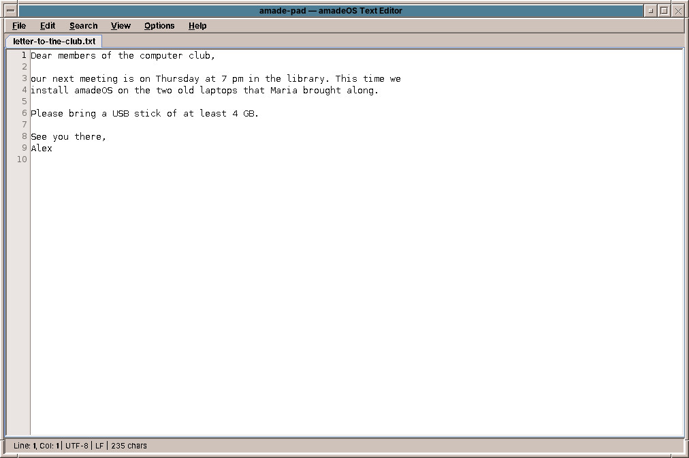

# 42. Text Editor

The **Text Editor** is for plain text without formatting: notes, shopping lists, a README, the settings files of the system. For letters with fonts and pages, use WritePad (chapter 43).

Start it with the Text & Office slot of the Front Panel, or with `amade-pad file.txt`.

## Working with it

- **Several files in tabs.** Each open file has a tab; a `*` in the tab means unsaved changes. Closing a tab or the window asks before throwing changes away.
- **Line numbers** on the left (*View → Line Numbers*) and **word wrap** for long lines (*View → Word Wrap*).
- **The status line** shows the line and column of the cursor, the encoding, the kind of line ends and the number of characters.
- **Find and replace** in a window that stays open while you work, with *Match case* and *Wrap around*.

| Key | What it does |
|---|---|
| ++ctrl+n++ / ++ctrl+o++ | New file / open a file |
| ++ctrl+s++ / ++ctrl+shift+s++ | Save / save as |
| ++ctrl+w++ | Close the tab |
| ++ctrl+z++ / ++ctrl+y++ | Undo / redo |
| ++ctrl+f++ / ++f3++ | Find / find next |
| ++ctrl+h++ | Replace |
| ++ctrl+q++ | Exit |

## Encodings and line ends

The Text Editor recognises how a file is stored, UTF-8, UTF-16, Windows-1252 or ISO-8859-1, and whether its lines end the Linux way (LF), the Windows way (CRLF) or the old Mac way (CR), and saves it back the same way. A file from a Windows computer stays a Windows file. If you type a character the file's encoding cannot hold, such as € in an ISO-8859-1 file, the editor offers to save the file as UTF-8.

!!! switching "Coming from Windows or macOS"
    The Text Editor is what Notepad or TextEdit in plain text mode are.

??? hood "Under the hood"
    Settings files of the system, under `/etc`, belong to the administrator. Open them from the *Root Console* in the Tools drawer, for example with `sudoedit /etc/hosts`, which opens a copy and puts it back with administrator rights (chapter 50).
