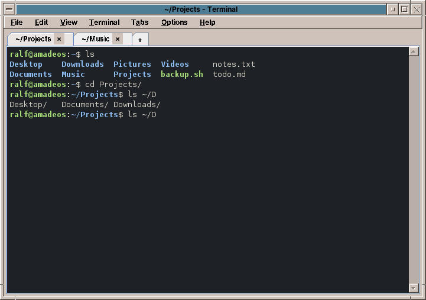

# 42. Text Editor and Terminal

The **Text Editor** is for plain text without formatting: notes, shopping lists, a README, the settings files of the system. For letters with fonts and pages, use WritePad (chapter 43).

Start it with the Text & Office slot of the Front Panel, or with `amade-pad file.txt`.

## Working with it

- **Several files in tabs.** Each open file has a tab; a `*` in the tab means unsaved changes. Closing a tab or the window asks before throwing changes away.
- **Line numbers** on the left (*View → Line Numbers*) and **word wrap** for long lines (*View → Word Wrap*).
- **The status line** shows the line and column of the cursor, the encoding, the kind of line ends and the number of characters.
- **Find and replace** in a window that stays open while you work, with *Match case* and *Wrap around*.

| Key | What it does |
|---|---|
| ++ctrl+n++ / ++ctrl+o++ | New file / open a file |
| ++ctrl+s++ / ++ctrl+shift+s++ | Save / save as |
| ++ctrl+w++ | Close the tab |
| ++ctrl+z++ / ++ctrl+y++ | Undo / redo |
| ++ctrl+f++ / ++f3++ | Find / find next |
| ++ctrl+h++ | Replace |
| ++ctrl+q++ | Exit |

## Encodings and line ends

The Text Editor recognises how a file is stored, UTF-8, UTF-16, Windows-1252 or ISO-8859-1, and whether its lines end the Linux way (LF), the Windows way (CRLF) or the old Mac way (CR), and saves it back the same way. A file from a Windows computer stays a Windows file. If you type a character the file's encoding cannot hold, such as € in an ISO-8859-1 file, the editor offers to save the file as UTF-8.

!!! switching "Coming from Windows or macOS"
    The Text Editor is what Notepad or TextEdit in plain text mode are.

??? hood "Under the hood"
    Settings files of the system, under `/etc`, belong to the administrator. Open them from the *Root Console* in the Tools drawer, for example with `sudoedit /etc/hosts`, which opens a copy and puts it back with administrator rights (chapter 50).

## Terminal

The **Terminal** is where you type commands: a command from a guide, `apt` for software, `top` to see what the computer is doing, or an editor such as `nano` or `vim`. It runs your *shell*, normally bash, the program that reads the commands.

Start it with **Terminal** in the Tools drawer of the Front Panel, with ++ctrl+alt+t++ anywhere on the desktop, or from the desktop menu (*New Window → Terminal Emulator*). Programs that need a terminal, for example `ncdu` from the Application Manager, open in it too.

### Typing less: Tab

Press ++tab++ while typing a command, a file or folder name or an option, and the shell completes it: `cd Doc` ++tab++ becomes `cd Documents/`. If several names fit, press ++tab++ twice to see them. ++up++ and ++down++ bring back earlier commands, ++ctrl+r++ searches in them.

### Copy and paste

In a terminal, ++ctrl+c++ stops the running command, so copy and paste have their own keys:

| Key | What it does |
|---|---|
| ++ctrl+shift+c++ | Copies the selected text |
| ++ctrl+shift+v++ | Pastes |
| Selecting with the mouse, then the middle mouse button | Copies and pastes in one go, the X11 way; also from and into other programs |
| ++shift+insert++ | Pastes the selected text |

A double click selects a word or a file path, a triple click the whole line. Before text with several lines is pasted into a program that would run each line at once, the Terminal shows the lines and asks; *Paste as One Line* joins them. Files dragged from the File Manager onto the Terminal are pasted as their paths.

### Tabs, scrolling and finding

| Key | What it does |
|---|---|
| ++ctrl+shift+t++ / ++ctrl+shift+n++ | New tab (in the folder of the current one) / new window |
| ++ctrl+page-up++ / ++ctrl+page-down++ | Previous / next tab; ++alt+1++ to ++alt+9++ go straight to a tab |
| ++ctrl+shift+w++ / ++ctrl+shift+q++ | Close the tab / the window; asks if a program is still running |
| ++shift+page-up++ / ++shift+page-down++ | Scroll back through earlier output (also with the mouse wheel) |
| ++ctrl+shift+f++ | Find in the output, also with *Match case* and *Regular expression* |
| ++ctrl+shift+k++ | Clear the scrollback |
| ++ctrl+plus++ / ++ctrl+minus++ / ++ctrl+0++ | Larger / smaller / normal text |
| ++f11++ | Full screen |

Web addresses and file paths in the output are underlined when the mouse is on them; ++ctrl++ and a click opens them. *Terminal → Open Folder in Files* opens the folder the shell is in. If a full-screen program left the screen in a mess, *Terminal → Reset* puts it right.

*Edit → Preferences* (++ctrl+shift+comma++) chooses the colours (*Night*, *Paper*, *Desktop theme* that follows the colours of Settings, *Green screen*, *Amber screen*), the font and its size, the cursor, how many lines of output are kept (10,000, or unlimited), a different shell or command, and what a bell does: flash the window, a sound, or a notification when the tab is not in front.

!!! switching "Coming from Windows or macOS"
    The Terminal is what the Command Prompt or PowerShell are on Windows and Terminal on macOS. The commands are those of Linux: `ls` instead of `dir`, `cp` instead of `copy`.

??? hood "Under the hood"
    The Terminal is `amade-terminal`, written in Java like the rest of the desktop. Its pseudo terminal comes from the C library through Java's Foreign Function and Memory API; it tells programs it is an `xterm-256color` terminal, so colours, mouse and full-screen programs work as in xterm. It is registered as `x-terminal-emulator`, the terminal Debian programs ask for. The old `xterm` is still installed for this release and starts the failsafe session.
