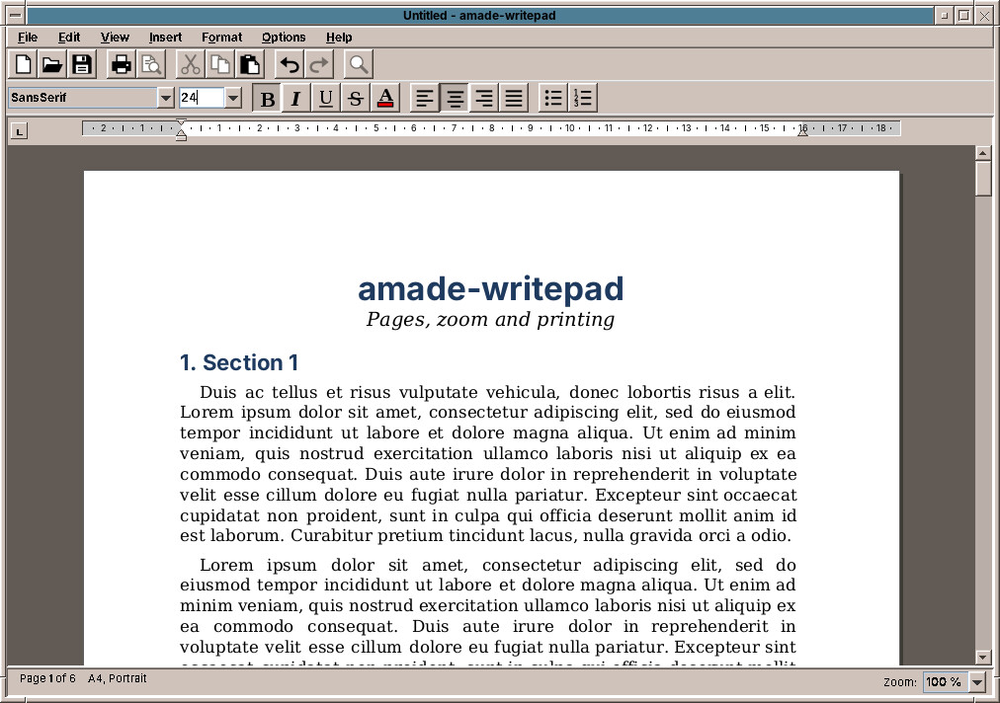

# 43. WritePad

**WritePad** writes letters and documents on **real pages**: fonts, bold and italic, lists, tab stops, A4 or Letter. What you see on the screen is what comes out of the printer, line for line and page for page. It is the size of program WordPad was on Windows: enough for a letter to the tax office or the club newsletter, quick to start and easy to learn.

Start it from the Text & Office drawer, by double-clicking an `.odt` file, or with `amade-writepad letter.odt`.

## The window

From top to bottom:

- **The toolbar**: new, open, save, print, cut, copy, paste, undo, redo.
- **The format bar**: font and size, bold, italic, underline, strike-through, text colour, the four alignments, bullets and numbering. It always shows the formatting where the cursor is.
- **The ruler**, in centimetres (in inches in the US).
- **The page** on a dark desk, with its margins.
- **The status bar** with the page and the paper, and the zoom.

The toolbar, format bar, ruler and status bar can each be hidden in the *View* menu. *View → Zoom* goes from 50 % to 300 %. *Insert → Sample Text* fills a few pages, to try things out.

## Paragraphs, tabs and lists

**On the ruler** you drag the markers of the paragraph: the upper triangle on the left is the first line, the lower one the rest of the paragraph, the triangle on the right the right edge. A click on the ruler sets a **tab stop**; the box at the left end of the ruler chooses its kind, left, centred, right or decimal (for columns of amounts). Drag a tab stop to move it, and off the ruler to remove it. Hold ++alt++ to place markers freely instead of on the quarter centimetre.

*Format → Paragraph…* sets indents, spacing above and below, line spacing and alignment to exact values, *Format → Tabs…* lists the tab stops.

**Lists**: the bullet and numbering buttons of the format bar, or *Format → Bullets* and *Numbering*. ++tab++ at the start of an item moves it a level down, ++shift+tab++ back up. ++enter++ on an empty item ends the list. *Restart Numbering* begins again at 1, *Continue Numbering* carries on from the list above.

++shift+enter++ starts a new line inside the same paragraph, without a new bullet or number.

## Pages and printing

*File → Page Setup…*, or *Format → Paper Size* and *Orientation*, choose **A5, A4, Letter or Legal**, portrait or landscape, and the margins. *File → Print…* prints through the printers of the Print Manager (chapter 27).

## File formats

| Format | Open | Save | |
|---|---|---|---|
| **ODT** (OpenDocument Text) | yes | yes | The standard format, used for new documents. LibreOffice and Word open it too. |
| **DOCX** (Word) | yes | yes | For documents from and for Word users. |
| **RTF** | yes | yes | The format of WordPad. |
| **Plain text** | yes | yes | Without formatting. |
| **DOC** (Word 97–2003) | yes | yes | Through LibreOffice, which is installed in amadeOS. |

Choose the format in *File → Save As…*. The title bar shows the file name and a `*` while there are unsaved changes; *New*, *Open* and *Exit* ask before throwing them away.

Tables, pictures, notes and comments in a document from elsewhere are left out for now. Open such documents in LibreOffice Writer instead.

!!! sovereignty "Your data"
    ODT is an open, international standard (ISO/IEC 26300), used by many European administrations to exchange documents. A document in ODT can still be opened in many years, by many programs, without a licence from anybody.

!!! planned "Planned"
    Pictures, header and footer, print preview and *Find*, then tables, spell checking and saving as PDF.

## LibreOffice

For everything WritePad does not do yet, tables, pictures, tables of contents, PDF export, **LibreOffice Writer** is installed in amadeOS, in the Text & Office drawer, in the five languages of amadeOS. It reads and writes the same ODT files.

Next to Writer, the drawer holds the other LibreOffice programs:

| Program | What it is for | Files |
|---|---|---|
| **LibreOffice Calc** | Spreadsheets: tables, formulas, charts | ODS, Excel (XLSX, XLS), CSV |
| **LibreOffice Impress** | Presentations and slide shows | ODP, PowerPoint (PPTX, PPT) |
| **LibreOffice Draw** | Drawings, diagrams, flyers; small changes in PDF files | ODG, PDF |
| **LibreOffice Math** | Mathematical formulas, also inside Writer documents | ODF |
| **LibreOffice** | The Start Center: opens any of them and shows the recent documents | |

Double-click a spreadsheet or a presentation in the File Manager and it opens in Calc or Impress. A PDF file still opens in the PDF Viewer; to change one, choose *Open with → LibreOffice Draw*. The database program LibreOffice Base is not installed.

??? hood "Under the hood"
    WritePad reads and writes ODT and DOCX with its own code, without a large office library; it runs LibreOffice in the background (`soffice --headless`) only to convert DOC files. Its settings are in `~/.config/amadeos/writepad/writepad.properties`.
