# 43. WritePad and Label Printer

**WritePad** writes letters and documents on **real pages**: fonts, bold and italic, lists, tab stops, A4 or Letter. What you see on the screen is what comes out of the printer, line for line and page for page. It is the size of program WordPad was on Windows: enough for a letter to the tax office or the club newsletter, quick to start and easy to learn.

Start it from the Text & Office drawer, by double-clicking an `.odt` file, or with `amade-writepad letter.odt`.

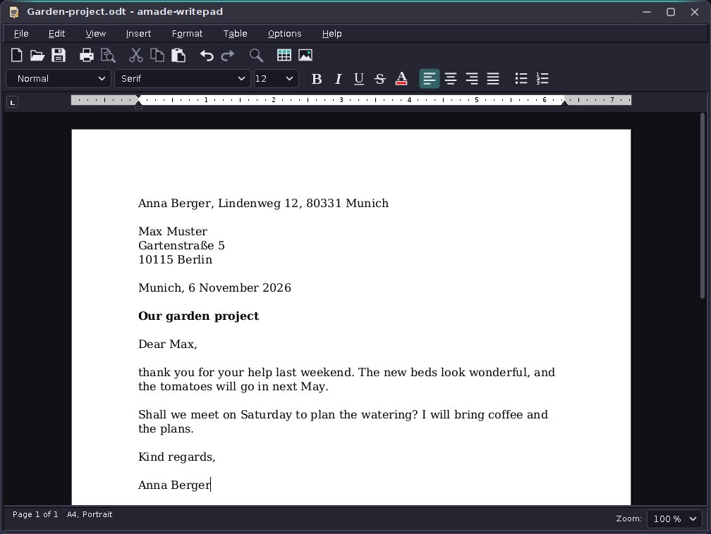

## The window

From top to bottom:

- **The toolbar**: new, open, save, print, cut, copy, paste, undo, redo, *Insert Table* and *Insert Picture*.
- **The format bar**: the paragraph style, font and size, bold, italic, underline, strike-through, text colour, the four alignments, bullets and numbering. It always shows the formatting where the cursor is.
- **The ruler**, in centimetres (in inches in the US).
- **The page** on a dark desk, with its margins.
- **The status bar** with the page and the paper, and the zoom.

The toolbar, format bar, ruler and status bar can each be hidden in the *View* menu. *View → Zoom* goes from 50 % to 300 %. *Insert → Sample Text* fills a few pages, to try things out. *Insert → Special Characters…* (++ctrl+shift+u++) puts in characters your keyboard lacks, such as € „ “ – or é, and *Smileys and Emoji…* (++ctrl+period++) smileys ([chapter 40](40-applications.md#special-characters)).

## Paragraphs, tabs and lists

**On the ruler** you drag the markers of the paragraph: the upper triangle on the left is the first line, the lower one the rest of the paragraph, the triangle on the right the right edge. A click on the ruler sets a **tab stop**; the box at the left end of the ruler chooses its kind, left, centred, right or decimal (for columns of amounts). Drag a tab stop to move it, and off the ruler to remove it. Hold ++alt++ to place markers freely instead of on the quarter centimetre.

*Format → Paragraph…* sets indents, spacing above and below, line spacing and alignment to exact values, *Format → Tabs…* lists the tab stops.

**Lists**: the bullet and numbering buttons of the format bar, or *Format → Bullets* and *Numbering*. ++tab++ at the start of an item moves it a level down, ++shift+tab++ back up. ++enter++ on an empty item ends the list. *Restart Numbering* begins again at 1, *Continue Numbering* carries on from the list above.

++shift+enter++ starts a new line inside the same paragraph, without a new bullet or number.

## Headings and paragraph styles

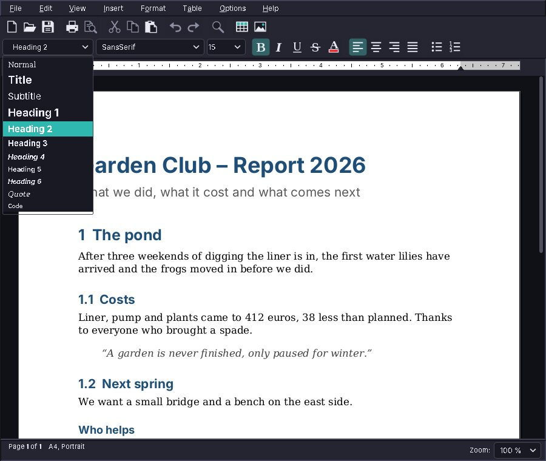

A **paragraph style** gives a paragraph its look in one step: font, size, colour, spacing above and below. WritePad has eleven of them: **Normal** for the body text, **Title** and **Subtitle** for the top of a document, **Heading 1 to Heading 6** for chapters, sections and their parts, **Quote** for quotations, indented and in italics, and **Code** in a fixed-width font.

Choose a style in the **style box** at the left end of the format bar, which shows each style in its own look, or in *Format → Paragraph Style*. Faster are the keys:

| Keys | Style |
|---|---|
| ++ctrl+0++ | Normal |
| ++ctrl+1++ to ++ctrl+6++ | Heading 1 to Heading 6 |

++enter++ at the end of a heading goes on in Normal, so you type a heading, press ++enter++ and write the text below it. After a quote or code you stay in that style.

**Changing a style** changes every paragraph in it. *Format → Styles…* (++f11++) opens the dialog: choose a style on the left and set its font, size, colour, bold, italic and underline, and its alignment, line spacing, spacing and indents. The preview shows the result. *Match Selection* takes over the look of the text where the cursor is, so you can format one heading by hand and make all headings look like it; *Reset to Default* brings back WritePad's look. *OK* changes the document, and ++ctrl+z++ undoes it in one step.

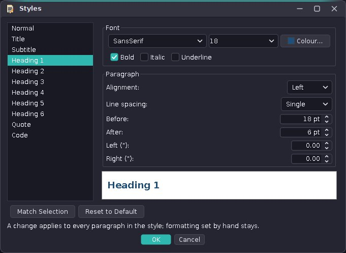

Formatting you set by hand, a bold word or a centred paragraph, stays on top of the style. *Format → Clear Direct Formatting* (++ctrl+m++) removes it from the selected text, or from the whole paragraph, and the text takes its style's look again.

The styles are saved in the file under the names that LibreOffice and Word use: a Heading 1 from WritePad is a Heading 1 there, appears in their navigator and table of contents, and comes back as Heading 1. WritePad's eleven styles are fixed for now; a document with styles of its own keeps their look, and its paragraphs open in the built-in style theirs is based on, usually Normal.

## Pictures

*Insert → Picture…* (or the picture button of the toolbar) puts a photo or drawing into the text: PNG, JPEG, GIF, BMP or TIFF. The file chooser shows a preview of the selected file and starts in your *Pictures* folder. A new picture goes on a line of its own, centred, and is made small enough to fit the page. You can also paste a picture (a screenshot, for example) or drag image files from the File Manager into the text.

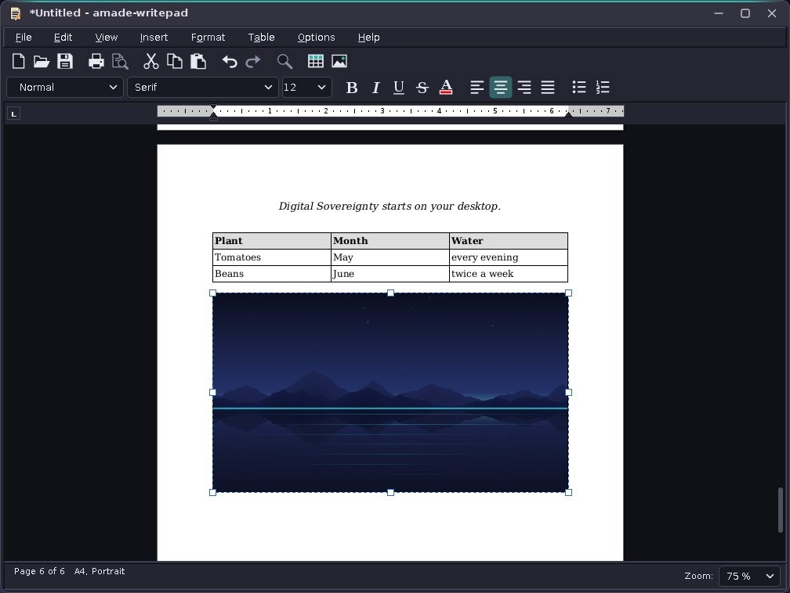

**Click** a picture to select it: a frame with eight handles appears. Drag a **corner** to make it larger or smaller, keeping its proportions (hold ++shift++ to stretch it freely), or drag the middle of an **edge** to change only the width or height. ++delete++ removes the selected picture, and cut, copy, paste and undo work as for text.

**Double-click** a picture, or choose *Format → Picture…*, for all its settings:

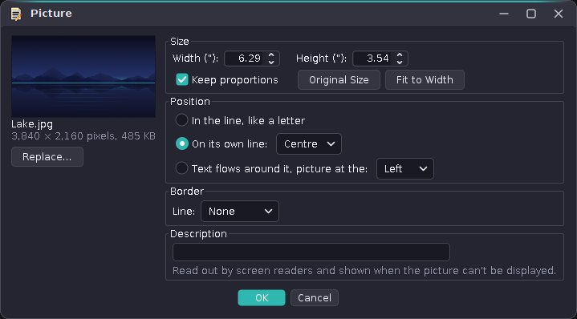

- **Size**, in centimetres (inches in the US). *Original Size* goes back to the picture's own size, *Fit to Width* makes it as wide as the text.
- **Position**: *in the line, like a letter*; *on its own line*, at the left, in the centre or at the right; or *text flows around it*, with the picture at the left or right margin and the text of the paragraph running down beside it.
- **Border**: none, a thin or a thick line.
- **Description**: a short text about what the picture shows. Screen readers read it out, and other programs show it when they cannot show the picture.

*Replace…* puts another picture in its place and keeps the size and position. The **right-click menu** of a picture also has *Original Size* and *Save Picture As…*, which saves the image as a file of its own.

Pictures are saved inside the document, in ODT, DOCX and RTF; a plain text file leaves them out. LibreOffice and Word show them in the same place.

## Tables

*Insert → Table…* (++ctrl+f12++) asks for the number of columns and rows, whether the first row is a **heading** (bold, on a grey background, and repeated at the top of every page the table runs onto), which lines to draw and how wide the table is. Faster: the table button of the toolbar shows a grid; move the mouse over it to choose the size and click.

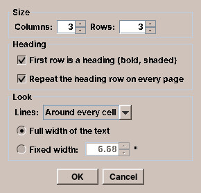

Inside the table, ++tab++ goes to the next cell and selects its text, ++shift+tab++ to the one before. ++tab++ in the last cell adds a new row. To type a real tab inside a cell, press ++ctrl+tab++. ++enter++ starts a new paragraph in the same cell. When a table is the very first thing in the document (or follows right after another table), ++enter++ at the start of its first cell makes room for a paragraph above it.

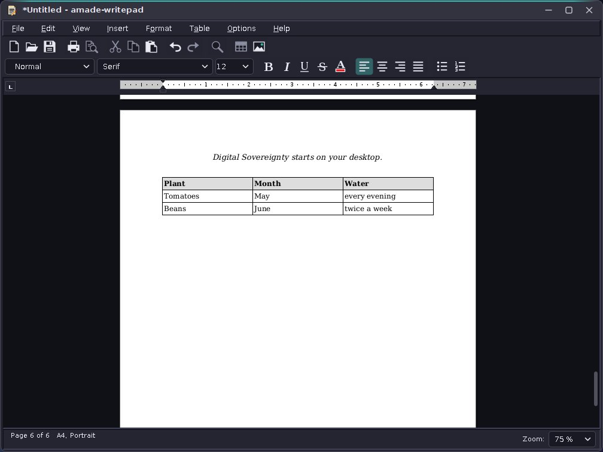

The **Table menu**, after *Format*, and the **right-click menu** in a cell insert rows above or below and columns to the left or right, delete the row, the column or the whole table, and select the row or the table. To make a column wider or narrower, **drag the line** between two columns; a dashed guide shows where it will go.

*Cell Background…* colours the cell the cursor is in, or all the selected cells. *Table Properties…* has three pages:

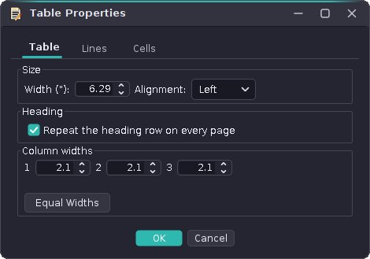

- **Table**: the width of the table and of each column (*Equal Widths* shares the width out evenly), its place between the margins (left, centred, right), and whether the heading row repeats on every page.
- **Lines**: around every cell, around the table only, between the rows only, or none, with their width and colour, and the space between the lines and the text. A table without lines shows thin dashed guides on the screen, which are not printed.
- **Cells**: the background and whether the text sits at the top, in the middle or at the bottom of the cell, for the selected cells.

A long table breaks between rows onto the next page; a row is never cut in half. Undo takes back each table change in one step.

## Pages and printing

*File → Page Setup…*, or *Format → Paper Size* and *Orientation*, choose **A5, A4, Letter or Legal**, portrait or landscape, and the margins. *File → Print…* prints through the printers of the Print Manager (chapter 27).

## File formats

| Format | Open | Save | |
|---|---|---|---|
| **ODT** (OpenDocument Text) | yes | yes | The standard format, used for new documents. LibreOffice and Word open it too. |
| **DOCX** (Word) | yes | yes | For documents from and for Word users. |
| **RTF** | yes | yes | The format of WordPad. |
| **Plain text** | yes | yes | Without formatting. |
| **DOC** (Word 97–2003) | yes | yes | Through LibreOffice, which is installed in amadeOS. |

Choose the format in *File → Save As…*. The title bar shows the file name and a `*` while there are unsaved changes; *New*, *Open* and *Exit* ask before throwing them away.

Pictures in a document from elsewhere are shown (PNG, JPEG and GIF; drawings and other formats are left out). Tables come in with their columns, lines, heading row and cell colours; **merged cells** are split again (the text stays in the first cell) and a table inside a table comes in as its text. In a plain text file a table becomes one line per row, its cells separated by tabs. Notes and comments are left out for now. Open such documents in LibreOffice Writer instead.

!!! sovereignty "Your data"
    ODT is an open, international standard (ISO/IEC 26300), used by many European administrations to exchange documents. A document in ODT can still be opened in many years, by many programs, without a licence from anybody.

!!! planned "Planned"
    Your own paragraph styles, a table of contents from the headings, merged cells, then header and footer, print preview and *Find*, spell checking and saving as PDF.

## LibreOffice

For everything WritePad does not do yet, merged cells, tables of contents, PDF export, **LibreOffice Writer** is installed in amadeOS, in the Text & Office drawer, in the five languages of amadeOS. It reads and writes the same ODT files.

Next to Writer, the drawer holds the other LibreOffice programs:

| Program | What it is for | Files |
|---|---|---|
| **LibreOffice Calc** | Spreadsheets: tables, formulas, charts | ODS, Excel (XLSX, XLS), CSV |
| **LibreOffice Impress** | Presentations and slide shows | ODP, PowerPoint (PPTX, PPT) |
| **LibreOffice Draw** | Drawings, diagrams, flyers; small changes in PDF files | ODG, PDF |
| **LibreOffice Math** | Mathematical formulas, also inside Writer documents | ODF |
| **LibreOffice** | The Start Center: opens any of them and shows the recent documents | |

Double-click a spreadsheet or a presentation in the File Manager and it opens in Calc or Impress. A PDF file still opens in the PDF Viewer; to change one, choose *Open with → LibreOffice Draw*. The database program LibreOffice Base is not installed.

??? hood "Under the hood"
    WritePad reads and writes ODT and DOCX with its own code, without a large office library; it runs LibreOffice in the background (`soffice --headless`) only to convert DOC files. Its settings are in `~/.config/amadeos/writepad/writepad.properties`.

## Label Printer

**Label Printer** prints labels and business cards on sheets of many labels: address labels for the Christmas mail, a shipping label, name badges for a meeting, labels for jam jars or file folders, your own business cards. You design **one** label, and the program places it on the sheet as often as it fits. With **mail merge**, every label gets the next address from a list.

Start it from the **Text & Office** drawer, with `amade-labelprinter`, or by double-clicking a `.label` file in the File Manager.

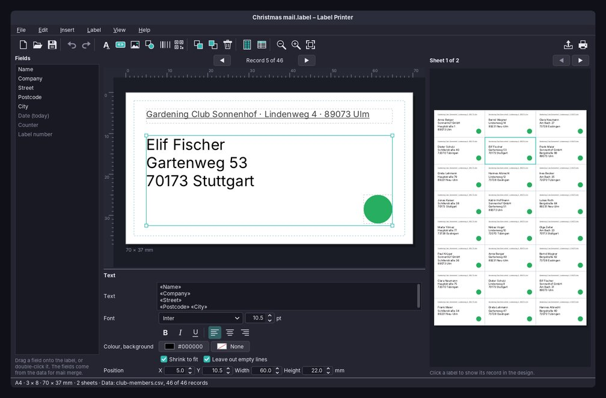

### The window

- **The toolbar**: new, open, save; undo and redo; insert a text, a field, a picture, a shape, a barcode or a QR code; front and back; delete; the label sheet and the data; zoom; on the right *Export as PDF* and *Print*. Hold the pointer over a button to see its name.
- **Fields**, on the left: the columns of your data and three built-in fields. Drag a field onto the label, or double-click it.
- **The label** in the middle, in its real proportions, with a ruler in millimetres. Above it, with data, the record that is shown, and the arrows to go through them (++ctrl+page-up++, ++ctrl+page-down++).
- **The properties** below the label: everything about the selected element, or about the label when nothing is selected.
- **The sheet**, on the right, exactly as it will be printed. Click a label on it to see its record in the design.

### Choosing the label sheet

Label sheets have the size of their labels printed on the package: *70 × 37 mm, 24 labels*. *Label → Label Sheet…* (++ctrl+l++) lists about seventy common sheets by kind: address, shipping and multi-purpose labels, business cards, name badges, file folder spines, round labels, CD and DVD labels, freezer and jar labels. Type the size from the package into *Size*, such as `70x37`, `63.5 x 38.1`, `3x8` or `24`, and the matching sheets are left. The box below the kinds chooses the paper: A4, A5, A6 or Letter.

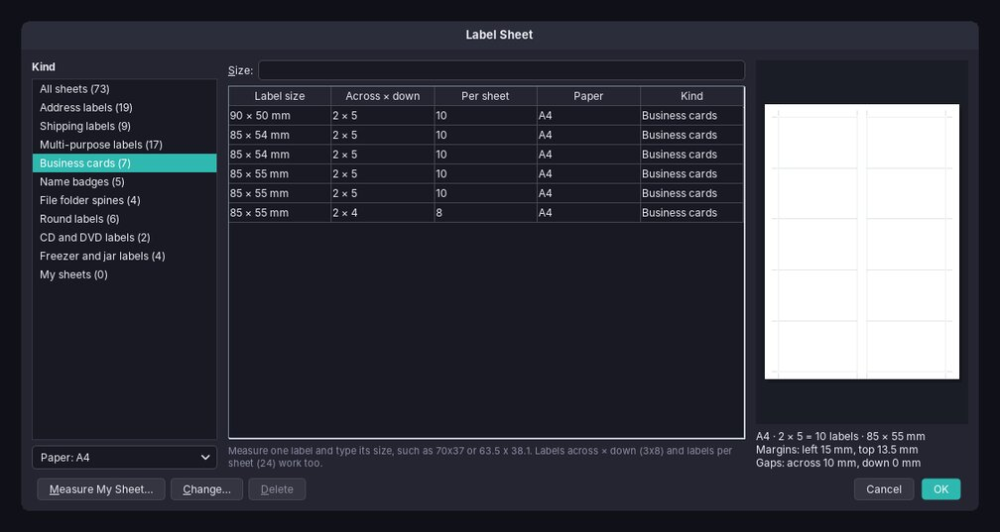

A sheet that is not in the list you measure once with a ruler: *Measure My Sheet…* asks for the paper, how many labels across and down, the size of a label, the distance from the top left corner of the paper to the first label, and the gaps between the labels. Labels can be rectangles with round corners, ellipses or discs with a hole (for CDs). The drawing follows every value you type; a sheet whose labels do not fit on the paper cannot be saved. Your own sheets are under *My sheets*, where *Change…* and *Delete* work on them.

### Designing the label

*Insert* puts a **text**, a **field**, a **picture**, a **shape** (rectangle, ellipse, line), a **barcode** (EAN-13, EAN-8, Code 128, Code 39) or a **QR code** on the label. Drag an element to move it, its handles to size it; the arrow keys move it by half a millimetre, with ++shift++ by 5 mm. ++tab++ selects the next element, ++delete++ removes it, ++ctrl+d++ duplicates it. *Edit → Bring to Front* and *Send to Back* decide what lies on top. Every change can be undone (++ctrl+z++, ++ctrl+y++).

For a **text** the properties hold the text itself, the font and size, bold, italic, underline and the alignment, the **text colour** and a **background colour** behind the text. **Shrink to fit** makes a long name smaller instead of cutting it off. **Leave out empty lines** closes the gap when an address has no company.

With nothing selected, the properties belong to the **label**: a **background** colour or picture, and *Print over the edge (bleed)*, so that a coloured business card has no white rim after cutting.

A text can mix fixed words and fields: `Dear «First name»,`. Type the field names in « » yourself, or drag them in from the list. A QR code or barcode can hold fields too, such as a membership number.

### Mail merge: a label for every address

*Label → Data for Mail Merge…* (++ctrl+m++) chooses where the addresses come from:

- **A file**: a CSV or tab-separated file (as spreadsheets and websites export them; the separator and the character set are recognised), a spreadsheet (`.ods`, `.xlsx`), or a vCard file (`.vcf`) exported from a phone. *First row holds the column names* when the file has a heading row.
- **Contacts**: all your contacts from the Contacts app ([chapter 45](45-calendar.md#contacts)), or one group, such as *Club*. The columns are name, first and last name, title, company, job title, street, postcode, city, country, phone, e-mail and groups.
- **Type a list**: type or paste the addresses, with an empty line between two; their lines become the fields *Line 1*, *Line 2* and so on.

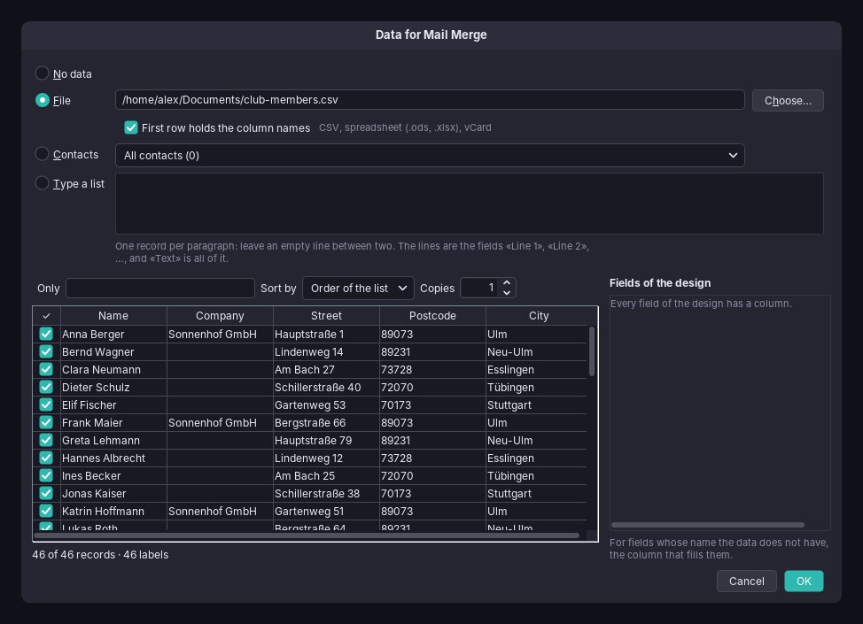

Below, the records are listed. Untick those who should not get a label. *Only* keeps the records that contain a text, or a column with a value: `City = Ulm`, `City != Ulm`. *Sort by* orders them, for example by postcode for a mass mailing, and *Copies* prints each record more than once. When your design has a field the data calls differently, such as *Name* in the design and *Full name* in the file, choose the column on the right.

The file is read again each time you open the design, and with *Label → Reload Data* (++f5++), so changes to the list are always printed.

The three **built-in fields** need no data: *Date (today)*, *Counter* (the properties choose its first number and how many digits it has, `0001`, for numbered tickets or inventory labels) and *Label number*.

### Business cards

Choose a sheet of the kind *Business cards*. With nothing selected, *Sides: Front and back* gives the card a back of its own; the two buttons in the toolbar switch between front and back. The back is printed on the second side of each sheet, mirrored so that it lies behind its front when you print on both sides.

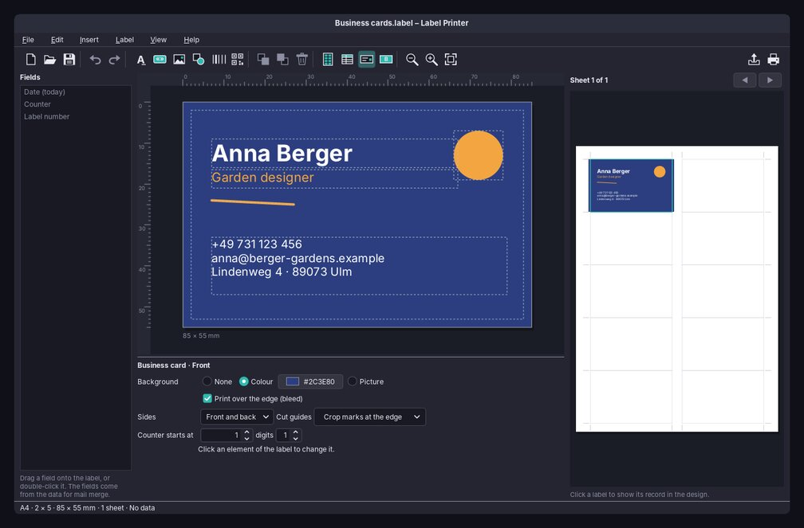

Business card sheets come with pre-cut cards. For plain card stock, *Cut guides* prints either a **line around each label** or **crop marks at the edge**: short marks outside the cards, at the edge of the sheet, which show where to cut without printing anything on the cards themselves.

### Printing

*File → Print…* (++ctrl+p++) shows the sheet once more.

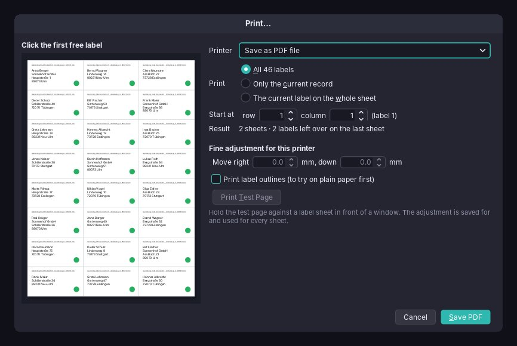

- **A partly used sheet**: click the first free label on the drawing, and printing starts there. The *Result* line says how many sheets you need.
- **Print**: all records, only the current one, or the current label on the whole sheet, for a sheet full of the same return address or business card.
- **Fine adjustment**: some printers place everything a little off. Print a test page on plain paper, hold it against a label sheet in front of a window, and enter how many millimetres to move right and down. The values are kept for this printer.
- *Print label outlines* shows where the labels are, to try on plain paper first.

Choose *Save as PDF file* as the printer, or *File → Export as PDF…* (++ctrl+e++), to print at a copy shop or send the labels to somebody.

!!! planned "Planned"
    Templates to start from (return address, name badge, jar label, business card) and a photo for each record, for name badges.

??? hood "Under the hood"
    A `.label` file is a ZIP archive with the design as JSON (`label.json`) and its pictures, so it can be moved to another computer in one piece. Your own sheets are in `~/.config/amadeos/labelprinter/own-sheets.json`, the last sheet, folder, printer and the fine adjustment for each printer in `labelprinter.properties` next to it. *Save as PDF* writes PostScript and turns it into PDF with Ghostscript (`ps2pdf`). Barcodes and QR codes are drawn with the ZXing library.
