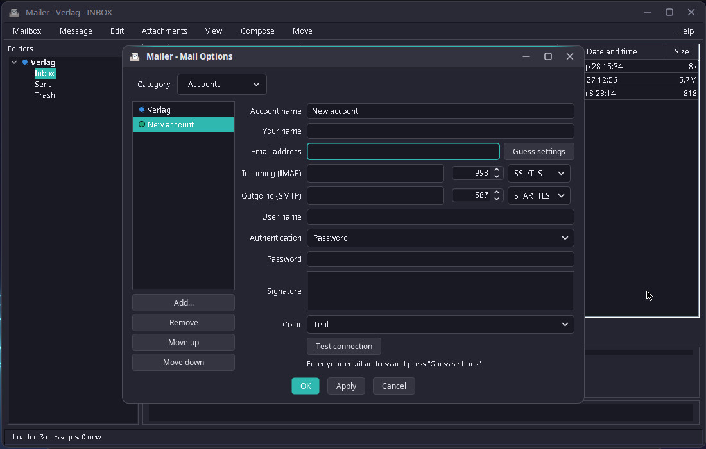
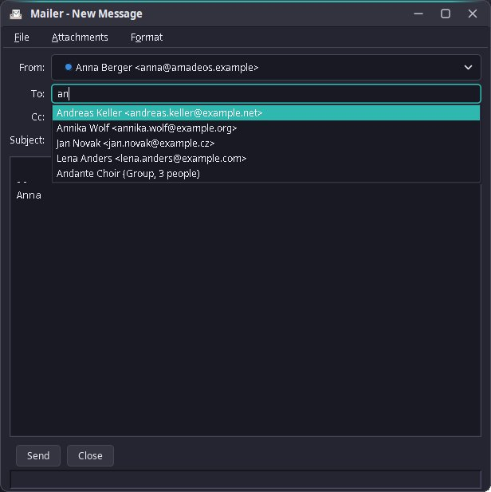
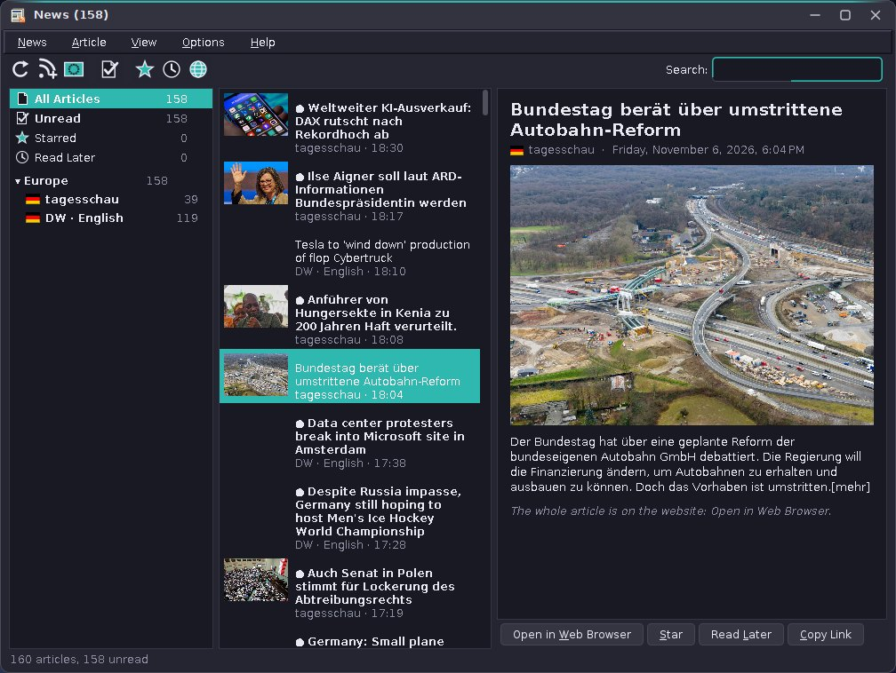
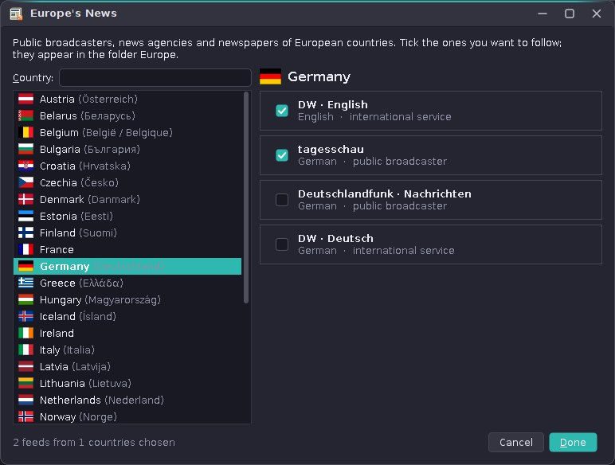
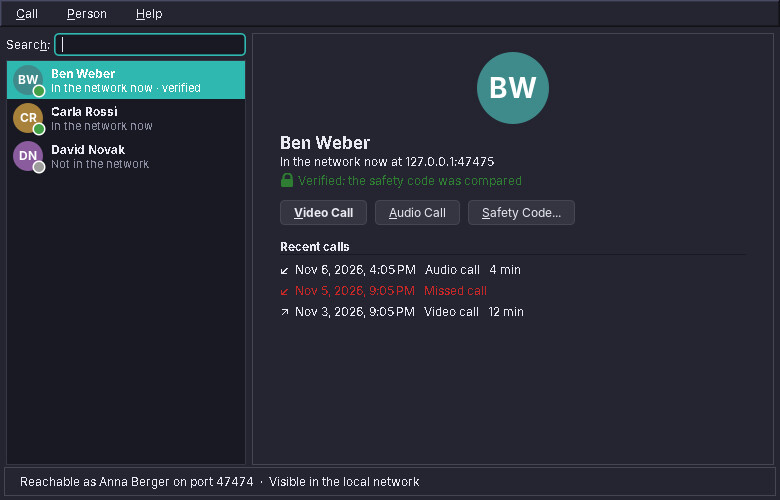
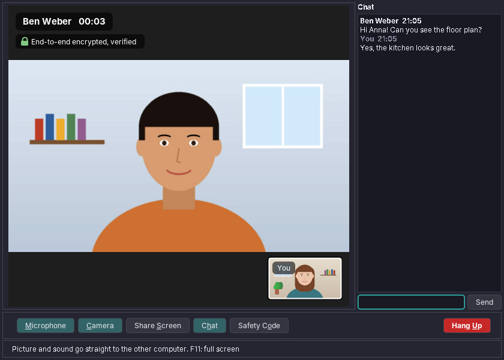
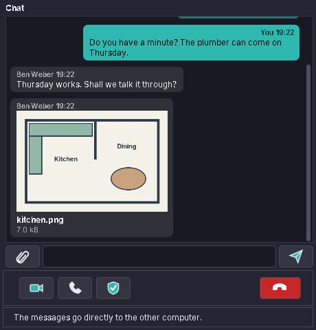
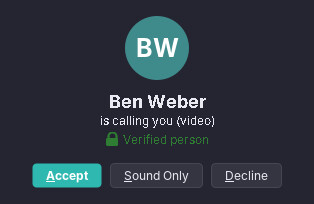

# 44. Mailer, News and Calls

## Mailer

The **Mailer** reads and sends e-mail, from as many accounts as you have. It is modelled on the CDE Mailer, with what a mail program needs today: the folders of the mail server in a column of their own, several accounts in one window, and mail in HTML shown safely.

Start it with the Mail & Internet slot of the Front Panel, or with `amade-mail`.

### Setting up an account

On the first start, the Mailer opens *Mail Options* with the **Accounts** page, because it has nothing to show yet. Later it is at *Mailbox → Mail Options…*.

1. Click **Add…**.
2. Enter a name for the account, such as *Private*, your name and your e-mail address.
3. Click **Guess settings**. The Mailer fills in the servers of the common providers from the address.
4. Check the servers: **Incoming (IMAP)** and **Outgoing (SMTP)**, each with its port and security (*SSL/TLS* or *STARTTLS*). Your provider's help pages list them.
5. Enter the **user name**, usually the address, and the **password**.
6. Click **Test connection**, then **OK**.

Each account gets a **colour**, which marks its mail when the inboxes are shown together. **Signature** is added below every message you write from that account.

!!! tip "Gmail"
    For Gmail, *Guess settings* chooses the sign-in with Google (OAuth2), which needs an access key of your own from Google. The simpler way is a Google **app password**: turn on 2-step verification in your Google account, create an app password at `myaccount.google.com/apppasswords`, set *Authentication* to *Password* and enter the 16 characters without spaces.

### Reading mail

- **The folder column** on the left (*View → Show Folders*) shows each account with its folders: Inbox, Drafts, Sent, Junk, Trash and your own, with the number of unread messages. With more than one account, **All inboxes** shows them together.
- **The message list**: sender, subject, date, and the letters of the CDE Mailer: `N` new, `A` answered, `!` flagged, `@` with attachment.
- **The message** below, with the buttons *Delete*, *Next*, *Previous*, *Reply to Sender* and *Forward*.
- **Attachments** in a bar under the message: *Open* or *Save As…*.

When a check of the mail finds new messages in an inbox, a notification in the corner of the screen (chapter 28) names the account and the number of new messages; a click on it opens that inbox.

*View → Plain Text* or *HTML* switches how mail in HTML is shown. The **Move** menu moves the selected message to another folder of its account. *Message → Show Source* shows the message as it arrived.

### Writing mail

*Compose → New Message*, or *Reply to Sender*, *Reply to All* and *Forward*. The compose window has *From* (the account), *To*, *Cc*, *Subject* and the attachments; *Format → Show Bcc Field* adds *Bcc*. Files dropped on the window become attachments. *Format → Special Characters…* (++ctrl+shift+u++) puts characters your keyboard lacks into the text, the subject or an address, *Format → Smileys and Emoji…* (++ctrl+period++) smileys ([chapter 40](40-applications.md#smileys-and-emoji)).

**Addresses from your contacts.** Start typing a name, a nickname or a part of an address into *To*, *Cc* or *Bcc*, and a list below the field shows the matching people from [Contacts](45-calendar.md#contacts); "mull" also finds "Müller". ++arrow-down++ and ++arrow-up++ choose, ++enter++ or ++tab++ takes the address, ++esc++ closes the list. A group from Contacts, such as *Chor*, puts in the addresses of all its members at once.

A mail with an appointment in it, as an `.ics` file or as text from the Calendar, shows a bar with **Schedule in Calendar** (chapter 45).

!!! sovereignty "Your data"
    - **Pictures from the internet are blocked** in HTML mail, because senders use them to see whether and when you read their mail. A bar offers *Load images* for this message or *Always for this sender*.
    - **Links** are never followed inside the Mailer. A click shows where the link really goes and asks before opening the web browser.
    - Scripts, forms and frames are removed from HTML mail before it is shown.
    - **Passwords** are never written to a settings file. They are kept in your **keyring**, which your login password locks and unlocks: it opens when you log in and stays closed to everybody else.
    - The connection to the server is encrypted and the server's certificate checked. *STARTTLS* never falls back to an unencrypted connection.

!!! planned "Planned"
    In the Mailer: new mail shown at once, folders to create and rename, drafts and templates, search, threads and printing, and reading mail without a network.

??? hood "Under the hood"
    The accounts, without passwords, are in `~/.config/amadeos/mail/accounts.conf`, the settings of *Message View* in `mail.conf`. The Mailer reads mail over IMAP and keeps it on the server; it sends over SMTP.

## News

**News** follows websites, blogs and podcasts through their **feeds**. Many websites announce their newest articles in a feed (RSS or Atom); News fetches them and shows them in one list, with pictures and without advertising. **Europe's News** offers the public broadcasters, news agencies and newspapers of European countries, sorted by country.

Start it from the Mail & Internet drawer of the Front Panel, or with `amade-news`.

The window has three columns:

- **On the left** *All Articles*, *Unread*, *Starred* and *Read Later*, then your feeds and their folders, each with the number of unread articles. A feed that could not be fetched shows why below its name.
- **In the middle** the articles of what you chose on the left, newest first, with a small picture. Unread ones have a dot and are bold.
- **On the right** the article: title, feed and date, picture and text. Most feeds carry only the start of an article; **Open in Web Browser** shows all of it.

### Choosing what to follow

On the first start, News has nothing to show and offers three ways in:

- **Europe's News** (*News → Europe's News…*, ++ctrl+e++): the countries of Europe with their flags, and for each country its feeds. Tick the ones you want to follow and click **Done**. They appear in the folder *Europe*; unticking a feed unsubscribes it. Feeds in your language and in English come first. Type into **Country** to find a country by its English or its own name.
- **Add Feed** (*News → Add Feed…*, ++ctrl+n++): type the address of a website, such as `tagesschau.de`, and click **Find Feeds**. News looks for the feeds the page names and lists them with the number of articles and the newest date. Choose one, give it a name and a folder, and click **Subscribe**. The address of a feed itself works as well.
- **Import Subscriptions** (*News → Import Subscriptions…*): the subscriptions of another feed reader, saved there as an *OPML* file. *Export Subscriptions…* writes such a file of your own.

A right click on a feed offers **Update**, **Open Website**, **Rename…**, **Move to Folder…**, **Mark All as Read** and **Unsubscribe…**; on a folder, **Rename Folder…**.

### Reading

Clicking an article shows it and marks it **read**. **Star** (++ctrl+d++) and **Read Later** (++ctrl+l++) put it into the lists of the same names, where it stays as long as you like. **Copy Link** copies its address. The search field (++ctrl+f++) finds articles that contain all the words you type.

In the lists, single keys work as in other feed readers:

| Key | What it does |
|---|---|
| ++j++ / ++k++ | Next / previous article |
| ++n++ or ++space++ | Next unread article |
| ++s++ | Star |
| ++l++ | Read Later |
| ++m++ | Mark as read or unread |
| ++o++ or ++enter++ | Open in the web browser |
| ++f5++ | Update all feeds (++shift+f5++: the selected feed or folder) |

### Preferences

*Options → Preferences…* sets how often News updates its feeds (every 15 minutes to every 2 hours, or only by hand), whether it updates when it starts, how long it keeps articles (a week to a year; starred ones and those in *Read Later* always), the text size and whether pictures are shown, and whether an article is marked read as soon as it is shown.

!!! sovereignty "Your data"
    - News fetches the feeds you subscribed to and their pictures, nothing else. No account, no tracking: the websites learn only that a feed reader asked for their feed.
    - It asks each website whether its feed has changed before fetching it again, and leaves a website alone for as long as it asks to be.
    - The connections go through the proxy of Settings: Network (chapter 38).

!!! planned "Planned"
    In News: the whole article shown inside News, cleaned up from its web page; podcasts handed to the Audio Station; Europe's News updated from amadeos.eu between releases.

??? hood "Under the hood"
    The subscriptions are in `~/.config/amadeos/news/subscriptions.opml`, the preferences in `news.properties` next to it. The articles of each feed are a JSON file in `~/.local/share/amadeos/news/articles/`, the pictures in `~/.cache/amadeos/news/images/`, where they are removed after 30 days. News reads RSS and Atom with its own parser, which does not follow references to other files inside a feed.

## Calls

**Calls** makes video and audio calls to other amadeOS computers. Computers in the same network, at home or in the office, find each other by themselves; picture and sound go straight from one computer to the other, end-to-end encrypted, without a server or an account in between.

Start it from the Mail & Internet drawer of the Front Panel, or with `amade-call`.

On the left are the **people**: first those whose computer is in the network now, with a green dot, then those you called before, with a grey one. *verified* below a name means you compared the safety code with that person (see *Safety code* below). The search field finds a person by name or address. On the right are the person you chose, the buttons to call them and the recent calls.

The name others see is the one in *Call → Settings…*; at first it is your full name and the name of the computer.

### Calling

Choose a person and click **Video Call** (++ctrl+enter++), **Audio Call** (++ctrl+shift+enter++) or **Chat** (++ctrl+t++). The buttons show pictures; their names appear when the pointer rests on them. A computer that does not show up in the list, for example one behind a VPN, is called with *Call → Call Address…* (++ctrl+l++): type its name, such as `anna-pc.local`, or its IP address, such as `192.168.1.20`, if needed with the port, such as `192.168.1.20:47475`.

The call window shows the other person large and yourself small in the corner:

| Switch | What it does |
|---|---|
| **Microphone** (++ctrl+d++) | Switches your microphone off and on; the other side sees a crossed-out microphone |
| **Camera** (++ctrl+e++) | Switches your camera off and on; the other side sees your initials instead |
| **Share Screen** | Shows your screen instead of the camera, and back. The other side sees everything on it |
| **Chat** | Messages, pictures and files beside the picture (see *Chat* below) |
| **Safety Code** | The numbers to compare (below) |
| **Hang Up** | Ends the call |

++f11++ shows the picture on the whole screen, ++esc++ goes back. When the call ends, the window says why, for example *The call was declined* or *Busy: the other side is in another call*, and closes.

### Chat

A **chat** is a conversation in writing, without picture and sound: choose a person and click **Chat** (++ctrl+t++). The other side sees *wants to chat with you* and accepts as with a call. Your messages are on the right in the colour of your theme, theirs on the left. The camera and handset buttons below end the chat and call the same person; the messages so far move into the call window.

**Pictures and files** go with the paper clip next to the text field, or by dragging them from the File Manager onto the chat, up to 2 GB each. Pictures show small in the chat; a click opens a picture or file with its program. Received files are in the folder *Downloads/amade-call*; a file there is never overwritten, a second *photo.jpg* becomes *photo (2).jpg*. A received program or script is not started by a click; its folder opens instead.

The chat with each person is **kept**, encrypted, and the next chat or call with them shows it above, lighter and with the date. *Person → Clear Chat History…* deletes it, and *Keep chats* in the settings turns it off.

**From Contacts.** *Person → Add to Contacts…* puts the person into [Contacts](45-calendar.md#contacts), into a contact of the same name or a new one. Their card there then has a line *amadeOS Calls* with buttons for a video call, an audio call and a chat.

### When someone calls

A call rings with a window of its own, also when the Calls window is closed:

**Accept** answers with picture and sound, **Sound Only** without your camera (you can switch it on later), **Decline** rejects the call. A call you did not answer becomes a notification with **Call Back** (chapter 28).

To be reachable without opening Calls, switch on *Wait for calls after login* in *Call → Settings…*. Calls then starts in the background when you log in; closing its window keeps it waiting, *Call → Exit* (++ctrl+q++) ends it.

### Safety code

Every computer has its own key. The **safety code** is made from the keys of both computers: 30 digits in six groups. Read them out to each other once, during a call or on the phone. If they are the same on both screens, the call goes straight from your computer to the other one and nobody sits in between; click **They Match**, and the person is *verified* from then on. If they differ, click **They Differ** and do not say anything private until you have found out why.

If another computer answers at the address of a person you know, for example after a new installation there, Calls does not make the call and says *Another computer answered at this address*.

### Settings

*Call → Settings…* (++ctrl+comma++) sets your name, the camera, microphone and speakers (or those of the desktop), whether video calls start with the camera on, echo cancellation for laptops without headphones, *Wait for calls after login* and the network port (47474). It also shows your key.

!!! sovereignty "Your data"
    - A call goes directly from computer to computer. There is no server, no account and no phone number; nobody else learns who called whom.
    - Picture and sound are encrypted with WebRTC (DTLS-SRTP), the messages before them with TLS 1.3. The safety code shows that the keys on both ends are the right ones.
    - Calls announces your name and key in the local network, so that others see you in their list. Who you called and when stays on your computer.

!!! planned "Planned"
    In Calls: calls over the internet with addresses like `name@call.amadeos.eu`, a relay for networks without a direct way, group calls and a blurred background.

??? hood "Under the hood"
    The key is in `~/.local/share/amadeos/call/identity.p12`, readable by you only; the settings, the known people and the list of calls are in `~/.config/amadeos/call/`. Kept chats are in `~/.local/share/amadeos/call/chats/`, one file per person, encrypted with AES-256-GCM; the key lies in your login keyring. Pictures and files travel in pieces through the same encrypted connection as the messages and are checked with SHA-256 when they arrive. Computers find each other with Avahi (`_amadeos-call._tcp`); the calls are set up over TCP port 47474 (or the next free one) and the picture and sound go through GStreamer's WebRTC parts with VP8 and Opus. Without Avahi, calls by address still work.
