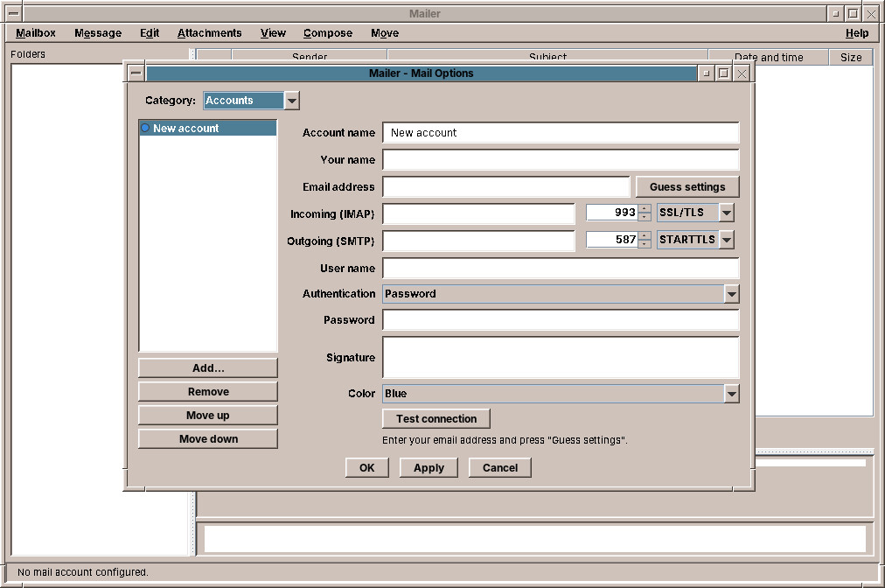

# 44. Mailer

The **Mailer** reads and sends e-mail, from as many accounts as you have. It is modelled on the CDE Mailer, with what a mail program needs today: the folders of the mail server in a column of their own, several accounts in one window, and mail in HTML shown safely.

Start it with the Mail & Internet slot of the Front Panel, or with `amade-mail`.

## Setting up an account

On the first start, the Mailer opens *Mail Options* with the **Accounts** page, because it has nothing to show yet. Later it is at *Mailbox → Mail Options…*.

1. Click **Add…**.
2. Enter a name for the account, such as *Private*, your name and your e-mail address.
3. Click **Guess settings**. The Mailer fills in the servers of the common providers from the address.
4. Check the servers: **Incoming (IMAP)** and **Outgoing (SMTP)**, each with its port and security (*SSL/TLS* or *STARTTLS*). Your provider's help pages list them.
5. Enter the **user name**, usually the address, and the **password**.
6. Click **Test connection**, then **OK**.

Each account gets a **colour**, which marks its mail when the inboxes are shown together. **Signature** is added below every message you write from that account.

!!! tip "Gmail"
    For Gmail, *Guess settings* chooses the sign-in with Google (OAuth2), which needs an access key of your own from Google. The simpler way is a Google **app password**: turn on 2-step verification in your Google account, create an app password at `myaccount.google.com/apppasswords`, set *Authentication* to *Password* and enter the 16 characters without spaces.

## Reading mail

- **The folder column** on the left (*View → Show Folders*) shows each account with its folders: Inbox, Drafts, Sent, Junk, Trash and your own, with the number of unread messages. With more than one account, **All inboxes** shows them together.
- **The message list**: sender, subject, date, and the letters of the CDE Mailer: `N` new, `A` answered, `!` flagged, `@` with attachment.
- **The message** below, with the buttons *Delete*, *Next*, *Previous*, *Reply to Sender* and *Forward*.
- **Attachments** in a bar under the message: *Open* or *Save As…*.

*View → Plain Text* or *HTML* switches how mail in HTML is shown. The **Move** menu moves the selected message to another folder of its account. *Message → Show Source* shows the message as it arrived.

## Writing mail

*Compose → New Message*, or *Reply to Sender*, *Reply to All* and *Forward*. The compose window has *From* (the account), *To*, *Cc*, *Subject* and the attachments; *Format → Show Bcc Field* adds *Bcc*. Files dropped on the window become attachments.

A mail with an appointment in it, as an `.ics` file or as text from the Calendar, shows a bar with **Schedule in Calendar** (chapter 45).

!!! sovereignty "Your data"
    - **Pictures from the internet are blocked** in HTML mail, because senders use them to see whether and when you read their mail. A bar offers *Load images* for this message or *Always for this sender*.
    - **Links** are never followed inside the Mailer. A click shows where the link really goes and asks before opening the web browser.
    - Scripts, forms and frames are removed from HTML mail before it is shown.
    - **Passwords** are never written to a settings file. They are kept in your **keyring**, which your login password locks and unlocks: it opens when you log in and stays closed to everybody else.
    - The connection to the server is encrypted and the server's certificate checked. *STARTTLS* never falls back to an unencrypted connection.

!!! planned "Planned"
    In the Mailer: new mail shown at once, folders to create and rename, drafts and templates, search, threads and printing, and reading mail without a network.

??? hood "Under the hood"
    The accounts, without passwords, are in `~/.config/amadeos/mail/accounts.conf`, the settings of *Message View* in `mail.conf`. The Mailer reads mail over IMAP and keeps it on the server; it sends over SMTP.
