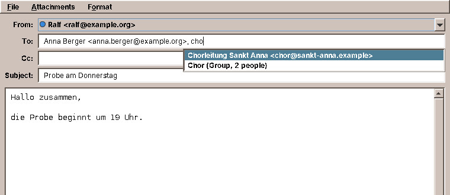
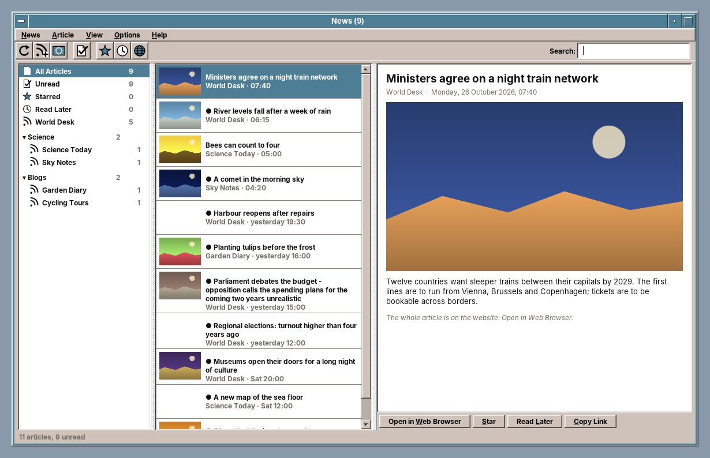
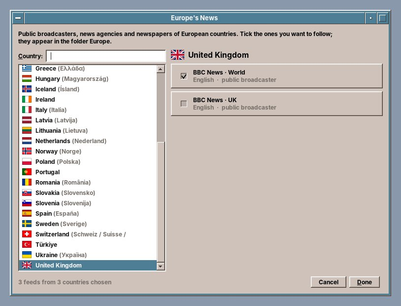

# 44. Mailer and News

## Mailer

The **Mailer** reads and sends e-mail, from as many accounts as you have. It is modelled on the CDE Mailer, with what a mail program needs today: the folders of the mail server in a column of their own, several accounts in one window, and mail in HTML shown safely.

Start it with the Mail & Internet slot of the Front Panel, or with `amade-mail`.

### Setting up an account

On the first start, the Mailer opens *Mail Options* with the **Accounts** page, because it has nothing to show yet. Later it is at *Mailbox → Mail Options…*.

1. Click **Add…**.
2. Enter a name for the account, such as *Private*, your name and your e-mail address.
3. Click **Guess settings**. The Mailer fills in the servers of the common providers from the address.
4. Check the servers: **Incoming (IMAP)** and **Outgoing (SMTP)**, each with its port and security (*SSL/TLS* or *STARTTLS*). Your provider's help pages list them.
5. Enter the **user name**, usually the address, and the **password**.
6. Click **Test connection**, then **OK**.

Each account gets a **colour**, which marks its mail when the inboxes are shown together. **Signature** is added below every message you write from that account.

!!! tip "Gmail"
    For Gmail, *Guess settings* chooses the sign-in with Google (OAuth2), which needs an access key of your own from Google. The simpler way is a Google **app password**: turn on 2-step verification in your Google account, create an app password at `myaccount.google.com/apppasswords`, set *Authentication* to *Password* and enter the 16 characters without spaces.

### Reading mail

- **The folder column** on the left (*View → Show Folders*) shows each account with its folders: Inbox, Drafts, Sent, Junk, Trash and your own, with the number of unread messages. With more than one account, **All inboxes** shows them together.
- **The message list**: sender, subject, date, and the letters of the CDE Mailer: `N` new, `A` answered, `!` flagged, `@` with attachment.
- **The message** below, with the buttons *Delete*, *Next*, *Previous*, *Reply to Sender* and *Forward*.
- **Attachments** in a bar under the message: *Open* or *Save As…*.

When a check of the mail finds new messages in an inbox, a notification in the corner of the screen (chapter 28) names the account and the number of new messages; a click on it opens that inbox.

*View → Plain Text* or *HTML* switches how mail in HTML is shown. The **Move** menu moves the selected message to another folder of its account. *Message → Show Source* shows the message as it arrived.

### Writing mail

*Compose → New Message*, or *Reply to Sender*, *Reply to All* and *Forward*. The compose window has *From* (the account), *To*, *Cc*, *Subject* and the attachments; *Format → Show Bcc Field* adds *Bcc*. Files dropped on the window become attachments.

**Addresses from your contacts.** Start typing a name, a nickname or a part of an address into *To*, *Cc* or *Bcc*, and a list below the field shows the matching people from [Contacts](45-calendar.md#contacts); "mull" also finds "Müller". ++arrow-down++ and ++arrow-up++ choose, ++enter++ or ++tab++ takes the address, ++esc++ closes the list. A group from Contacts, such as *Chor*, puts in the addresses of all its members at once.

A mail with an appointment in it, as an `.ics` file or as text from the Calendar, shows a bar with **Schedule in Calendar** (chapter 45).

!!! sovereignty "Your data"
    - **Pictures from the internet are blocked** in HTML mail, because senders use them to see whether and when you read their mail. A bar offers *Load images* for this message or *Always for this sender*.
    - **Links** are never followed inside the Mailer. A click shows where the link really goes and asks before opening the web browser.
    - Scripts, forms and frames are removed from HTML mail before it is shown.
    - **Passwords** are never written to a settings file. They are kept in your **keyring**, which your login password locks and unlocks: it opens when you log in and stays closed to everybody else.
    - The connection to the server is encrypted and the server's certificate checked. *STARTTLS* never falls back to an unencrypted connection.

!!! planned "Planned"
    In the Mailer: new mail shown at once, folders to create and rename, drafts and templates, search, threads and printing, and reading mail without a network.

??? hood "Under the hood"
    The accounts, without passwords, are in `~/.config/amadeos/mail/accounts.conf`, the settings of *Message View* in `mail.conf`. The Mailer reads mail over IMAP and keeps it on the server; it sends over SMTP.

## News

**News** follows websites, blogs and podcasts through their **feeds**. Many websites announce their newest articles in a feed (RSS or Atom); News fetches them and shows them in one list, with pictures and without advertising. **Europe's News** offers the public broadcasters, news agencies and newspapers of European countries, sorted by country.

Start it from the Mail & Internet drawer of the Front Panel, or with `amade-news`.

The window has three columns:

- **On the left** *All Articles*, *Unread*, *Starred* and *Read Later*, then your feeds and their folders, each with the number of unread articles. A feed that could not be fetched shows why below its name.
- **In the middle** the articles of what you chose on the left, newest first, with a small picture. Unread ones have a dot and are bold.
- **On the right** the article: title, feed and date, picture and text. Most feeds carry only the start of an article; **Open in Web Browser** shows all of it.

### Choosing what to follow

On the first start, News has nothing to show and offers three ways in:

- **Europe's News** (*News → Europe's News…*, ++ctrl+e++): the countries of Europe with their flags, and for each country its feeds. Tick the ones you want to follow and click **Done**. They appear in the folder *Europe*; unticking a feed unsubscribes it. Feeds in your language and in English come first. Type into **Country** to find a country by its English or its own name.
- **Add Feed** (*News → Add Feed…*, ++ctrl+n++): type the address of a website, such as `tagesschau.de`, and click **Find Feeds**. News looks for the feeds the page names and lists them with the number of articles and the newest date. Choose one, give it a name and a folder, and click **Subscribe**. The address of a feed itself works as well.
- **Import Subscriptions** (*News → Import Subscriptions…*): the subscriptions of another feed reader, saved there as an *OPML* file. *Export Subscriptions…* writes such a file of your own.

A right click on a feed offers **Update**, **Open Website**, **Rename…**, **Move to Folder…**, **Mark All as Read** and **Unsubscribe…**; on a folder, **Rename Folder…**.

### Reading

Clicking an article shows it and marks it **read**. **Star** (++ctrl+d++) and **Read Later** (++ctrl+l++) put it into the lists of the same names, where it stays as long as you like. **Copy Link** copies its address. The search field (++ctrl+f++) finds articles that contain all the words you type.

In the lists, single keys work as in other feed readers:

| Key | What it does |
|---|---|
| ++j++ / ++k++ | Next / previous article |
| ++n++ or ++space++ | Next unread article |
| ++s++ | Star |
| ++l++ | Read Later |
| ++m++ | Mark as read or unread |
| ++o++ or ++enter++ | Open in the web browser |
| ++f5++ | Update all feeds (++shift+f5++: the selected feed or folder) |

### Preferences

*Options → Preferences…* sets how often News updates its feeds (every 15 minutes to every 2 hours, or only by hand), whether it updates when it starts, how long it keeps articles (a week to a year; starred ones and those in *Read Later* always), the text size and whether pictures are shown, and whether an article is marked read as soon as it is shown.

!!! sovereignty "Your data"
    - News fetches the feeds you subscribed to and their pictures, nothing else. No account, no tracking: the websites learn only that a feed reader asked for their feed.
    - It asks each website whether its feed has changed before fetching it again, and leaves a website alone for as long as it asks to be.
    - The connections go through the proxy of Settings: Network (chapter 38).

!!! planned "Planned"
    In News: the whole article shown inside News, cleaned up from its web page; podcasts handed to the Audio Station; Europe's News updated from amadeos.eu between releases.

??? hood "Under the hood"
    The subscriptions are in `~/.config/amadeos/news/subscriptions.opml`, the preferences in `news.properties` next to it. The articles of each feed are a JSON file in `~/.local/share/amadeos/news/articles/`, the pictures in `~/.cache/amadeos/news/images/`, where they are removed after 30 days. News reads RSS and Atom with its own parser, which does not follow references to other files inside a feed.
