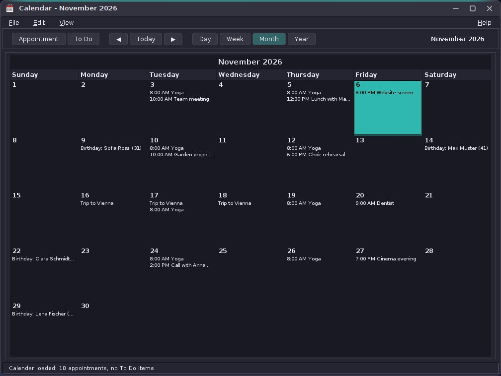
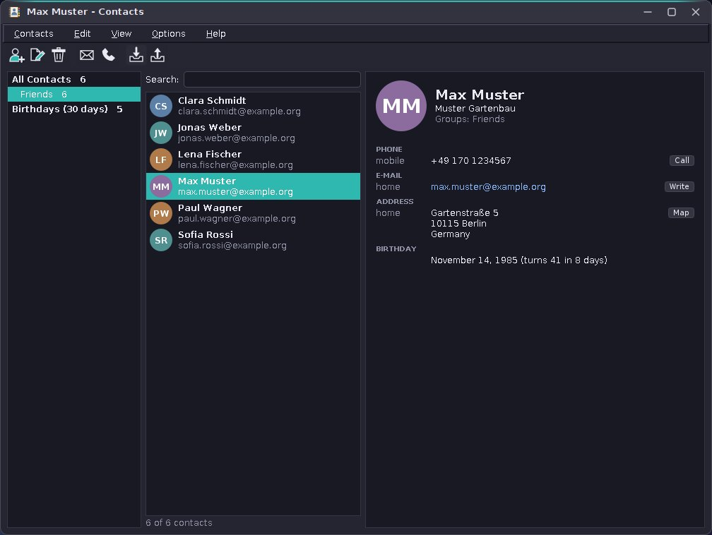
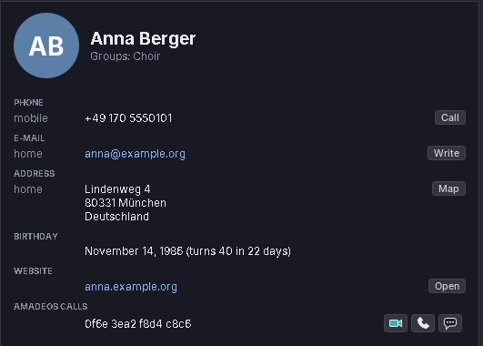
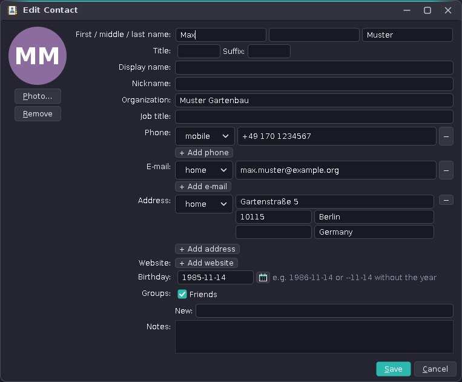
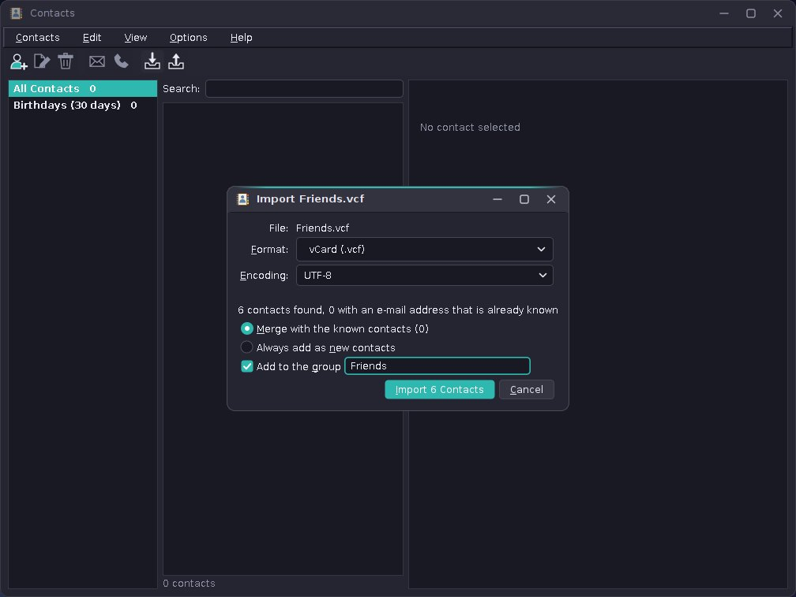
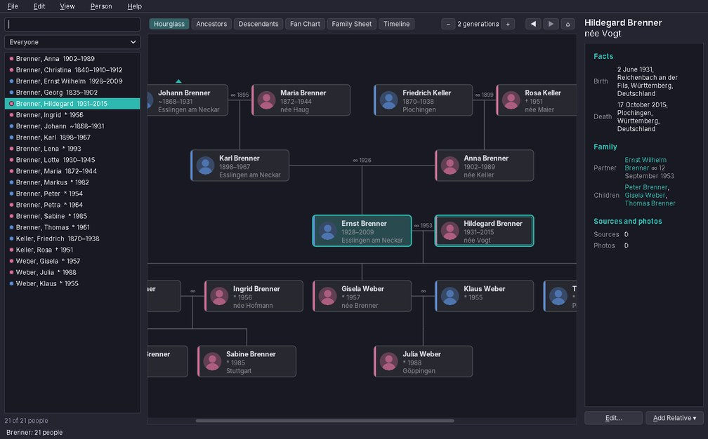
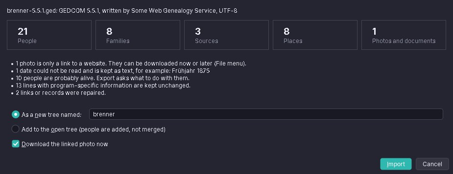
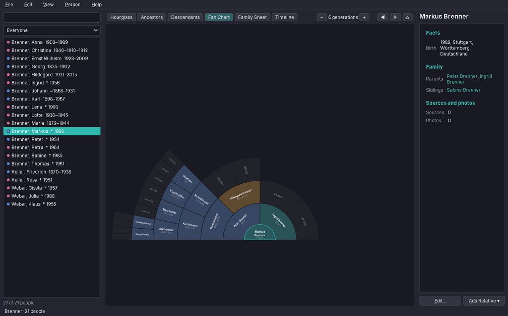
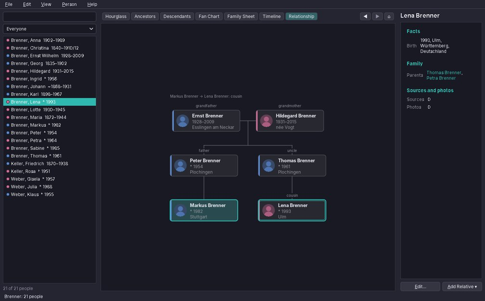
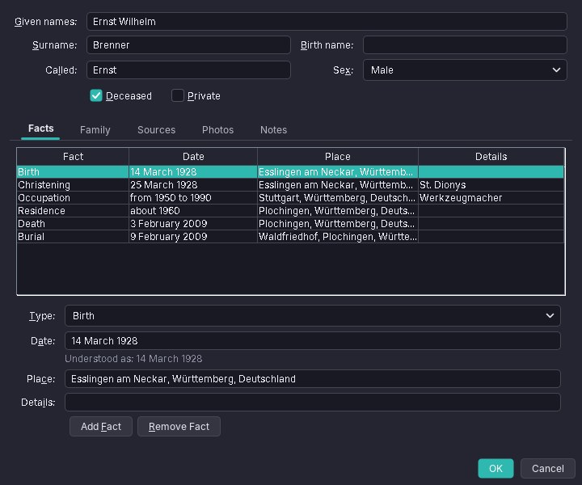

# 45. Calendar, Contacts and Family Tree

The Calendar keeps your appointments, the Contacts program the people you deal with. Both store their data in open standard formats that phones and other programs read as well.

## Calendar

The **Calendar** keeps your appointments and To Do items, reminds you of them, and exchanges them with the Mailer and other calendar programs. It is the CDE Calendar, with its four views, its Appointment Editor and its reminders, stored in the standard iCalendar format.

Click the **Calendar** in the Front Panel, which shows today's date, or start `amade-calendar`.

### The views

The buttons **Day**, **Week**, **Month** and **Year** in the tool bar switch the view; **◀**, **Today** and **▶** step back and forward by a day, a week, a month or a year. *View → Go To Date…* jumps anywhere.

| View | What it shows |
|---|---|
| **Day** | The day hour by hour, with a small calendar of three months beside it. Days with appointments are bold there. |
| **Week** | A column for each day with its appointments, and below a grid of the week with the taken hours shaded. |
| **Month** | The month with the appointments in the day boxes. |
| **Year** | The twelve months. A click on a month or a day opens it. |

### Appointments

**Double-click a day**, or an hour in the Day view, to open the **Appointment Editor** for it; double-click an appointment to change it. Enter the **Date**, **Start** and **End**, and in **What** what it is about; the first line is what the views show. Leave *Start* empty for an appointment without a time, such as a birthday. Then click **Insert**. **Change** saves changes to the selected appointment, **Delete** removes it.

The small calendar button next to each date field opens a date chooser.

**More** shows the rest:

- **Reminders**: *Beep*, *Flash* (the Calendar window draws attention), *Popup* (a notification in the corner of the screen, chapter 28, with *Snooze 5 min*) and *Mail* (a message to yourself, ready to send in the Mailer), each a chosen time before the appointment.
- **Occurs**: once, daily, weekly, every two weeks, monthly by date or by weekday, yearly, Monday to Friday and more, with **For** the number of times (empty for ever). When you change or delete one appointment of a series, the Calendar asks whether you mean *This One*, *Forward* (this one and all later ones) or *All*.
- **Privacy**: what others may see when the calendar is printed for them: time and text, the time only, or nothing.

Reminders appear while the Calendar runs, so leave it open, on another workspace if you like.

### To Do items

*Edit → To Do…* (or **To Do** in the tool bar) opens the To Do Editor: a due date, a description and *Completed*. *View → To Do List…* lists them with a check box each, and can show all, the pending or the completed ones.

### Finding and listing

*View → Find…* searches the text of the appointments, six months back and ahead, or with *Search all* the whole calendar. *View → Appointment List…* lists the appointments of the view's period in a table.

### With the Mailer and other calendars

- An **`.ics` file**, from a mail attachment, the File Manager or another calendar program, opens in the Calendar and its appointments are added. Files can also be dropped on the Calendar window.
- In a mail with an appointment, **Schedule in Calendar** adds it.
- In the Appointment Editor, **Mail…** opens the Mailer with the appointment as the message, and the **Drag Appointment** icon carries the appointment out to the File Manager or a mail as an `.ics` file.

**Birthdays** of the people in [Contacts](#contacts) appear on their day, "Birthday: Anna Berger (40)", with the age when the year of birth is known. They are not part of your calendar: to change one, change the contact. A double-click on a birthday offers to open Contacts. The *Mail To* address of a Mail reminder is completed from your contacts as in the Mailer.

An export of your Google Calendar opens without losses: repeating appointments with their exceptions, appointments spanning several days and times in other time zones.

### Printing

*File → Print Current View* (++ctrl+p++) prints what is on the screen. *File → Print…* chooses what to print, day, week, month or year, the appointment list or the To Do list, the dates and the number of copies.

### Options

*File → Options…* has a *Category* menu: **Editor Defaults** for new appointments, **Display Settings** (the hours of the Day and Week views, 12- or 24-hour time, the view to start with, and whether birthdays from Contacts are shown), **Date Format**, **Printer Settings** and **Language**.

!!! planned "Planned"
    One place for all your accounts, shared by the Mailer and the Calendar; showing other calendars next to your own (Google, Nextcloud and other CalDAV servers); keeping your calendar in step with a server both ways, which also lets you share a calendar with another person.

??? hood "Under the hood"
    The whole calendar is one iCalendar file (RFC 5545), `~/.local/share/amadeos/calendar/calendar.ics`, the options are in `~/.config/amadeos/calendar/calendar.conf`. What the Calendar does not know itself, such as places or attendees from other programs, it keeps and writes back unchanged.

## Contacts

**Contacts** is your address book: people and organizations with their phone numbers, e-mail and postal addresses, birthdays, groups, notes and a photo. It is in the **Text & Office** and **Mail & Internet** drawers of the Front Panel; or start `amade-contacts`.

### The window

The window has three columns:

- On the left, **All Contacts**, your **groups** and **Birthdays**, which lists everyone whose birthday is in the next 30 days, the soonest first. The numbers say how many contacts each has.
- In the middle, the contacts, with their photo or initials and an e-mail address or phone number below the name. *View → Sort by First Name* or *Sort by Last Name* sets the order.
- On the right, the **card** of the selected contact. Next to a phone number is **Call**, next to an e-mail address **Write**, next to an address **Map**, next to a website **Open**. A person you added from [Calls](44-mailer.md#chat) has a line *amadeOS Calls* with buttons for a video call, an audio call and a chat:

**Search** (++ctrl+f++) finds contacts by any part of what is on their card: the name, the organization, an e-mail address, a city, a group or the notes. Phone numbers are found by their digits, so `5550123` finds `+49 170 555 0123`, and accents do not count: `muller` finds *Müller*. ++down++ moves from the search field into the list, ++esc++ clears the search.

### Adding and changing contacts

**New Contact** (++ctrl+n++, the first tool bar button) opens an empty card; **Edit Contact** (++ctrl+e++, or a double-click on a contact) the selected one.

- **First, middle and last name**, a title such as *Dr.* and a suffix. The **Display name** is what the list shows; it follows the name as you type until you write your own, for example a nickname or a company.
- **Phone**, **E-mail**, **Address** and **Website** take as many entries as you need: **+ Add phone** and so on adds one, the **–** button removes it, and the menu in front says whether it is *mobile*, *home*, *work*, *fax* or *other*.
- **Birthday**: a date such as `1986-11-14`, or `--11-14` if you do not know the year. The small calendar button opens a date chooser.
- **Groups**: tick the groups the contact belongs to, or write new ones into **New**, separated by commas. A contact can be in several groups; a group exists as long as a contact is in it.
- **Photo…** chooses a picture; it is cut square and kept small.

**Save** keeps the contact, **Cancel** or ++esc++ forgets the changes. **Delete** (++del++) removes the selected contacts after asking.

### Writing, calling, finding the way

- **Write a mail** (++ctrl+m++) opens a new message in the Mailer to the selected contacts; select several, or a whole group with ++ctrl+a++, for a mail to all of them. **Write** on the card writes to that one address.
- **Call** hands the number to a program for phone calls, if one is installed, such as a softphone. Without one, the number is copied, so you can paste it where you need it.
- **Map** shows the address on OpenStreetMap in the web browser.
- *Edit → Copy* (++ctrl+c++) copies the selected contacts as "Name &lt;address&gt;" lines, which you can paste into the *To* field of a mail. *Copy as vCard* (++ctrl+shift+c++) copies them as a business card for other programs, and *Paste vCard* (++ctrl+v++) adds the business cards on the clipboard as contacts.

### Bringing your contacts along

*Contacts → Import…* (++ctrl+i++) reads contacts from another program. You can also drop a file on the window, or double-click a `.vcf` file in the File Manager.

| Coming from | Export there as | Import here |
|---|---|---|
| Android phone, iPhone, Thunderbird, Evolution, macOS Contacts | vCard (`.vcf`) | as it is |
| Google Contacts | *Export → Google CSV* or *vCard* | as it is |
| Outlook | *File → Open & Export → Import/Export → Export to a file → Comma Separated Values* | as it is, also a German Outlook |
| Thunderbird (older versions) | *Tools → Export → LDIF* | as it is |
| A table of your own (Excel, LibreOffice) | *Save as CSV* | check the columns |

The import window shows the format and the encoding it recognised; if umlauts look wrong, choose another **Encoding**. For tables it shows each column with an example and what it becomes: *First name*, *E-mail (work)*, *Birthday* and so on. Click into the **Field** column to change it, or choose *(ignore)*.

Contacts whose e-mail address is already in your address book are **merged** with the known contact: new phone numbers, addresses and groups are added, nothing is overwritten. Choose *Always add as new contacts* if you prefer them separate. With **Add to the group** the new contacts go into a group such as *Imported 2026-10-23*, so you can look through them and delete the group's contacts again if the import was not what you wanted.

*Contacts → Export…* (++ctrl+shift+e++) saves the selected contacts, or all that the list shows, for another program: **vCard 4.0**, **vCard 3.0** for older phones and programs, **CSV for Google Contacts**, **CSV for Outlook** or **LDIF for Thunderbird**.

!!! planned "Planned"
    Inviting attendees from your contacts in the Calendar; keeping your contacts in step with a server (Nextcloud and other CardDAV servers) from the program itself; merging two contacts by hand.

??? hood "Under the hood"
    Every contact is a vCard 4.0 file (RFC 6350) of its own in `~/.local/share/amadeos/contacts/personal/`, named after the contact's unique ID; the file `displayname` holds the name of the address book, and further folders next to `personal` are further address books. This is the layout that [vdirsyncer](https://vdirsyncer.pimutils.org/) uses, so it can already keep the folder in step with a CardDAV server. Contacts writes each file anew as a whole and only changes the properties you edited; what other programs put into a card stays. When the window becomes active, it reads files that other programs changed. The sort order is in `~/.config/amadeos/contacts/contacts.properties`.

## Family Tree

**Family Tree** shows and records your family's history: ancestors and relatives with dates, places, sources, notes and photos. It is in the **Text & Office** drawer of the Front Panel; or start `amade-familytree`, or double-click a GEDCOM file (`.ged`, `.gdz`) in the File Manager.

### Bringing your tree along

Genealogy websites and programs exchange family trees as **GEDCOM** files. Look on the website for *Export tree* or *Download GEDCOM*, usually in the settings of the tree; it gives you a `.ged` file, sometimes a `.zip` file with the photos. *File → Import GEDCOM File…* (++ctrl+i++) reads GEDCOM 5.5.1 and 7.0, GEDZIP (`.gdz`) and a `.zip` with a `.ged` inside, in every character set these files come in.

Before anything is imported, a page shows what the file holds: people, families, sources, places and photos, how many people are probably still alive, and which dates could not be read. Such dates are kept as text, so nothing is lost; *Dates kept as text* in the person list finds them later. The file becomes a **new tree**, or its people are **added to the open tree** (they are added, not merged with people who are already there).

Many websites export photos only as links to their own servers. Tick *Download the linked photos now* on the import page, or choose *File → Download Linked Photos* later, and they are fetched into the tree's own folder (through the proxy of Settings → Network, if you have one). Photos you saved yourself are matched by their file names with *File → Find Photos in a Folder…*.

Lines the program does not know, such as the extra details some websites write, are kept and written back unchanged when you export.

### The views

On the left is the **person list**: type a name, a place or a year into the search field above it. Names that sound alike are found too, so *Meyer* finds *Maier*. The box below the search field shows everyone, the same surname, the ancestors or descendants of the person in the middle, people without parents, people who are probably alive, or people with dates kept as text.

In the middle is the chart of the person in the middle. The buttons above it, or ++ctrl+1++ to ++ctrl+7++, choose the view:

- **Hourglass**: ancestors above, partners and children below.
- **Ancestors** and **Descendants**: the lines up and down.
- **Fan Chart**: the ancestors in half circles. The lines of the four grandparents have their own colours, and empty places show where research can go on.

    

- **Family Sheet**: the person, the partner and the children with all their dates, on one page.
- **Timeline**: the person's events together with those of parents, partners and children, and the age at each.
- **Relationship**: how the person you click in the list is related to you. The view draws the way from the home person to them, like a route on a map, zoomed out so that the whole way fits: the nearest common ancestors at the top, your line down on one side and theirs on the other, and above each person what they are to you, such as *grandfather*, *uncle* or *cousin*. A partner on the way, for in-laws, stands next to the person they are married to. Click another person in the list or the chart and the way changes; double-click a person to start the way there instead of at yourself, and **Home** (++alt+home++) starts it at you again.

    

A click selects a person, a double-click or ++ctrl+m++ puts them in the middle. **−** and **+** (++ctrl+page-down++, ++ctrl+page-up++) show fewer or more generations, ++ctrl+plus++ and ++ctrl+minus++ zoom. **Back** and **Forward** (++alt+left++, ++alt+right++) go through the people you looked at, like in a web browser, and **Home** (++alt+home++) returns to the **home person**, usually yourself; *Person → Set as Home Person* chooses another. The home person has a frame in the person list. Set it once after importing a file: until then the program starts with the first person of the file.

On the right are the details of the selected person: portrait, name, dates and a summary of their family.

### Adding and changing people

**Add Relative ▾** adds a father, mother, partner (++ctrl+shift+p++), son, daughter, brother or sister to the selected person, with the surname already filled in. *Person → Connect Existing Person…* (++ctrl+l++) links a person who is already in the tree, for example when two lines meet.

**Edit** (++ctrl+enter++) opens the person:

- **Names**: given names, surname, call name and birth name (for a married woman, the surname she was born with), sex, *deceased* and *private*.
- **Facts**: birth, baptism, occupation, residence, emigration, death, burial and many more, each with date, place and details. Dates are written the way people write them, also in German, French, Spanish or Italian: `14.03.1928`, `about 1890`, `before 1900`, `between 1850 and 1855`, `um 1890`. Below the field the editor says how it understood the date.
- **Family**: parents, and the date and place of each marriage.
- **Sources**: where a fact comes from, such as a church register with its page.
- **Photos**: pictures and documents, one of them as the portrait.
- **Notes**.

Every change is saved at once, and each can be undone with ++ctrl+z++ and done again with ++ctrl+y++. *Edit → Delete Person* (++ctrl+delete++) removes the selected person.

**Relationship to Home Person** (++ctrl+r++, also in the right-click menu of a person) switches to the relationship view and names in a message how the selected person is related to you: *great-great-grandmother*, *second cousin once removed*, *brother-in-law*, with the people in between.

### Sharing and printing

*File → Export GEDCOM File…* (++ctrl+e++) writes the tree for another program or website: **GEDCOM 7.0**, **GEDCOM 5.5.1** for older programs, or **GEDZIP** with the photos. People marked as **private** are always left out. People who are probably alive (born less than 110 years ago, without a death) are written in full, shortened to surname, sex and family links, or left out, as you choose. That protects living relatives when you share the file.

*File → Print…* (++ctrl+p++) prints the chart or page; *Save Chart as Picture…* saves it as a PNG picture.

!!! planned "Planned"
    Merging two people who are the same; places on a map; reports as PDF (an ancestor list with numbers, a descendant report, a family book); several people marked on a group photo.

??? hood "Under the hood"
    Each tree is a folder in *Documents/Family Trees* with the tree as a GEDCOM 7.0 file, a `media` folder for photos and documents and a `backups` folder: the first change of each session keeps a copy of the file before it, the last ten copies stay. Any other genealogy program can open the file. *File → Show Tree Folder* opens the folder in the File Manager. The last tree, the home person of each tree and the view are in `~/.config/amadeos/familytree/familytree.properties`.
