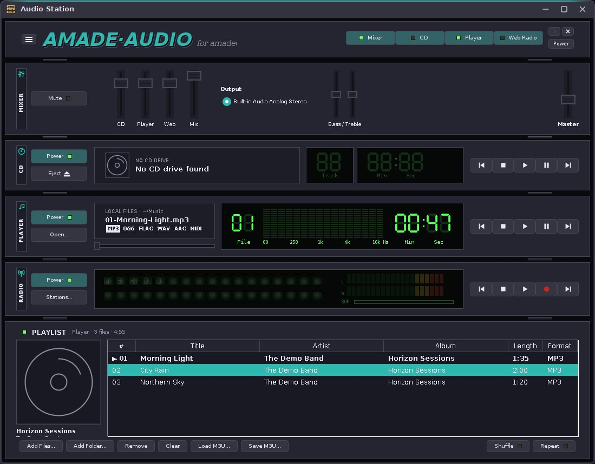
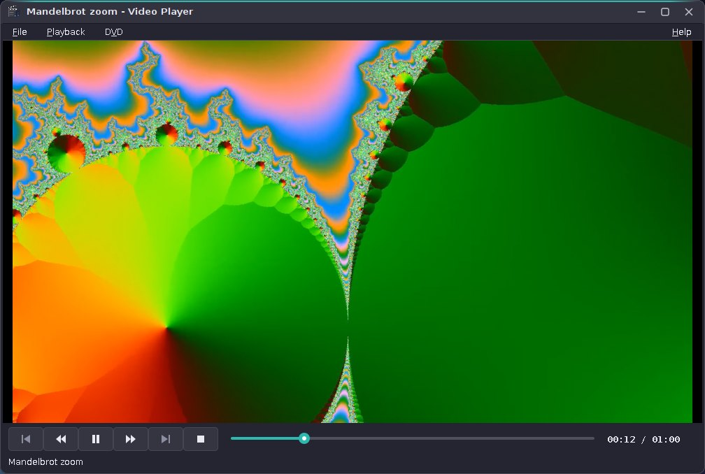
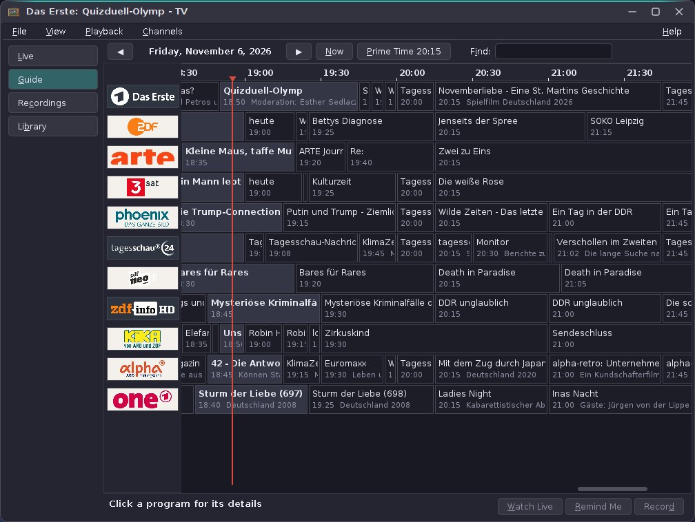
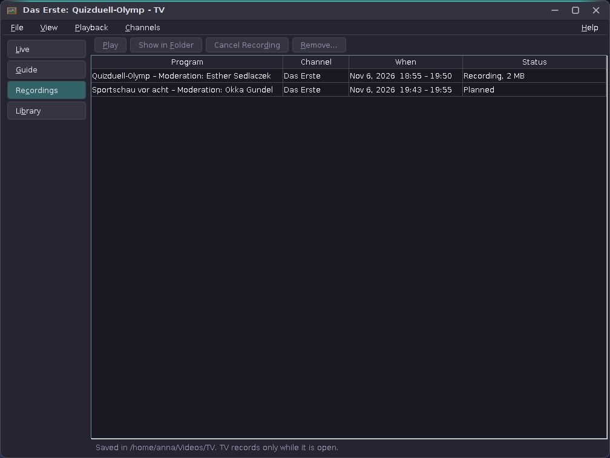
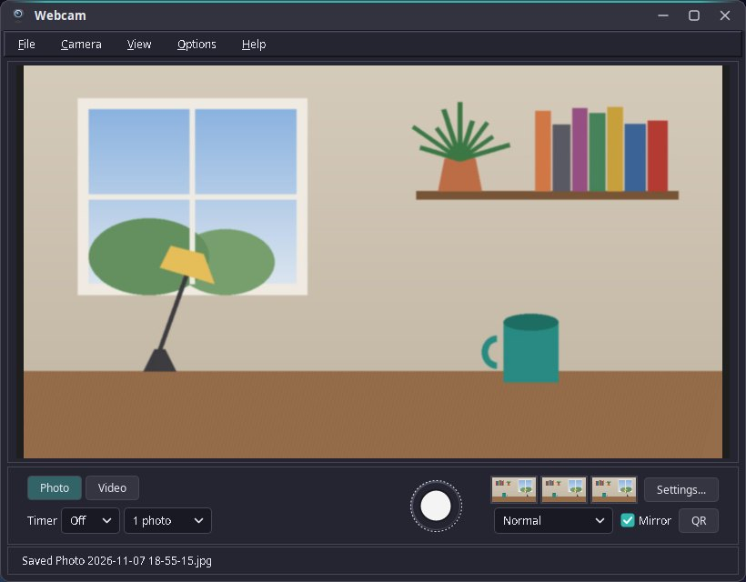
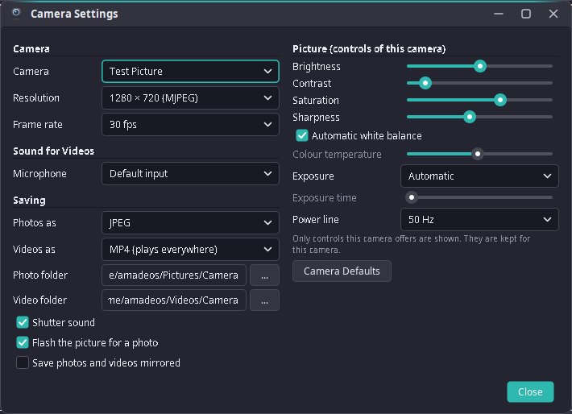
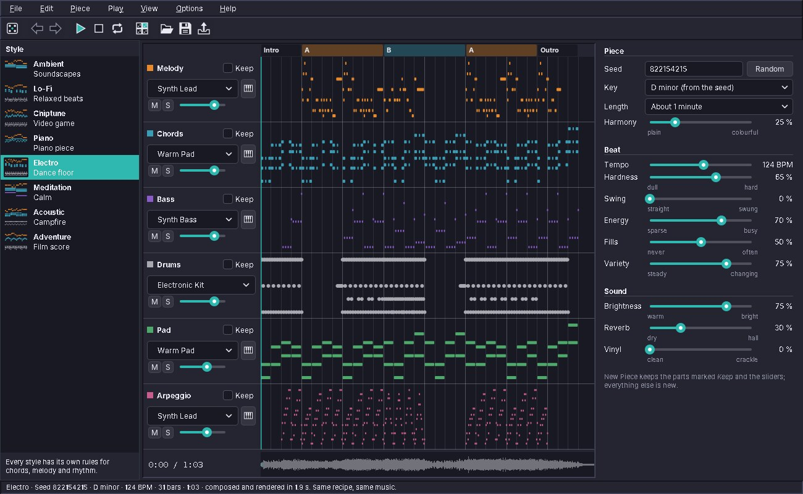

# 46. Audio Station, Video Player, TV, Webcam and Music Studio

## Audio Station

The **Audio Station** looks like a stereo of the 1990s: a rack of devices, one above the other, in the colours of your desktop. It plays **audio CDs**, **music files** and **internet radio**, and records radio.

Start it from the Sound & Video drawer, or with `amade-audio`.



The window has no frame of its own: its top rack is the title bar. Drag it to move the window. The buttons in the top rack, *Mixer*, *CD*, *Player* and *Web Radio*, show or hide the racks. Pressing Play on one device stops the others.

| Rack | What it does |
|---|---|
| **Mixer** | A fader for each device, the microphone, the output (speakers, headphones, HDMI), bass and treble, and the master volume. *Mute* silences everything. |
| **CD** | Plays audio CDs. The titles come from the CD itself or from the free MusicBrainz database, the cover from the Cover Art Archive; a CD it knows needs no network. *Edit Titles…* names the tracks by hand. |
| **Player** | Plays MP3, Ogg Vorbis, AAC, FLAC, WAV, AIFF and MIDI files, and tracker modules (MOD, XM, S3M, IT). Drop files or folders on the list below the racks. |
| **Web Radio** | Thousands of internet radio stations from radio-browser.info: search by name, genre or country, keep your favourites. *Stations…* opens the list. |

Below the racks, the **list** shows the playlist, the tracks of the CD or the stations, with a large cover beside it.

### Tracker modules

Tracker modules are the music of Amiga and DOS games and of the demo scene: songs made of short sound samples and notes, in a few kilobytes. The Player plays the four common kinds, **MOD**, **XM**, **S3M** and **IT**, and older ones such as MTM, 669, STM, MED, OKT, FAR, ULT and UMX. Files from Amiga collections often have the kind in front of the name, `mod.Song title`; these play too. The list shows the song's title from the module itself and its length; you can jump to any point with the position slider. A module plays once to its end, even if the song itself would loop forever.

Collections of free modules are at *The Mod Archive* (modarchive.org) and *Aminet* (aminet.net).

### Recording the radio

Press **●** while a station plays, and again to stop. The recording goes to `~/Music/Radio/<station>/`, as the station sends it, without losing quality. A right click on ● sets the options, such as a new file for each song. Recordings are for your private use only.

### Settings

The menu button (**☰**) opens *Settings…*: the size of the racks (by default it fits your screen), the colour of the displays and the language. Its *Network* page shows the proxy in use; the proxy itself is set for all programs in Settings: Network (chapter 38).

## Video Player

The **Video Player** plays video files, video streams from the internet and DVDs.

Start it from the Sound & Video drawer, by double-clicking a video file, or with `amade-video film.mp4`.



| What | How |
|---|---|
| **A file** | *File → Open File…*: MP4, MKV, WebM, AVI, MOV, MPEG-2 and nearly everything else |
| **A stream** | *File → Open URL…*: a video address, HLS (`.m3u8`) and DASH |
| **A DVD** | Put it in, or *File → Open DVD…*, also an `.iso` image or a `VIDEO_TS` folder; it starts with the main film, without the DVD menus |

| Key | What it does |
|---|---|
| ++space++ | Play and pause |
| ++s++ | Stop |
| ++arrow-left++ / ++arrow-right++ | 10 seconds back / forward |
| ++page-up++ / ++page-down++ | Previous / next chapter |

### DVDs

While the Video Player is open, put in a video DVD and its main film starts after a few seconds. The main film is the longest title on the disc. If something else is playing, the Video Player doesn't interrupt it; open the DVD with *File → Open DVD…* instead. To stop DVDs from starting by themselves, untick *DVD → Play DVDs When Inserted*.

The **DVD** menu lists all titles of the disc with their lengths: the main film, and also trailers, extras or the episodes of a series. The title playing is ticked, the main film is marked *(main film)*. Click another title to play it. ++page-up++ and ++page-down++ jump between the chapters of a title.

!!! warning "Encrypted DVDs"
    Most bought DVDs are encrypted. To play them the Video Player needs the library *libdvdcss*, which amadeOS does not install, because in some countries, Germany among them, getting round copy protection is not allowed. Find out what applies where you live. Home-made DVDs play without it.

    Debian has no package called libdvdcss, so `sudo apt install libdvdcss` finds nothing. Instead, the helper package *libdvd-pkg* downloads the source code of libdvdcss from VideoLAN and builds the library on your computer. Open a terminal and type:

    ```
    sudo apt install libdvd-pkg
    sudo dpkg-reconfigure libdvd-pkg
    ```

    The second command does the download and the building. Answer *Yes* when it asks about automatic upgrades, so that libdvdcss is rebuilt when libdvd-pkg gets an update. Then start the Video Player again.

    *Help → Encrypted DVDs…* in the Video Player tells you whether libdvdcss is installed and shows the two commands; **Copy Commands** puts them on the clipboard for the terminal. When a DVD can't be played and libdvdcss is missing, the Video Player shows this help by itself.

!!! planned "Planned"
    The Video Player is at an early stage. Next come a face in the style of the Audio Station, a list of chapters, recent files, a playlist, audio and subtitle tracks, full screen, the volume, and remembering where you stopped in a file.

## TV

**TV** shows the live programs of the German-language public broadcasters: Das Erste, ZDF, ARTE, 3sat, phoenix, tagesschau24, ZDFneo, ZDFinfo, KiKA, ARD-alpha and ONE. Next to it is a program guide for them. More channels come in groups that you switch on in the **Channels** menu.

Start it from the Sound & Video drawer. It needs a connection to the internet.

### Live

The page **Live** lists the channels with their logos and what runs on each right now, with a bar for how much of it is over. Click a channel, or select it and press ++enter++, and it plays. Below the picture is today's program of the channel.

| Button | What it does |
|---|---|
| **⏪** | 10 minutes back, as far as the broadcaster keeps the stream |
| **▶ / ⏸** | Pause and go on; the picture then runs behind the live program |
| **⏭** | Back to live. The red **● LIVE** sign shows that you see the live program; otherwise it shows how many minutes behind you are |
| **⏹** | Stop |
| **Mute**, the slider | The sound |
| **Subtitles** | Subtitles, where the broadcaster sends them |
| **Audio** | The next audio track, such as the original language or audio description |
| **Full Screen** | The picture alone on the screen; ++escape++ or ++f11++ brings the window back |

TV starts with the channel you watched last.

### More channels

The **Channels** menu has four groups. Each one adds its channels to the list when you tick it, and TV remembers the choice:

| Menu item | Channels |
|---|---|
| **Show Regional Channels** | The regional channels of the ARD (BR, HR, MDR, NDR, RBB, Radio Bremen, SR, SWR, WDR) and the channels of the Bundestag |
| **Show Austria and Switzerland** | ORF, ServusTV and other channels from Austria and Switzerland |
| **Show International Channels** | News and public channels from other countries, for example in English and French |
| **Show More German Channels** | Further free German channels: news, music, documentaries, church channels |

Only the main and the regional channels have a program guide. The others are live streams only: the list shows *Live stream, no program guide*, and they are not on the Guide page. A few international channels stream through YouTube. They are only in the list when the program `yt-dlp` is installed; amadeOS comes with it.

### Guide

The page **Guide** shows one day of all channels on a time line. The red line is now.



The arrows go to the previous and the next day; **Now** and **Prime Time 20:15** scroll the day there. **Find** looks for a word in the titles and descriptions of the day shown; ++enter++ goes to the next hit. Click a program to read about it below the grid. **Watch Live** switches to it if it is running. For a program that is still to come, **Remind Me** sets a reminder: when it starts, a notification (chapter 28) says so, and its **Watch** switches to the program. Reminders work while TV is open.

### Recordings

**Record** keeps a program as a file. The button is below the guide, next to **Remind Me**, and below today's program on the page **Live**. It works for a program that is running and for one still to come. A planned recording has a red dot in the guide. The button then reads **Cancel Recording**, and while the program is being recorded, **Stop Recording**.

TV starts two minutes before the program and stops five minutes after it, because programs rarely keep to the minute. The file goes into the folder **TV** in your videos folder, for example `Tatort – Tod am Deich (Das Erste, 2026-10-26 20.15).mkv`, and plays in the Video Player.



The page **Recordings** lists what is planned, running and done, and how big the file is. **Play** opens a recording, **Show in Folder** opens the folder in Files, **Stop Recording** or **Cancel Recording** ends or drops one, and **Remove** takes it off the list, and the file too if you tick **Also delete the file**.

!!! note "Only while TV is open"
    TV records only while it is open. A recording whose time passed while TV was closed is marked *Missed*. If you quit TV during a recording, it asks first; the file keeps what was recorded until then.

A recording is for your own use: you may keep it, but not pass it on or publish it.

| Key | What it does |
|---|---|
| ++ctrl+1++ / ++ctrl+2++ / ++ctrl+3++ | Live / Guide / Recordings |
| ++ctrl+f++ | Find in the guide |
| ++ctrl+p++ | Play and pause |
| ++alt+arrow-left++ / ++alt+arrow-right++ | 10 minutes back / back to live |
| ++ctrl+page-up++ / ++ctrl+page-down++ | Previous / next channel |
| ++ctrl+m++, ++alt+arrow-up++ / ++alt+arrow-down++ | Mute, louder / quieter |
| ++ctrl+u++, ++ctrl+shift+a++ | Subtitles, next audio track |
| ++f11++ | Full screen |
| ++f5++ | Load the channels and the guide again |

!!! warning "Only in some countries"
    Some programs, often films and sport, may only be shown in Germany, sometimes also in Austria and Switzerland. Outside these countries the broadcaster shows a notice instead, or the stream does not play, and TV says so. TV does not try to get round this. Private channels whose streams are encrypted or cost money are not included.

!!! planned "Planned"
    Next, TV gets the media libraries of the broadcasters: programs to watch later, a search across all of them, downloads, and a watch-later list.

## Webcam

**Webcam** shows the picture of the camera built into a laptop or plugged in by USB, takes photos and records videos with sound. It also makes time lapses and reads QR codes. Start it from the Sound & Video drawer.



The picture is shown like a mirror, so moving your right hand moves the hand on the right; photos and videos are saved the right way round. While Webcam (or any other program) uses the camera, the **camera light** in the Front Panel's status slot is on (chapter 22).

### Photos

Click **Photo**, then the round **shutter button**, or press ++space++ or ++enter++. The picture flashes white, a shutter clicks, and the photo goes to the folder `Pictures/Camera` in your home folder with a name like *Photo 2026-10-31 14-05-12.jpg*.

| Below Photo | What it does |
|---|---|
| **Timer** | *Off*, *3 s* or *10 s*: a large countdown runs in the picture before the photo is taken. ++escape++ stops it. |
| **Shots** | *1 photo*, or *3* or *5 photos* a quarter of a second apart, so one of them is good. |

### Videos

Click **Video**: the shutter button turns red. A click starts the recording, and the red square in the button stops it. A red **REC** sign with the time runs in the picture, and the level meter beside **Mic** shows that the microphone hears you. The video goes to `Videos/Camera`.

| Below Video | What it does |
|---|---|
| **Speed** | *Normal*, or a **time lapse** that keeps one picture every 1, 5, 10 or 30 seconds and plays them at normal speed: an hour of clouds becomes a few seconds. A time lapse has no sound. |
| **Mic** | The microphone for the sound, or *No sound* |

Videos are saved as **MP4**, which plays on every computer, phone and TV. Settings can switch to **WebM**, the open format of the web.

While Webcam is in front, the line at the bottom says what was saved. If you are in another window when a photo, a burst or a video is saved, for example after the timer or at the end of a time lapse, a notification (chapter 28) says so; its **Open** opens the file.

### Looks, mirror and QR codes

The list beside **Mirror** gives the picture a **look**: *Normal*, *Black and White*, *Sepia*, *Warm* or *Cool*. The look is in the photo or video too. **Mirror** turns the mirror view off, for example to hold a page up to the camera and read it.

Click **QR** and hold a QR code up to the camera. A bar above the picture shows what it contains, with a button that fits: **Open** for a web address, **Write** for an e-mail address, **Copy Password** for the code of a WLAN (from a poster in a café, for example), **Copy** for other text.

### The last photos and videos

The three small pictures beside the shutter are the newest photos and videos; a video has a ▶ sign. Click one to open it in the Image Viewer or Video Player. The right mouse button offers **Edit** (in the Image Editor), **Show in Folder** and **Delete**.

### Settings

**Settings…**, or ++ctrl+comma++, opens the camera settings beside the picture, so you see each change at once.



On the left are the **camera** (if there are several), its **resolution** and **frame rate**, the **microphone**, whether photos are saved as JPEG or PNG and videos as MP4 or WebM, and the folders. *Shutter sound* and *Flash the picture for a photo* can be switched off; *Save photos and videos mirrored* saves what you see on the screen.

On the right are the **picture controls** the camera offers: brightness, contrast, saturation, sharpness, white balance, exposure, and *Power line* (50 Hz in Europe), which stops the picture flickering under lamps. Each camera offers different controls, and only those are shown. Webcam keeps them for each camera; **Camera Defaults** puts them back.

### Keys

| Key | What it does |
|---|---|
| ++space++, ++enter++ | Take the photo, or start and stop the recording |
| ++escape++ | Stop the countdown, leave full screen |
| ++ctrl+1++, ++ctrl+2++ | Photo, Video |
| ++ctrl+m++, ++ctrl+g++, ++ctrl+k++ | Mirror, a grid of thirds for framing, QR codes |
| ++f11++ | Full screen |
| ++ctrl+o++ | Open the photo folder |

!!! tip "No picture?"
    If Webcam says *No camera found*, check that the camera is plugged in; many laptops also have a key or a little slider that switches the camera off. *The camera is in use by another program* means that a video call or another program still has it: close that program, and the picture comes back by itself. A camera plugged in while Webcam is open appears within two seconds in the **Camera** menu.

!!! planned "Planned"
    A blurred or replaced background, and recording the screen together with the camera.

??? hood "Under the hood"
    The Audio Station plays music in Java itself, tracker modules with *libopenmpt*, the library of the OpenMPT tracker, and reads CDs with libcdio; its settings are in `~/.config/amadeos/audio/`, the CD titles and covers in `~/.cache/amadeos/audio/discs/`. The Video Player leaves the playing to *libmpv*, the engine of the mpv player, with FFmpeg and libdvdnav. TV plays with libmpv too and records with *ffmpeg*, which copies the stream into the file without converting it. It takes the stream addresses and what runs now from the Zapp service of the MediathekView project, the addresses of the other channels from the IPTV list of the Kodinerds community, and the guide from the ARD and the ZDF; the guide and the channel logos are kept in `~/.cache/amadeos/tv/`, the settings, reminders and recordings list in `~/.config/amadeos/tv/`. Webcam reads the camera through *ffmpeg* (Video4Linux) and its picture controls with `v4l2-ctl`, records with a second ffmpeg (H.264 and AAC for MP4, VP9 and Opus for WebM), and reads QR codes with the ZXing library; its settings, including the picture controls of each camera, are in `~/.config/amadeos/webcam/`.

## Music Studio

**Music Studio** makes music from a style, a few sliders and chance: background music for a video or a game, a loop for a presentation, or just something to listen to. Every note is composed by rules and every sound is calculated on your computer, without internet and without recordings. A short **recipe** describes the piece: the same recipe always gives the same music.

Music Studio is not on the installation medium: install it from **Software** (chapter 51), or with `sudo apt install amade-musicstudio` in a terminal. Then start it from the Sound & Video drawer, or with `amade-musicstudio`.



### Styles and parts

The list on the left shows eight styles, each with its own rules for chords, melody and rhythm: *Ambient*, *Lo-Fi*, *Chiptune*, *Piano*, *Electro*, *Meditation*, *Acoustic* and *Adventure*. The *Piece → Style* menu has the same list, with ++alt+1++ to ++alt+8++.

In the middle, every part of the piece has a lane of its own: **Melody**, **Chords**, **Bass** and **Drums**. The notes are shown like a piano roll, high notes at the top; the bar above shows the form (intro, A, B, outro), the waveform below the sound. Click a lane or the waveform to jump there. At the left of each lane:

| Control | What it does |
|---|---|
| Instrument list | The instrument of the part, or the drum kit |
| Keyboard button | The **instrument chooser**: a description, the waveform of a note and a keyboard to try it, with the mouse or the keys ++a++ to ++l++. Attack, release and octave can be changed there too. |
| **M**, **S** | Mute the part, or hear it alone (solo) |
| Slider | The volume of the part |
| **Keep** | *New Piece* leaves this part as it is and only writes the others anew |

There are sixteen instruments (piano, electric piano, organ, bells, marimba, strings, harp, guitar, flute, pads, synth lead, two chip sounds and three basses) and five drum kits. All of them are calculated, so every instrument can play every part.

### Making a piece

| Key | What it does |
|---|---|
| ++ctrl+n++ or the die | A new piece: new notes for every part that is not kept; style, sliders and instruments stay |
| ++ctrl+r++ | A new seed for all parts, also the kept ones |
| ++ctrl+g++ | **Variations**: eight relatives of the piece (other melody, chords, bass or drums; faster, slower, harder, softer). Listen to each, then take one. |
| ++space++ | Play and pause |
| ++ctrl+home++ | Stop and go back to the start |
| ++ctrl+l++ | Play again and again |
| ++alt+left++ / ++alt+right++ | Back and forward through the last fifty pieces (also ++ctrl+z++ / ++ctrl+y++) |

The panel on the right holds the recipe:

- **Seed**: the number chance starts from, 0 to 999 999 999. Type one in to get a piece again.
- **Key** (or the key the seed chooses) and **Length**, from 30 seconds to 5 minutes.
- **Beat**: *Tempo*, *Hardness* (dull to hard drums), *Swing* (straight to swung), *Energy* (sparse to busy) and *Fills*.
- **Sound**: *Brightness*, *Reverb* (dry to a hall) and *Vinyl* (the crackle of an old record).

A slider takes effect when you let it go. Composing takes a moment; the sound is then calculated in the background, a minute of music in one or two seconds. Volumes, reverb, crackle, mute and solo change the sound almost at once.

### Saving and exporting

*File → Export* (++ctrl+e++) writes the piece as a sound file:

| Format | For |
|---|---|
| **WAV**, **FLAC** | Lossless sound for video editing and further work; FLAC is about half the size |
| **OGG** | Small files, like MP3 but free |
| **MOD** | A tracker module with the instruments as samples, for tracker programs and old computers; the Audio Station plays it too |
| **MIDI** | Only the notes, one track per part, for notation programs and keyboards |

*As a seamless loop* leaves out intro and outro, so the end flows into the start, for games and presentations. *Each part as a separate file* writes the four parts besides the whole piece, for mixing them elsewhere.

Every exported file keeps the recipe inside: opening it in Music Studio (*File → Open*) brings the piece back, to change it further. *File → Save Recipe* writes a small text file (`.musicrecipe`). *Edit → Copy Recipe* puts the recipe on the clipboard as one line, to send in a mail; whoever pastes it with *Edit → Paste Recipe* gets exactly your piece.

??? hood "Under the hood"
    Every part draws its chance from a seed of its own, which is how *Keep* works. The four parts are calculated side by side on all processor cores and kept apart until the end, so a new volume only mixes them again. FLAC and WAV are written by Music Studio itself; OGG uses the GStreamer tools, which Software installs with it.

!!! planned "Planned"
    Sung voices: a choir without words (ooh, aah, mmm) with male, female and children's voices, as further instruments.
