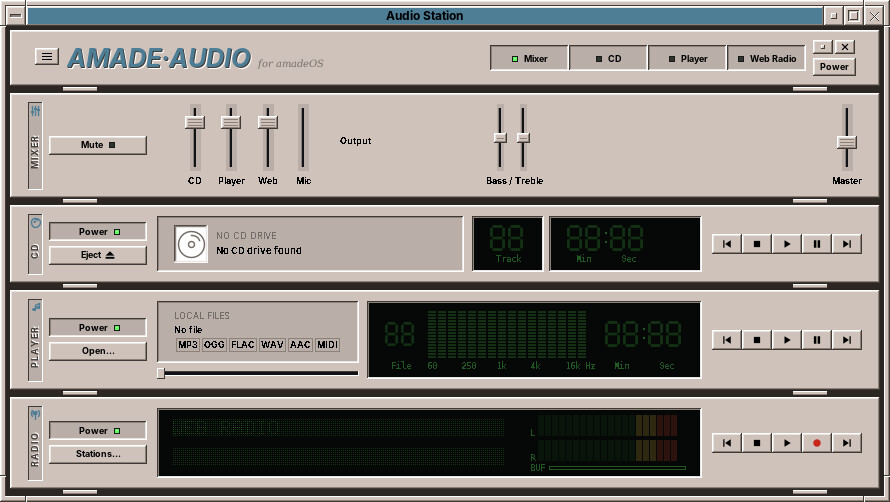
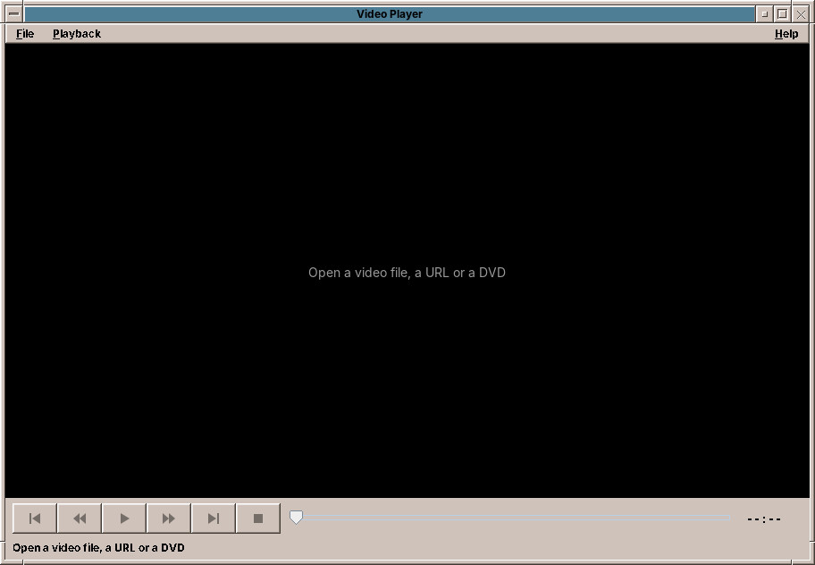
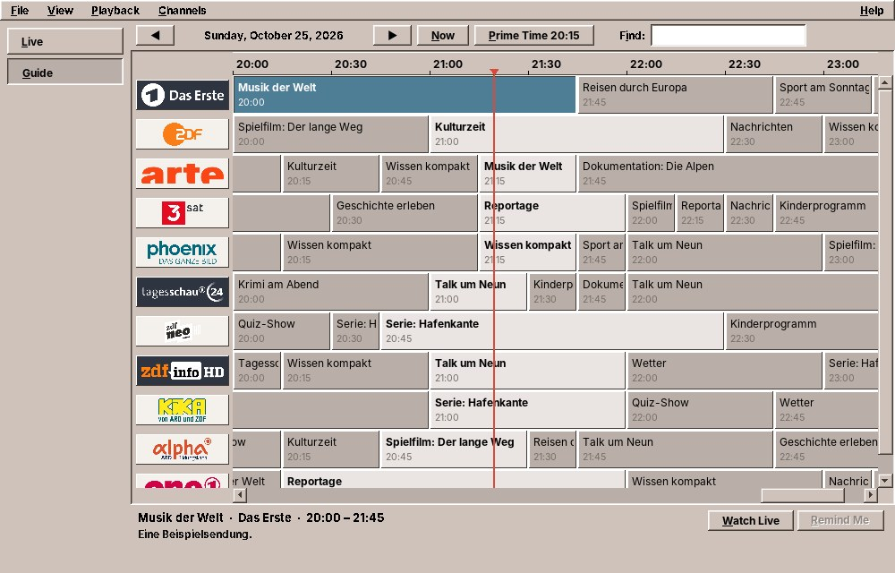
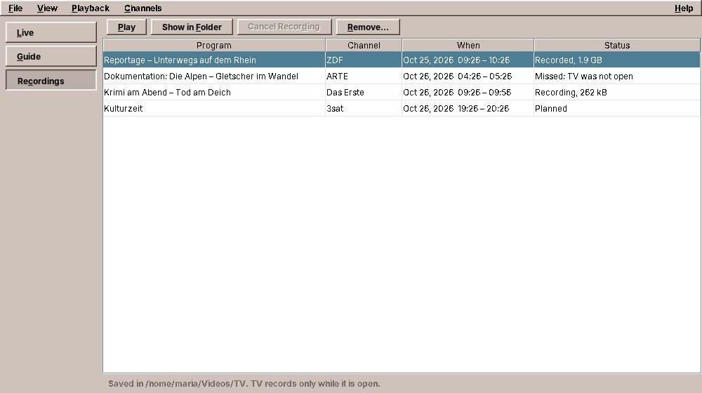

# 46. Audio Station, Video Player and TV

## Audio Station

The **Audio Station** looks like a stereo of the 1990s: a rack of devices, one above the other, in the colours of your desktop. It plays **audio CDs**, **music files** and **internet radio**, and records radio.

Start it from the Sound & Video drawer, or with `amade-audio`.

The window has no frame of its own: its top rack is the title bar. Drag it to move the window. The buttons in the top rack, *Mixer*, *CD*, *Player* and *Web Radio*, show or hide the racks. Pressing Play on one device stops the others.

| Rack | What it does |
|---|---|
| **Mixer** | A fader for each device, the microphone, the output (speakers, headphones, HDMI), bass and treble, and the master volume. *Mute* silences everything. |
| **CD** | Plays audio CDs. The titles come from the CD itself or from the free MusicBrainz database, the cover from the Cover Art Archive; a CD it knows needs no network. *Edit Titles…* names the tracks by hand. |
| **Player** | Plays MP3, Ogg Vorbis, AAC, FLAC, WAV, AIFF and MIDI files. Drop files or folders on the list below the racks. |
| **Web Radio** | Thousands of internet radio stations from radio-browser.info: search by name, genre or country, keep your favourites. *Stations…* opens the list. |

Below the racks, the **list** shows the playlist, the tracks of the CD or the stations, with a large cover beside it.

### Recording the radio

Press **●** while a station plays, and again to stop. The recording goes to `~/Music/Radio/<station>/`, as the station sends it, without losing quality. A right click on ● sets the options, such as a new file for each song. Recordings are for your private use only.

### Settings

The menu button (**☰**) opens *Settings…*: the size of the racks (by default it fits your screen), the colour of the displays, the language, and a proxy if your network needs one.

## Video Player

The **Video Player** plays video files, video streams from the internet and DVDs.

Start it from the Sound & Video drawer, by double-clicking a video file, or with `amade-video film.mp4`.

| What | How |
|---|---|
| **A file** | *File → Open File…*: MP4, MKV, WebM, AVI, MOV, MPEG-2 and nearly everything else |
| **A stream** | *File → Open URL…*: a video address, HLS (`.m3u8`) and DASH |
| **A DVD** | *File → Open DVD…*, also an `.iso` image or a `VIDEO_TS` folder; titles and chapters, without the DVD menus |

| Key | What it does |
|---|---|
| ++space++ | Play and pause |
| ++s++ | Stop |
| ++arrow-left++ / ++arrow-right++ | 10 seconds back / forward |
| ++page-up++ / ++page-down++ | Previous / next chapter |

!!! warning "Encrypted DVDs"
    Most bought DVDs are encrypted. To play them the Video Player needs the library *libdvdcss*, which amadeOS does not install, because in some countries, Germany among them, getting round copy protection is not allowed. Find out what applies where you live. Home-made DVDs play without it.

!!! planned "Planned"
    The Video Player is at an early stage. Next come a face in the style of the Audio Station, lists of DVD titles and chapters, recent files, a playlist, audio and subtitle tracks, full screen, the volume, and remembering where you stopped in a file.

## TV

**TV** shows the live programs of the German-language public broadcasters: Das Erste, ZDF, ARTE, 3sat, phoenix, tagesschau24, ZDFneo, ZDFinfo, KiKA, ARD-alpha and ONE. Next to it is a program guide for them. More channels come in groups that you switch on in the **Channels** menu.

Start it from the Sound & Video drawer. It needs a connection to the internet.

### Live

The page **Live** lists the channels with their logos and what runs on each right now, with a bar for how much of it is over. Click a channel, or select it and press ++enter++, and it plays. Below the picture is today's program of the channel.

| Button | What it does |
|---|---|
| **⏪** | 10 minutes back, as far as the broadcaster keeps the stream |
| **▶ / ⏸** | Pause and go on; the picture then runs behind the live program |
| **⏭** | Back to live. The red **● LIVE** sign shows that you see the live program; otherwise it shows how many minutes behind you are |
| **⏹** | Stop |
| **Mute**, the slider | The sound |
| **Subtitles** | Subtitles, where the broadcaster sends them |
| **Audio** | The next audio track, such as the original language or audio description |
| **Full Screen** | The picture alone on the screen; ++escape++ or ++f11++ brings the window back |

TV starts with the channel you watched last.

### More channels

The **Channels** menu has four groups. Each one adds its channels to the list when you tick it, and TV remembers the choice:

| Menu item | Channels |
|---|---|
| **Show Regional Channels** | The regional channels of the ARD (BR, HR, MDR, NDR, RBB, Radio Bremen, SR, SWR, WDR) and the channels of the Bundestag |
| **Show Austria and Switzerland** | ORF, ServusTV and other channels from Austria and Switzerland |
| **Show International Channels** | News and public channels from other countries, for example in English and French |
| **Show More German Channels** | Further free German channels: news, music, documentaries, church channels |

Only the main and the regional channels have a program guide. The others are live streams only: the list shows *Live stream, no program guide*, and they are not on the Guide page. A few international channels stream through YouTube. They are only in the list when the program `yt-dlp` is installed; amadeOS comes with it.

### Guide

The page **Guide** shows one day of all channels on a time line. The red line is now.

The arrows go to the previous and the next day; **Now** and **Prime Time 20:15** scroll the day there. **Find** looks for a word in the titles and descriptions of the day shown; ++enter++ goes to the next hit. Click a program to read about it below the grid. **Watch Live** switches to it if it is running. For a program that is still to come, **Remind Me** sets a reminder: when it starts, TV asks whether you want to watch it. Reminders work while TV is open.

### Recordings

**Record** keeps a program as a file. The button is below the guide, next to **Remind Me**, and below today's program on the page **Live**. It works for a program that is running and for one still to come. A planned recording has a red dot in the guide. The button then reads **Cancel Recording**, and while the program is being recorded, **Stop Recording**.

TV starts two minutes before the program and stops five minutes after it, because programs rarely keep to the minute. The file goes into the folder **TV** in your videos folder, for example `Tatort – Tod am Deich (Das Erste, 2026-10-26 20.15).mkv`, and plays in the Video Player.

The page **Recordings** lists what is planned, running and done, and how big the file is. **Play** opens a recording, **Show in Folder** opens the folder in Files, **Stop Recording** or **Cancel Recording** ends or drops one, and **Remove** takes it off the list, and the file too if you tick **Also delete the file**.

!!! note "Only while TV is open"
    TV records only while it is open. A recording whose time passed while TV was closed is marked *Missed*. If you quit TV during a recording, it asks first; the file keeps what was recorded until then.

A recording is for your own use: you may keep it, but not pass it on or publish it.

| Key | What it does |
|---|---|
| ++ctrl+1++ / ++ctrl+2++ / ++ctrl+3++ | Live / Guide / Recordings |
| ++ctrl+f++ | Find in the guide |
| ++ctrl+p++ | Play and pause |
| ++alt+arrow-left++ / ++alt+arrow-right++ | 10 minutes back / back to live |
| ++ctrl+page-up++ / ++ctrl+page-down++ | Previous / next channel |
| ++ctrl+m++, ++alt+arrow-up++ / ++alt+arrow-down++ | Mute, louder / quieter |
| ++ctrl+u++, ++ctrl+shift+a++ | Subtitles, next audio track |
| ++f11++ | Full screen |
| ++f5++ | Load the channels and the guide again |

!!! warning "Only in some countries"
    Some programs, often films and sport, may only be shown in Germany, sometimes also in Austria and Switzerland. Outside these countries the broadcaster shows a notice instead, or the stream does not play, and TV says so. TV does not try to get round this. Private channels whose streams are encrypted or cost money are not included.

!!! planned "Planned"
    Next, TV gets the media libraries of the broadcasters: programs to watch later, a search across all of them, downloads, and a watch-later list.

??? hood "Under the hood"
    The Audio Station plays music in Java itself and reads CDs with libcdio; its settings are in `~/.config/amadeos/audio/`, the CD titles and covers in `~/.cache/amadeos/audio/discs/`. The Video Player leaves the playing to *libmpv*, the engine of the mpv player, with FFmpeg and libdvdnav. TV plays with libmpv too and records with *ffmpeg*, which copies the stream into the file without converting it. It takes the stream addresses and what runs now from the Zapp service of the MediathekView project, the addresses of the other channels from the IPTV list of the Kodinerds community, and the guide from the ARD and the ZDF; the guide and the channel logos are kept in `~/.cache/amadeos/tv/`, the settings, reminders and recordings list in `~/.config/amadeos/tv/`.
