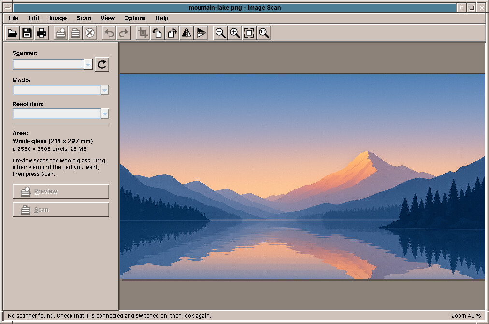
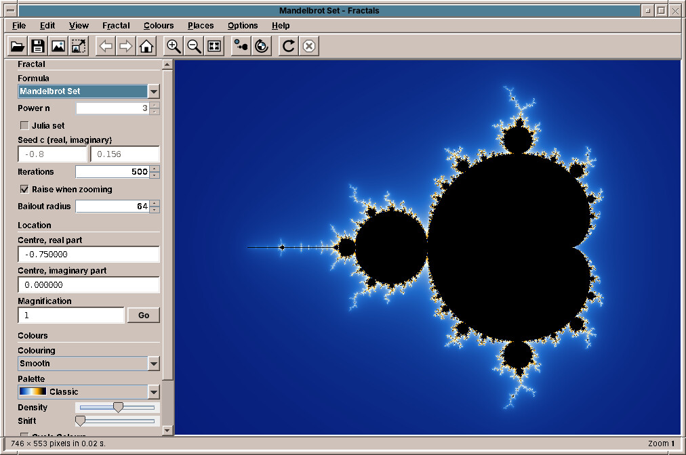

# 47. Image Scan and Fractals

## Image Scan

**Image Scan** scans photos, letters and documents from a flatbed scanner, lets you cut out the part you want, turn it, and save it.

Start it from the Graphics drawer, or with `amade-imagescan`.

### Scanning

1. Put the original on the glass. The panel on the left shows the **Scanner**; ↻ looks for scanners again.
2. Click **Preview**. Image Scan scans the whole glass quickly at low resolution.
3. **Drag a frame** around the photo or page you want. Its eight handles change its size.
4. Choose the **Mode**, colour, grey or black and white, and the **Resolution**. The panel shows how large the result will be, for example *≈ 2480 × 3508 pixels, 25 MB*.
5. Click **Scan**. Only the framed part is scanned. *Cancel Scan* stops it.

300 dpi is right for letters and most photos, 600 dpi for small photos you want to print larger. Image Scan remembers the scanner, mode and resolution you used last.

### Editing and saving

Crop to the frame, turn left, right or by 180°, mirror; undo and redo. The picture keeps every pixel: nothing is made worse by turning it.

*File → Save* stores the scan as **PNG** (the default), **JPEG** or **TIFF**, with a dated name in your Pictures folder. The resolution is written into the file, so a scanned A4 page prints as A4 again. Image Scan also opens existing pictures to crop or turn them, prints them at their true size, and copies them to the clipboard.

!!! tip "No scanner found?"
    Image Scan uses SANE, the scanner system of Linux. Many USB scanners work without an extra driver; network scanners need the package `sane-airscan` (chapter 51). If none is found, check that the scanner is switched on and connected, and type `scanimage -L` in a terminal: it lists the scanners SANE sees.

!!! planned "Planned"
    Several pages into one PDF, brightness and contrast, straightening a crooked scan, and the scan button on the scanner.

## Fractals

**Fractals** draws the **Mandelbrot set** and its relatives: endless shapes from a short formula, which show ever new detail the further you zoom in.

Start it from the Graphics drawer, or with `amade-fractals`.

### Exploring

| Mouse | What it does |
|---|---|
| Click | Zooms in two times at that point |
| Right click | Zooms out |
| Drag a frame | Fills the window with what is in the frame |
| Wheel | Zooms at the pointer |
| Drag with the right or middle button | Moves the picture |
| ++ctrl++ + click | Shows the **Julia set** of that point |

*Back*, *Forward* and *Home* in the tool bar go through what you have seen; ++f11++ shows the picture on the whole screen. While a new picture is calculated, the old one moves and grows at once, so you never wait to see where you are.

The **Places** menu goes straight to famous spots: Seahorse Valley, Elephant Valley, a triple spiral, a tiny copy of the whole set, and a zoom of 10²⁰ times. The Mandelbrot set can be zoomed to a magnification of about 10²⁹⁰, a number with 290 zeros.

### Formulas and colours

The panel on the left chooses the **formula**: Mandelbrot, Multibrot, Burning Ship, Tricorn, Celtic, Buffalo, Phoenix, Magnet and Newton's method, each but Newton also as a Julia set. **Colouring** and **Palette** change the colours without calculating again; the palette *Desktop Colours* takes the colours of your Style Manager palette, and colour cycling sets the colours moving.

### Saving

*File → Save Image* saves the picture as you see it. *File → Export Image* calculates it at any size up to 64 megapixels: Full HD, 4K, 8K, or A4 at 300 dpi for a poster. A **parameter file** (`.fractal`) keeps a place with all its digits; *Copy Parameters* puts it on the clipboard to send to a friend.

??? hood "Under the hood"
    Fractals uses all processor cores. Below the precision of ordinary numbers, the Mandelbrot set is calculated with *perturbation*: one point with hundreds of digits, and every pixel as a small difference from it.
