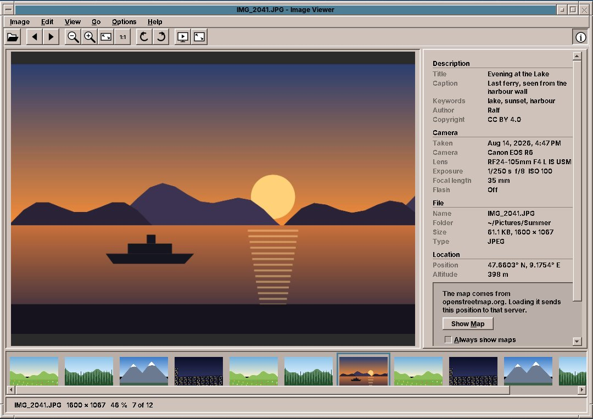
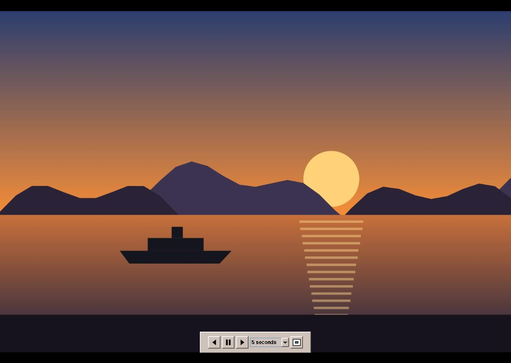
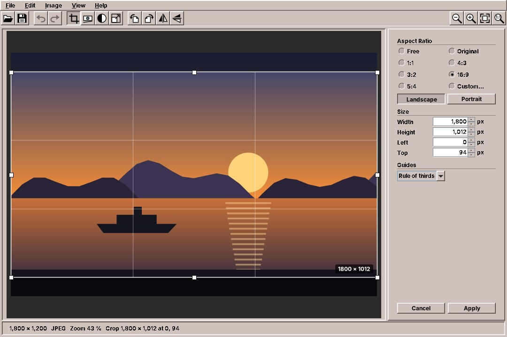
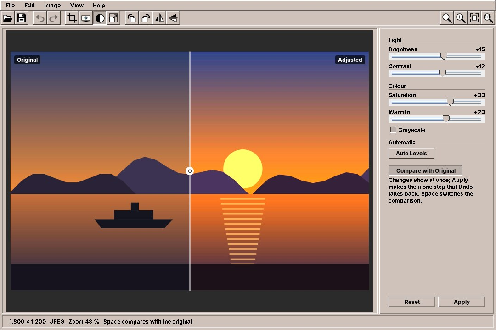

# 47. Image Viewer, Image Editor, Image Scan and Fractals

## Image Viewer

The **Image Viewer** shows your photos and pictures, one after the other, as large as the window allows. It turns them, plays them as a slideshow on the whole screen, and shows what the camera wrote into them: when and with which camera a photo was taken, its title and caption, and where it was taken, on a map.

Start it from the Graphics drawer, or with `amade-imageviewer`. A double-click on a picture in the File Manager opens it in the Image Viewer, and pictures can also be dropped on its window.

### Looking at pictures

The Image Viewer opens JPEG, PNG, GIF, BMP, TIFF and WebP pictures. When you open one picture, all the pictures of its folder come along, sorted by name the way people count: `IMG_9` comes before `IMG_10`. The **film strip** below the picture shows them small; a click on one shows it. *View → Film Strip* hides the strip.

| Key or mouse | What it does |
|---|---|
| ++right++, ++page-down++, ++space++ or the wheel | Next picture |
| ++left++, ++page-up++, ++backspace++ or the wheel | Previous picture |
| ++home++, ++end++ | First and last picture of the folder |
| ++ctrl+plus++, ++ctrl+minus++, ++ctrl++ + wheel | Zooms in and out |
| ++ctrl+0++ | Fits the picture into the window |
| ++ctrl+1++ | Shows the picture at its actual size, one pixel of the picture on one pixel of the screen |
| Drag | Moves a zoomed picture |
| ++ctrl+l++, ++ctrl+r++ | Turns the picture left or right |

The status line at the bottom shows the file name, the size of the picture in pixels, the zoom and where you are in the folder, such as *7 of 12*.

### Turning pictures

Photos taken with the camera held upright appear upright: the camera notes how it was held, and the Image Viewer follows the note. If a picture still lies on its side, turn it with ++ctrl+l++ or ++ctrl+r++, or mirror it in the **View** menu. That only changes how you see it. *Image → Save Rotation* (++ctrl+s++) writes the turn into the file.

JPEG photos are turned **without loss**: the Image Viewer moves the compressed blocks of the picture instead of compressing it again, so nothing is made worse. For that it needs the program `jpegtran`, which comes with amadeOS; if it is missing, the Image Viewer says so and names the package to install with Software. PNG and BMP pictures are simply written anew, which loses nothing either. Other formats cannot be saved turned.

### The sidebar

*View → Information Sidebar* (++f9++), or the ⓘ button at the right of the tool bar, shows what is known about the picture, in up to four sections:

- **Description**: title, caption, keywords, author and copyright, as photo programs and cameras write them.
- **Camera**: when the photo was taken, the camera and lens, exposure time, aperture and ISO, focal length and flash.
- **File**: name, folder, file size, size in pixels and format.
- **Location**: where the photo was taken, if the camera or phone recorded it, and the height above the sea.

A section appears only when the picture has something for it. The link *All metadata…* at the end lists everything written in the picture, tag by tag.

If you switch on *Options → Window Title from Metadata*, the window shows the picture's title instead of its file name, if the picture has a real title. Cameras that write a placeholder such as `OLYMPUS DIGITAL CAMERA` are ignored.

### The map

For a photo with a location, the sidebar can show the place on a map from **OpenStreetMap**, the free map of the world made by volunteers. The map is not loaded on its own: to draw it, the Image Viewer has to ask the OpenStreetMap server for the map pieces around the place, and so tells it where the photo was taken. The sidebar asks first. Click **Show Map** for this one picture, or tick **Always show maps** (also in the **Options** menu) to be asked no more.

Below the map, **Open in Browser** shows the place on openstreetmap.org, and **Copy** puts the coordinates on the clipboard. Both work without loading the map.

??? hood "Under the hood"
    The map pieces are kept for seven days in `~/.cache/amadeos/imageviewer/tiles`, so a folder of holiday photos asks the server only once for its region. The Image Viewer loads at most two pieces at a time and names itself to the server, as the rules of the OpenStreetMap tile servers ask.

### Full screen and slideshow

++f11++ shows the picture on the whole screen, without window and menus; ++esc++ or ++f11++ goes back. All the keys of the table above still work, and a click on the left or right third of the screen goes back or on.

++f5++, *View → Slideshow* or the ▶ button in the tool bar starts a **slideshow** on the whole screen: the pictures follow one another on their own.

- When you move the mouse, a **control bar** appears at the bottom: previous, play or pause, next, the time each picture stays, and a button to leave the full screen. Two seconds after the mouse rests, the bar and the pointer disappear again.
- ++space++ **pauses** the slideshow, and a *Pause* sign shows for a moment; ++space++ again goes on.
- The arrow keys jump to the previous or next picture, and the time for that picture starts anew.
- ++esc++ ends the slideshow and the full screen.

*Options → Slideshow* sets the time per picture, 3, 5, 10 or 30 seconds, and two choices: **Shuffle** shows the pictures in a random order, and **Loop** starts again at the beginning after the last one; in a shuffled loop no picture comes twice before all have been seen.

### More

- *Image → Move to Trash* (++delete++) puts the picture into the Trash Can of the Front Panel, from where it can be brought back. The Image Viewer shows the next picture.
- *Edit → Copy Image* (++ctrl+c++) copies the picture for other programs, *Edit → Copy Path* (++ctrl+shift+c++) its file name with the folder.
- *Image → Print* (++ctrl+p++) prints the picture as large as the paper allows, across the page for wide pictures.
- *Image → Open in Image Editor* (++ctrl+e++) opens the picture in the Image Editor (next section) to crop, straighten or brighten it. A turn you made in the Image Viewer but did not save does not come along; save it first with ++ctrl+s++.

!!! planned "Planned"
    Using a picture as the backdrop of a workspace, moving pictures (animated GIF and WebP), HEIC photos from phones, and writing the title, caption and keywords into a picture.

## Image Editor

The **Image Editor** makes a photo better before you send, print or keep it: it cuts away what does not belong, levels a crooked horizon, turns, brightens and shrinks it. Every step can be taken back.

Start it from the Graphics drawer, with `amade-imageeditor`, or from the Image Viewer with *Image → Open in Image Editor* (++ctrl+e++). In the File Manager it is under *Open with* for pictures; a double-click still opens the Image Viewer. Pictures can also be dropped on its window.

The Image Editor opens JPEG, PNG, WebP, TIFF, BMP and GIF pictures, and also less common formats such as PSD, TGA and PNM. A photo appears upright, as the camera noted how it was held.

The tool bar and the **Image** menu hold the tools. Crop, Straighten and Adjust Colours open a panel at the right; while one is open, ++enter++ or **Apply** takes the change, ++esc++ or **Cancel** leaves the picture as it was. Resize asks in a dialog; turning and flipping happen at once.

### Cropping

*Image → Crop* (++ctrl+k++) lays a frame over the picture; what is outside it is darkened and goes when you apply.

- Drag the frame to move it, or one of its eight handles to change its size. Dragging outside the frame draws a new one.
- **Aspect Ratio** keeps the frame in shape: **Free**, **Original** (the shape of the picture), **1:1** for a square, **4:3**, **3:2** and **5:4** for prints, **16:9** for screens, or **Custom…** for any other, such as `7:5`. **Landscape** and **Portrait** turn the shape on its side.
- **Size** shows the frame in pixels: width, height and where it starts. Type a number to set it exactly.
- **Guides** draws lines over the frame: the **rule of thirds**, a finer **grid**, or none. Placing the horizon or a face on a line of thirds often makes a better picture.

### Straightening

*Image → Straighten* (++ctrl+t++) levels a picture that was taken a little crooked.

- Move the **angle** slider, from −45° to 45°; a grid helps to see when lines are level.
- Or draw a line along something that should be level, a horizon or the edge of a roof, with the mouse: the picture turns so that the line becomes level. A line drawn along something that should stand upright, such as a wall, works too.
- **Crop to the largest rectangle** cuts away the empty corners that turning leaves; switched off, they stay and are filled transparent or white, depending on the format.

### Turning and flipping

*Image → Rotate Left* (++ctrl+l++) and *Rotate Right* (++ctrl+r++) turn the picture by a quarter, *Flip Horizontally* and *Flip Vertically* mirror it. If you only turn or flip a JPEG photo and save it again as JPEG, the Image Editor turns it **without loss**, as the Image Viewer does.

### Colours

*Image → Adjust Colours* (++ctrl+j++) shows sliders that change the picture at once:

- **Brightness** and **Contrast**: lighter or darker, flatter or crisper.
- **Saturation**: more or less colour; all the way down gives grey.
- **Warmth**: towards orange like evening light, or towards blue.
- **Grayscale**: a black and white picture.
- **Auto Levels** spreads the tones from the darkest to the lightest; a pale or dull photo often gets its colours back with one click. It is also in the **Image** menu.

**Compare with Original**, or ++space++, shows the picture split in two: the left half as it was, the right half as it will be. Drag the line in the middle to move the split. **Reset** puts all sliders back to zero.

### Size

*Image → Resize* (++ctrl+e++) makes the picture smaller (or larger) for e-mail or the web. Give the new width or height in **pixels** or in **percent**; with **Keep aspect ratio** the other follows. The buttons below offer common sizes: 3840, 1920, 1280, 1024 or 800 pixels on the long side, or half the size. **Quality** chooses between *Best* (sharp, a little slower), *Fast*, and *Pixel art*, which keeps hard pixel edges when you enlarge pixel art or screenshots.

### Undo, saving and the camera's data

*Edit → Undo* (++ctrl+z++) takes back the last step, as many steps as you like, and *Redo* (++ctrl+y++) brings them back. The menu says which step it is, such as *Undo Crop*. The status line at the bottom shows the size of the picture, its format and the zoom; ++ctrl+0++ fits it into the window, ++ctrl+1++ shows it at its actual size.

*File → Save* (++ctrl+s++) writes the picture back into its file. *File → Save As* (++ctrl+shift+s++) asks for a name, a folder and a format:

| Format | Good for |
|---|---|
| **JPEG** | Photos. **Quality** from 1 to 100; 90 is hardly to tell from the original, 75 makes much smaller files. |
| **PNG** | Screenshots, drawings, pictures with transparent parts. Loses nothing. |
| **WebP** | Photos for the web: smaller than JPEG at the same quality, or **lossless**. Needs the program `cwebp`, which comes with amadeOS. |
| **TIFF** | Pictures for printing and archiving. Loses nothing. |
| **BMP** | Old programs that know nothing else. |

The dialog says whether the new file **replaces** the original or keeps it. If you close the window or open another picture with changes not yet saved, the Image Editor asks whether to save them.

A photo from a camera or phone carries more than the picture: when it was taken and with which camera, perhaps a title and keywords, and often **where** it was taken. When you save a JPEG as JPEG, three boxes decide what comes along:

- **Keep camera data (EXIF)**: date, camera, exposure.
- **Keep location (GPS)**: the place where the photo was taken. Switch it off before you send a photo taken at home to people who should not know where you live. The location is part of the camera data, so it also goes when *Keep camera data* is off.
- **Keep title, keywords, author**: title, caption, keywords, author and copyright.

The Image Editor also removes the small preview picture that cameras store inside the photo, because it would still show the uncropped picture in some programs. Other formats are saved without these data.

??? hood "Under the hood"
    The Image Editor keeps the original and the list of steps; the picture after each step is kept while memory allows and is otherwise computed again, so even long histories need little memory. Lossless turns of JPEGs use `jpegtran` from the package `libjpeg-turbo-progs`, WebP pictures are written by `cwebp` from the package `webp`. A file is written under a temporary name first and then put in place, so a failed save never leaves half a picture behind. The settings of the save dialog per format are kept in `~/.config/amadeos/imageeditor/imageeditor.properties`.

!!! planned "Planned"
    Painting, text and shapes on the picture, layers, red-eye removal, sharpening and blurring, and writing the title, caption and keywords.

## Image Scan

**Image Scan** scans photos, letters and documents from a flatbed scanner, lets you cut out the part you want, turn it, and save it.

Start it from the Graphics drawer, or with `amade-imagescan`.

### Scanning

1. Put the original on the glass. The panel on the left shows the **Scanner**; ↻ looks for scanners again.
2. Click **Preview**. Image Scan scans the whole glass quickly at low resolution.
3. **Drag a frame** around the photo or page you want. Its eight handles change its size.
4. Choose the **Mode**, colour, grey or black and white, and the **Resolution**. The panel shows how large the result will be, for example *≈ 2480 × 3508 pixels, 25 MB*.
5. Click **Scan**. Only the framed part is scanned. *Cancel Scan* stops it.

300 dpi is right for letters and most photos, 600 dpi for small photos you want to print larger. Image Scan remembers the scanner, mode and resolution you used last.

### Editing and saving

Crop to the frame, turn left, right or by 180°, mirror; undo and redo. The picture keeps every pixel: nothing is made worse by turning it.

*File → Save* stores the scan as **PNG** (the default), **JPEG** or **TIFF**, with a dated name in your Pictures folder. The resolution is written into the file, so a scanned A4 page prints as A4 again. Image Scan also opens existing pictures to crop or turn them (in the File Manager: *Open with → Image Scan*), prints them at their true size, and copies them to the clipboard.

!!! tip "No scanner found?"
    Image Scan uses SANE, the scanner system of Linux. Most USB scanners, network scanners and the scanners of all-in-one printers work without a driver from the maker. If none is found, check that the scanner is switched on and connected, and type `scanimage -L` in a terminal: it lists the scanners SANE sees.

!!! planned "Planned"
    Several pages into one PDF, brightness and contrast, straightening a crooked scan, and the scan button on the scanner.

## Fractals

**Fractals** draws the **Mandelbrot set** and its relatives: endless shapes from a short formula, which show ever new detail the further you zoom in.

Start it from the Graphics drawer, or with `amade-fractals`.

### Exploring

| Mouse | What it does |
|---|---|
| Click | Zooms in two times at that point |
| Right click | Zooms out |
| Drag a frame | Fills the window with what is in the frame |
| Wheel | Zooms at the pointer |
| Drag with the right or middle button | Moves the picture |
| ++ctrl++ + click | Shows the **Julia set** of that point |

*Back*, *Forward* and *Home* in the tool bar go through what you have seen; ++f11++ shows the picture on the whole screen. While a new picture is calculated, the old one moves and grows at once, so you never wait to see where you are.

The **Places** menu goes straight to famous spots: Seahorse Valley, Elephant Valley, a triple spiral, a tiny copy of the whole set, and a zoom of 10²⁰ times. The Mandelbrot set can be zoomed to a magnification of about 10²⁹⁰, a number with 290 zeros.

### Formulas and colours

The panel on the left chooses the **formula**: Mandelbrot, Multibrot, Burning Ship, Tricorn, Celtic, Buffalo, Phoenix, Magnet and Newton's method, each but Newton also as a Julia set. **Colouring** and **Palette** change the colours without calculating again; the palette *Desktop Colours* takes the colours of your palette in Settings, and colour cycling sets the colours moving.

### Saving

*File → Save Image* saves the picture as you see it. *File → Export Image* calculates it at any size up to 64 megapixels: Full HD, 4K, 8K, or A4 at 300 dpi for a poster. A **parameter file** (`.fractal`) keeps a place with all its digits; *Copy Parameters* puts it on the clipboard to send to a friend.

??? hood "Under the hood"
    Fractals uses all processor cores. Below the precision of ordinary numbers, the Mandelbrot set is calculated with *perturbation*: one point with hundreds of digits, and every pixel as a small difference from it.
