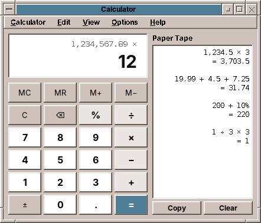
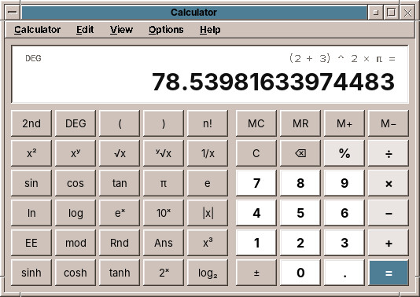
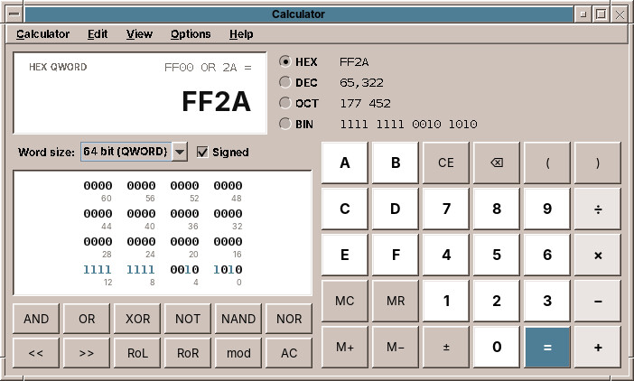
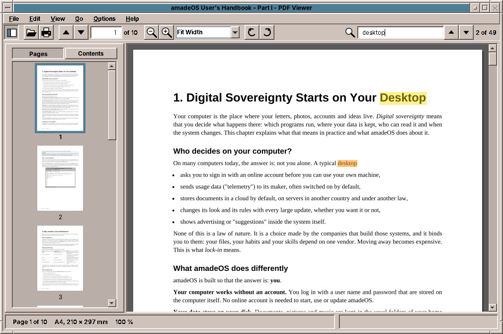
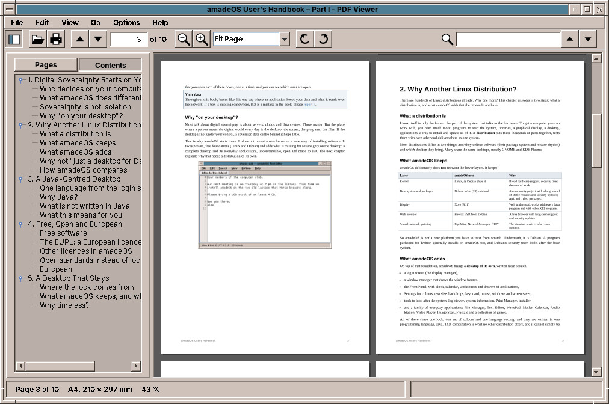
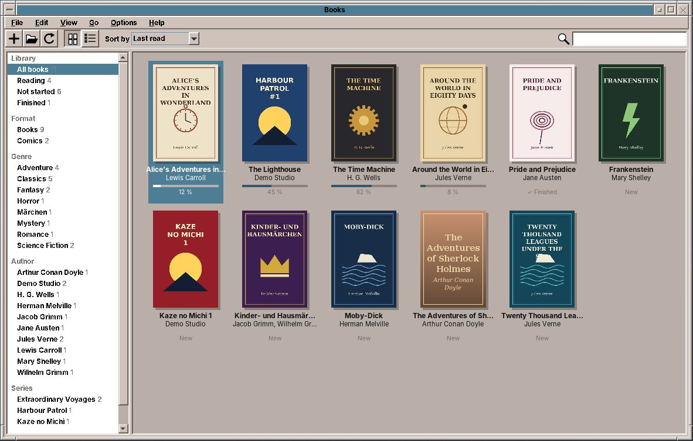
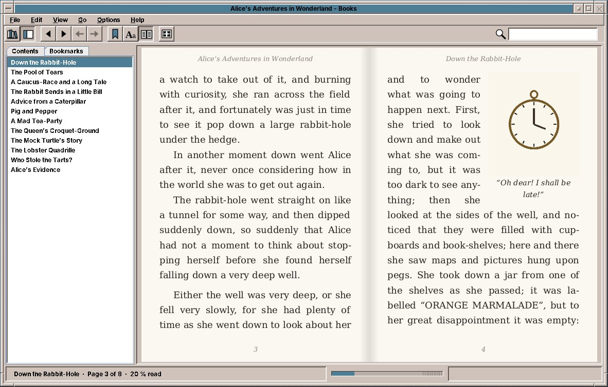
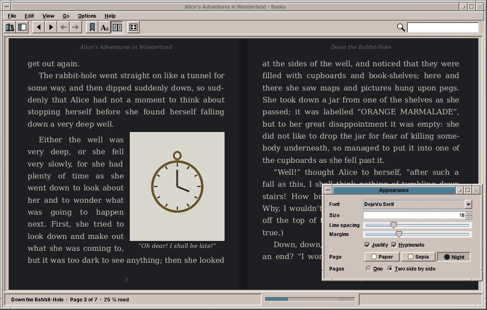
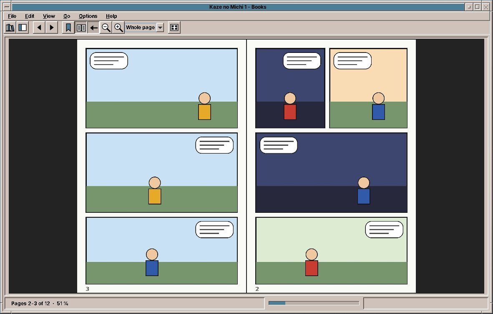
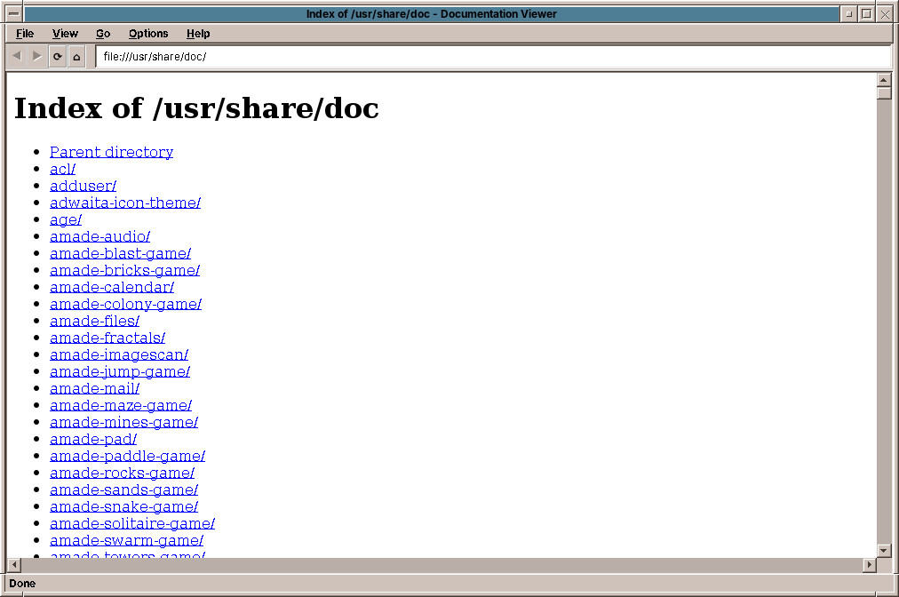

# 48. Calculator, PDF Viewer, Books, Web Browser and Handbooks

## Calculator

The **Calculator** is a desk calculator, a scientific calculator and a programmer's calculator in one window. It computes exactly with decimal numbers, so 0.1 + 0.2 is 0.3 and not 0.30000000000000004, and it follows the rules of arithmetic: 2 + 3 × 4 is 14.

Start it from the Text & Office drawer, or with `amade-calculator`.

### Three modes

The **View** menu switches between the modes; the Calculator starts in the one you used last.

- **Basic** (++ctrl+1++): the four basic operations, percent, ± and the memory.
- **Scientific** (++ctrl+2++): brackets, powers and roots, logarithms, trigonometry, π and e.
- **Programmer** (++ctrl+3++): whole numbers in hexadecimal, decimal, octal and binary, and operations on bits.

The number you are working with stays when you change the mode. Going to Programmer drops the part after the decimal point.

### Calculating

Type a calculation as you would write it, with the mouse or the keyboard, and finish it with **=** or ++enter++. The small line at the top of the display shows the whole calculation, the large number the result or the number you are typing.

- **Functions** such as √x, x² or sin work at once on the number in the display, as on a pocket calculator: type 16 and press √x, and the display shows 4 and the line above `√(16)`.
- **Percent** works as on a desk calculator: 200 + 10 % is 220 (200 plus 10 % of it), 100 × 19 % is 19.
- Pressing **=** again repeats the last operation: 2 + 3 = = = counts 5, 8, 11.
- **C** (++esc++, **AC** in Programmer) clears everything, **⌫** (++backspace++) the last digit. A wrong calculation, such as a division by zero, shows a message in the display until the next key.
- **MC, MR, M+, M−** use the memory: M+ adds the number in the display to it, MR brings it back. An **M** in the display shows that something is in the memory.
- *Edit → Copy* (++ctrl+c++) copies the result for other programs, *Edit → Paste* (++ctrl+v++) takes a number from them. Numbers such as `1.234,50`, `1,234.50` or `1 234,50` are understood.

### The keyboard

All the main keys have a key on the keyboard: the digits, `.` or `,` for the decimal point, `+ - * /`, `^` for powers, `%`, `(` and `)`, `!` for the factorial, ++enter++ for =, ++delete++ to clear the number you are typing. The key on the screen lights up when you type it.

### The paper tape

*View → Paper Tape* (++ctrl+t++) shows a strip of paper next to the keys, as on an adding machine: every finished calculation with its result. **Copy** puts the whole tape on the clipboard as text, for a mail or a document; **Clear** starts a new one. The tape is kept while the Calculator is open.

### Scientific

Next to the basic keys are brackets, x², x³, xʸ, √x and the y-th root, 1/x, the factorial n!, the trigonometric functions and their hyperbolic forms, logarithms to the base e, 10 and 2, the powers eˣ, 10ˣ and 2ˣ, the absolute value |x|, π and e. **2nd** turns sin, cos and tan into their inverses for one key press. **DEG** switches between degrees and radians; sin 30 in degrees is exactly 0.5. **EE** enters a power of ten (1.5 EE 3 is 1500), **mod** gives the remainder of a division, **Rnd** a random number, **Ans** the last result.

Very large and very small numbers appear as `1.5e+20`, which means 1.5 × 10²⁰. The Calculator keeps 34 digits and shows 16.

### Programmer

The Programmer mode works with whole numbers as a computer does. The number is shown in all four number bases at once, **HEX**, **DEC**, **OCT** and **BIN**; click one to type numbers in that base (the keys A to F are for hexadecimal). The **word size**, from 8 to 64 bits, and **Signed** decide how large a number can be: in 8 bits with a sign, 127 + 1 gives −128, as in a computer's register. Division drops the remainder.

The keys **AND, OR, XOR, NOT, NAND, NOR** combine the bits of two numbers, **<<** and **>>** shift them, **RoL** and **RoR** rotate them by one place, **mod** gives the remainder. The field of bits shows each bit of the number, numbered from 0 on the right; click a bit to switch it between 0 and 1.

!!! tip "Grouping"
    The Calculator groups digits as your language does, `1,234,567.5` in English and `1.234.567,5` in German. *View → Digit Grouping* switches that off.

!!! planned "Planned"
    A fourth mode for converting units such as length, weight and temperature, and later currencies.

??? hood "Under the hood"
    The Calculator computes with Java's `BigDecimal` to 34 digits, the precision of the decimal numbers of the IEEE 754 standard. Roots of non-square numbers, logarithms and the trigonometric functions are rounded to 15 digits. Its settings are in `~/.config/amadeos/calculator/calculator.properties`.

## PDF Viewer

The **PDF Viewer** shows PDF documents: manuals, forms you received, bank statements, tickets, papers. It shows the pages as they were made, with the table of contents of the document, and finds words on all pages.

Double-click a PDF file in the File Manager, start it from the Text & Office drawer, or type `amade-pdfviewer file.pdf`. *File → Open* (++ctrl+o++) opens another file, *File → Recent* one of the last ten; you can also drop a file on the window. A document with a password asks for it.

### Reading

The pages lie below each other, and the mouse wheel, the scroll bar, ++page-up++, ++page-down++ and ++space++ move through them. ++ctrl+page-up++ and ++ctrl+page-down++ turn a whole page, ++ctrl+home++ and ++ctrl+end++ go to the first and the last page. Type a page number into the box in the toolbar, or use *Go → Go to Page* (++ctrl+g++). The status bar shows the page, its paper size and the zoom.

The **View** menu has three ways to lay out the pages:

- **Continuous** (++ctrl+1++): all pages below each other.
- **Single Page** (++ctrl+2++): one page at a time.
- **Two Pages** (++ctrl+3++): two pages side by side, as in an open book; the first page stands alone on the right.

**Zoom** with the magnifier buttons, ++ctrl+plus++ and ++ctrl+minus++, or ++ctrl++ and the mouse wheel, which keeps the place under the pointer still. The box in the toolbar offers *Fit Page*, which shows whole pages, *Fit Width*, which fills the width of the window, and fixed sizes from 10 % to 800 %; you can also type a number. ++ctrl+0++ shows the pages at 100 %, their size on paper. A page that was scanned the wrong way round turns with the two arrow buttons or ++ctrl+arrow-left++ and ++ctrl+arrow-right++; the file itself is not changed.

The PDF Viewer remembers for every document the page, the zoom and the turn where you stopped, and opens it there the next time.

### The sidebar

The sidebar (++f9++, or the first button of the toolbar) shows either **Pages**, small pictures of all pages, or **Contents**, the table of contents of the document, if it has one. Click a page or a heading to go there.

Links in a document work as on the web: a link inside the document jumps to its target, a link to a web page opens Firefox. *Go → Back* (++alt+arrow-left++) returns to where you were before the jump, *Go → Forward* (++alt+arrow-right++) goes there again.

### Finding and copying text

Type a word into the search box at the right of the toolbar (++ctrl+f++ puts the cursor there) and press ++enter++. The PDF Viewer searches all pages, marks every place in yellow and the current one in orange, and shows how many it found, such as "2 of 49". ++enter++ or ++f3++ goes to the next place, ++shift+f3++ to the previous one. Upper and lower case do not count, and a phrase is found even when it is broken over two lines.

To copy text, drag over it with the mouse, or double-click a word, and press ++ctrl+c++. ++ctrl+a++ selects the whole page.

!!! tip "Scanned documents"
    A PDF made by a scanner often holds only pictures of the pages, without text. Then search and copying find nothing, because there are only pixels.

### Printing, presenting and properties

*File → Print* (++ctrl+p++) opens the print dialog, with the choice of printer, pages and copies; chapter 27 explains how to set up a printer.

*View → Presentation* (++f5++) shows the document on the whole screen, one page at a time, for slides made as a PDF. A click, ++space++, ++page-down++ or the arrow keys go on, ++esc++ ends it.

*File → Properties* (++alt+enter++) shows what the document says about itself: title, author, subject, keywords, the program that made it, the dates, the PDF version, the page count, the paper size in millimetres and its name (A4, Letter), the size of the file and whether it is encrypted.

When the file changes on disk while it is open, for example because you saved it again from another program, the PDF Viewer loads it again and stays on the same page. *File → Reload* (++ctrl+r++) does that by hand.

!!! sovereignty "Your data"
    The PDF Viewer never goes online by itself. It only opens a web link when you click one, and then in Firefox.

!!! planned "Planned"
    A night mode with light text on dark pages, filling in PDF forms, highlighting and notes, and and comic archives inside PDF. E-books (EPUB) and comics (CBZ) open in Books, described next.

??? hood "Under the hood"
    The PDF Viewer draws the pages with Apache PDFBox, a free PDF library of the Apache Software Foundation. Its settings are in `~/.config/amadeos/pdfviewer/pdfviewer.properties`, the reading positions of the last 300 documents in `positions.properties` next to it.

## Books

**Books** reads e-books and comics: novels and non-fiction as EPUB files, comics and manga as CBZ archives. It keeps them on a bookshelf of your own, sets the text on real pages with the font, size and colours you like, and remembers in every book where you stopped.

Start it from the Text & Office drawer, double-click an `.epub` or `.cbz` file in the File Manager, or type `amade-books` (with a file name to open it at once). It starts on the shelf.

### The bookshelf

Books looks for books and comics in the folder **Books** of your home folder and in all its subfolders. Put your EPUB and CBZ files there, from a shop that sells them without copy protection or from a library of free books such as Project Gutenberg, and they appear on the shelf. *File → Add to Library* (the **+** button) copies files into it, and you can also drop files on the window. *File → Library Folders* adds more folders, for example one on an external disk; *File → Rescan Library* (++f5++) looks for new books at once.

amadeOS comes with fifteen classics to start with, three in each language of the desktop: *Alice's Adventures in Wonderland*, *Pride and Prejudice*, *The Time Machine*, *Die Verwandlung*, *Faust*, Grimm's fairy tales, *Le tour du monde en quatre-vingts jours*, *Candide*, *Les misérables*, *Pinocchio*, *Novelle rusticane*, Dante's *Inferno*, *Don Quijote*, Bécquer's *Rimas* and *Lazarillo de Tormes*. They are in the public domain and lie in `/usr/share/amadeos/books`, which is a library folder until you remove it in *File → Library Folders*; they are on the shelf *Included with amadeOS*. Your place in them and your bookmarks are kept for you alone.

The list at the left sorts the books into **shelves**:

- **Library**: all books, those you are *Reading*, those *Not started* and those *Finished*, and the books *Included with amadeOS*.
- **Format**: *Books* and *Comics*.
- **Genre**, **Author** and **Series**, as the books themselves say.
- **Collections**: your own groups, such as "Holiday". Right-click a book and choose *Add to Collection*.

The two buttons in the toolbar show the books as **covers** or as a **list** with title, author, series, format, how much you read and when. *Sort by* orders them by the last read, title, author, series (with the volumes of a series in their order) or the date they were added. The search box finds a book by its title, author or series as you type; ++esc++ clears it. Under each cover Books shows how far you read, or ✓ Finished. The right mouse button on a book opens it, marks it as finished or not, adds it to a collection or shows its file in the File Manager.

Double-click a book to open it. *File → Show Library* (++ctrl+l++) or the first button of the toolbar goes back to the shelf.

### Reading a book

Books lays out the text on pages, two side by side as in an open book, with the title of the book and of the chapter at the top and the page numbers at the bottom. Turn the pages with the arrow keys, ++page-down++, ++space++ or the mouse wheel, or click into the outer third of a page; ++home++ and ++end++ go to the start and the end of the chapter. The bar at the bottom shows where you are in the whole book, with a mark for every chapter; click it to jump there.

The **sidebar** (++f9++) shows the **Contents** of the book; click a chapter to go there. The **Bookmarks** tab lists your bookmarks with the first words of their page: ++ctrl+d++ or the ribbon button sets a bookmark on the pages you see, and removes it again. ++delete++ removes the chosen bookmark in the list.

Links work as on the web: a link inside the book jumps to its target, a link to a web page opens Firefox. *Go → Back* (++alt+arrow-left++) returns to where you were before the jump. A footnote opens in a small window next to its number, so you do not lose your place.

Type a word into the search box at the right of the toolbar (++ctrl+f++) and press ++enter++: Books searches the whole book, marks every place and shows how many it found. ++f3++ goes to the next place, ++shift+f3++ to the previous one. To copy text, drag over it with the mouse and press ++ctrl+c++.

Books remembers in every book the page where you stopped, and opens it there the next time. With *Options → Reopen the Last Book on Start* it opens the book you read last straight away. *View → Full Screen* (++f11++) shows only the pages; ++esc++ brings back the window.

### Font, size and colours

The **Aa** button opens the **Appearance** window. What you change there is shown in the book at once:

- **Font**: the font the book brings with it (*Publisher's font*), or one of the fonts installed on the computer.
- **Size**: ++ctrl+plus++ and ++ctrl+minus++ also make the text bigger and smaller.
- **Line spacing** and **Margins**.
- **Justify** sets the lines flush on both sides, as in a printed book, and **Hyphenate** divides long words at the end of a line, so that there are no wide gaps. Words are divided by the rules of the book's language.
- **Page**: *Paper* (dark on white), *Sepia* (dark brown on cream) or *Night* (light grey on dark, for reading in bed; pictures are dimmed a little).
- **Pages**: one page, or two side by side (++ctrl+2++).

Books remembers the settings for the book you are reading, and uses them for every book you open that has none of its own yet. A larger font means fewer words on a page, so the page numbers change; your place in the book stays.

### Comics and manga

A comic shows its pages as pictures, two side by side; the cover stands alone. The toolbar and *View → Comic Pages* choose how a page fits into the window: the **whole page**, the **width** or the **height**. Zoom in with the magnifier buttons or ++ctrl+plus++, ++ctrl+0++ shows the pages at their real size. When a page is larger than the window, ++space++ and ++arrow-down++ first scroll down and then turn the page.

A **manga** is read from right to left: the first page is on the right, and the left arrow key and a click on the left half turn forward. Books knows this from the information in the archive (ComicInfo.xml); *View → Comic Pages → Right to Left (Manga)* switches it by hand, and the button with the arrow in the toolbar too.

!!! tip "Where do I get books?"
    Free classics in many languages come from Project Gutenberg (gutenberg.org) and Wikisource. Many publishers and shops sell EPUB books without copy protection, often marked "DRM-free". Books with copy protection (Adobe DRM) cannot be opened.

!!! sovereignty "Your data"
    Books never goes online by itself and sends nothing anywhere. Your shelf, your reading positions and your bookmarks stay on your computer. A web link in a book opens only when you click it, and then in Firefox.

!!! planned "Planned"
    A scrolling view without pages, comics in CBR (RAR) and PDF form, notes and highlighting in the text, tables and vertical Japanese writing.

??? hood "Under the hood"
    Books sets the text itself instead of showing it as a web page: it reads the XHTML of the book with jsoup, understands the most used parts of its CSS, and breaks the lines with Java's text layout, with the hyphenation patterns of the `hyphen-*` packages, which also LibreOffice uses. That is what makes real pages with justified text, page numbers and pictures with the text flowing around them possible. The settings are in `~/.config/amadeos/books/books.properties`, the reading positions, bookmarks and collections in `~/.local/share/amadeos/books/library.json`.

## Firefox

The web browser of amadeOS is **Firefox ESR**, the long-term version of Firefox that receives security updates for a long time without changing its face every few weeks. It is installed in the five languages of amadeOS.

Start it from the Mail & Internet drawer of the Front Panel, or by clicking a web link in any program. The Mailer and the Documentation Viewer hand web links to Firefox; the Mailer shows you first where a link really goes.

amadeOS sets Firefox up for privacy from the first start:

- **No telemetry** and no studies: Firefox sends no usage data to Mozilla.
- **No sponsored content**: no sponsored tiles and suggestions on the start page or in the address bar, no Pocket, no recommendations.
- **Ecosia** is the search engine, a search engine from Berlin that plants trees with its income. Any other can be chosen in the settings.
- **uBlock Origin** is installed, which blocks advertising and trackers. It can be switched off for single sites with its icon.

These are defaults. Everything can be changed in Firefox's settings, and the changes are yours.

!!! sovereignty "Your data"
    Firefox is developed by Mozilla, which belongs to a non-profit foundation, under a free licence, and its engine, Gecko, is one of the last that does not come from one of the large technology companies.

??? hood "Under the hood"
    The defaults are a Firefox *policy* file, `/usr/share/firefox-esr/distribution/policies.json`, which applies to every user of the computer.

## The Documentation Viewer

The **Documentation Viewer** shows the documentation that comes with the installed programs, under `/usr/share/doc`, and other local HTML and text files. It starts in a second and needs no network: it loads nothing from the internet, and web links go to Firefox.

Open it from the Help drawer, or with `amade-web file.html`.

| Key | What it does |
|---|---|
| ++ctrl+l++ | Type an address or a path |
| ++ctrl+o++ | Open a local file |
| ++alt+arrow-left++ / ++alt+arrow-right++ | Back / forward |
| ++alt+home++ | The start page, `/usr/share/doc` |
| ++f5++ | Reload |
| ++ctrl+plus++ / ++ctrl+minus++ / ++ctrl+0++ | Larger / smaller text / normal size |

It shows HTML pages, folders (with their `index.html`, or as a list), text files such as READMEs and changelogs, also when they are compressed (`changelog.Debian.gz`), and pictures. PDF and office files go to their programs.

It has no JavaScript and draws modern layouts (CSS 3) only in part, so the large handbooks open in Firefox instead.

!!! planned "Planned"
    A table of contents of all installed documentation, full-text search, manual pages and bookmarks.

## The handbooks

The **Help** slot of the Front Panel opens this handbook, the *amadeOS User's Handbook*. Its drawer lists:

| Entry | What it is |
|---|---|
| **amadeOS User's Handbook** | This book. It is installed on the computer, so it opens in Firefox without a network. |
| **Application Developer's Handbook** | How the amade applications of Part V are made, and how to write your own with amade-commons (chapter 63). |
| **Game Developer's Handbook** | How the games of chapter 49 are made, and how to write your own with the amade game engine. |
| **Documentation Viewer** | The documentation of the installed packages, see above. |

The handbook is also on the web, at `https://datazuul.github.io/amadeos/`, always in its newest version. In Firefox, ++ctrl+f++ searches the page and the search box at the top searches the whole book.
