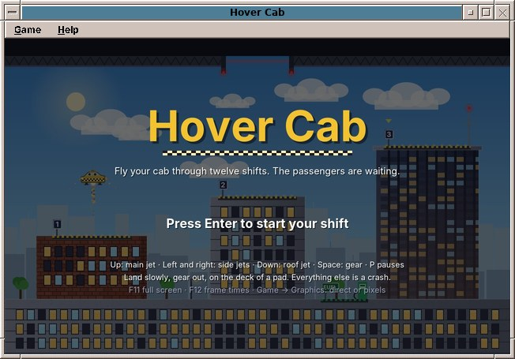
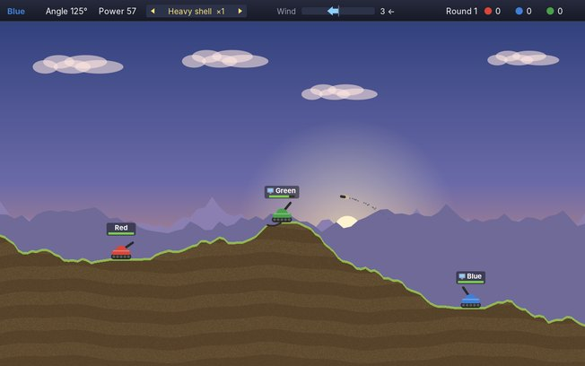
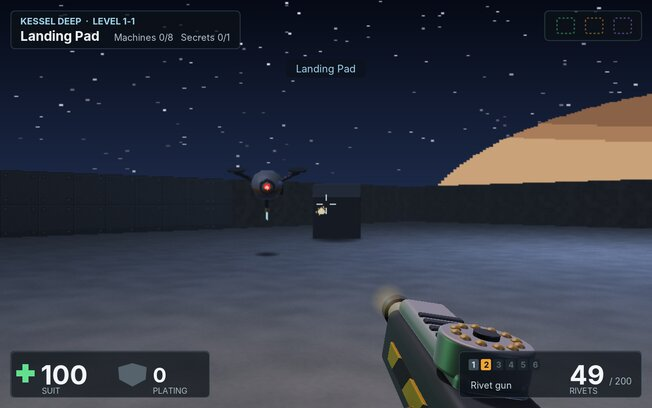
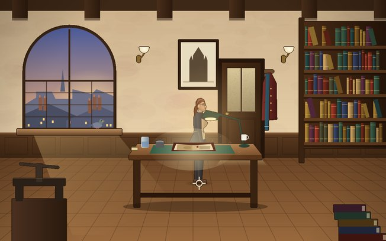

# 49. Games

amadeOS comes with **eighteen games**, all in the Games drawer of the Front Panel. They are written for amadeOS with its own game engine, have no advertising, no accounts and no purchases, and need no network.

## What all games share

- **Best scores and times**, ten for each game (*Game → High Scores…* in Mines and Solitaire).
- Every game speaks the five languages of amadeOS.

The fifteen action and strategy games also share:

| Key | What it does |
|---|---|
| ++enter++ or ++space++ | Starts from the title screen |
| ++p++ or ++esc++ | Pause. Leaving the window pauses too. |
| ++f11++ | Full screen and back |
| ++f12++ | Shows how long each frame takes, for the curious |

- **Title screen.** It names the keys, and in the arcade games the computer plays until you start, so you can watch how the game goes.
- ***Game → Graphics*** chooses how the picture reaches the screen: **Direct**, sharp at the full size of the screen, or **Pixels**, at 640 × 400 enlarged with square pixels, as on the home computers of the 1980s. If a game runs jerkily on an old computer, try *Pixels*.
- ***Game → Sound*** switches sound effects and music off.

Mines and Solitaire take the colours of your palette in Settings; ++f2++ starts a new game in Mines.

## Thinking and cards

### Mines

{ align=right width="180" }

Find all mines on the field without stepping on one. **Left click** opens a cell; a number says how many mines touch it. **Right click** sets a flag. **Middle click** on a number opens its neighbours once enough flags surround it. The first click is always safe. Three sizes in the *Game* menu, from *Beginner* (9 × 9, 10 mines) to *Expert* (30 × 16, 99 mines).

### Solitaire

{ align=right width="240" }

Klondike, the classic patience. Build the four piles at the top right from ace to king in one suit; in the seven columns cards go down in alternating colours. **Click the stock** to turn a card, or three with *Game → Draw Three*. **Drag** cards, **double-click** to send a card home. Undo with ++ctrl+z++ as far back as you like.

## Arcade classics

| | Game | What you do |
|---|---|---|
| { width="200" } | **Paddle** | The ball game for two paddles: against the computer with the arrow keys, or two players on one keyboard (W and S against the arrows). The first to 11 wins. |
| { width="200" } | **Bricks** | Break the wall with ball and paddle, by mouse or keys. Silver bricks take two hits, gold ones never break. Five levels. |
| { width="200" } | **Snake** | Steer the snake to the apples with the arrow keys; it grows longer and faster. Never bite the wall or yourself. |
| { width="200" } | **Rocks** | Turn, thrust and shoot through waves of rocks that break into smaller ones. ++arrow-down++ jumps into hyperspace. |
| { width="200" } | **Swarm** | Insects fly in, take their places and dive at your fighter. Every third stage is a challenge with a bonus. |
| { width="200" } | **Maze** | Eat every dot while four ghosts hunt you, each in its own way. After an energizer, you hunt them. |
| { width="200" } | **Blast** | Up to four players lay bombs among crates, on the keyboard and on gamepads; the computer fills the empty seats. The last one standing wins. |
| { width="200" } | **Jump** | Run and jump through a meadow, caves and the clouds, take the coins, land on beetles and birds, reach the red flag. Gamepads work too. |
| { width="200" } | **Hover Cab** | Fly a cab on jets between rooftops: ++arrow-up++ lifts, the side arrows steer, ++space++ moves the gear. Land gently on the passenger's pad, fly them where they ask, and earn the fare and a tip. The passengers call out loud. Twelve shifts, from the city to an orbit station and a storm at sea. |
| { width="200" } | **Artillery** | Two to four tanks take turns on hills of breakable ground, people or the computer at three levels. ++arrow-left++ and ++arrow-right++ turn the barrel, ++arrow-up++ and ++arrow-down++ set the power, ++tab++ picks the weapon, ++space++ fires; or hold the mouse button, point and let go. Mind the wind. The last tank standing wins the round. |

## Strategy and building

| | Game | What you do |
|---|---|---|
| { width="200" } | **Towers** | Orcs, wolves and trolls march on your castle. Build archers, cannons and frost towers beside the road, or on open ground, where your towers make the maze. |
| { width="200" } | **Sands** | Real-time strategy on a desert planet: harvest crystals, build a base, wind turbines and factories, and drive out the enemy with trikes, tanks and rocket launchers. Three missions. |
| { width="200" } | **Colony** | Lay out houses and roads in a green valley; carriers bring the goods from flag to flag. Woodcutters, a sawmill, farms, a windmill and a bakery, sheep and a weaver make the settlement grow. |
| { width="200" } | **Town** | A city in isometric view: roads, zones for homes, shops and industry, power and water. The town grows by itself where people want to live and work. |

In the strategy games, ++f5++ saves and ++f9++ loads, and a mission opens when the one before it is won.

## Seen from inside

### Rivet

{ width="400" }

A first-person shooter in 3D. An engineer goes down into Kessel Deep, a mine under the ice of a frozen moon, where the control system called the Foreman has turned the machines against the crew. Nine levels in three sections, from the landing pad on the surface to the Foreman's core, with the tools of the trade for weapons.

- ++w++ ++a++ ++s++ ++d++ walk and step sideways, the **mouse** or the arrow keys turn, ++shift++ runs. The mouse is caught by the window while you play and let go in the pause; *Game → Mouse Speed* sets how fast it turns.
- **Click** or ++ctrl++ uses the tool in hand; ++1++ to ++6++, ++q++ or the wheel choose another.
- ++space++ or the right mouse button opens doors and works the lift. A coloured door needs the access chip of its colour. Some walls give way: those are the secrets.
- ++tab++ shows the map of what you have seen. ++p++ or ++esc++ pauses.
- The first start takes a few seconds while the machines are built in 3D; later starts are quick.

## A story

### The Seal of the Templars

{ width="400" }

A point-and-click adventure in three acts. On the night of 12 October 1307 the squire Aimery has to save the last page of the Temple's accounts before the King's men arrive; today the book restorer Maria Vogt finds that page in the binding of an old psalter, and follows it from Paris to La Rochelle and to the Convent of Christ in Tomar. The history is true, and legends are called legends; an epilogue says which is which.

- **Left click** walks, uses, talks or goes through a door; **right click** looks at something.
- Point at the top of the screen for the inventory. Click an item to take it in hand, then click where to use it, or on another item to put the two together.
- ++n++ opens the notebook with the next goal; ++n++ again gives a hint. ++esc++ or ++period++ skips a line.
- ++f5++ saves, ++f9++ continues; the game also saves itself in every new room. ++f11++, ++f12++ and the *Graphics* and *Sound* menus work as in the other games.

!!! tip "Your own keys"
    Most action games let you change their keys in a small settings file, such as `~/.config/amadeos/snake/snake.properties`. The Game Developer's Handbook in the Help drawer has the details.

## Source code and problem reports

Every game has its source code in a repository of its own on GitHub. If a game misbehaves, or you have an idea for it, open an issue there.

| Game | Source code | Problems and ideas |
|---|---|---|
| Mines | [amade-mines-game](https://github.com/datazuul/amade-mines-game) | [Report a problem](https://github.com/datazuul/amade-mines-game/issues) |
| Solitaire | [amade-solitaire-game](https://github.com/datazuul/amade-solitaire-game) | [Report a problem](https://github.com/datazuul/amade-solitaire-game/issues) |
| Paddle | [amade-paddle-game](https://github.com/datazuul/amade-paddle-game) | [Report a problem](https://github.com/datazuul/amade-paddle-game/issues) |
| Bricks | [amade-bricks-game](https://github.com/datazuul/amade-bricks-game) | [Report a problem](https://github.com/datazuul/amade-bricks-game/issues) |
| Snake | [amade-snake-game](https://github.com/datazuul/amade-snake-game) | [Report a problem](https://github.com/datazuul/amade-snake-game/issues) |
| Rocks | [amade-rocks-game](https://github.com/datazuul/amade-rocks-game) | [Report a problem](https://github.com/datazuul/amade-rocks-game/issues) |
| Swarm | [amade-swarm-game](https://github.com/datazuul/amade-swarm-game) | [Report a problem](https://github.com/datazuul/amade-swarm-game/issues) |
| Maze | [amade-maze-game](https://github.com/datazuul/amade-maze-game) | [Report a problem](https://github.com/datazuul/amade-maze-game/issues) |
| Blast | [amade-blast-game](https://github.com/datazuul/amade-blast-game) | [Report a problem](https://github.com/datazuul/amade-blast-game/issues) |
| Jump | [amade-jump-game](https://github.com/datazuul/amade-jump-game) | [Report a problem](https://github.com/datazuul/amade-jump-game/issues) |
| Hover Cab | [amade-hover-cab-game](https://github.com/datazuul/amade-hover-cab-game) | [Report a problem](https://github.com/datazuul/amade-hover-cab-game/issues) |
| Artillery | [amade-artillery-game](https://github.com/datazuul/amade-artillery-game) | [Report a problem](https://github.com/datazuul/amade-artillery-game/issues) |
| Rivet | [amade-rivet-game](https://github.com/datazuul/amade-rivet-game) | [Report a problem](https://github.com/datazuul/amade-rivet-game/issues) |
| Towers | [amade-towers-game](https://github.com/datazuul/amade-towers-game) | [Report a problem](https://github.com/datazuul/amade-towers-game/issues) |
| Sands | [amade-sands-game](https://github.com/datazuul/amade-sands-game) | [Report a problem](https://github.com/datazuul/amade-sands-game/issues) |
| Colony | [amade-colony-game](https://github.com/datazuul/amade-colony-game) | [Report a problem](https://github.com/datazuul/amade-colony-game/issues) |
| Town | [amade-town-game](https://github.com/datazuul/amade-town-game) | [Report a problem](https://github.com/datazuul/amade-town-game/issues) |
| The Seal of the Templars | [amade-templar-game](https://github.com/datazuul/amade-templar-game) | [Report a problem](https://github.com/datazuul/amade-templar-game/issues) |

The games are in the spirit of the classics of the 1980s and 1990s, drawn anew, and built so that each one can be read and learned from: the **Game Developer's Handbook** in the Help drawer explains them chapter by chapter.

??? hood "Under the hood"
    Every game is a package of its own, such as `amade-mines-game` or `amade-templar-game`, and all are installed by default. They are built on *amade-game-engine*, a 2D game engine in Java. The best scores are in `~/.local/share/amadeos/games/<game>/`, the settings in `~/.config/amadeos/<game>/`.
