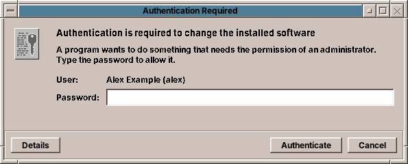

# 50. Administrator Basics

Most of what you do on amadeOS needs no special rights: your documents, your settings and your programs' data belong to you. A few things change the computer for everybody, and those need an **administrator**: installing and removing software, installing updates, adding users, changing system settings under `/etc`.

## Who is an administrator

| On… | The administrator is… |
|---|---|
| **The live system** | The live user `amadeos` (password `amadeos`). |
| **An installed system** | The first user, the one you created in the installer (chapter 14), and everyone you later add to the group `sudo` (chapter 53). |

There is **no root password**. The account `root` exists, as on every Linux system, but you cannot log in with it. An administrator proves who they are with **their own password**.

!!! switching "Coming from Windows or macOS"
    This is how Windows treats an account of the type *Administrator* and macOS an *Admin* user: you work with your normal account and type your password when the system asks for permission.

## When amadeOS asks for your password

When a program needs an administrator's permission, a window **Authentication Required** appears in the middle of the screen. It says what the program wants to do, for example *Authentication is required to change the installed software*.



- Type your password and press **Authenticate** (or ++enter++).
- **Cancel** refuses; the program then says *Not done: the password was not given*.
- If several users are administrators, the **User** list chooses whose password you type.
- **Details** shows the exact action and the command that is waiting for permission.

If the password is wrong, the window says so and asks again. For software, amadeOS **keeps the permission for a few minutes**, so that installing three programs in a row asks only once.

Some things need no password although they change the system, because they are harmless:

| Without a password | Who may |
|---|---|
| Refreshing the list of available software (*Check now*) | The user at the computer |
| Joining a WLAN, changing network connections | Members of the group `netdev` |
| Pausing printers, choosing the default printer, cancelling your own print jobs | Members of the group `lpadmin` (own jobs: everyone) |
| Starting the installer in the live system | Members of the group `sudo` |

The first user and the live user are in all these groups.

!!! warning
    The password window always comes from the desktop itself and always looks like this. It never appears inside a web page. Type your password only when you have just asked for something that needs it.

## The Root Console

Some administration happens in a terminal: editing a configuration file, a command from a guide. **Root Console (sudo)** in the Tools drawer opens a terminal that asks for your password once and then runs everything with administrator rights. Its prompt ends with `#` instead of `$` to remind you.

In a normal terminal, put `sudo` before a single command:

```sh
sudo apt install htop
```

To change a system file, use `sudoedit`, which opens a copy in your editor and puts it back when you save:

```sh
sudoedit /etc/hosts
```

!!! tip
    Close the Root Console when you are done. A terminal with administrator rights is a terminal in which a typing mistake can break the system.

!!! sovereignty "Your data"
    Your password stays on the computer. It is stored only as a one-way hash in `/etc/shadow`, which only the system can read, and it is checked there; no server sees it.

??? hood "Under the hood"
    amadeOS asks for permission through **polkit**, the permission service of Linux desktops. A program asks polkit whether the user may do an action; polkit checks its rules and, where they say *auth_admin*, asks the session's **authentication agent** for a password. The agent of amadeOS is a Motif dialog started at login by `/etc/amadeos/autostart.d/30-amadeos-polkit-agent`. The rules of amadeOS are in `/usr/share/polkit-1/rules.d/` (`50-amadeos-packages.rules`, `50-amadeos-network.rules`, `50-amadeos-installer.rules`); your own go into `/etc/polkit-1/rules.d/`. The terminal side is **sudo**: members of the group `sudo` may run every command as root with their own password. `pkexec COMMAND` runs a command through polkit and so shows the password window instead of asking in the terminal.
