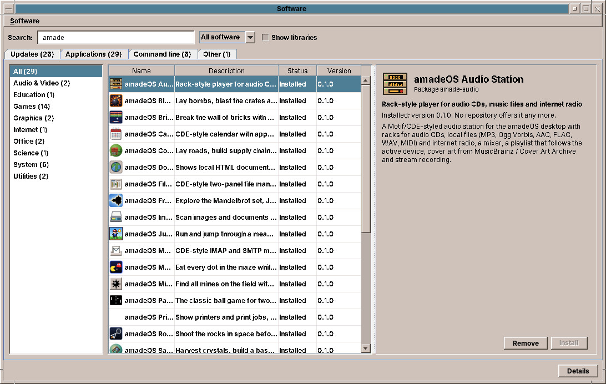

# 51. Installing and Removing Software

amadeOS is built on Debian, and Debian offers tens of thousands of programs, all free software, all checked and built by the Debian project. **Software** finds, installs and removes them. Open it from the Tools drawer (*amadeOS Software*) or with `amadeos-software` in a terminal.



## Finding software

The window has four tabs, each for one kind of software:

| Tab | What it lists |
|---|---|
| **Applications** | Programs with a window, sorted into groups on the left: Audio & Video, Development, Education, Games, Graphics, Internet, Office, Science, System, Utilities and Other. |
| **Command line** | Programs for the terminal, such as `htop` or `ffmpeg`. |
| **Other** | Everything else: fonts, documentation, drivers, data. |
| **Libraries** | Code that programs use. Shown only with *Show libraries*; libraries come and go with the programs that need them, so you rarely install one yourself. |

The **Search** field searches all tabs at once, by name and description; the tabs show how many packages each holds. The list next to it chooses between **All software** and **Installed only**. The number after each group says how many of its programs match.

Click a program to see its description on the right: its name and summary, whether it is installed and in which version, how much it downloads and how much room it takes, a link to its home page and, for many applications, a screenshot.

## Installing and removing

1. Choose the program in the list.
2. Click **Install** (or **Remove** for an installed program).
3. If the program needs other packages, Software lists them and asks; the same when removing it would remove others that need it.
4. Type your password in the *Authentication Required* window (chapter 50).

A progress bar shows the download and the installation. **Details** at the bottom shows what the package system is doing, line by line. A new application appears in its Front Panel drawer by itself (chapter 22).

If another program is installing software at the same time, Software says *Another program is installing software right now* and does nothing; try again a moment later.

!!! tip
    Removing a program keeps its settings files in the system and your own files in your home folder. Installing it again brings it back as you left it.

!!! switching "Coming from Windows or macOS"
    Software is the App Store of amadeOS, but without an account, without payments and without tracking. You do not download installers from web sites: everything comes from the Debian archive, signed by Debian, and is updated with the rest of the system (chapter 52).

!!! sovereignty "Your data"
    Software reads the list of packages from the Debian mirror, as `apt` does. Screenshots of applications are loaded from Debian's screenshot server only when you look at a program, and kept in `~/.cache/amadeos-software`. Nothing is sent about you or what you install.

## Software from elsewhere

Software does not install packages from outside the Debian archive. A `.deb` file you downloaded can be installed in a terminal:

```sh
sudo apt install ./program.deb
```

Install such files only from a source you trust: a package runs its installation scripts with administrator rights.

!!! planned "Planned"
    An amadeOS package repository (ROADMAP milestone M16), so that the amade applications and games are updated like the rest of Debian. Until then, they come with the image; Software shows them as installed with *No repository offers it any more*.

## In the terminal

Everything Software does, `apt` does in a terminal:

| Command | What it does |
|---|---|
| `apt search WORD` | Searches for packages. |
| `apt show PACKAGE` | Describes a package. |
| `sudo apt install PACKAGE` | Installs it. |
| `sudo apt remove PACKAGE` | Removes it. |
| `apt list --installed` | Lists what is installed. |

??? hood "Under the hood"
    Software reads the package lists with apt as you, without rights, and sorts the packages with the AppStream data of the Debian archive (package `appstream`); the amade applications bring their own descriptions in `/usr/share/metainfo/`. To install, update or remove, it runs the helper `/usr/libexec/amadeos-packages` through `pkexec`, the only part that runs as root. The helper writes what apt and dpkg said to `/var/log/amadeos-packages.log`.
