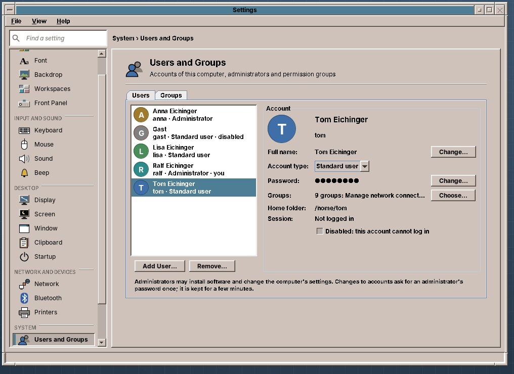
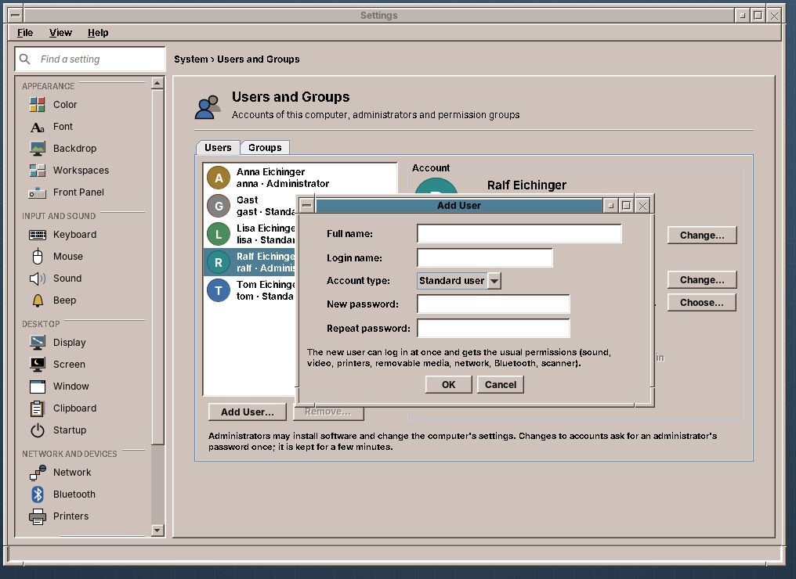
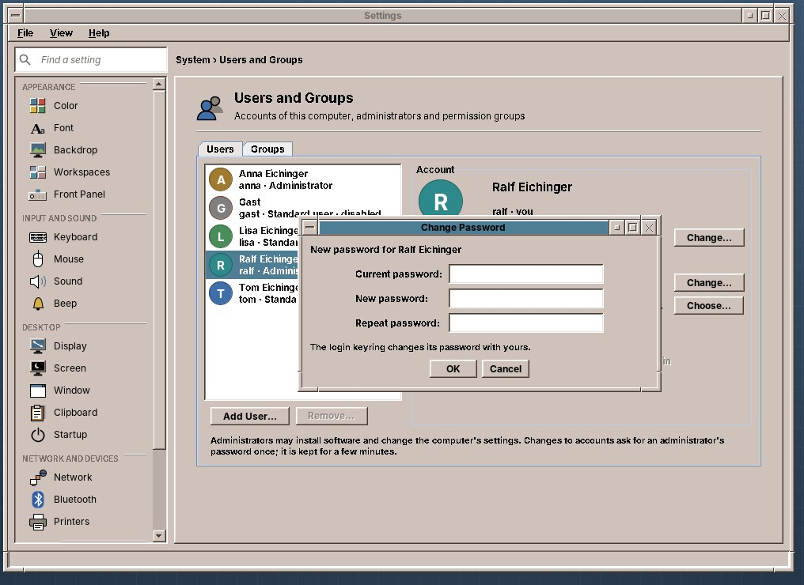
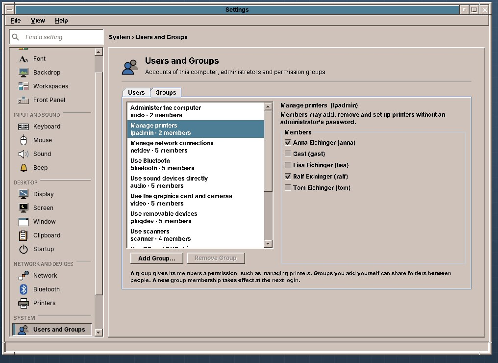
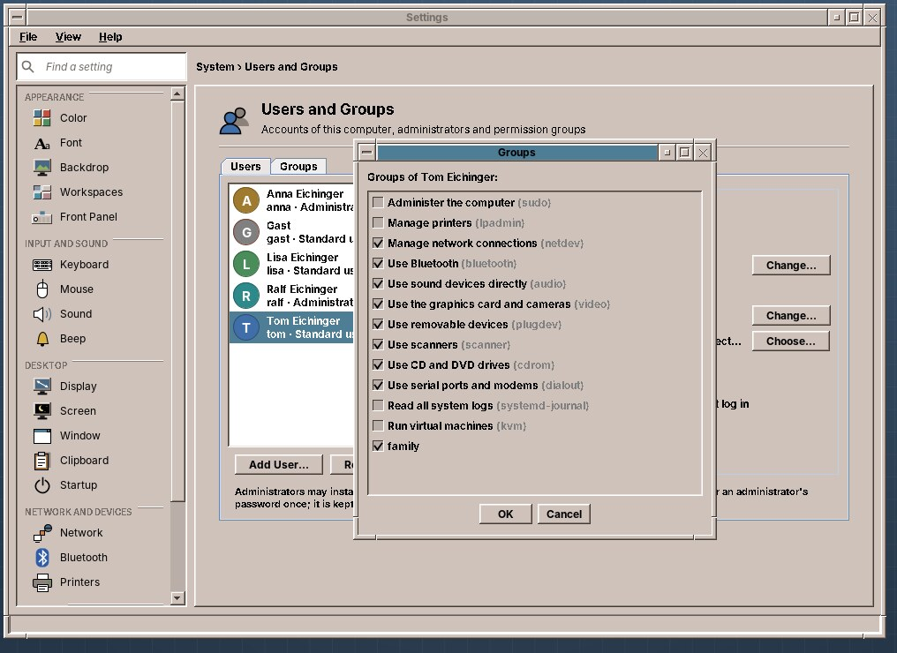

# 53. Users and Groups

Every person who uses the computer should have an **account** of their own: their own home folder, their own settings, their own password. Accounts keep the family's or the club's documents apart, and one user's mistake does not reach the others' files.

The installer creates the first user (chapter 14). Everyone else gets an account on the **Users and Groups** page of Settings: open **Settings** from the Tools drawer and choose *System › Users and Groups*, or type `amadeos-settings users` in a terminal.

What you change there happens at once; the page has no *Apply*. Each change to an account asks for an **administrator's password** (chapter 50) in a small window. After you typed it, further changes in the next few minutes don't ask again. Only your own password is changed without it: for that you type your current password.

## Users



On the left are the accounts of the computer, each with a round picture showing the first letter of the name. Below the name: the login name, *Standard user* or *Administrator*, *you* for your own account, *logged in* for someone who is logged in right now, and *disabled* for an account that cannot log in.

On the right are the details of the account you chose:

| Line | What it means |
|---|---|
| **Full name** | The name shown in the list and, for example, in mails. **Change…** gives it a new one. |
| **Account type** | **Standard user** or **Administrator**. An administrator may install software and change settings of the whole computer, with their own password. |
| **Password** | **Change…** sets a new password (below). |
| **Groups** | The permissions the account has, from the Groups tab. **Choose…** ticks and unticks them. |
| **Home folder** | Where the user's files are, `/home/` and the login name. |
| **Session** | Whether the user is logged in now. |
| **Disabled** | Ticked, the account can no longer log in; its files stay. Untick it to let the user in again. |

!!! warning
    An administrator can read every file on the computer, including those of other users. Make only people administrators whom you would also give the key to the house.

### Adding a user



**Add User…** asks for:

- the **full name**, for example *Maria Huber*;
- the **login name**, which amadeOS suggests from the full name (*maria*). It starts with a small letter and has only small letters, digits, `-` and `_`. It cannot be changed later;
- the **account type**;
- the **password**, twice.

Maria can log in at once. Her account gets the usual permissions: sound, video, printers, removable media, network, Bluetooth and the scanner, the same as the first user apart from administration.

### Changing a password



For **your own** account, **Change…** asks for your current password and the new one twice. Your login keyring, where programs such as the Mailer keep passwords (chapter 38), changes its password with it.

For **someone else's** account, an administrator types only the new password, twice, for example when the user forgot theirs. That user's login keyring was locked with the old password: after their next login, the keyring stays locked until they unlock it with the old password on the *Passwords* page (chapter 38), or the saved passwords have to be typed again once.

### Removing a user

**Remove…** asks whether to **keep the home folder** or **delete it with all files**. A kept folder stays in `/home`, and an administrator can copy what is needed from it later.

You cannot remove your own account, nor the account of someone who is logged in, and the computer always keeps at least one administrator: the page says so when you try.

## Groups



A **group** gives its members a permission. The Groups tab lists the groups of the computer with what they allow, and the system name in small type. Choose one, and the accounts appear on the right; tick an account to make it a member, untick it to take the permission away. The same groups are behind **Choose…** on the Users tab:



| Group | Its members may |
|---|---|
| Administer the computer (`sudo`) | Install software and change settings of the whole computer (chapter 50). |
| Manage printers (`lpadmin`) | Add, remove and set up printers without an administrator's password. |
| Manage network connections (`netdev`) | Join networks and change network connections. |
| Use Bluetooth (`bluetooth`) | Switch Bluetooth on and off and pair devices. |
| Use sound devices directly (`audio`), Use the graphics card and cameras (`video`) | Use sound and graphics devices directly. |
| Use removable devices (`plugdev`) | Use USB sticks, phones and other devices that are plugged in. |
| Use scanners (`scanner`) | Use scanners. |
| Use CD and DVD drives (`cdrom`) | Read and burn CDs and DVDs. |
| Use serial ports and modems (`dialout`) | Use serial ports, modems and boards such as Arduino. |
| Read all system logs (`systemd-journal`) | See the messages of the whole computer in the Log Viewer (chapter 57). |

Groups for virtual machines (`kvm`, `libvirt`) and Docker appear once those programs are installed.

A new membership counts from the member's **next login**.

**Add Group…** makes a group of your own, such as *family*. Give a folder to it, and all its members can work with the files in it. The Files program cannot do that yet; an administrator does it once in the Root Console (chapter 50):

```sh
sudo mkdir /home/family
sudo chgrp family /home/family
sudo chmod 2770 /home/family     # the group may read and write; new files belong to it too
```

**Remove Group** removes such a group again; the groups of the system stay.

!!! switching "Coming from Windows or macOS"
    The *Standard* and *Administrator* account types of Windows and macOS are, on amadeOS, a user outside or inside the group `sudo`.

!!! sovereignty "Your data"
    Accounts are local: they exist only on this computer, and no online account is linked to them. The home folder of each user is readable only by that user (and the administrators).

!!! planned "Planned"
    A picture for each user, automatic login without a password, rules for good passwords, and giving a folder to a group in Files.

## In a terminal

Everything on the page can also be done in the **Root Console** (chapter 50):

```sh
sudo adduser maria                      # add a user
sudo usermod -aG sudo maria             # make her an administrator
sudo gpasswd -d maria sudo              # make her a standard user again
passwd                                  # change your own password
sudo passwd maria                       # set a new password for her
sudo deluser --remove-home maria        # remove her and her files
groups maria                            # her groups
```

??? hood "Under the hood"
    Users are in `/etc/passwd`, their password hashes in `/etc/shadow`, groups in `/etc/group`; the page reads the first and the last, which every user may read. Changes go through the small program `/usr/libexec/amadeos-users`, which runs as root through `pkexec`; the polkit rule `eu.amadeos.users.manage` asks for an administrator's password and keeps it for a few minutes. It uses `useradd`, `usermod`, `userdel`, `gpasswd` and `chpasswd`, and refuses to remove or lock out the user who called it, the last administrator, or a logged-in user. A disabled account has a locked password and the shell `/usr/sbin/nologin`. Your own password goes through `passwd`, so PAM checks the old one and `pam_gnome_keyring` passes the new one to the keyring. The installer puts the first user into the groups `audio cdrom dip floppy video plugdev netdev powerdev scanner bluetooth lpadmin systemd-journal sudo`; the live user has the same.
