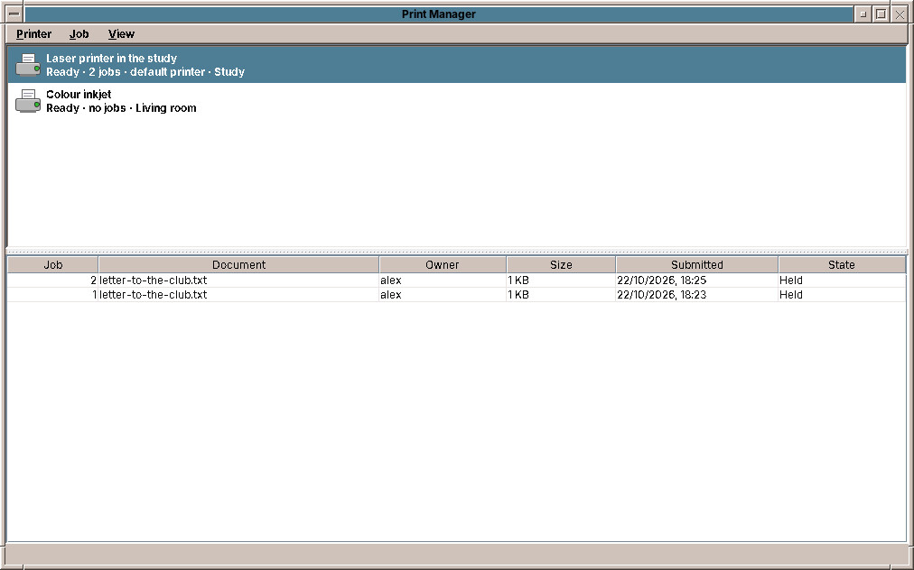

# 54. Network and Printers in Depth

Chapter 27 covers the everyday: joining a WLAN, printing a page. This chapter is for the cases that need more.

## Network settings

**Network settings…** in the menu of the network cell opens the detailed network settings in a terminal window. It is a text program, `nmtui`, worked with the keyboard: the arrow keys and ++tab++ move, ++enter++ chooses, ++esc++ goes back.

| In `nmtui` | What it is for |
|---|---|
| **Edit a connection** | Change a connection, add one, or delete it. |
| **Activate a connection** | Switch connections on and off. |
| **Set system hostname** | The computer's name in the network. |

### A fixed address

Some home networks, or a computer that serves others, need a fixed IP address:

1. *Edit a connection*, choose the connection (for example *Wired connection 1*) and *Edit…*.
2. At *IPv4 CONFIGURATION*, change *Automatic* to *Manual* and choose *Show*.
3. Fill in *Addresses* (for example `192.168.1.20/24`), *Gateway* (`192.168.1.1`) and *DNS servers*.
4. *OK*, then in *Activate a connection* switch the connection off and on again.

### A hidden WLAN

A network that does not announce its name does not appear in the menu of the network cell. Add it in *Edit a connection → Add → Wi-Fi* with its name (*SSID*) and password.

### VPN

A VPN connects your computer to another network, an office or a VPN provider, through the internet. NetworkManager supports the common VPN types through plug-ins, which you install in Software (chapter 51): `network-manager-openvpn` for OpenVPN, `wireguard-tools` for WireGuard (built into NetworkManager), `network-manager-openconnect` for Cisco-compatible company VPNs. The provider's configuration file is then imported in a terminal:

```sh
nmcli connection import type openvpn file provider.ovpn
nmcli connection import type wireguard file wg0.conf
```

The VPN then appears in *Activate a connection*.

!!! planned "Planned"
    A network settings window in the style of the desktop, with fixed addresses, hidden networks and VPNs, so that the terminal is no longer needed.

## Printers

### The Print Manager



The upper half lists the printers, each with its state, its number of jobs and where it stands; the default printer says so. The lower half lists the jobs of the chosen printer.

| Menu | Entries |
|---|---|
| **Printer** | *Print Test Page*, *Pause*, *Resume*, *Use as Default*, *Add or Configure Printers…*, *Exit* |
| **Job** | *Cancel Job*, *Hold*, *Release* |
| **View** | *Refresh*, *Show Finished Jobs* |

You may cancel, hold and release your own jobs; pausing a printer and choosing the default printer need membership in the group `lpadmin` (chapter 53), which the first user has.

### Adding a printer by hand

Most printers appear by themselves (chapter 27). An older printer, or one in another network, is added in the administration pages of the print system, CUPS: *Printer → Add or Configure Printers…* opens <http://localhost:631> in the web browser.

1. *Administration → Add Printer*. The browser asks for a user name and password: yours.
2. Choose the printer from the list (*Discovered Network Printers* or a USB printer), or give its address, for example `ipp://192.168.1.30/ipp/print`.
3. Give it a name, a description and a location; these are what the Print Manager shows.
4. Choose the model. For a current printer, *IPP Everywhere* or *driverless*; for an older one, its make and model.
5. *Set Default Options* sets paper size, two-sided printing and quality.

Some older printers need a driver package: `printer-driver-gutenprint` covers many inkjets, `hplip` the printers of HP, `printer-driver-brlaser` many Brother lasers. Install it in Software, then add the printer.

!!! tip
    If a printer suddenly prints nothing, look at its state in the Print Manager. A printer that CUPS paused after an error stays paused until you choose *Resume*.

## Scanners

Image Scan (chapter 47) finds current scanners and multi-function printers by itself, over USB and the network, without a driver (eSCL and WSD, the scanning counterparts of IPP Everywhere). For an older scanner, the SANE project has drivers: `sane-utils` brings `scanimage -L`, which lists the scanners the system sees; many vendors offer a SANE driver package for their models.

!!! sovereignty "Your data"
    Print jobs and scans go straight from your computer to the printer or scanner in your network. No vendor cloud and no app account is involved.

??? hood "Under the hood"
    NetworkManager keeps its connections in `/etc/NetworkManager/system-connections/`, one file per connection, readable only by root; `nmcli connection show` lists them. Printers are found by Avahi (mDNS) and `cups-browsed`, USB printers by `ipp-usb`; CUPS keeps them in `/etc/cups/printers.conf` and logs to `/var/log/cups/error_log`. Scanners are found by `sane-airscan` (eSCL/WSD) and the SANE back-ends; the user needs to be in the group `scanner`.
